<style>
@import url('https://fonts.googleapis.com/css2?family=Inter:wght@400;600;700;800&display=swap');

:root {
  --primary: #1d4ed8;
  --primary-dark: #1e3a8a;
  --accent: #0ea5e9;
  --ink: #0f172a;
  --muted: #64748b;
  --bg: #ffffff;
  --soft: #f1f5f9;
  --teal: #0d9488;
  --amber: #d97706;
  --rose: #e11d48;
}

section {
  font-family: 'Inter', 'Noto Sans', 'Segoe UI', system-ui, sans-serif;
  color: var(--ink);
  background: var(--bg);
  font-size: 29px;
  line-height: 1.35;
  padding: 64px 78px 48px;
}

h1 { font-size: 1.5em; color: var(--primary); margin: 0 0 .35em; font-weight: 800; letter-spacing: -.01em; }
h2 { font-size: 1.18em; color: var(--ink); margin: 0 0 .45em; font-weight: 700; }
h3 { font-size: .82em; color: var(--muted); margin: 0 0 .3em; font-weight: 600; text-transform: uppercase; letter-spacing: .04em; }

ul, ol { margin: 0 0 .55em; padding-left: 1.25em; }
li { margin: .16em 0; }
li strong, li b { color: var(--primary-dark); }
p { margin: 0 0 .5em; }

a { color: var(--primary); }

table { width: 100%; border-collapse: collapse; font-size: .76em; }
th { background: var(--primary); color: #fff; padding: 9px 14px; text-align: left; font-weight: 600; }
td { padding: 8px 14px; border-bottom: 1px solid #e2e8f0; vertical-align: top; }
tr:nth-child(even) td { background: #f8fafc; }

img { display: block; margin: 0 auto; }

code { background: var(--soft); border-radius: 4px; padding: 1px 6px; font-size: .82em; font-family: 'JetBrains Mono', ui-monospace, monospace; }
pre { background: #0f172a; color: #e2e8f0; border-radius: 10px; padding: 16px 22px; font-size: .68em; line-height: 1.5; }
pre code { background: transparent; color: inherit; padding: 0; }

.columns { display: grid; grid-template-columns: 1fr 1fr; gap: 48px; align-items: start; }
.cols3 { display: grid; grid-template-columns: 1fr 1fr 1fr; gap: 30px; align-items: start; }

section.section {
  background: linear-gradient(135deg, #0f172a 0%, #1e3a8a 55%, #1d4ed8 100%);
  color: #fff; justify-content: center; text-align: center;
}
section.section h1 { color: #fff; font-size: 2.1em; border: none; }
section.section h2 { color: rgba(255,255,255,.85); font-weight: 400; font-size: 1.1em; }
section.section::after { content: ''; }

section.title {
  background: linear-gradient(135deg, #0f172a 0%, #1e3a8a 55%, #1d4ed8 100%);
  color: #fff; justify-content: center; text-align: center;
}
section.title h1 { color: #fff; font-size: 2.5em; border: none; }
section.title h2 { color: rgba(255,255,255,.9); font-weight: 400; }
section.title p { color: rgba(255,255,255,.8); }
section.title .meta { margin-top: 1.4em; font-size: .8em; color: rgba(255,255,255,.7); letter-spacing: .06em; text-transform: uppercase; }

.callout { border-left: 5px solid var(--accent); background: #eff6ff; border-radius: 6px; padding: 14px 20px; margin: .5em 0; }
.callout.warn { border-left-color: var(--amber); background: #fffbeb; }
.callout.good { border-left-color: var(--teal); background: #ecfdf5; }

.muted { color: var(--muted); font-size: .8em; }
.small { font-size: .8em; }
.badge { display: inline-block; background: var(--soft); border-radius: 999px; padding: 4px 14px; margin: 3px; font-size: .74em; font-weight: 600; color: var(--primary-dark); }
</style>

<!-- _class: title -->

# Лекция 1
## Архитектура систем обработки данных

<div class="meta">Инженерия данных · Магистратура ИТМО · Осень 2025</div>

<!--
Приветствие. Цель лекции — сформировать общую картину: что такое данные, кто их обрабатывает и какие архитектуры для этого существуют.
-->

---

<!-- _class: section -->

# План лекции

## 4 раздела · 160 минут

---

## План лекции

### Структура занятия

1. **Введение в данные и их значение** — 40 мин
2. **Основные концепции инженерии данных** — 40 мин
3. **Архитектуры систем обработки** — 40 мин
4. **Микросервисы и облачные платформы** — 40 мин

<br/>

<div class="callout good">
Каждый раздел заканчивается <b>резюме</b> и <b>вопросами для самопроверки</b>.
</div>

<!--
Скажите слушателям, что лекция обзорная: детали (конкретные инструменты, код) будут в последующих лекциях.
-->

---

<!-- _class: section -->

# Раздел 1
## Введение в данные и их значение

---

## Что такое данные?

### Определение

**Данные** — это факты, зафиксированные в формализованном виде, удобные для хранения, передачи и машинной обработки.

### Три признака данных

<div class="columns">
<div>

**Формализация**
- Единый формат и структура
- Пригодность для программ

**Связь с реальностью**
- Отражение фактов и событий

</div>
<div>

**Ценность для решений**
- Основа аналитики и ML
- Источник конкурентных преимуществ

**Примеры**
- Температура: `23.5 °C`
- Транзакция: `{user_id: 123, amount: 1500}`
- Отзыв: «Отличный продукт!»

</div>
</div>

<!--
Подчеркните: данные ≠ информация. Данные — сырьё, информация — осмысленный результат обработки.
-->

---

## Классификация данных

### Три основных типа

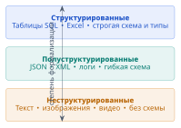

<br/>

<div class="cols3">

<span class="badge">Строгая схема</span>
<span class="badge">Гибкая схема</span>
<span class="badge">Без схемы</span>

</div>

<!--
Ключевая ось классификации — степень формализации (наличие/строгость схемы).
-->

---

## Структурированные данные

### Характеристики и пример

<div class="columns">
<div>

**Характеристики**
- Чёткая схема данных
- Табличная организация
- Строгие типы полей
- Легко индексируются
- SQL-запросы

</div>
<div>

**Пример: SQL-таблица**

| user_id | name  | age | city   |
|---------|-------|-----|--------|
| 1       | Иван  | 25  | Москва |
| 2       | Мария | 30  | СПб    |

</div>
</div>

<!--
Структурированные данные — ~5–10% всех данных в организациях, но исторически самые «проработанные» с точки зрения инструментов.
-->

---

## Полуструктурированные данные

### Характеристики и пример

<div class="columns">
<div>

**Характеристики**
- Гибкая структура
- Теги и маркеры
- Самоописываемость
- Переменная схема
- Нет строгой типизации

</div>
<div>

**Пример: JSON**

```json
{
  "user_id": 1,
  "name": "Иван",
  "contacts": {
    "email": "ivan@mail.ru",
    "phones": ["+7900", "+7901"]
  }
}
```

</div>
</div>

<!--
Полуструктурированные данные — самый частый формат обмена в API и логах. Схема «подразумевается», но не жёсткая.
-->

---

## Неструктурированные данные

### Характеристики и примеры

**Характеристики**
- Отсутствие схемы
- Сложная обработка
- Требуют специальных методов (NLP, CV)
- Наибольший объём

**Примеры**
- Текстовые документы
- Аудио и видеофайлы
- Медицинские снимки (DICOM)
- Изображения

<div class="callout warn">
На неструктурированные данные приходится **~80–90%** мирового объёма данных.
</div>

<!--
Пример обработки: изображение нужно сначала превратить в признаки (эмбеддинги), прежде чем использовать в аналитике.
-->

---

## Вопрос для размышления

### Классифицируйте данные

**Какой тип данных?** Обсудите в парах (2 минуты)

1. CSV-файл с продажами
2. Email-переписка
3. Лог-файл веб-сервера
4. Фотография товара

<br/>

<div class="muted">Ответы: 1 — структурированные; 2 — неструктурированные (тело письма) + полуструктурированные (заголовки); 3 — полуструктурированные; 4 — неструктурированные.</div>

<!--
Это лёгкий интерактив для «разогрева» аудитории. Дайте студентам обсудить и озвучить ответы.
-->

---

## Эпоха Big Data

### От 3V к 5V

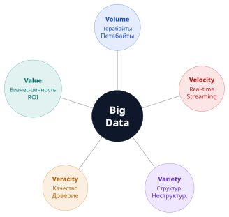

<!--
3V (Volume, Velocity, Variety) сформулировал аналитик Gartner Даг Лэйни (2001). Позже добавили Veracity и Value.
-->

---

## Volume: Объём данных

### Масштабы роста

| Год  | Объём данных |
|------|--------------|
| 2010 | 2 зеттабайта  |
| 2020 | 64 зеттабайта |
| 2025 | 181 зеттабайт  |

**1 зеттабайт = 1 триллион гигабайт** ($10^{21}$ байт)

<div class="callout">
Проблема не «где хранить», а **как обработать** такой объём за разумное время.
</div>

<!--
Ключевой переход: от вертикального масштабирования (один мощный сервер) к горизонтальному (кластер из дешёвых машин).
-->

---

## Velocity: Скорость данных

### Примеры потоков

- **Twitter / X** — ~6 000 твитов в секунду
- **YouTube** — ~500 часов видео в минуту
- **IoT-сенсоры** — миллионы событий в секунду
- **Биржевые торги** — миллионы сделок в минуту

**Требования**
- Обработка в реальном времени
- Минимальная задержка (latency)

<!--
Velocity определяет выбор между batch (пакетной) и streaming (потоковой) обработкой — к этому вернёмся в разделе 3.
-->

---

## Variety: Многообразие данных

### Источники и форматы

<div class="columns">
<div>

**Источники**
- Транзакционные системы (CRM, ERP)
- Социальные сети
- IoT-устройства, GPS
- Мобильные приложения
- Веб-логи (Nginx, Apache)

</div>
<div>

**Форматы**
- Таблицы SQL
- JSON / XML
- Логи (текст)
- Изображения, видео
- Бинарные файлы (Parquet, Avro)

</div>
</div>

<!--
Variety — главная причина появления Data Lake и гибких схем. Разные форматы нельзя сложить в одну таблицу.
-->

---

## Veracity и Value

### Дополнительные измерения Big Data

<div class="columns">
<div>

### Veracity (Достоверность)

- Качество данных
- Доверие к источникам
- Очистка от шума и ошибок

> «Мусор на входе — мусор на выходе» (GIGO)

</div>
<div>

### Value (Ценность)

- Бизнес-польза данных
- ROI от инициатив
- Монетизация данных

> Данные ценны, только если приводят к действию.

</div>
</div>

<!--
Veracity часто недооценивают: 25–30% времени дата-инженера уходит на очистку и валидацию.
-->

---

## Качество данных (кратко)

### Шесть измерений качества

| Измерение | Вопрос | Пример проблемы |
|-----------|--------|-----------------|
| **Полнота** | Все ли данные есть? | Пропущенные поля |
| **Точность** | Данные верны? | Опечатка в адресе |
| **Согласованность** | Нет ли противоречий? | Разные значения в системах |
| **Своевременность** | Данные свежие? | Отчёт с опозданием на день |
| **Уникальность** | Нет ли дубликатов? | Один клиент дважды |
| **Доступность** | Данные доступны? | Отказ источника |

<!--
Это вводный слайд — детальный разбор качества данных будет на лекции 3 «Очистка и валидация».
-->

---

## Данные как «новая нефть»

### Почему эта метафора работает?

- **Ценный сырьевой ресурс** — сырые данные дешевы, но потенциально дороги
- **Требует переработки** — нужны пайплайны и очистка
- **Создаёт конкурентное преимущество** — те, кто лучше использует данные, выигрывают
- **Источник инноваций** — новые продукты и модели

> «Data is the new oil» — Clive Humby, 2006

<div class="callout warn">
Отличие от нефти: данные **не истощаются** при использовании и могут использоваться многократно.
</div>

<!--
Метафора популярна, но неточна: нефть — конечный невозобновляемый ресурс, данные — возобновляемый и копируемый.
-->

---

## Применение данных: Бизнес

### Примеры использования

<div class="cols3">
<div>

**Netflix**
- Персонализация рекомендаций
- ~80% просмотров через алгоритмы
- A/B-тесты контента

</div>
<div>

**Amazon**
- Оптимизация логистики
- Предиктивная отправка товаров
- Динамическое ценообразование

</div>
<div>

**Банки**
- Кредитный скоринг
- Выявление мошенничества
- Анти-фрод в реальном времени

</div>
</div>

<!--
Акцент: данные — не побочный продукт, а движок бизнеса. Netflix экономит ~$1 млрд/год на удержании благодаря рекомендациям.
-->

---

## Применение данных: Наука и общество

<div class="columns">
<div>

### Наука

**Геномика**
- Секвенирование ДНК
- Персонализированная медицина

**Климатология**
- Моделирование изменений
- Прогноз катастроф

**Физика**
- Большой адронный коллайдер
- Петабайты данных

</div>
<div>

### Общество

**Умные города**
- Управление трафиком
- Оптимизация энергопотребления

**Здравоохранение**
- Прогноз эпидемий
- Ранняя диагностика

**Образование**
- Адаптивное обучение
- Аналитика успеваемости

</div>
</div>

<!--
БАК генерирует ~90 ПБ данных в год; обрабатывается распределённо (Grid-вычисления).
-->

---

## Жизненный цикл данных

### Семь этапов

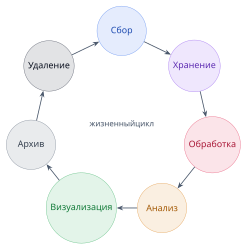

<!--
Это «круговая» модель: после удаления цикл может начаться заново с новых источников. Важно: удаление — обязательный этап (GDPR), а не опция.
-->

---

## Этапы 1–2: Сбор и хранение

<div class="columns">
<div>

### 1. Сбор

**Методы**
- API-интеграции
- Web scraping
- Датчики и IoT
- Пользовательский ввод
- Файловые загрузки

</div>
<div>

### 2. Хранение

**Типы хранилищ**
- Реляционные БД (PostgreSQL)
- NoSQL (MongoDB, Cassandra)
- Файловые системы (S3, HDFS)
- DWH (Snowflake)
- Data Lake (Delta Lake)

</div>
</div>

<!--
Выбор хранилища зависит от типа данных, нагрузки (OLTP vs OLAP) и бюджета. Детали — в разделе 2.
-->

---

## Этапы 3–4: Обработка и анализ

<div class="columns">
<div>

### 3. Обработка

**Пакетная (Batch)**
- Большие объёмы
- Периодическое выполнение

**Потоковая (Streaming)**
- Реальное время
- Непрерывный поток

</div>
<div>

### 4. Анализ

- **Дескриптивный** — что произошло?
- **Диагностический** — почему?
- **Предиктивный** — что будет?
- **Прескриптивный** — что делать?

</div>
</div>

<!--
Дескриптивный → диагностический → предиктивный → прескриптивный: рост «зрелости» аналитики.
-->

---

## Этапы 5–7: Визуализация, архив, удаление

### Завершение цикла

<div class="cols3">
<div>

**Визуализация**
- Tableau, Power BI
- Grafana, Kibana
- Matplotlib, Plotly
- Кастомные дашборды

</div>
<div>

**Архивирование**
- Долгосрочное хранение
- Снижение затрат
- Соответствие регуляциям

</div>
<div>

**Удаление**
- Требования GDPR
- Политики хранения
- Безопасное уничтожение

</div>
</div>

<!--
GDPR (ст. 17) даёт «право на забвение» — данные обязаны удаляться по запросу. Это архитектурное требование, а не пожелание.
-->

---

## Резюме: Введение в данные

### Ключевые тезисы

1. Данные — основа цифровой экономики
2. Три типа: структурированные, полуструктурированные, неструктурированные
3. Big Data характеризуется **5V** (Volume, Velocity, Variety, Veracity, Value)
4. Данные проходят полный **жизненный цикл** — от сбора до удаления
5. Данные применяются во всех сферах: бизнес, наука, общество
6. Качество данных — сквозное требование каждого этапа

---

## Вопросы для самопроверки

### Проверьте понимание (обсуждение 5 минут)

1. Чем отличаются JSON и SQL-таблица?
2. Что означает «Velocity» в Big Data?
3. Приведите пример проблемы Veracity.
4. Перечислите этапы жизненного цикла данных.
5. Почему данные сравнивают с нефтью, и в чём неточность этой метафоры?
6. Назовите хотя бы 3 измерения качества данных.

<!--
Ответы стоит дать студентам после обсуждения, кратко.
-->

---

<!-- _class: section -->

# Раздел 2
## Основные концепции инженерии данных

---

## Кто такой Data Engineer?

### Определение

**Data Engineer** — специалист, который:

- Проектирует **инфраструктуру** данных
- Строит **ETL/ELT-пайплайны**
- Обеспечивает **качество и доступность** данных
- Оптимизирует **хранение и обработку**
- Интегрирует источники и системы

<div class="callout">
Коротко: Data Engineer делает данные **доступными, надёжными и готовыми к использованию**.
</div>

<!--
Data Engineer — «фундамент» всей работы с данными. Без него Data Scientist и аналитики не получат данные.
-->

---

## Data Engineer vs Data Scientist vs Data Analyst

### Три роли в данных

| Аспект | Data Engineer | Data Scientist | Data Analyst |
|--------|---------------|----------------|--------------|
| **Фокус** | Инфраструктура | ML-модели | Бизнес-инсайты |
| **Инструменты** | Python, Spark, Airflow | Python, ML-фреймворки | SQL, Excel, BI |
| **Результат** | Пайплайны, системы | Модели, прогнозы | Отчёты, дашборды |
| **Масштаб** | Терабайты+ | Гигабайты+ | Гигабайты |
| **Вопрос** | «Как доставить?» | «Что предсказать?» | «Что случилось?» |

<!--
Границы ролей размыты в небольших командах, но в крупных организациях они чётко разделены.
-->

---

## Метафора: дороги и заводы

### Роли в экосистеме данных

<div class="columns">
<div>

### Data Engineer

- Строит **«дороги»** (пайплайны)
- Возводит **«заводы»** (хранилища)
- Обеспечивает инфраструктуру
- Следит за надёжностью «дорог»

</div>
<div>

### Data Scientist / Analyst

- **«Ездит по дорогам»**
- **«Производит продукты»** на заводах
- Использует готовую инфраструктуру
- Не задумывается о трубах и насосах

</div>
</div>

<!--
Метафора помогает запомнить разницу ответственности: инженер строит, аналитик пользуется.
-->

---

## Навыки Data Engineer

### Технический стек

<div class="cols3">
<div>

**Языки**
- Python
- Scala, Java
- SQL (обязательно!)

</div>
<div>

**Инструменты**
- Spark, Kafka, Airflow
- Docker, Kubernetes
- dbt

</div>
<div>

**Базы данных**
- PostgreSQL
- MongoDB, ClickHouse
- Snowflake, BigQuery

</div>
</div>

<div class="callout good">
**Soft skills** тоже важны: коммуникация с бизнесом, документирование, понимание предметной области.
</div>

<!--
Подчеркните SQL — это «фундаментальный» навык, который не теряет актуальности.
-->

---

## Data Pipeline: концепция

### Что такое пайплайн?

**Конвейер данных** — автоматизированный процесс:

- **Извлечения** данных из источников
- **Преобразования** и обогащения
- **Загрузки** в целевые системы

**Аналогия**: производственный конвейер на заводе — сырьё заходит, готовый продукт выходит.

**Ключевые свойства**
- Автоматизация (без ручных шагов)
- Повторяемость (идемпотентность)
- Наблюдаемость (мониторинг)

<!--
Идемпотентность — свойство, когда повторный запуск не портит данные. Важно для надёжных пайплайнов.
-->

---

## ETL vs ELT

### Два подхода к преобразованию

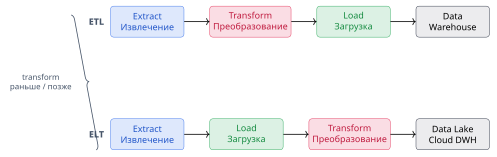

<!--
Разница — в ПОРЯДКЕ: ETL трансформирует до загрузки (на промежуточном сервере), ELT — после (в самом хранилище).
-->

---

## ETL: Extract, Transform, Load

### Классический подход

<div class="columns">
<div>

**Extract (Извлечение)**
- Источники: БД, API, файлы
- Инкрементальная выгрузка

**Transform (Преобразование)**
- Очистка, валидация
- Обогащение, агрегация

**Load (Загрузка)**
- В Data Warehouse

</div>
<div>

**Где выполняется**
- На промежуточном ETL-сервере

**Особенности**
- Данные чистятся до попадания в DWH
- Трансформации на отдельной инфраструктуре

</div>
</div>

<!--
ETL доминировал в эпоху дорогих хранилищ: выгодно было «чистить» данные до загрузки, чтобы не тратить ресурсы DWH.
-->

---

## ELT: Extract, Load, Transform

### Современный подход

<div class="columns">
<div>

**Extract (Извлечение)**
- Источники: БД, API, файлы

**Load (Загрузка)**
- Сырые данные в Data Lake / Cloud DWH

**Transform (Преобразование)**
- SQL в хранилище, Spark, dbt

</div>
<div>

**Где выполняется**
- В самом хранилище

**Особенности**
- Быстрая загрузка сырых данных
- Гибкость: трансформации «по требованию»
- Использует мощь облачных DWH

</div>
</div>

<!--
ELT стал популярен с появлением облачных хранилищ (BigQuery, Snowflake), где вычисления дешёвые и масштабируются отдельно от хранения.
-->

---

## ETL vs ELT: сравнение

### Ключевые различия

| Аспект | ETL | ELT |
|--------|-----|-----|
| **Порядок** | Extract → Transform → Load | Extract → Load → Transform |
| **Где трансформация** | Промежуточный сервер | В хранилище |
| **Подход** | Традиционный | Облачный |
| **Гибкость** | Ниже | Выше |
| **Скорость загрузки** | Медленнее | Быстрее |
| **Стоимость хранения** | Дешевле (только чистые) | Дороже (храним сырьё) |

---

## Когда использовать ETL?

### Сценарии применения

- Ограниченные ресурсы хранилища
- Сложные трансформации до загрузки
- Строгие требования к качеству и приватности
- On-premise инфраструктура
- Чувствительные данные (маскирование до загрузки)

<div class="callout">
ETL предпочтителен, когда трансформации **дорогие** и их выгодно делать до попадания в хранилище.
</div>

---

## Когда использовать ELT?

### Сценарии применения

- Облачные хранилища (BigQuery, Snowflake)
- Большие объёмы данных
- Гибкость в трансформациях
- Быстрая загрузка сырых данных
- Исследовательская аналитика (data exploration)

<div class="callout">
ELT предпочтителен, когда нужно **быстро** загрузить сырьё и трансформировать позже.
</div>

---

## Форматы хранения данных

### Почему это важно для Data Engineer

| Формат | Тип | Характеристики | Когда использовать |
|--------|-----|----------------|--------------------|
| **CSV** | текстовый | Простой, без схемы | Обмен, быстрые прототипы |
| **JSON** | текстовый | Вложенность, читаемый | API, semi-structured |
| **Parquet** | колоночный | Сжатие, быстрый read | Аналитика, Data Lake |
| **ORC** | колоночный | Оптимизирован для Hive | Hadoop-экосистема |
| **Avro** | строковый | Схема внутри, компактный | Kafka, стриминг |

<div class="callout good">
**Колоночные форматы** (Parquet/ORC) ускоряют аналитику в 10–100 раз: читаются только нужные колонки.
</div>

<!--
Выбор формата влияет на стоимость хранения и скорость запросов. Parquet — де-факто стандарт для Data Lake.
-->

---

## Data Warehouse (DWH)

### Характеристики

**Определение** — централизованное хранилище для **структурированных** данных.

**Особенности**
- Оптимизация для аналитики (OLAP)
- **Schema-on-Write** — схема задаётся при записи
- Денормализованные таблицы
- Исторические данные (snapshots)
- Высокая стоимость хранения

<!--
DWH решает задачу «быстрые аналитические запросы по согласованным данным». OLAP ≠ OLTP (операционные системы).
-->

---

## Звёздная схема (Star Schema)

### Модель данных в DWH

<div class="columns">
<div>

**Факты**
- Количественные события
- Продажи, клики, платежи
- Большой объём, часто растут

**Измерения**
- Описательные атрибуты
- Товар, клиент, дата, магазин
- Меньше объём, стабильнее

</div>
<div>

```text
        ┌─ dim_date
        │
fact_sales ─ dim_product
        │
        └─ dim_customer
```

**Схема «звезда»**: таблица фактов в центре, измерения — лучи.

</div>
</div>

<!--
Схема «звезда» — основа Кимбалловской методологии (Ralph Kimball). Денормализация ускоряет запросы ценой избыточности.
-->

---

## Data Lake (Озеро данных)

### Характеристики

**Определение** — хранилище для **сырых** данных в любом формате.

**Особенности**
- **Schema-on-Read** — схема применяется при чтении
- Все типы данных
- Низкая стоимость хранения
- Гибкость использования
- Риск превратиться в «болото данных» (Data Swamp)

<div class="callout warn">
Без управления Data Lake превращается в **Data Swamp** — свалку непонятных данных.
</div>

<!--
«Болото данных» — известная антипаттерн: озеро без метаданных, каталогизации и governance.
-->

---

## Medallion Architecture

### Зоны хранения в Data Lake

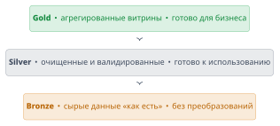

<!--
Medallion-архитектура (Bronze/Silver/Gold) — способ структурировать озеро и избежать «болота». Придумана в Databricks.
-->

---

## Data Warehouse vs Data Lake vs Lakehouse

### Эволюция хранения

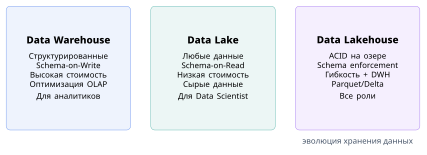

---

## Data Lakehouse

### Лучшее из двух миров

**Концепция** — объединение преимуществ Data Lake и Data Warehouse.

**Возможности**
- ACID-транзакции на озере
- Schema enforcement (контроль схемы)
- Производительность DWH
- Гибкость Data Lake

**Технологии**
- **Delta Lake** (Databricks) — ACID, time travel, schema evolution
- **Apache Iceberg** (Netflix) — партиции, эволюция схем
- **Apache Hudi** (Uber) — upserts, инкрементальная обработка

<!--
Lakehouse — современный мейнстрим. Позволяет и аналитике, и ML работать по одним данным.
-->

---

## Резюме: Концепции инженерии данных

### Ключевые тезисы

1. Data Engineer строит инфраструктуру и пайплайны
2. Data Pipeline — автоматизированный процесс ETL/ELT
3. ETL трансформирует **до**, ELT — **после** загрузки
4. Формат хранения (CSV/JSON/Parquet/Avro) влияет на стоимость и скорость
5. DWH — структурированная аналитика; Data Lake — гибкость и ML
6. Lakehouse (Delta/Iceberg/Hudi) — гибридное решение
7. Medallion-архитектура (Bronze/Silver/Gold) структурирует озеро

---

## Вопросы для самопроверки

### Проверьте понимание (обсуждение 5 минут)

1. В чём отличие Data Engineer от Data Scientist?
2. Когда выбрать ETL, а когда ELT?
3. Чем Data Lake отличается от Data Warehouse?
4. Что такое Medallion-архитектура?
5. Какие преимущества у Data Lakehouse?
6. Почему Parquet быстрее CSV для аналитики?

<!--
Попросите студентов объяснить понятия своими словами — это лучший способ проверить понимание.
-->

---

<!-- _class: section -->

# Раздел 3
## Архитектуры инжиниринга данных

---

## Зачем нужны архитектурные паттерны?

### Причины использования

- Решение **типовых задач** (не изобретать велосипед)
- **Масштабируемость** систем
- **Отказоустойчивость**
- Управление **сложностью**
- Обмен опытом между командами

<div class="callout">
Паттерн — это проверенное решение с известными компромиссами. Важно понимать не только «как», но и «когда».
</div>

<!--
Ключевая идея: нет «серебряной пули». Каждая архитектура — это компромисс. Выбор зависит от требований.
-->

---

## Лямбда-архитектура

### Lambda Architecture

**Автор**: Nathan Marz (2011)

**Цель** — обработка больших данных с **минимальной задержкой** и **полнотой**.

**Идея** — два параллельных пути обработки:
- **Batch** — точная обработка всей истории
- **Speed** — приближённая обработка нового потока

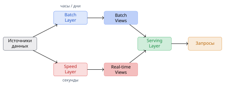

<!--
Лямбда отвечает на вопрос: «как получить и точность, и скорость одновременно?» — обрабатывать данные двумя способами.
-->

---

## Слои Лямбда-архитектуры

### Batch, Speed, Serving

| Слой | Задача | Технологии | Скорость |
|------|--------|------------|----------|
| **Batch** | Точная обработка всей истории | Hadoop, Spark | Часы/дни |
| **Speed** | Новые данные в реальном времени | Storm, Flink, Kafka Streams | Секунды |
| **Serving** | Объединение и выдача результатов | Druid, Cassandra, HBase | Мс |

<div class="callout">
**Serving Layer** индексирует данные и отвечает на запросы, объединяя batch- и real-time-представления.
</div>

---

## Лямбда в действии: счётчик просмотров

### Численный пример

<div class="columns">
<div>

**Batch Layer**
- Считает просмотры за всю историю
- Обновляется раз в сутки
- Точное значение: **1 000 000**

**Speed Layer**
- Считает просмотры с последнего батча
- Обновляется в реальном времени
- Текущее значение: **+150**

</div>
<div>

**Итоговый результат**

$$\text{1 000 150 просмотров}$$

Batch-значение + Speed-приращение.

<br/>

**Компромисс**: точность batch + свежесть speed.

</div>
</div>

<!--
Обратите внимание: это сумма двух значений, а не единый счётчик. При смене батча speed-слой «обнуляется».
-->

---

## Лямбда: плюсы и минусы

<div class="columns">
<div>

### Плюсы

- Отказоустойчивость
- Точность + скорость
- Обработка исторических данных
- Низкая задержка для новых данных

</div>
<div>

### Минусы

- Высокая сложность
- **Дублирование логики** (две кодовые базы)
- Дорогая инфраструктура
- Сложность отладки и поддержки

</div>
</div>

<div class="callout warn">
Главный минус — **две реализации одной и той же логики**: одну пишут на Spark (batch), другую на Flink (streaming).
</div>

---

## Каппа-архитектура

### Kappa Architecture

**Автор**: Jay Kreps (LinkedIn, 2014)

**Цель** — упростить Лямбду.

**Идея** — «Всё есть поток»: **отказ от пакетного слоя**.


<!--
Каппа убирает дублирование логики: одна потоковая реализация. «Переобработка» достигается повторным проигрыванием лога.
-->

---

## Принципы Каппа

### Ключевые идеи

<div class="cols3">
<div>

**Единая обработка**
- Только потоковая
- Нет разделения batch/speed

</div>
<div>

**Переобработка**
- Повторное проигрывание потока
- Исправление ошибок логики

</div>
<div>

**Хранение потока**
- Kafka хранит события долго
- Возможность «перемотки» лога

</div>
</div>

<div class="callout good">
Ключевое отличие: **reprocessing** (переобработка) вместо **recompute** (пересчёта) в Лямбде.
</div>

<!--
Лог (Kafka) — источник истины. Чтобы исправить баг в логике, запускаем новую версию и проигрываем лог с начала.
-->

---

## Переобработка в Каппа

### Как это работает?

**Процесс**
1. Запускаем **новую версию** обработки
2. **Проигрываем** поток с начала (replay)
3. **Заменяем** старые результаты новыми

<div class="callout">
Версия 2 обработки «догоняет» версию 1, а затем заменяет её результаты.
</div>

**Требование**: события должны быть **идемпотентно воспроизводимыми**.

<!--
Переобработка возможна только если события сохраняются в логе (retention) и обработка детерминирована.
-->

---

## Лямбда vs Каппа

### Сравнение архитектур

| Аспект | Лямбда | Каппа |
|--------|--------|-------|
| **Сложность** | Высокая | Средняя |
| **Слои** | Batch + Speed | Stream |
| **Код** | Дублируется | Единый |
| **Переобработка** | Batch (recompute) | Replay stream |
| **Задержка** | Минимальная | Минимальная |
| **Полнота** | Гарантирована | Зависит от логики |
| **Когда** | Точность критична | Простота важнее |

<!--
Каппа проще, но требует, чтобы всю логику можно было выразить потоково. Лямбда — когда нужна гарантированная полнота.
-->

---

## Batch vs Streaming

### Два режима обработки

| Аспект | Batch (пакетная) | Streaming (потоковая) |
|--------|------------------|----------------------|
| **Данные** | Ограниченный набор | Бесконечный поток |
| **Задержка** | Минуты–часы | Мс–секунды |
| **Точность** | Высокая | Приближённая |
| **Сложность** | Ниже | Выше |
| **Примеры** | Отчёты, ETL | Алерты, анти-фрод |

<div class="callout">
Многие задачи требуют **обоих** режимов: batch для истории, streaming для свежих событий.
</div>

<!--
Этот слайд связывает раздел 2 (обработка) и раздел 3 (архитектуры): Лямбда/Каппа — способы объединить оба режима.
-->

---

## Data Mesh

### Новая парадигма

**Автор**: Zhamak Dehghani (ThoughtWorks, 2019)

**Проблема** — централизованные команды данных **не масштабируются**.

**Решение** — **децентрализация владения** данными.

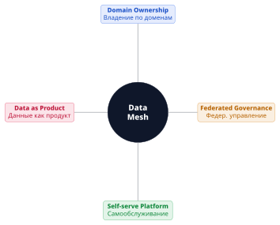

<!--
Data Mesh — это прежде всего ОРГАНИЗАЦИОННАЯ, а не техническая парадигма. Она меняет то, как команды владеют данными.
-->

---

## Принципы Data Mesh

### Четыре столпа

<div class="cols3">
<div>

### Domain Ownership

Команда, генерирующая данные, **владеет** ими.

</div>
<div>

### Data as Product

Данные — **продукт** для других команд.

</div>
<div>

### Self-serve Platform

Инфраструктура для **самостоятельной** работы.

</div>
</div>

<div class="cols3">
<div>

**Характеристики продукта**
- Discoverable
- Addressable
- Trustworthy
- Self-describing
- Interoperable

</div>
<div>

**Платформа даёт**
- Инфраструктуру как сервис
- Инструменты пайплайнов
- Мониторинг
- Стандарты и шаблоны

</div>
<div>

**Federated Governance**
- Баланс автономии и стандартов
- Центрально: политики, форматы
- Децентрализованно: реализация

</div>
</div>

<!--
Data as Product — самое важное понятие: данные должны быть «упакованы» как продукт с SLA, документацией, версионированием.
-->

---

## Data Mesh: пример e-commerce

### Домены и data-продукты

| Домен | Данные | Data Product |
|-------|--------|--------------|
| **Каталог** | Товары | Product Catalog API |
| **Заказы** | Покупки | Customer Purchase History |
| **Логистика** | Доставка | Delivery Performance |

<div class="callout">
Каждый домен владеет своими данными и предоставляет их как продукт другим командам.
</div>

<!--
Ключевой эффект: ответственность за качество данных переходит к доменным командам, которые их и генерируют.
-->

---

## Data Mesh: плюсы, минусы и когда применять

<div class="columns">
<div>

### Плюсы

- Масштабируемость команд
- Автономия доменов
- Быстрая разработка
- Качество (ownership)
- Гибкость технологий

</div>
<div>

### Минусы

- Организационная сложность
- Требует зрелости команд
- Дублирование инфраструктуры
- Сложность governance
- Не для малых компаний

</div>
</div>

**Когда применять**
- Крупные организации (500+ человек)
- Множество доменов/продуктов
- Проблемы с централизованной моделью
- Высокая скорость изменений

---

## Сравнение архитектур

### Выбор подхода

| Задача | Архитектура |
|--------|-------------|
| Real-time + гарантированная полнота | Лямбда |
| Простота + streaming | Каппа |
| Масштабирование команд и владения | Data Mesh |
| Традиционная аналитика | ETL + DWH |
| Исследования + ML | Data Lake |
| Гибрид аналитики и ML | Lakehouse |

<div class="callout good">
Архитектуры **не исключают друг друга** — их можно комбинировать.
</div>

---

## Резюме: Архитектуры данных

### Ключевые тезисы

1. Лямбда — batch + speed слои (точность + скорость)
2. Каппа — только потоковая обработка (простота)
3. Data Mesh — децентрализация владения данными
4. Batch vs streaming — разные компромиссы
5. Выбор зависит от контекста и требований
6. Архитектуры можно **комбинировать**

---

## Вопросы для самопроверки

### Проверьте понимание (обсуждение 5 минут)

1. Чем Каппа проще Лямбды?
2. Как работает переобработка в Каппа?
3. Что такое «Data as Product»?
4. Когда Data Mesh не подходит?
5. Можно ли совместить Каппа и Data Mesh?
6. В чём разница batch и streaming?

<!--
Вопрос 5 провокационный: да, Data Mesh — про владение, Каппа — про обработку; они ортогональны.
-->

---

<!-- _class: section -->

# Раздел 4
## Микросервисы и облачные платформы

---

## От монолита к микросервисам

### Эволюция архитектуры


---

## Монолитный пайплайн и его проблемы

<div class="columns">
<div>

**Монолит** — один большой процесс:
- Extract → Transform → Validate → Enrich → Load
- Всё в одном коде

</div>
<div>

**Проблемы**
- Сложность изменений
- Нельзя масштабировать части
- Один язык программирования
- Долгие релизы
- Высокий риск при деплое
- Сложная отладка

</div>
</div>

<div class="callout warn">
Монолит **не всегда плох** — для малых пайплайнов он проще. Проблемы возникают с ростом сложности.
</div>

<!--
Важно дать сбалансированную картину: микросервисы — не панацея, а решение для масштаба.
-->

---

## Микросервисный пайплайн

### Пример e-commerce

<div class="columns">
<div>

**Сервисы**
1. Сбор заказов (Python)
2. Валидация (Go)
3. Обогащение клиентами (Java)
4. Расчёт метрик (Scala/Spark)
5. Загрузка в DWH (Python)

</div>
<div>

**Преимущества**
- Независимое масштабирование
- Технологическая гибкость
- Надёжность (сбой ≠ остановка)
- Быстрые релизы по частям

</div>
</div>

<!--
Каждый сервис — отдельный процесс с собственной ответственностью. Технологии выбираются под задачу.
-->

---

## Взаимодействие микросервисов

### Синхронное и асинхронное

<div class="columns">
<div>

### Синхронное

- **REST API** — просто, HTTP
- **gRPC** — быстро, protobuf

Запрос → ответ, вызывающий ждёт.

</div>
<div>

### Асинхронное

- **Message Queue** — RabbitMQ
- **Event Streaming** — Kafka

События, нет ожидания ответа.

</div>
</div>

<div class="callout">
Синхронное — просто, но создаёт сильную связность. Асинхронное — слабее связность, выше надёжность.
</div>

<!--
В data-инженерии чаще асинхронное: пайплайны обмениваются событиями через Kafka.
-->

---

## REST vs gRPC

### Сравнение протоколов

| Аспект | REST | gRPC |
|--------|------|------|
| **Протокол** | HTTP/1.1 + JSON | HTTP/2 + protobuf |
| **Производительность** | Ниже | Выше |
| **Контракты** | Нестрогие | Строгие (protobuf) |
| **Читаемость** | Человекочитаемый | Бинарный |
| **Отладка** | Простая | Сложнее |
| **Когда** | Публичные API | Внутренние сервисы |

<!--
gRPC — выбор для высоконагруженного внутреннего общения; REST — для внешних и простых интеграций.
-->

---

## Kafka: распределённый лог

### Event Streaming

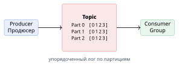

**Характеристики**
- Распределённый, реплицируемый лог
- Высокая пропускная способность
- Хранение событий (retention)
- Партиции → параллелизм и порядок

<!--
Kafka — «позвоночник» современных data-платформ. Партиции обеспечивают порядок в пределах ключа и параллельную обработку.
-->

---

## Message Queue vs Event Streaming

### RabbitMQ vs Kafka

| Аспект | RabbitMQ (MQ) | Kafka (Streaming) |
|--------|---------------|-------------------|
| **Модель** | Очереди | Распределённый лог |
| **Порядок** | Не гарантирован | Гарантирован в партиции |
| **Повторное чтение** | Нет | Да (replay) |
| **Масштаб** | Средний | Очень высокий |
| **Сценарий** | Задачи, команды | Потоки событий |

<!--
Ключевая разница: Kafka хранит историю и позволяет перечитывать — это основа Каппы и event-driven архитектур.
-->

---

## Контейнеризация: Docker

### Зачем нужен Docker?

**Проблема**: «У меня работает, а у вас — нет».

**Решение**: упаковка приложения **со всеми зависимостями** в изолированный контейнер.

**Концепции**
- **Dockerfile** → образ (**Image**) → контейнер (**Container**)
- Один образ — много запущенных контейнеров

**Преимущества**
- Изоляция
- Портативность
- Быстрое развёртывание

<!--
Docker решает проблему воспроизводимости окружения. Для data-пайплайнов это значит: одинаковое поведение локально и в проде.
-->

---

## Пример Dockerfile

### Data Pipeline сервис

```dockerfile
FROM python:3.11-slim

WORKDIR /app

COPY requirements.txt .
RUN pip install --no-cache-dir -r requirements.txt

COPY . .

CMD ["python", "pipeline.py"]
```

<div class="muted">`docker build -t pipeline .` → `docker run pipeline`</div>

---

## Оркестрация: Kubernetes

### Управление контейнерами в проде

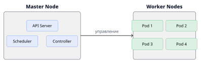

**Задачи Kubernetes**
- Автоматическое масштабирование
- Балансировка нагрузки
- Self-healing (перезапуск упавших)
- Rolling updates
- Service discovery

<!--
Kubernetes управляет контейнерами на кластере машин. Master управляет, Worker выполняет (pod'ы = группы контейнеров).
-->

---

## Kubernetes для Data Engineering

### Примеры использования

<div class="cols3">
<div>

**Spark on K8s**
- Динамические executors
- Изоляция задач

</div>
<div>

**Airflow on K8s**
- KubernetesPodOperator
- Масштабирование workers

</div>
<div>

**Kafka on K8s**
- Strimzi operator
- Управление кластером

</div>
</div>

<div class="callout good">
Kubernetes стал стандартом запуска data-нагрузок: единая платформа для batch, streaming и сервисов.
</div>

---

## Облачные платформы

### Зачем облако для данных?

**Преимущества**
- **Эластичность** — масштабирование под нагрузку
- **Pay-as-you-go** — платим за использование
- **Управляемые сервисы** — без администрирования
- **Глобальная доступность**

<div class="callout">
Облако превращает **капитальные** затраты (CAPEX) в **операционные** (OPEX) и снижает порог входа.
</div>

<!--
Для data-инженерии облако критично: всплески нагрузки (пересчёт батчей) требуют эластичности.
-->

---

## Yandex Cloud для Data Engineering

### Сервисы для работы с данными

<div class="cols3">
<div>

**Хранение**
- Object Storage (S3)
- Managed PostgreSQL
- Managed ClickHouse
- Managed MongoDB

</div>
<div>

**Обработка**
- DataProc (Hadoop, Spark)
- Data Streams (Kafka-like)
- Serverless Functions

</div>
<div>

**Аналитика**
- DataLens (BI)
- Query (аналитика в S3)
- Managed Greenplum

</div>
</div>

<!--
DataProc — управляемый Hadoop/Spark; Data Streams — аналог Kafka; DataLens — BI-визуализация.
-->

---

## Архитектура в Yandex Cloud

### Поток данных

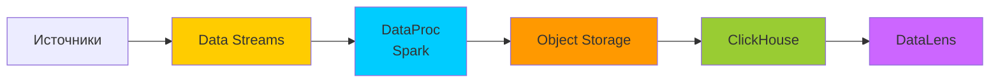

<div class="muted">Потоковая обработка: события → стриминг → Spark → озеро → аналитическая БД → BI.</div>

<!--
Типичный конвейер: Data Streams собирает события, Spark обрабатывает, результат складывается в S3 и ClickHouse для аналитики.
-->

---

## Другие облачные платформы

### Сравнение провайдеров

| Сервис | AWS | Google Cloud | Azure |
|--------|-----|--------------|-------|
| **Хранилище** | S3 | Cloud Storage | Blob Storage |
| **DWH** | Redshift | BigQuery | Synapse |
| **Стриминг** | Kinesis | Pub/Sub | Event Hubs |
| **Обработка** | EMR | Dataflow | Data Factory |

<div class="muted">Принципы одинаковые, сервисы взаимозаменяемы — важно понимать концепции, а не кнопки.</div>

---

## Serverless для Data Engineering

### Обработка без серверов

**Концепция** — платформа управляет инфраструктурой.

**Примеры**
- AWS Lambda для ETL
- Google Cloud Functions
- Yandex Cloud Functions

**Преимущества**
- Автоматическое масштабирование
- Оплата за выполнение
- Нет управления серверами

**Сценарий ETL**
1. Файл загружен в S3
2. Триггер запускает функцию
3. Функция обрабатывает файл
4. Результат в DWH

<!--
Serverless хорош для событийных ETL, но не для длительных тяжёлых задач (лимиты времени выполнения).
-->

---

## Инфраструктура как код (IaC)

### Terraform для данных

**Преимущества**
- Версионирование инфраструктуры
- Воспроизводимость окружений
- Автоматизация деплоя

**Пример: создание Spark-кластера**

```hcl
resource "yandex_dataproc_cluster" "spark" {
  name               = "data-processing"
  bucket             = "my-data-bucket"
  service_account_id = var.sa_id
}
```

<!--
IaC — инфраструктура описывается кодом, как обычное ПО: review, версии, откат.
-->

---

## Наблюдаемость (Observability)

### Три столпа

<div class="cols3">
<div>

**Metrics**
- Prometheus, Grafana
- Метрики пайплайна

</div>
<div>

**Logs**
- ELK Stack, Loki
- Логи сервисов

</div>
<div>

**Traces**
- Jaeger, Zipkin
- Сквозные запросы

</div>
</div>

**Для пайплайнов данных важно отслеживать**
- Задержки обработки (latency)
- Объёмы данных (throughput)
- Ошибки и retry
- Качество данных (data quality)

<!--
Наблюдаемость — не «приятный бонус», а необходимость: пайплайн без мониторинга — чёрный ящик.
-->

---

## Best Practices микросервисов

### Рекомендации

<div class="columns">
<div>

**Проектирование**
- Один сервис — одна ответственность
- API-first подход
- Версионирование API
- Отказоустойчивость (timeouts, retries)

</div>
<div>

**Операционка**
- Health checks
- Graceful shutdown
- Retry с exponential backoff
- Идемпотентные операции

</div>
</div>

<div class="callout good">
**Идемпотентность** критична для пайплайнов: повторная обработка не должна дублировать данные.
</div>

---

## Резюме: Микросервисы и облака

### Ключевые тезисы

1. Микросервисы — гибкость, масштабируемость, надёжность
2. Синхронная (REST/gRPC) и асинхронная (Kafka/RabbitMQ) коммуникация
3. Docker — изоляция и портативность
4. Kubernetes — оркестрация в продакшене
5. Облако — эластичность и управляемые сервисы
6. Serverless — обработка без управления серверами
7. IaC — автоматизация и воспроизводимость
8. Observability — метрики, логи, трейсы

---

## Вопросы для самопроверки

### Проверьте понимание (обсуждение 5 минут)

1. Почему микросервисы лучше монолита (и всегда ли)?
2. Чем gRPC отличается от REST?
3. Какие задачи решает Kubernetes?
4. Преимущества облачных платформ?
5. Что такое Serverless для данных?
6. В чём разница Kafka и RabbitMQ?

<!--
Провокация в вопросе 1: микросервисы не всегда лучше — для малого проекта монолит проще и дешевле.
-->

---

<!-- _class: section -->

# Заключение
## Итоги лекции

---

## Общее резюме лекции

### Что мы изучили

<div class="cols3">
<div>

**Раздел 1**
Данные и их значение
- Типы данных
- Big Data (5V)
- Жизненный цикл

</div>
<div>

**Раздел 2**
Концепции инженерии данных
- Data Engineer
- ETL/ELT
- Хранилища

</div>
<div>

**Разделы 3–4**
Архитектуры и инфраструктура
- Лямбда, Каппа, Mesh
- Микросервисы, облака

</div>
</div>

---

## Связь с последующими лекциями

### Что дальше?

| Лекция | Тема | Связь с сегодняшней |
|--------|------|---------------------|
| **2** | Продвинутый сбор данных | API, Scrapy, Kafka |
| **3** | Очистка и валидация | Качество данных (жизненный цикл) |
| **6** | ETL/ELT и оркестрация | Airflow, мониторинг |

---

## Домашнее задание

### Практическая работа

<div class="columns">
<div>

**Задание 1: Архитектура**
- Выберите кейс (e-commerce, IoT, финтех)
- Спроектируйте архитектуру данных
- Обоснуйте выбор компонентов

</div>
<div>

**Задание 2: Docker**
- Создайте простой ETL-скрипт (Python)
- Напишите Dockerfile
- Запустите контейнер

</div>
</div>

**Срок**: 2 недели · **Формат**: отчёт + код в Git

<!--
Задания взаимосвязаны: в задании 1 проектируем, в задании 2 — реализуем минимальный пайплайн в Docker.
-->

---

## Дополнительные материалы

### Рекомендации для изучения

**Книги**
- *Designing Data-Intensive Applications* — Martin Kleppmann
- *The Data Warehouse Toolkit* — Ralph Kimball
- *Fundamentals of Data Engineering* — Reis & Housley
- *Building Microservices* — Sam Newman

**Онлайн-курсы**
- DataCamp: Data Engineering track
- Coursera: Data Engineering on GCP

---

## Полезные ресурсы

### Сообщества и блоги

**Блоги**
- [Martin Fowler's Blog](https://martinfowler.com)
- [Netflix Tech Blog](https://netflixtechblog.com)
- [Uber Engineering](https://eng.uber.com)

**Подкасты**
- Data Engineering Podcast
- Software Engineering Daily

**Telegram-каналы**
- Data Engineering Russia
- Big Data & ML

---

<!-- _class: section -->

# Вопросы и ответы

## Открытое обсуждение

<br/>

**Концепции · Архитектуры · Технологии · Домашнее задание**

<br/>

<div class="muted">Время для вопросов — 10 минут</div>

---

<!-- _class: title -->

# Спасибо за внимание!

## Следующая лекция: Продвинутый сбор данных

**Темы**
- REST API и GraphQL
- Web scraping с Scrapy
- Потоковая обработка (Kafka)
- Работа с большими файлами

**Подготовка**: установите Python и Docker

<div class="meta">Вопросы и материалы — в репозитории курса</div>

<!--
Завершите лекцию анонсом и напоминанием о подготовке к следующему занятию.
-->
