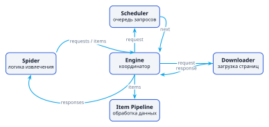
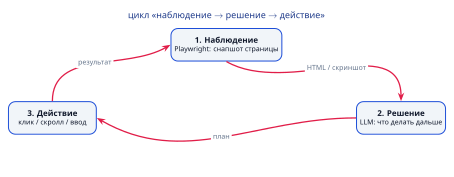
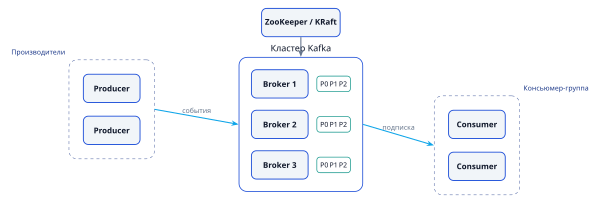
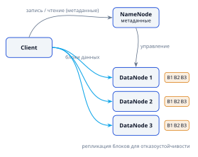

<style>
@import url('https://fonts.googleapis.com/css2?family=Inter:wght@400;600;700;800&display=swap');

:root {
  --primary: #1d4ed8;
  --primary-dark: #1e3a8a;
  --accent: #0ea5e9;
  --ink: #0f172a;
  --muted: #64748b;
  --bg: #ffffff;
  --soft: #f1f5f9;
  --teal: #0d9488;
  --amber: #d97706;
  --rose: #e11d48;
}

section {
  font-family: 'Inter', 'Noto Sans', 'Segoe UI', system-ui, sans-serif;
  color: var(--ink);
  background: var(--bg);
  font-size: 29px;
  line-height: 1.35;
  padding: 56px 78px;
}

h1 { font-size: 1.5em; color: var(--primary); margin: 0 0 .35em; font-weight: 800; letter-spacing: -.01em; }
h2 { font-size: 1.18em; color: var(--ink); margin: 0 0 .45em; font-weight: 700; }
h3 { font-size: .82em; color: var(--muted); margin: 0 0 .3em; font-weight: 600; text-transform: uppercase; letter-spacing: .04em; }

ul, ol { margin: 0 0 .55em; padding-left: 1.25em; }
li { margin: .16em 0; }
li strong, li b { color: var(--primary-dark); }
p { margin: 0 0 .5em; }

a { color: var(--primary); }

table { width: 100%; border-collapse: collapse; font-size: .76em; }
th { background: var(--primary); color: #fff; padding: 9px 14px; text-align: left; font-weight: 600; }
td { padding: 8px 14px; border-bottom: 1px solid #e2e8f0; vertical-align: top; }
tr:nth-child(even) td { background: #f8fafc; }

img { display: block; margin: 0 auto; }

code { background: var(--soft); border-radius: 4px; padding: 1px 6px; font-size: .82em; font-family: 'JetBrains Mono', ui-monospace, monospace; }
pre { background: #0f172a; color: #e2e8f0; border-radius: 10px; padding: 16px 22px; font-size: .68em; line-height: 1.5; }
pre code { background: transparent; color: inherit; padding: 0; }

.columns { display: grid; grid-template-columns: 1fr 1fr; gap: 48px; align-items: start; }
.cols3 { display: grid; grid-template-columns: 1fr 1fr 1fr; gap: 30px; align-items: start; }

section.section {
  background: linear-gradient(135deg, #0f172a 0%, #1e3a8a 55%, #1d4ed8 100%);
  color: #fff; justify-content: center; text-align: center;
}
section.section h1 { color: #fff; font-size: 2.1em; border: none; }
section.section h2 { color: rgba(255,255,255,.85); font-weight: 400; font-size: 1.1em; }
section.section::after { content: ''; }

section.title {
  background: linear-gradient(135deg, #0f172a 0%, #1e3a8a 55%, #1d4ed8 100%);
  color: #fff; justify-content: center; text-align: center;
}
section.title h1 { color: #fff; font-size: 2.5em; border: none; }
section.title h2 { color: rgba(255,255,255,.9); font-weight: 400; }
section.title p { color: rgba(255,255,255,.8); }
section.title .meta { margin-top: 1.4em; font-size: .8em; color: rgba(255,255,255,.7); letter-spacing: .06em; text-transform: uppercase; }

.callout { border-left: 5px solid var(--accent); background: #eff6ff; border-radius: 6px; padding: 14px 20px; margin: .5em 0; }
.callout.warn { border-left-color: var(--amber); background: #fffbeb; }
.callout.good { border-left-color: var(--teal); background: #ecfdf5; }
.callout.bad { border-left-color: var(--rose); background: #fef2f2; }

.muted { color: var(--muted); font-size: .8em; }
.small { font-size: .8em; }
.badge { display: inline-block; background: var(--soft); border-radius: 999px; padding: 4px 14px; margin: 3px; font-size: .74em; font-weight: 600; color: var(--primary-dark); }
</style>

<!-- _class: title -->

# Лекция 2
## Продвинутый сбор данных

<div class="meta">Инженерия данных · Магистратура ИТМО · Осень 2025</div>

<!--
Цель — дать инструментарий сбора данных: REST/GraphQL API, веб-скрапинг (Scrapy + AI-агенты), потоковая обработка и большие файлы.
-->

---

<!-- _class: section -->

# План лекции

## 4 раздела · 160 минут

---

## План лекции

### Структура занятия

1. **Работа с REST API и GraphQL** — 40 мин
2. **Web scraping (Scrapy) и AI-агенты** — 45 мин
3. **Потоковая обработка данных** — 40 мин
4. **Большие файлы и распределённые системы** — 35 мин

<br/>

<div class="callout good">
Каждый раздел заканчивается <b>резюме</b> и <b>вопросами для самопроверки</b>.
</div>

<!--
Акцент: качество данных на входе определяет качество аналитики и ML. Раздел 2 расширен блоком про AI-агентов (LLM + Playwright).
-->

---

## Почему это важно?

### Сбор данных — фундамент всего пайплайна

- **Качество данных** определяет качество аналитики и ML-моделей
- Современные источники требуют **специализированных подходов**
- Эффективный сбор — **фундамент** для всех последующих этапов

<div class="columns">
<div>

**Источники данных**
- REST / GraphQL API
- Веб-сайты (скрапинг)
- Потоки событий (Kafka)
- Файлы и объектные хранилища

</div>
<div>

**Ключевые вызовы**
- Пагинация и rate limits
- Блокировки и капчи
- Объёмы и скорость
- Надёжность доставки

</div>
</div>

<!--
Проведите сквозную нить: каждый последующий этап (очистка, трансформация) зависит от того, что собрано здесь.
-->

---

<!-- _class: section -->

# Раздел 1
## Работа с REST API и GraphQL

---

## REST API: основы

### Архитектурный стиль для распределённых систем

- **Ресурсно-ориентированный** подход — всё есть ресурс
- Стандартные HTTP-методы: `GET`, `POST`, `PUT`, `DELETE`
- **Stateless** взаимодействие (каждый запрос самодостаточен)
- Представление ресурсов: **JSON**, XML

<div class="callout">
Ресурс адресуется URL, а операция задаётся HTTP-методом — не наоборот.
</div>

<!--
Проверьте, что студенты отличают REST (стиль) от конкретной реализации. Подчеркните stateless: сервер не хранит сессию между запросами.
-->

---

## Пагинация в REST API

### Три стратегии

| Стратегия | Параметры | Когда |
|-----------|-----------|-------|
| **Offset-based** | `page`, `limit` | Простые API, небольшой объём |
| **Cursor-based** | `next_token`, `cursor` | Стабильные наборы, потоковые данные |
| **Time-based** | `from_date`, `to_date` | Данные с временной меткой |

<div class="callout warn">
Cursor-пагинация устойчивее offset: вставка новых строк не «сдвигает» страницы.
</div>

<!--
Объясните разницу на примере: offset-пагинация на ленте с новыми записями может вернуть дубли или пропуски.
-->

---

## Пример: обработка пагинации

```python
import requests

def fetch_all_pages(base_url, params=None):
    all_data = []
    params = params or {}
    page = 1

    while True:
        params['page'] = page
        response = requests.get(base_url, params=params, timeout=30)
        response.raise_for_status()
        data = response.json()

        if not data['results']:
            break

        all_data.extend(data['results'])
        page += 1

    return all_data
```

<div class="muted">Для cursor-based пагинации вместо `page += 1` читаем `next_token` из ответа.</div>

<!--
Подчеркните добавленные `timeout` и `raise_for_status()`: без них код «зависает» и молча возвращает мусор при ошибках.
-->

---

## Фильтрация, сортировка, аутентификация

<div class="columns">
<div>

### Параметры запроса

**Фильтрация**
- Точное: `?status=active`
- Диапазон: `?created_from=…&created_to=…`
- Множество: `?status=active,pending`

**Сортировка**
- `?sort=created_at`
- `?sort=-created_at` (обратный)

</div>
<div>

### Методы аутентификации

- **API Key** — ключ в заголовке/параметрах
- **Basic Auth** — логин/пароль в `Authorization`
- **OAuth 2.0** — access/refresh токены, scope
- **JWT** — самодостаточные подписанные токены

</div>
</div>

<!--
Кратко: OAuth 2.0 — самый распространённый для публичных API; JWT — компактный формат без серверного состояния.
-->

---

## Пример: аутентификация OAuth 2.0

```python
import requests

def get_oauth_token(client_id, client_secret, token_url):
    # Упрощённо: client_credentials без refresh-токена
    auth = (client_id, client_secret)
    data = {'grant_type': 'client_credentials'}

    response = requests.post(token_url, auth=auth, data=data)
    response.raise_for_status()
    return response.json()['access_token']

def call_api_with_token(url, token):
    headers = {'Authorization': f'Bearer {token}'}
    response = requests.get(url, headers=headers)
    response.raise_for_status()
    return response.json()
```

<div class="muted">Для user/authorization code добавьте обработку `refresh_token` при истечении срока.</div>

---

## Ошибки, ретраи и rate limiting

<div class="columns">
<div>

### Коды ответов

- **2xx** — успех
- **4xx** — ошибка клиента (400, 401, 403)
- **5xx** — ошибка сервера
- **429 / 503** — временные

**Стратегия**
- Экспоненциальный backoff
- Постоянные ошибки не ретраить
- Логировать и мониторить

</div>
<div>

### Rate limiting

Заголовки лимитов:
- `X-RateLimit-Limit`
- `X-RateLimit-Remaining`
- `X-RateLimit-Reset`
- `Retry-After`

<div class="callout warn">
`X-RateLimit-Reset` — это **Unix-время**, а не секунды ожидания.
</div>

</div>
</div>

<!--
Классическая ошибка — трактовать Reset как задержку. На этом слайде фиксируем правильную семантику.
-->

---

## Пример: обработка 429

```python
import time
import requests

def api_call_with_rate_limit(url, headers=None):
    while True:
        response = requests.get(url, headers=headers)

        if response.status_code == 429:
            # X-RateLimit-Reset — это Unix-время (epoch), а НЕ секунды
            reset = int(response.headers.get('X-RateLimit-Reset', 0))
            delay = max(reset - time.time(), 0)
            retry_after = response.headers.get('Retry-After')
            wait = int(retry_after) if retry_after else delay
            print(f"Rate limit exceeded. Waiting {wait:.0f}s")
            time.sleep(wait)
            continue

        response.raise_for_status()
        return response.json()
```

<!--
Ранее в слайдах был баг: time.sleep(reset_time) засыпал на миллиарды секунд. Исправлено: вычитаем текущее время, поддерживаем Retry-After.
-->

---

## GraphQL: введение

### Язык запросов к API

- **Единая точка входа** для всех запросов
- Клиент запрашивает **только нужные поля** одним запросом
- Строгая **типизация и схема**
- **Интроспекция** — схему можно изучить запросом

<div class="columns">
<div>

### Преимущества

- Минимизация избыточности
- Меньше запросов
- Эволюция без версионирования
- Документация в схеме

</div>
<div>

### Подводные камни

- **N+1 проблема** на сервере
- Сложнее кэшировать (POST)
- Нужна своя пагинация (`first`/`after`)

</div>
</div>

<!--
Важно не подавать GraphQL как «серебряную пулю»: упомяните N+1 и сложности кэширования.
-->

---

## Структура GraphQL-запроса

```graphql
query GetUser($userId: ID!) {
  user(id: $userId) {
    id
    name
    email
    posts(limit: 5) {
      id
      title
      comments {
        author { name }
        text
      }
    }
  }
}
```

- Запрашивайте **только необходимые поля**
- **Фрагменты** для повторного использования
- **Переменные** для параметризации
- **Директивы** `@include`, `@skip`
- Именуйте операции (`GetUser`) для отладки

---

## GraphQL в Python

```python
from gql import Client, gql
from gql.transport.requests import RequestsHTTPTransport

transport = RequestsHTTPTransport(
    url='https://api.example.com/graphql',
    headers={'Authorization': 'Bearer token'}
)
client = Client(transport=transport)

query = gql('''
    query GetUser($userId: ID!) {
        user(id: $userId) { id  name  email }
    }
''')

result = client.execute(query, variable_values={'userId': '123'})
print(result)
```

<div class="muted">Библиотеки: `gql`, `sgqlc`, `python-graphql-client`.</div>

---

## Резюме: REST API и GraphQL

### Ключевые тезисы

1. REST — стандарт для большинства сервисов
2. GraphQL — гибкость для сложных запросов
3. Пагинация: offset / cursor / time-based
4. Ошибки и rate limits критичны для надёжного сбора
5. Выбор REST vs GraphQL зависит от требований

<br/>

### Вопросы для самопроверки

1. Чем REST отличается от GraphQL?
2. Какие стратегии пагинации вы знаете и когда их применять?
3. Как корректно обработать `429` с заголовком `X-RateLimit-Reset`?
4. Какие преимущества даёт GraphQL для сбора данных?

---

<!-- _class: section -->

# Раздел 2
## Web scraping и AI-агенты

---

## Что такое web scraping?

### Автоматизированное извлечение данных со страниц

- **Применение:** сбор цен, мониторинг контента, исследования
- **Альтернативы:** API, открытые данные, партнёрства — всегда проверяйте их первыми

<div class="callout good">
Если у сайта есть API — используйте API. Скрапинг — запасной путь.
</div>

<div class="callout warn">
Скрапинг сопряжён с **этическими и правовыми** аспектами: robots.txt, ToS, персональные данные.
</div>

<!--
Установите правильный тон с самого начала: скрапинг — легитимный, но регулируемый инструмент.
-->

---

## Архитектура Scrapy

### Компоненты фреймворка



- **Spiders** — логика извлечения · **Items** — структуры данных
- **Pipelines** — обработка/сохранение · **Middlewares** — модификация запросов/ответов
- **Selectors** — извлечение из HTML/XML

---

## Создание и запуск проекта

```bash
pip install scrapy
scrapy startproject myproject
scrapy genspider myspider example.com
scrapy crawl myspider
```

**Структура проекта**

| Файл | Назначение |
|------|-----------|
| `spiders/` | пауки |
| `items.py` | структуры данных |
| `pipelines.py` | обработка данных |
| `settings.py` | конфигурация |

---

## Селекторы: XPath vs CSS

<div class="columns">
<div>

### XPath

- Навигация по XML-дереву
- Абсолютные/относительные пути
- Предикаты и функции
- Мощнее, но многословнее

</div>
<div>

### CSS

- Компактная альтернатива
- Классы, ID, атрибуты
- Псевдоклассы, комбинаторы
- Проще для веб-разработчика

</div>
</div>

<div class="callout">
Правило: **CSS** для простых выборок, **XPath** — когда нужно обращаться к тексту, родителям или по атрибутам.
</div>

---

## Пример: простой паук

```python
import scrapy

class BookSpider(scrapy.Spider):
    name = 'bookspider'
    start_urls = ['http://books.toscrape.com/']

    def parse(self, response):
        for book in response.css('article.product_pod'):
            yield {
                'title':  book.css('h3 a::attr(title)').get(),
                'price':  book.css('p.price_color::text').get(),
                'rating': book.css('p.star-rating::attr(class)').get(),
                'url':    book.css('h3 a::attr(href)').get(),
            }

        next_page = response.css('li.next a::attr(href)').get()
        if next_page:
            yield response.follow(next_page, self.parse)
```

---

## Обход блокировок и капч

<div class="columns">
<div>

### Имитация браузера

- User-Agent ротация
- Заголовки запросов
- Cookies

### Прокси и VPN

- Ротация IP
- Резидентные прокси

</div>
<div>

### Задержки

- Случайные интервалы
- Адаптивные паузы

### Капчи

- Сервисы распознавания
- Браузерная автоматизация

</div>
</div>

<div class="callout warn">
Лучший способ «обхода» — **не нагружать** сервер: включите `ROBOTSTXT_OBEY` и `AUTOTHROTTLE_ENABLED`.
</div>

---

## Настройка прокси и User-Agent

```python
# settings.py
DOWNLOADER_MIDDLEWARES = {
    'scrapy.downloadermiddlewares.useragent.UserAgentMiddleware': None,
    'scrapy_user_agents.middlewares.RandomUserAgentMiddleware': 400,
    'scrapy_proxies.RandomProxy': 100,
}

PROXY_LIST = '/path/to/proxies.txt'
PROXY_MODE = 0  # случайный прокси для каждого запроса

DOWNLOAD_DELAY = 2          # пауза между запросами
RANDOMIZE_DOWNLOAD_DELAY = True
ROBOTSTXT_OBEY = True       # уважаем robots.txt
AUTOTHROTTLE_ENABLED = True # адаптивный троттлинг
```

<div class="muted">`scrapy_user_agents` и `scrapy_proxies` — сторонние пакеты; установите их отдельно.</div>

---

## Распределённый скрапинг

### Масштабирование на несколько машин

- **Scrapy Cluster** — распределённые пауки
- **ScrapyD** — пауки как сервис
- **Frontera** — управление очередью URL

**Что даёт масштабирование**
- Параллельное выполнение запросов
- Балансировка нагрузки
- Синхронизация состояния между узлами

<div class="callout">
Распределение по доменам: отдельные узлы под разные сайты со своими правилами вежливости.
</div>

---

## Scrapy vs Selenium

| Критерий | Scrapy | Selenium |
|----------|--------|----------|
| **Производительность** | Высокая | Низкая |
| **Потребление ресурсов** | Низкое | Высокое |
| **Работа с HTML** | Напрямую | Через браузер |
| **JavaScript** | Нет | Да |
| **Взаимодействие** | Ограниченное | Полное |

<div class="callout good">
**Гибрид:** Scrapy для скорости + Selenium/Playwright только для динамических страниц.
</div>

---

## Пример: Selenium со Scrapy

```python
from scrapy import Spider
from selenium import webdriver
from selenium.webdriver.chrome.options import Options
from selenium.webdriver.common.by import By

class SeleniumSpider(Spider):
    name = 'selenium_spider'
    start_urls = ['https://example.com']

    def __init__(self):
        options = Options()
        options.add_argument('--headless')   # headless=True устарел
        self.driver = webdriver.Chrome(options=options)

    def parse(self, response):
        self.driver.get(response.url)
        self.driver.implicitly_wait(10)

        # Selenium 4: find_elements(By.CSS_SELECTOR, ...)
        elements = self.driver.find_elements(By.CSS_SELECTOR, '.item')
        for element in elements:
            yield {
                'text': element.text,
                'link': element.find_element(By.CSS_SELECTOR, 'a')
                              .get_attribute('href')
            }

    def closed(self, reason):
        self.driver.quit()
```

---

## AI-агенты и LLM в сборе данных

### Когда классический скрапинг ломается

- Вёрстка меняется → **XPath/CSS-селекторы устаревают**
- Контент рендерится на клиенте (SPA), формы, логины
- Данные **неструктурированы** (отзывы, статьи) → нужна схема

<div class="callout">
Идея: вместо «напиши селектор» — «**опиши, что извлечь**», а навигацию и извлечение отдать модели.
</div>

---

## Два паттерна AI-сбора

| Паттерн | Как работает | Когда |
|---------|-------------|-------|
| **Извлечение** (extraction) | Рендер → LLM → JSON по схеме | Структура известна, данные неструктурированы |
| **Агентная навигация** (plan-and-act) | Наблюдение → решение → действие | Нужно пройти по сайту: пагинация, поиск, формы |



---

## Стек AI-агентов

<div class="columns">
<div>

**Браузер**
- Playwright
- **Playwright MCP** — браузер как инструменты для LLM

**Оркестрация**
- browser-use
- Crawl4AI
- Firecrawl
- Stagehand, Skyvern

</div>
<div>

**Структурированный вывод**
- Function calling / JSON mode
- Pydantic, Instructor

<div class="callout good">
Отдавайте модели **accessibility tree / лёгкий DOM-снапшот**, а не весь HTML — экономит токены.
</div>

</div>
</div>

---

## Пример: извлечение по схеме

```python
from pydantic import BaseModel
from playwright.sync_api import sync_playwright
from openai import OpenAI

class Product(BaseModel):
    name: str
    price: float
    in_stock: bool

class Catalog(BaseModel):
    products: list[Product]

llm = OpenAI()  # любой OpenAI-совместимый endpoint

def extract_products(url: str) -> Catalog:
    with sync_playwright() as p:
        browser = p.chromium.launch(headless=True)
        page = browser.new_page()
        page.goto(url, wait_until="domcontentloaded")
        html = page.content()   # на практике — нужный фрагмент/снапшот
        browser.close()

    completion = llm.chat.completions.parse(
        model="gpt-4o-mini",
        messages=[
            {"role": "system", "content": "Извлеки товары из HTML по схеме."},
            {"role": "user", "content": html},
        ],
        response_format=Catalog,   # structured outputs
    )
    return completion.choices[0].message.parsed
```

---

## Пример: агентная навигация (схематично)

```python
from browser_use import Agent, ChatOpenAI

agent = Agent(
    task="Открой каталог, пролистай все страницы и собери названия и цены",
    llm=ChatOpenAI(model="gpt-4o"),
)
result = await agent.run()   # история действий + извлечённые данные
```

<div class="muted">API инструментов меняется быстро — детали сверяйте с официальной документацией.</div>

---

## AI-агент vs классический скрапинг

| Критерий | Классика (Scrapy/Selenium) | AI-агент |
|----------|---------------------------|----------|
| **Устойчивость к вёрстке** | Низкая | Высокая |
| **Стоимость** | ~0 | Плата за токены |
| **Скорость** | Высокая | Низкая |
| **Детерминизм** | Полный | Вероятностный → валидация |
| **Масштаб** | Большой | Малый/средний |

<div class="callout warn">
**Не используйте AI-агентов** для массового сбора (миллионы страниц) — дорого и медленно.
</div>

---

## AI-сбор: когда и риски

<div class="columns">
<div>

### Когда использовать

- Сложные/уникальные сайты
- Неструктурированный текст
- Быстрое прототипирование
- Длинный хвост вёрсток

</div>
<div>

### Риски

- Стоимость растёт линейно
- Галлюцинации → **валидация** (Pydantic + проверки)
- Агент быстрее нарушает ToS
- Не отправлять чувствительные данные в LLM

</div>
</div>

<div class="callout good">
Вывод LLM требует **валидации** — это мост к следующей лекции по очистке и валидации данных.
</div>

---

## Этика и право

### Перед началом скрапинга

- Проверяйте `robots.txt` и Terms of Service
- Уважайте rate limits и ресурсы сервера
- Идентифицируйте бота (User-Agent)
- Учитывайте авторские права и приватность
- Помните о законодательных ограничениях по странам

<div class="callout warn">
Персональные данные требуют особого обращения (GDPR, 152-ФЗ) — даже при «публичном» доступе.
</div>

---

## Сохранение и обработка данных

<div class="columns">
<div>

### Форматы

- JSON, CSV, XML

### Базы данных

- SQLite, PostgreSQL
- MongoDB

</div>
<div>

### Практики

- **Инкрементальный** скрапинг
- Обработка **дубликатов**
- **Валидация и очистка** данных

</div>
</div>

<div class="callout">
Сохранение «сырого» HTML полезно для отладки, но требует контроля объёма и очистки.
</div>

---

## Резюме: Web scraping и AI-агенты

### Ключевые тезисы

1. Scrapy — мощный фреймворк для систематического сбора
2. Правильные селекторы и обход блокировок критичны для успеха
3. Selenium/Playwright — для динамического контента
4. **AI-агенты (LLM + Playwright)** — для сложных и неструктурированных данных
5. Этические и правовые аспекты требуют внимания

<br/>

### Вопросы для самопроверки

1. Какие компоненты входят в архитектуру Scrapy?
2. Чем отличаются XPath и CSS-селекторы?
3. Какие методы обхода блокировок вы знаете?
4. Когда Selenium предпочтительнее Scrapy?
5. Когда уместно использовать AI-агентов вместо классического скрапинга?

---

<!-- _class: section -->

# Раздел 3
## Потоковая обработка данных

---

## Концепция потоковой обработки

### Непрерывная обработка в реальном времени

<div class="columns">
<div>

### Сценарии

- Мониторинг и алертинг
- Анализ поведения пользователей
- IoT и телеметрия
- Обнаружение мошенничества

</div>
<div>

### Ключевые вызовы

- Масштабируемость
- Отказоустойчивость
- Гарантии доставки

</div>
</div>

<div class="callout">
Потоковая ≠ пакетная: данные **бесконечны** и обрабатываются **по мере поступления**.
</div>

---

## Apache Kafka: архитектура



- **Брокеры** хранят и обрабатывают сообщения
- **Топики** — категории сообщений · **Партиции** — параллелизм
- **Продюсеры** отправляют · **Консьюмеры** читают
- **ZooKeeper/KRaft** — координация кластера

---

## Топики и партиции

<div class="columns">
<div>

### Топик

- Логический канал сообщений
- Разбивается на партиции

### Партиция

- Единица параллелизма
- Упорядоченная, append-only
- Смещение (**offset**)

</div>
<div>

### Репликация

- Лидеры и фолловеры
- Отказоустойчивость
- Выбор количества партиций

</div>
</div>

<div class="callout">
Гарантия порядка — **внутри партиции**, а не между партициями.
</div>

---

## Продюсеры и консьюмеры

<div class="columns">
<div>

### Продюсеры

- Выбор партиции (round-robin, ключ)
- Подтверждения записи (`acks`)
- Сжатие данных

</div>
<div>

### Консьюмеры

- Консьюмер-группы для параллелизма
- Управление offset
- Стратегии обработки сбоев

</div>
</div>

<div class="callout good">
`acks=all` + `enable_idempotence=true` — путь к надёжной доставке.
</div>

---

## Пример: Kafka в Python

```python
# Продюсер
from kafka import KafkaProducer
import json

producer = KafkaProducer(
    bootstrap_servers=['localhost:9092'],
    value_serializer=lambda v: json.dumps(v).encode('utf-8')
)
producer.send('my-topic', {'key': 'value'})
producer.flush()

# Консьюмер
from kafka import KafkaConsumer

consumer = KafkaConsumer(
    'my-topic',
    bootstrap_servers=['localhost:9092'],
    value_deserializer=lambda m: json.loads(m.decode('utf-8')),
    group_id='my-group',
    auto_offset_reset='earliest'
)

for message in consumer:
    print(message.value)
```

<div class="muted">В продакшене чаще используют `confluent-kafka` — более зрелый и производительный.</div>

---

## Kafka Connect и Apache Flink

<div class="columns">
<div>

### Kafka Connect

Интеграция с внешними системами:
- **Source**: CDC из БД, файлы
- **Sink**: хранилища, поиск

</div>
<div>

### Apache Flink

Распределённая потоковая обработка:
- DataStream API
- Окна (временные, счётные, сессионные)
- Состояние и checkpoint
- **Exactly-once**

</div>
</div>

---

## Spark Streaming: микро-батчи

### Микро-батчи vs настоящий стриминг

- Обработка небольшими **пакетами**
- Задержка = **batch interval**
- Унифицированный API с пакетной обработкой

### Structured Streaming

- Поток как **неограниченная таблица**
- Инкрементальное выполнение запросов
- Интеграция со Spark SQL

<div class="callout">
Flink — настоящий стриминг (событие за событием); Spark — микро-батчи.
</div>

---

## Пример: Structured Streaming

```python
from pyspark.sql import SparkSession
from pyspark.sql.functions import from_json, window, avg, col
from pyspark.sql.types import StructType, StructField, StringType, DoubleType, TimestampType

spark = SparkSession.builder.appName("StreamingExample").getOrCreate()

# Схема входящих JSON-сообщений
schema = StructType([
    StructField("timestamp", TimestampType()),
    StructField("deviceId", StringType()),
    StructField("temperature", DoubleType()),
])

stream_df = spark.readStream.format("kafka") \
    .option("kafka.bootstrap.servers", "localhost:9092") \
    .option("subscribe", "my-topic").load()

processed = stream_df.selectExpr("CAST(value AS STRING)") \
    .select(from_json("value", schema).alias("data")) \
    .select("data.*") \
    .groupBy(window(col("timestamp"), "1 minute"), col("deviceId")) \
    .agg(avg("temperature").alias("avg_temp"))

query = processed.writeStream.outputMode("complete") \
    .format("console").start()
query.awaitTermination()
```

---

## Поздние события и гарантии доставки

<div class="columns">
<div>

### Поздние события

- **Watermarks** — маркер полноты
- **Allowed lateness**
- Триггеры и режимы вывода
- Side outputs

</div>
<div>

### Гарантии доставки

- **At-most-once** — возможна потеря
- **At-least-once** — возможны дубли
- **Exactly-once** — транзакции + идемпотентность

</div>
</div>

<div class="callout warn">
Exactly-once — это компромисс: выше надёжность, ниже производительность.
</div>

---

## Резюме: Потоковая обработка

### Ключевые тезисы

1. Потоковая обработка — анализ в реальном времени
2. Kafka — надёжный транспорт потоковых данных
3. Flink — настоящий стриминг, Spark — микро-батчи
4. Выбор гарантий доставки критичен для сценария

<br/>

### Вопросы для самопроверки

1. Какие преимущества даёт Apache Kafka?
2. Чем отличаются Flink и Spark Streaming?
3. Какие типы окон используются в потоковой обработке?
4. Как обеспечить exactly-once семантику?

---

<!-- _class: section -->

# Раздел 4
## Большие файлы и распределённые системы

---

## Проблемы больших файлов

- Ограничения **оперативной памяти**
- Время обработки и **задержки ввода-вывода**
- Параллельный доступ
- Отказоустойчивость и масштабируемость

**Подходы к чтению/записи**
- Потоковая обработка, чтение по частям (**chunking**)
- Буферизация, параллельная обработка
- Сжатие на лету, memory-mapped файлы

<div class="callout">
Правило: **не загружайте** файл целиком в память, если он больше доступного RAM.
</div>

---

## Пример: чтение CSV по частям

```python
import pandas as pd

chunk_size = 100000
chunks = pd.read_csv('large_file.csv', chunksize=chunk_size)

results = []
for chunk in chunks:
    processed = chunk[chunk['value'] > 100]
    results.append(processed)

result_df = pd.concat(results, ignore_index=True)
```

<div class="muted">Чанки обрабатываются **по одному**, поэтому в памяти — только текущий кусок.</div>

---

## Форматы данных

| Формат  | Сжатие  | Схема | Сплитуемость | Эволюция схемы |
| ------- | ------- | ----- | ------------ | -------------- |
| CSV     | Низкое  | Нет   | Да           | Сложно         |
| JSON    | Низкое  | Нет   | Нет          | Просто         |
| Parquet | Высокое | Да    | Да           | Средне         |
| Avro    | Среднее | Да    | Да           | Хорошо         |
| ORC     | Высокое | Да    | Да           | Средне         |

<div class="muted">«Сплитуемость» — возможность разбить файл на независимые блоки для параллельного чтения.</div>

<div class="callout good">
Колоночные форматы (Parquet/ORC) читают только нужные колонки — ускорение аналитики в 10–100×.
</div>

---

## Пример: работа с Parquet

```python
import pandas as pd
import pyarrow as pa
import pyarrow.parquet as pq

# CSV -> Parquet
df = pd.read_csv('data.csv')
table = pa.Table.from_pandas(df)
pq.write_table(table, 'data.parquet')

# Чтение только нужных колонок
df_subset = pq.read_table('data.parquet', columns=['id', 'name']).to_pandas()

# Чтение с предикатами (pushdown)
filters = [('age', '>', 30)]
df_filtered = pq.read_table('data.parquet', filters=filters).to_pandas()

# Партиционированный датасет
pq.write_to_dataset(table, root_path='dataset', partition_cols=['country', 'year'])
```

---

## HDFS: распределённая файловая система



- **NameNode** — метаданные · **DataNode** — блоки данных
- Блочное хранение с **репликацией** для отказоустойчивости
- Оптимизирована для **больших файлов**

<div class="muted">S3 — объектное хранилище: почти безграничное масштабирование, классы хранения, политики жизненного цикла.</div>

---

## Партиционирование и сжатие

<div class="columns">
<div>

### Партиционирование

- По времени: год/месяц/день
- По категориям: регион/продукт
- По хешу ключа

**Преимущества**
- Параллельная обработка
- Эффективная фильтрация
- Управление жизненным циклом

</div>
<div>

### Сжатие

| Алгоритм | Степень | Скорость |
|----------|---------|----------|
| Gzip | Высокая | Низкая |
| Snappy | Средняя | Высокая |
| ZSTD | Высокая | Хорошая |

</div>
</div>

---

## Параллельная обработка с Dask

```python
import dask.dataframe as dd

ddf = dd.read_parquet('s3://bucket/path/to/data/*.parquet')

result = ddf[ddf['value'] > 0].groupby('category').agg({
    'value': ['mean', 'sum', 'count']
})

final = result.compute()   # ленивые вычисления запускаются здесь
```

<div class="columns">
<div>

**Технологии**
- Apache Hadoop, Spark
- Dask, Ray
- Vaex

</div>
<div>

**Ключевое**
- Отложенные вычисления
- Параллелизм по чанкам
- Масштабирование на кластер

</div>
</div>

---

## Современные форматы таблиц (Lakehouse)

| Формат | Ключевая возможность |
|--------|---------------------|
| **Delta Lake** | ACID, time travel, schema evolution |
| **Apache Iceberg** | Атомарные обновления, скрытие файлов |
| **Apache Hudi** | Upsert/delete, инкрементальная обработка |

```python
from delta.tables import DeltaTable

deltaTable = DeltaTable.forPath(spark, "/path/to/delta-table")
deltaTable.update(condition="id = 123", set={"value": "new_value"})

# Time travel — чтение исторической версии
historical_df = spark.read.format("delta") \
    .option("versionAsOf", 5).load("/path/to/delta-table")
```

---

## Резюме: Большие файлы и распределённые системы

### Ключевые тезисы

1. Большие файлы требуют специальных подходов и форматов
2. Колоночные форматы (Parquet) ускоряют аналитику
3. Партиционирование и сжатие — ключ к производительности
4. Lakehouse-форматы решают проблемы целостности и эволюции

<br/>

### Вопросы для самопроверки

1. Какие преимущества дают колоночные форматы?
2. Как организовать партиционирование данных?
3. Какие стратегии сжатия подходят для аналитики?
4. Чем отличаются Delta Lake, Iceberg и Hudi?

---

<!-- _class: section -->

# Заключение

## Итоги и дальнейшие шаги

---

## Ключевые выводы

1. Современный сбор данных требует владения **разными техниками**
2. **REST/GraphQL** — структурированный доступ к API
3. **Web scraping** (Scrapy + AI-агенты) — для сайтов без API
4. **Потоковая обработка** — данные в реальном времени
5. **Большие файлы** — специальные форматы и подходы

<div class="callout good">
Выбор инструмента всегда зависит от **источника**, **объёма** и **требований к скорости**.
</div>

---

## Связь с другими темами курса

| Тема | Как связана |
|------|-------------|
| Архитектуры (Лекция 1) | Определяют стратегии сбора |
| Очистка и валидация | Зависит от качества собранных данных |
| ETL/ELT-пайплайны | Используют изученные техники сбора |
| Валидация LLM-вывода | Мост от AI-агентов к очистке |

<div class="callout">
Следующая лекция: **Продвинутая очистка и валидация данных**.
</div>

---

## Домашнее задание

1. **API-клиент** — публичный API с пагинацией и обработкой rate limits
2. **Scrapy-паук** — сбор данных с обходом блокировок
3. **Kafka-пайплайн** — простой поток данных
4. **CSV → Parquet** — обработка большого файла по частям

<div class="muted">Критерии приёмки: корректная обработка ≥3 страниц, ожидание при 429, валидация схемы.</div>

---

## Список литературы

1. Richardson & Ruby — *RESTful Web Services*. O'Reilly, 2007
2. Eve — *Web Scraping with Python*. O'Reilly, 2018
3. Narkhede et al. — *Kafka: The Definitive Guide*. O'Reilly, 2017
4. Kleppmann — *Designing Data-Intensive Applications*. O'Reilly, 2017
5. Chambers & Zaharia — *Spark: The Definitive Guide*. O'Reilly, 2018
6. White — *Hadoop: The Definitive Guide*. O'Reilly, 2015

### Онлайн-ресурсы

`kafka.apache.org` · `docs.scrapy.org` · `flink.apache.org` · `docs.delta.io` · `parquet.apache.org` · `graphql.org` · `playwright.dev/docs/mcp` · `github.com/browser-use/browser-use` · `github.com/unclecode/crawl4ai` · `firecrawl.dev`
