<!--
ОБЩИЕ ЗАМЕТКИ К ПРЕЗЕНТАЦИИ
- Хронометраж: ~105 минут (80 мин × 1.33)
- Баланс: теория ↔ код. Код-слайды помечены «→ семинар», полные листинги — в файле Практикум_Лекция3.md
- Mermaid рендерится в Marp и Obsidian нативно
- Tikz-блоки — это исходный код диаграмм; рендер отдаётся Kroki (endpoint /tikz/{png|svg}, см. https://kroki.io). Каждый блок — самодостаточный standalone-документ
-->

<!-- _class: lead -->

# Продвинутая очистка и валидация данных

**Лекция 3**

Инжиниринг данных (продвинутый уровень)

---

## План лекции

- Автоматизация процессов очистки
- Статистические методы выявления аномалий
- Библиотеки для валидации данных
- Профилирование данных
- Сквозной практический кейс

**Продолжительность:** ~105 минут

**Формат:** теория + код (код детально разбирается на семинаре)

---

## Цели лекции

После лекции вы сможете:

- **Обосновать**, почему автоматизация очистки критична для масштаба
- **Выбрать** метод детектирования аномалий под тип данных
- **Различать** валидацию и верификацию, уровни проверок
- **Формулировать** метрики качества и тесты дрейфа данных
- **Спроектировать** пайплайн очистки + валидации end-to-end

---

## Зачем всё это: стоимость плохих данных

<!-- 6 мин — мотивация, акцент на кривой 1-10-100 -->

Ошибка дешевле всего исправляется **в точке возникновения**.

```tikz
\documentclass[tikz]{standalone}
\usepackage{pgfplots}
\pgfplotsset{compat=1.18}
\begin{document}
\begin{tikzpicture}
\begin{axis}[
    width=11cm, height=6cm,
    xlabel={Этап жизненного цикла},
    ylabel={Стоимость исправления ошибки},
    ymin=0, ymax=120,
    symbolic x coords={Источник, Трансформация, Хранилище, Отчёт},
    xtick=data,
    ybar, bar width=1.4cm,
    nodes near coords, nodes near coords align={vertical},
    ymajorgrids=true
]
\addplot[fill=red!40, draw=red!80!black] coordinates {
    (Источник,1) (Трансформация,10) (Хранилище,50) (Отчёт,100)
};
\end{axis}
\end{tikzpicture}
\end{document}
```

**Правило 1-10-100:** стоимость растёт на порядок с каждым этапом.


---

<!-- _class: lead -->

# Раздел 1
## Автоматизация процессов очистки

<!-- ~20 мин -->

---

## Проблемы ручной очистки

- **Масштабируемость** — миллионы записей ежедневно
- **Консистентность** — разные подходы разработчиков
- **Повторяемость** — невозможность воспроизведения
- **Скорость** — часы работы вместо минут
- **Ошибки** — человеческий фактор

> Ключевое: ручная очистка **не детерминирована** и **не воспроизводима**.

---

## Таксономия «грязных» данных

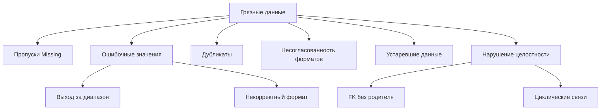

**Ценность таксономии:** единый язык для описания проблем и выбора правил.

---

## Паттерны автоматической очистки

- **Rule-based** — предопределённые правила трансформации
- **ML-based** — обучение на исторических данных
- **Hybrid** — комбинация правил и моделей
- **Declarative** — декларативное описание требований
- **Streaming** — очистка в реальном времени

**Теоретическая ось:** императивный (`как`) ↔ декларативный (`что`).

---

## Императивный vs декларативный

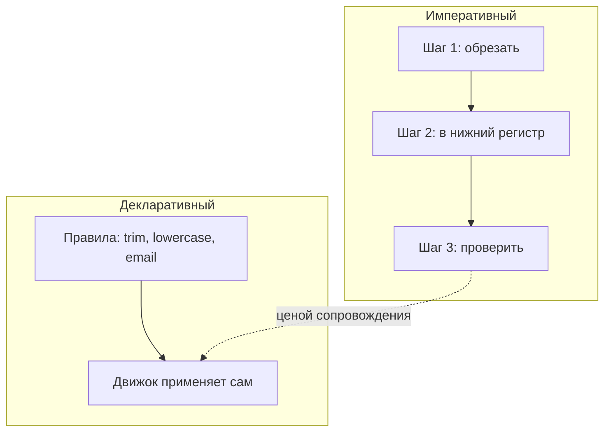

|                   | Императивный   | Декларативный         |
| ----------------- | -------------- | --------------------- |
| Описывает         | **как** делать | **что** нужно         |
| Читаемость        | ниже           | выше                  |
| Переиспользование | слабое         | сильное               |
| Версионирование   | код            | конфигурация (данные) |

---

## Декларативный подход: пример

```python
# Декларативное описание очистки
cleaning_rules = {
    'email': [lowercase, trim, validate_email],
    'phone': [normalize_phone, validate_format],
    'age':   [to_int, clip(0, 120), fill_median],
    'name':  [trim, title_case, remove_special]
}
```

- Читаемость и поддерживаемость
- Переиспользование правил
- Версионирование конфигураций

**Идея:** правила — это **данные**, их можно хранить, тестировать и версионировать.

<!-- → семинар: реализация движка правил -->

---

## Идемпотентность и детерминизм

Требования к любой автоматической очистке:

- **Детерминизм** — одни данные → один результат
- **Идемпотентность** — повторный прогон не меняет результат
- **Чистота функции** — правило не зависит от внешнего состояния

```python
clean(clean(x)) == clean(x)   # идемпотентность
```

> Без этого очистку невозможно ни тестировать, ни откатывать.

---

## Архитектура системы очистки

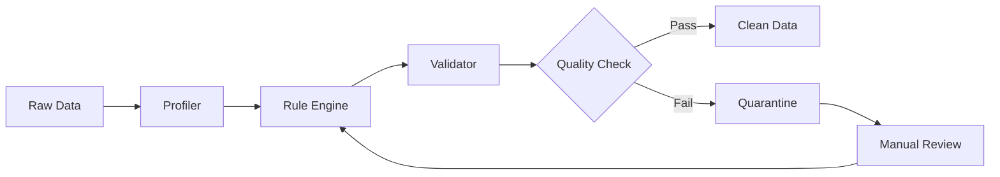

**Компоненты:** профилирование → правила → валидация → проверка → карантин.

**Паттерн Quarantine:** проблемные записи не блокируют весь поток.

---

## Масштабируемые решения

- **Партиционирование** — обработка по частям
- **Параллелизм** — многопоточная очистка
- **Распределённая обработка** — Spark, Dask
- **Инкрементальность** — только новые/изменённые данные
- **Кэширование** — повторное использование результатов

**Выбор зависит от:** объёма, латентности, бюджета, команды.

---

## Пример: Spark для очистки

```python
from pyspark.sql import functions as F

cleaned_df = (
    raw_df
    .withColumn('email', F.lower(F.trim('email')))
    .withColumn('age', F.when(F.col('age') < 0, None)
                        .otherwise(F.col('age')))
    .filter(F.col('email').rlike(r'^[\w\.-]+@[\w\.-]+\.\w+$'))
    .dropDuplicates(['user_id'])
)
```

**Преимущества:** распределённая обработка, ленивые вычисления.

<!-- → семинар: запуск на кластере -->

---

## Инкрементальная очистка

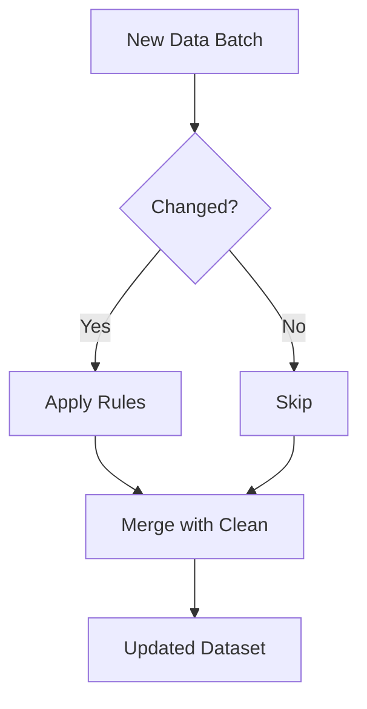

- Обработка только изменений
- Снижение вычислительных затрат
- Поддержка версионности

---

## Batch vs Streaming: теория выбора

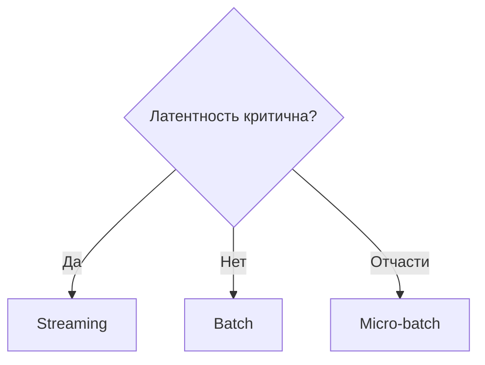

| Критерий | Batch | Streaming |
|---|---|---|
| Латентность | минуты–часы | мс–секунды |
| Полнота контекста | полная | окно |
| Сложность правил | высокая | ограничена |
| Стоимость | ниже | выше |

---

## Очистка в реальном времени

- **Kafka Streams** — трансформации в потоке
- **Flink** — сложная логика очистки
- **Spark Streaming** — микро-батчи
- **Правила валидации** — на лету
- **Dead Letter Queue** — для проблемных записей

**Ключевая идея:** отбраковка на входе, а не на выходе (shift-left).

---

## Вопрос для обсуждения

**Когда предпочесть пакетную очистку потоковой?**

Обсудите по осям:

- Объём данных
- Требования к латентности
- Сложность правил
- Доступные ресурсы

*Обсудите в парах 2 минуты*

---

## Резюме раздела 1

- Автоматизация критична для масштаба
- Декларативный подход упрощает поддержку
- Идемпотентность и детерминизм обязательны
- Выбор стратегии зависит от требований
- Real-time требует специальных инструментов

---

<!-- _class: lead -->

# Раздел 2
## Статистические методы выявления аномалий

<!-- ~22 мин -->

---

## Что такое аномалия? Разграничение понятий

| Термин                 | Определение                       | Задача      |
| ---------------------- | --------------------------------- | ----------- |
| **Выброс** (outlier)   | значение далеко от массы          | очистка     |
| **Новизна** (novelty)  | новый, не встречавшийся паттерн   | детекция    |
| **Аномалия** (anomaly) | отклонение, требующее реакции     | алерт       |
| **Дрейф** (drift)      | системное изменение распределения | мониторинг  |
| **Ошибка** (error)     | технический сбой сбора            | исправление |

> Это **разные задачи с разными методами** — не синонимы.

---

## Робастность: почему Z-Score ломается

**Breakdown point** — доля «испорченных» наблюдений, которую оценка выдерживает.

| Оценка | Breakdown point |
|---|---|
| Среднее $\mu$ | 0% |
| Стандартное отклонение $\sigma$ | 0% |
| Медиана $\tilde{x}$ | 50% |
| MAD | 50% |

```tikz
\documentclass[tikz]{standalone}
\usepackage{pgfplots}
\pgfplotsset{compat=1.18}
\begin{document}
\begin{tikzpicture}
\begin{axis}[
    width=11cm, height=6cm,
    xlabel={Величина выброса $x_{out}$},
    ylabel={Оценка центра},
    grid=major, legend pos=north west
]
\addplot[blue, thick] coordinates {(0,50)(1,50)(2,50)(3,53)(4,65)(5,90)};
\addplot[red, thick] coordinates {(0,50)(1,50)(2,50)(3,50)(4,50)(5,50)};
\legend{Среднее, Медиана}
\end{axis}
\end{tikzpicture}
\end{document}
```

**Вывод:** среднее «уезжает» от одного выброса, медиана — нет.


---

## Z-Score метод

$$z = \frac{x - \mu}{\sigma}$$

```python
from scipy import stats
import numpy as np

z_scores = np.abs(stats.zscore(data))
outliers = data[z_scores > 3]
```

- **Порог:** обычно $|z| > 3$
- **Предположение:** нормальное распределение
- **Ограничение:** чувствителен к выбросам в $\mu$ и $\sigma$

---

## Модифицированный Z-Score

$$M_i = \frac{0.6745(x_i - \tilde{x})}{MAD},\qquad MAD = \operatorname{median}(|x_i - \tilde{x}|)$$

```python
def modified_z_score(data):
    median = np.median(data)
    mad = np.median(np.abs(data - median))
    return 0.6745 * (data - median) / mad
```

**Преимущество:** устойчивость к выбросам (робастность 50%).

**Константа 0.6745** связывает MAD с σ для нормального распределения.

---

## Нормальное распределение и пороги

```tikz
\documentclass[tikz]{standalone}
\usepackage{pgfplots}
\pgfplotsset{compat=1.18}
\begin{document}
\begin{tikzpicture}
\begin{axis}[
    width=11cm, height=6cm,
    xlabel={$x$}, ylabel={Плотность},
    grid=major, samples=200
]
\addplot[blue, thick, domain=-4:4] {1/sqrt(2*pi)*exp(-x^2/2)};
\addplot[red!30, domain=-4:-3] {1/sqrt(2*pi)*exp(-x^2/2)} \closedcycle;
\addplot[red!30, domain=3:4] {1/sqrt(2*pi)*exp(-x^2/2)} \closedcycle;
\end{axis}
\end{tikzpicture}
\end{document}
```

**Интерпретация:** закрашенные хвосты за $\pm 3\sigma$ — зона аномалий.


---

## IQR метод

$$IQR = Q_3 - Q_1$$

**Границы выбросов:**
- Нижняя: $Q_1 - 1.5 \times IQR$
- Верхняя: $Q_3 + 1.5 \times IQR$

```python
Q1 = data.quantile(0.25)
Q3 = data.quantile(0.75)
IQR = Q3 - Q1
outliers = data[(data < Q1 - 1.5*IQR) | (data > Q3 + 1.5*IQR)]
```

**Робастный:** опирается на квантили, не на моменты.

---

## Box Plot

```tikz
\documentclass[tikz]{standalone}
\usepackage{pgfplots}
\pgfplotsset{compat=1.18}
\begin{document}
\begin{tikzpicture}
\begin{axis}[
    width=9cm, height=8cm,
    boxplot/draw direction=y,
    ylabel={Значения},
    xtick={1}, xticklabels={Данные}
]
\addplot+[boxplot prepared={
    lower whisker=10, lower quartile=20, median=30,
    upper quartile=40, upper whisker=50,
}] coordinates {};
\addplot[only marks, mark=*, red] coordinates {(1,5)(1,60)(1,65)};
\end{axis}
\end{tikzpicture}
\end{document}
```

**Красные точки:** выбросы за пределами усов ($\pm 1.5\,IQR$).


---

## Таксономия методов детекции

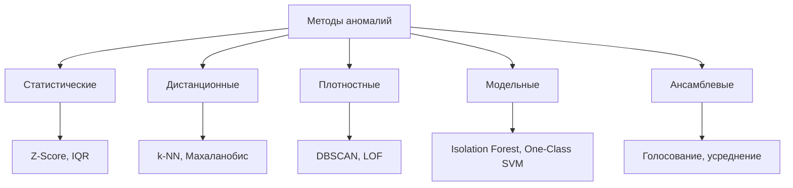

**Единая рамка:** помогает осознанно выбирать метод.

---

## Расстояние Махаланобиса

Обобщение Z-Score на многомерный случай (учитывает корреляции):

$$D_M(x) = \sqrt{(x-\mu)^T \Sigma^{-1} (x-\mu)}$$

```tikz
\documentclass[tikz]{standalone}
\usepackage{pgfplots}
\pgfplotsset{compat=1.18}
\begin{document}
\begin{tikzpicture}
\begin{axis}[
    width=8cm, height=8cm,
    xlabel={Признак 1}, ylabel={Признак 2},
    grid=major, axis equal
]
\addplot[blue, dashed, thick, domain=0:360, samples=100] ({3*cos(x)}, {1.5*sin(x)});
\addplot[only marks, mark=*, blue!60] coordinates {(0,0)(1,0.5)(-1,-0.5)(0.5,-0.8)(-0.3,0.9)};
\addplot[only marks, mark=*, red] coordinates {(4,2)};
\end{axis}
\end{tikzpicture}
\end{document}
```

**Эллипс** — линия равного расстояния; красная точка — аномалия.


---

## DBSCAN

**Density-Based Spatial Clustering of Applications with Noise**

```python
from sklearn.cluster import DBSCAN

clustering = DBSCAN(eps=0.5, min_samples=5)
labels = clustering.fit_predict(data)
outliers = data[labels == -1]
```

- **eps** — радиус окрестности
- **min_samples** — минимум точек для кластера
- **-1** — аномалия (не в кластере)

**Идея:** точки вне плотных областей — аномалии.

---

## DBSCAN: визуализация

```tikz
\documentclass[tikz]{standalone}
\usepackage{pgfplots}
\pgfplotsset{compat=1.18}
\begin{document}
\begin{tikzpicture}
\begin{axis}[
    width=9cm, height=9cm,
    xlabel={Признак 1}, ylabel={Признак 2},
    grid=major
]
\addplot[only marks, mark=*, blue] coordinates {(1,1)(1.5,1.2)(0.8,1.5)(1.2,0.9)(1.4,1.6)};
\addplot[only marks, mark=*, green!50!black] coordinates {(4,4)(4.5,3.8)(3.9,4.2)(4.3,4.5)(4.6,4.1)};
\addplot[only marks, mark=*, red] coordinates {(3,1.5)(1,4)};
\legend{Кластер 1, Кластер 2, Аномалии}
\end{axis}
\end{tikzpicture}
\end{document}
```

**Проклятие размерности:** плотность теряет смысл в высоких измерениях.


---

## Isolation Forest

- **Идея:** аномалии легче изолировать
- **Механизм:** случайные разбиения пространства
- **Метрика:** глубина изоляции (короткий путь → аномалия)
- **Преимущество:** эффективность на больших данных

```python
from sklearn.ensemble import IsolationForest

iso_forest = IsolationForest(contamination=0.1)
predictions = iso_forest.fit_predict(data)
outliers = data[predictions == -1]
```

> Аномалий **мало и они отдельные** → случайный разрез отделяет их быстрее.

---

## One-Class SVM

```python
from sklearn.svm import OneClassSVM

svm = OneClassSVM(nu=0.1, kernel='rbf', gamma='auto')
predictions = svm.fit_predict(data)
outliers = data[predictions == -1]
```

- **nu** — ожидаемая доля выбросов
- **kernel** — функция ядра (rbf, linear, poly)
- **Применение:** высокоразмерные данные

<!-- → семинар: сравнение с Isolation Forest -->

---

## Временные ряды: скользящие средние

$$MA_t = \frac{1}{n}\sum_{i=0}^{n-1}x_{t-i}$$

```python
window = 7
rolling_mean = data.rolling(window=window).mean()
rolling_std  = data.rolling(window=window).std()

upper = rolling_mean + 3 * rolling_std
lower = rolling_mean - 3 * rolling_std
outliers = data[(data > upper) | (data < lower)]
```

**ARIMA** — для тренда и сезонности (residuals как сигнал).

---

## Ансамблевые методы

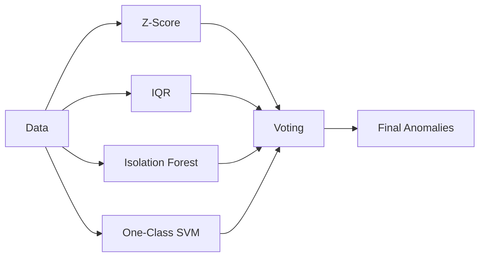

**Стратегии:** голосование, усреднение скоров, взвешивание.

> Комбинируем **аномальные скоры**, а не `VotingClassifier` (то для supervised).

---

## Оценка детекторов без разметки

- **Precision / Recall / ROC-AUC** — нужна разметка
- **Imbalance:** аномалий мало → accuracy бесполезна
- **Без ground truth:** экспертиза, бэк-тест, согласие методов

```tikz
\documentclass[tikz]{standalone}
\usepackage{pgfplots}
\pgfplotsset{compat=1.18}
\begin{document}
\begin{tikzpicture}
\begin{axis}[
    width=8cm, height=8cm,
    xlabel={False Positive Rate}, ylabel={True Positive Rate},
    xmin=0,xmax=1,ymin=0,ymax=1, grid=major, legend pos=south east
]
\addplot[blue, thick] coordinates {(0,0)(0.1,0.6)(0.3,0.85)(0.6,0.97)(1,1)};
\addplot[gray, dashed] coordinates {(0,0)(1,1)};
\legend{Детектор, Случайность}
\end{axis}
\end{tikzpicture}
\end{document}
```


---

## Дерево выбора метода

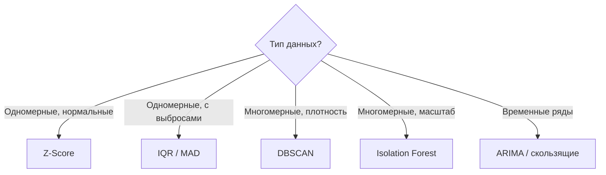

---

## Вопрос для обсуждения

**Какой метод выбрать для:**

- Одномерных данных с нормальным распределением?
- Многомерных данных без предположений?
- Временных рядов с сезонностью?
- Данных с неизвестной долей аномалий?

*Обсудите в группах 3 минуты*

---

## Резюме раздела 2

- Выбор метода зависит от типа данных
- Z-Score для нормальных распределений
- IQR/MAD — робастная альтернатива
- ML-методы для сложных паттернов
- Ансамбли повышают надёжность
- Оценка без разметки — отдельная задача

---

<!-- _class: lead -->

# Раздел 3
## Библиотеки для валидации данных

<!-- ~20 мин -->

---

## Зачем нужна валидация?

- Предотвращение ошибок в пайплайнах
- Раннее обнаружение проблем качества
- Документирование ожиданий от данных
- Автоматизация контроля качества
- Соответствие бизнес-требованиям

**Философия:** «тестирование для данных».

---

## Валидация vs верификация

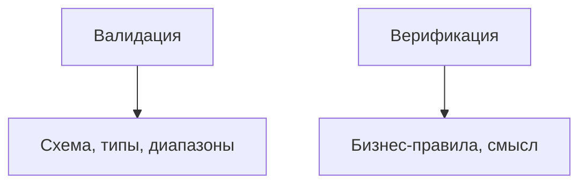

| | Валидация | Верификация |
|---|---|---|
| Вопрос | «данные корректны по форме?» | «данные верны по смыслу?» |
| Уровень | синтаксис | семантика |
| Автоматизация | полная | частичная |

---

## Уровни проверок

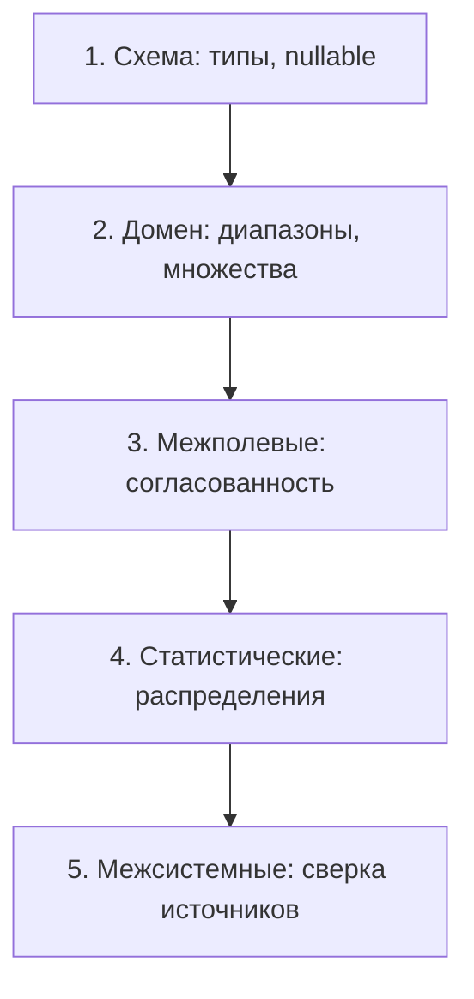

**Дешевле ловить на нижних уровнях** (shift-left).

---

## Data Contracts и schema evolution

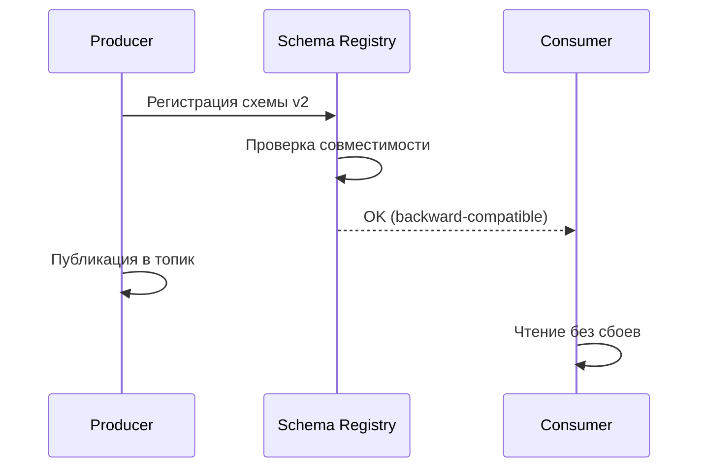

**Контракт** — соглашение о форме данных; **эволюция** — управляемое изменение схемы.

---

## Great Expectations: обзор

- Декларативные ожидания (expectations)
- Автоматическая генерация документации
- Интеграция с пайплайнами данных
- Профилирование и анализ
- Чекпоинты для валидации

**Философия:** «Тестирование для данных»

---

## Expectations: примеры

```python
import great_expectations as gx

validator.expect_column_values_to_not_be_null('user_id')
validator.expect_column_values_to_be_unique('email')
validator.expect_column_values_to_be_between('age', 0, 120)
validator.expect_column_values_to_match_regex(
    'phone', r'^\+?\d{10,15}$'
)
```

- Полнота, уникальность, диапазоны
- Форматы, паттерны, типы данных

<!-- Внимание: зафиксировать версию GX (1.x); примеры в едином стиле -->

---

## Great Expectations: архитектура

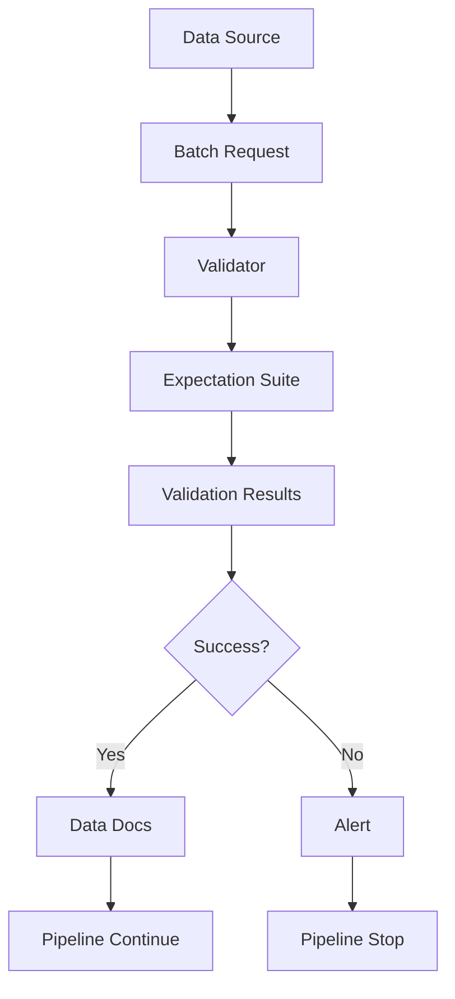

**Workflow:** источник → валидатор → ожидания → результаты.

---

## Checkpoint в GX

```python
checkpoint_config = {
    "name": "daily_data_check",
    "validations": [
        {"batch_request": batch_request,
         "expectation_suite_name": "user_data_suite"}
    ],
    "action_list": [
        {"name": "store_validation_result"},
        {"name": "update_data_docs"},
        {"name": "send_slack_notification"}
    ]
}
checkpoint = context.add_checkpoint(**checkpoint_config)
results = checkpoint.run()
```

<!-- → семинар: запуск на реальных данных -->

---

## Pandera: обзор

```python
import pandera as pa
from pandera import Column, Check

schema = pa.DataFrameSchema({
    'user_id': Column(int, Check.greater_than(0)),
    'email': Column(str, Check.str_matches(r'^[\w\.-]+@[\w\.-]+\.\w+$')),
    'age': Column(int, Check.in_range(0, 120)),
    'created_at': Column(pa.DateTime)
})

validated_df = schema.validate(df)
```

**Schema-based валидация** для Pandas/Spark.

---

## Pandera: статистические проверки

```python
schema = pa.DataFrameSchema({
    'revenue': Column(
        float,
        checks=[
            Check.greater_than(0),
            Check(lambda s: s.mean() > 100,
                  error="Средний доход слишком низкий"),
            Check(lambda s: s.std() < s.mean() * 0.5,
                  error="Слишком высокая дисперсия")
        ]
    )
})
```

- Пользовательские функции проверки
- Статистические метрики
- Бизнес-правила

---

## Pandera vs Great Expectations

| Критерий | Pandera | Great Expectations |
|----------|---------|-------------------|
| Подход | Schema-based | Expectation-based |
| Интеграция | Pandas/Spark | Многие источники |
| Документация | Код | Автогенерация |
| Кривая обучения | Низкая | Средняя |
| Гибкость | Средняя | Высокая |

**Правило:** Pandera — внутри Python-кода; GX — корпоративный контур.

---

## Pydantic для структурированных данных

```python
from pydantic import BaseModel, EmailStr, field_validator

class User(BaseModel):
    user_id: int
    email: EmailStr          # требует пакет email-validator
    age: int

    @field_validator('age')
    @classmethod
    def validate_age(cls, v):
        if not 0 <= v <= 120:
            raise ValueError('Недопустимый возраст')
        return v

user = User(**user_data)     # автоматическая валидация
```

<!-- Обновлено под Pydantic v2: field_validator вместо устаревшего validator -->

---

## Cerberus и Deequ

**Cerberus** — валидация словарей/JSON:

```python
schema = {'age': {'type': 'integer', 'min': 0, 'max': 120}}
v = Validator(schema)
if not v.validate(document):
    print(v.errors)
```

**Deequ** — валидация на Spark (миллиарды записей):

```python
check = Check(spark, CheckLevel.Error, "Data Quality") \
    .isComplete("user_id").isUnique("email") \
    .isContainedIn("status", ["active", "inactive"])
```

<!-- → семинар: оба инструмента -->

---

## Интеграция с ETL пайплайнами

```python
from great_expectations_provider.operators.great_expectations import \
    GreatExpectationsOperator

validate_task = GreatExpectationsOperator(
    task_id='validate_data',
    data_context_root_dir='/path/to/gx',
    checkpoint_name='daily_checkpoint',
    fail_task_on_validation_failure=True
)

extract >> transform >> validate_task >> load
```

**Валидация — отдельный этап пайплайна**, а не послесловие.

---

## Стратегия валидации

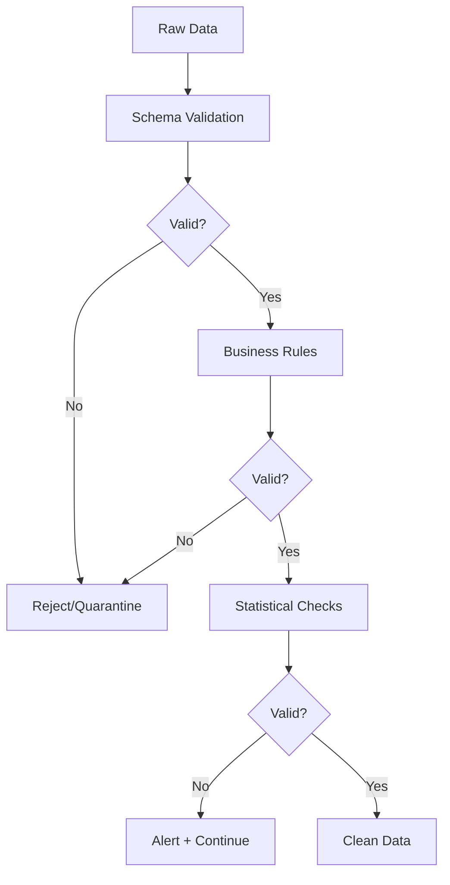

**Уровни:** схема → бизнес-правила → статистика.

---

## Вопрос для обсуждения

**Когда использовать:**

- Great Expectations vs Pandera?
- Pydantic vs Cerberus?
- Deequ vs другие инструменты?

**Критерии:** размер данных, сложность правил, интеграция с инфраструктурой.

*Обсудите 3 минуты*

---

## Резюме раздела 3

- Валидация — критичная часть пайплайна
- Валидация (форма) ≠ верификация (смысл)
- Great Expectations — комплексное решение
- Pandera — простота для Pandas/Spark
- Pydantic — для структурированных моделей
- Deequ — масштабируемость на Spark

---

<!-- _class: lead -->

# Раздел 4
## Профилирование данных

<!-- ~18 мин -->

---

## Что такое профилирование?

- **Анализ структуры** — типы, схема, связи
- **Статистики** — распределения, выбросы, корреляции
- **Качество** — полнота, уникальность, консистентность
- **Паттерны** — тренды, аномалии, дубликаты
- **Метаданные** — происхождение, линейность, версии

**Профилирование = понимание данных до обработки.**

---

## Метрики качества данных

- **Completeness** — $\dfrac{\text{Non-null}}{\text{Total}}$
- **Uniqueness** — $\dfrac{\text{Unique}}{\text{Total}}$
- **Validity** — $\dfrac{\text{Valid}}{\text{Total}}$
- **Consistency** — согласованность между источниками
- **Timeliness** — актуальность данных

> **Accuracy** часто недоступна: требует эталонной истины.

---

## Pandas Profiling

```python
from ydata_profiling import ProfileReport

profile = ProfileReport(df, title="User Data Profile")
profile.to_file("report.html")
```

**Генерирует:** обзор, статистики по колонкам, корреляции, предупреждения.

<!-- → семинар: интерпретация отчёта -->

---

## Структура отчёта профиля

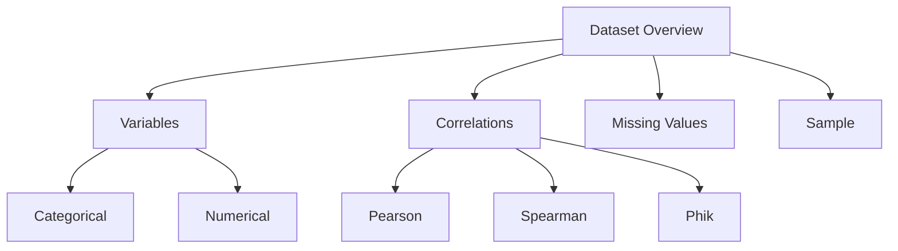

**Разделы:** обзор → переменные → корреляции → пропуски.

---

## Sweetviz: сравнительный анализ

```python
import sweetviz as sv

report = sv.compare(
    [train_df, "Training Data"],
    [test_df, "Test Data"],
    target_feat='target'
)
report.show_html("comparison.html")
```

- Визуальное сравнение распределений
- Анализ целевой переменной
- Ассоциации признаков

<!-- → семинар: сравнение train/test -->

---

## Профилирование больших данных

- **Сэмплирование** — анализ репрезентативной выборки
- **Партиционирование** — профилирование по частям
- **Распределённые вычисления** — Spark, Dask
- **Инкрементальное обновление** — только изменения
- **Кэширование** — переиспользование результатов

---

## Spark для профилирования

```python
from pyspark.sql import functions as F

df.describe().show()

profile = df.select([
    F.count(F.when(F.col(c).isNull(), c)).alias(f'{c}_nulls'),
    F.countDistinct(c).alias(f'{c}_unique'),
    F.min(c).alias(f'{c}_min'),
    F.max(c).alias(f'{c}_max')
    for c in df.columns
])
```

**Масштаб:** терабайты данных.

<!-- → семинар: распределённое профилирование -->

---

## Дашборд качества

```tikz
\documentclass[tikz]{standalone}
\usepackage{pgfplots}
\pgfplotsset{compat=1.18}
\begin{document}
\begin{tikzpicture}
\begin{axis}[
    ybar, width=11cm, height=6cm,
    ylabel={Процент},
    symbolic x coords={Completeness, Uniqueness, Validity, Consistency},
    xtick=data, nodes near coords, ymin=0, ymax=100
]
\addplot coordinates {
    (Completeness,95) (Uniqueness,88) (Validity,92) (Consistency,78)
};
\end{axis}
\end{tikzpicture}
\end{document}
```


---

## Дрейф данных: формально

| Тип | Формулировка | Действие |
|---|---|---|
| **Data drift** | меняется $P(X)$ | переобучение, мониторинг |
| **Concept drift** | меняется $P(Y|X)$ | пересмотр модели |

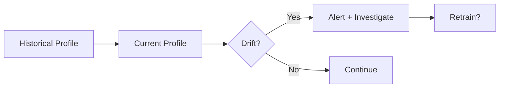

---

## Статистические тесты дрейфа

```tikz
\documentclass[tikz]{standalone}
\usepackage{pgfplots}
\pgfplotsset{compat=1.18}
\begin{document}
\begin{tikzpicture}
\begin{axis}[
    width=11cm, height=6cm,
    xlabel={$x$}, ylabel={Плотность},
    grid=major, legend pos=north west
]
\addplot[blue, thick, domain=0:10, samples=100] {1/sqrt(2*pi)*exp(-(x-4)^2/2)};
\addplot[red, thick, domain=0:10, samples=100] {1/sqrt(2*pi)*exp(-(x-7)^2/2)};
\legend{Исторически, Сейчас}
\end{axis}
\end{tikzpicture}
\end{document}
```

- **Kolmogorov–Smirnov** — тест на сдвиг распределения
- **PSI** (Population Stability Index) — сравнение бинов
- **Chi-square / Jensen–Shannon** — дискретные признаки


---

## Data Observability: 5 столпов

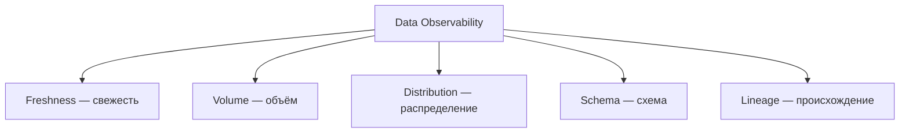

**Идея:** отслеживать здоровье данных, как здоровье систем.

---

## Data Lineage

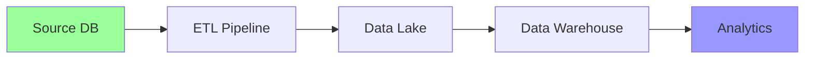

**Инструменты:** Apache Atlas, Marquez, DataHub

- Откуда данные?
- Какие трансформации?
- Кто использует?

---

## Жизненный цикл качества данных

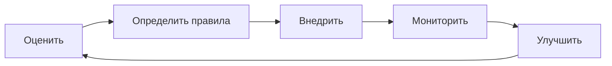

**Качество данных — процесс, а не разовая акция.**

---

## Вопрос для обсуждения

**Как использовать профилирование для:**

- Обнаружения проблем качества?
- Мониторинга дрейфа данных?
- Документирования датасетов?
- Оптимизации пайплайнов?

*Обсудите практические сценарии 3 минуты*

---

## Резюме раздела 4

- Профилирование — основа понимания данных
- Метрики качества формализуют «хорошие данные»
- Дрейф (data vs concept) требует разных действий
- Observability = постоянный мониторинг здоровья
- Lineage даёт доверие и root-cause анализ

---

<!-- _class: lead -->

# Практический кейс
## E-commerce платформа

<!-- ~10 мин, сквозной синтез -->

---

## Кейс: постановка

- **10 млн транзакций** ежедневно
- **5 источников** данных
- Проблемы: дубликаты, пропуски, выбросы
- Требование: автоматизированная очистка

**Задача:** построить систему очистки и валидации end-to-end.

---

## Этапы решения

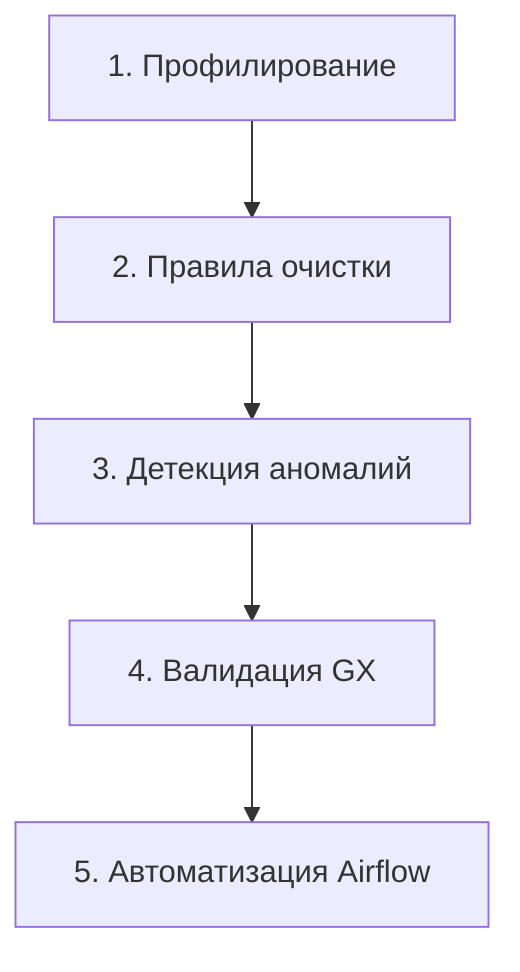

**Находки профилирования:** 15% дубликатов, 8% пропусков в amount.

<!-- → семинар: код каждого этапа -->

---

## Этап 2: правила очистки

```python
cleaning_rules = {
    'transaction_id': [remove_duplicates],
    'user_id':       [fill_forward, validate_exists_in_users],
    'amount':        [remove_negatives, clip(0, 10000),
                      fill_median_by_category],
    'timestamp':     [parse_datetime, validate_not_future],
    'category':      [lowercase, map_to_standard_categories]
}
```

**Ключ:** декларативность — правила читаемы и версионируемы.

---

## Этап 5: автоматизация Airflow

```python
with DAG('transaction_cleaning', schedule_interval='@daily') as dag:
    extract  = PythonOperator(task_id='extract', ...)
    profile  = PythonOperator(task_id='profile', ...)
    clean    = PythonOperator(task_id='clean', ...)
    detect   = PythonOperator(task_id='detect_anomalies', ...)
    validate = GreatExpectationsOperator(task_id='validate', ...)
    load     = PythonOperator(task_id='load', ...)

    extract >> profile >> clean >> detect >> validate >> load
```

---

## Результаты кейса

| Метрика | До | После | Улучшение |
|---------|-----|-------|-----------|
| Дубликаты | 15% | 0% | 100% |
| Пропуски | 8% | 0.5% | 94% |
| Аномалии | не обн. | 2% выявлено | — |
| Время обработки | 4 ч | 45 мин | 81% |
| Качество данных | 72% | 98% | 36% |

**ROI:** экономия 20 часов/неделю аналитиков.

---

## Архитектура решения

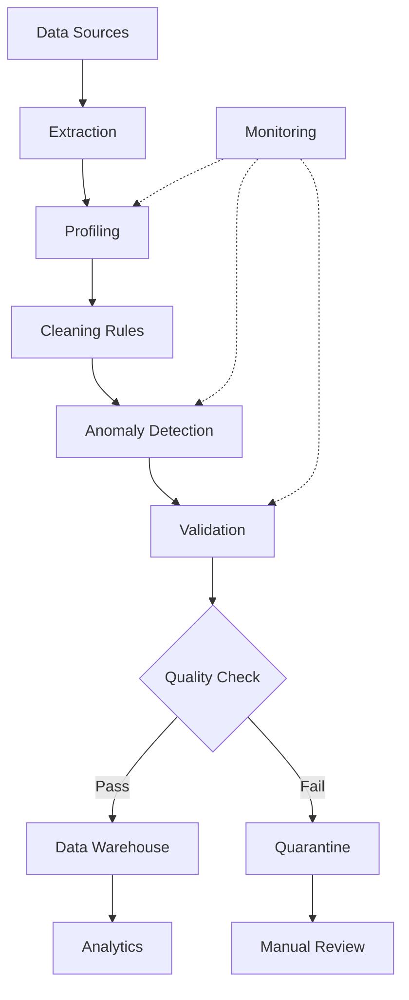

---

<!-- _class: lead -->

# Итоги и связь с курсом

<!-- ~7 мин -->

---

## Связь с другими лекциями

**Лекция 1 (Архитектура):** микросервисы очистки, контейнеризация валидации.

**Лекция 2 (Сбор данных):** валидация при сборе из API, очистка потоков.

**Лекция 4 (Трансформация):** чистые данные → качественные признаки.

**Лекция 6 (ETL):** интеграция валидации в Airflow, мониторинг качества.

---

## Итоговое резюме

- **Автоматизация** очистки критична для масштаба
- **Статистические методы** — для аномалий (выбор по типу данных)
- **Библиотеки валидации** — формальный контроль качества
- **Профилирование** — основа понимания и мониторинга
- **Интеграция** в пайплайны обязательна

> **Качество данных = качество решений**

---

## Ключевые вопросы лекции

1. В чём разница между пакетной и потоковой очисткой?
2. Когда использовать Z-Score vs IQR?
3. Валидация vs верификация: в чём разница?
4. Как обнаружить дрейф данных?
5. Зачем нужна линейность (lineage) данных?

---

## Домашнее задание

**Обязательные:**
1. Автоматизация очистки (декларативные правила, пропуски, дубликаты)
2. Валидация с Great Expectations (suite ≥15 ожиданий + checkpoint)

**По выбору:**
3. Обнаружение аномалий (3 метода + ансамбль)
4. Профилирование и мониторинг дрейфа

**Бонус:** PySpark, ML-imputation, real-time Kafka (+10–20 баллов)

<!-- Детали критериев — в исходном файле Лекции 3 и на портале -->

---

## Следующая лекция

**Лекция 4: Сложная предобработка и трансформация**

- Feature engineering для ML
- Работа с временными рядами
- Обработка текстовых данных (NLP)
- Работа с изображениями

**Подготовка:** повторите основы ML и статистики.

---

<!-- _class: lead -->

# Спасибо за внимание!

**Материалы:** код-листинги → файл `Практикум_Лекция3.md`
**Вопросы:** Slack #data-engineering-course
**Office Hours:** Вторник, 16:00–18:00
