<style>
@import url('https://fonts.googleapis.com/css2?family=Inter:wght@400;600;700;800&display=swap');

:root {
  --primary: #1d4ed8;
  --primary-dark: #1e3a8a;
  --accent: #0ea5e9;
  --ink: #0f172a;
  --muted: #64748b;
  --bg: #ffffff;
  --soft: #f1f5f9;
  --teal: #0d9488;
  --amber: #d97706;
  --rose: #e11d48;
}

section {
  font-family: 'Inter', 'Noto Sans', 'Segoe UI', system-ui, sans-serif;
  color: var(--ink);
  background: var(--bg);
  font-size: 27px;
  line-height: 1.35;
  padding: 72px 68px 40px;
}

h1 { font-size: 1.5em; color: var(--primary); margin: 0 0 .35em; font-weight: 800; letter-spacing: -.01em; }
h2 { font-size: 1.18em; color: var(--ink); margin: 0 0 .55em; font-weight: 700; }
h3 { font-size: .82em; color: var(--muted); margin: 0 0 .3em; font-weight: 600; text-transform: uppercase; letter-spacing: .04em; }

ul, ol { margin: 0 0 .55em; padding-left: 1.25em; }
li { margin: .16em 0; }
li strong, li b { color: var(--primary-dark); }
p { margin: 0 0 .5em; }

a { color: var(--primary); }

table { width: 100%; border-collapse: collapse; font-size: .74em; }
th { background: var(--primary); color: #fff; padding: 9px 14px; text-align: left; font-weight: 600; }
td { padding: 8px 14px; border-bottom: 1px solid #e2e8f0; vertical-align: top; }
tr:nth-child(even) td { background: #f8fafc; }

img { display: block; margin: .25em auto; max-width: 100%; max-height: 370px; }

code { background: var(--soft); border-radius: 4px; padding: 1px 6px; font-size: .82em; font-family: 'JetBrains Mono', ui-monospace, monospace; }
pre { background: #0f172a; color: #e2e8f0; border-radius: 10px; padding: 16px 22px; font-size: .62em; line-height: 1.5; }
pre code { background: transparent; color: inherit; padding: 0; }

/* подсветка кода: тёмная палитра под фон pre */
.hljs-comment, .hljs-quote { color: #94a3b8; font-style: italic; }
.hljs-keyword, .hljs-selector-tag, .hljs-built_in, .hljs-type { color: #93c5fd; }
.hljs-string, .hljs-attr, .hljs-regexp { color: #86efac; }
.hljs-number, .hljs-literal, .hljs-symbol { color: #fbbf24; }
.hljs-title, .hljs-section, .hljs-name { color: #f0abfc; }
.hljs-variable, .hljs-template-variable { color: #fca5a5; }
.hljs-meta { color: #cbd5e1; }

.columns { display: grid; grid-template-columns: 1fr 1fr; gap: 48px; align-items: start; }
.cols3 { display: grid; grid-template-columns: 1fr 1fr 1fr; gap: 30px; align-items: start; }

section.section {
  background: linear-gradient(135deg, #0f172a 0%, #1e3a8a 55%, #1d4ed8 100%);
  color: #fff; justify-content: center; text-align: center;
}
section.section h1 { color: #fff; font-size: 2.1em; border: none; }
section.section h2 { color: rgba(255,255,255,.85); font-weight: 400; font-size: 1.1em; }
section.section::after { content: ''; }

section.title {
  background: linear-gradient(135deg, #0f172a 0%, #1e3a8a 55%, #1d4ed8 100%);
  color: #fff; justify-content: center; text-align: center;
}
section.title h1 { color: #fff; font-size: 2.5em; border: none; }
section.title h2 { color: rgba(255,255,255,.9); font-weight: 400; }
section.title p { color: rgba(255,255,255,.8); }
section.title ul, section.title ol, section.section ul, section.section ol { display: inline-block; text-align: left; }
section.title code, section.section code { background: rgba(255,255,255,.16); color: #fff; }

section.title .meta { margin-top: 1.4em; font-size: .8em; color: rgba(255,255,255,.7); letter-spacing: .06em; text-transform: uppercase; }

.callout { display: block; border-left: 5px solid var(--accent); background: #eff6ff; border-radius: 6px; padding: 14px 20px; margin: .5em 0; }
.callout.warn { border-left-color: var(--amber); background: #fffbeb; }
.callout.good { border-left-color: var(--teal); background: #ecfdf5; }
.callout.bad { border-left-color: var(--rose); background: #fef2f2; }

.muted { color: var(--muted); font-size: .8em; }
.small { font-size: .8em; }
.badge { display: inline-block; background: var(--soft); border-radius: 999px; padding: 4px 14px; margin: 3px; font-size: .74em; font-weight: 600; color: var(--primary-dark); }
</style>

<!--
ОБЩИЕ ЗАМЕТКИ К ПРЕЗЕНТАЦИИ
- Хронометраж: ~105 минут
- Баланс: теория ↔ код. Код-слайды помечены «→ семинар», полные листинги — в файле Практикум_Лекция3.md
- Схемы вставлены картинками: Mermaid → SVG, TikZ → PNG (папка Лекция3_figs/).
  Исходники всех диаграмм — в файле «Лекция 3 — источники диаграмм.md»
- Математика рендерится KaTeX (math: katex)
-->

<!-- _class: title -->

# Лекция 3
## Продвинутая очистка и валидация данных

<div class="meta">Инженерия данных · Магистратура ИТМО · Осень 2025</div>

---

<!-- _class: section -->

# План лекции

## 4 раздела + кейс · 105 минут

---

## План лекции

### Структура занятия

1. **Автоматизация процессов очистки** — 25 мин
2. **Статистические методы выявления аномалий** — 25 мин
3. **Библиотеки для валидации данных** — 20 мин
4. **Профилирование данных** — 18 мин
5. **Сквозной практический кейс** — 10 мин

<br/>

<div class="callout good">
<b>Формат:</b> теория + код; каждый раздел заканчивается <b>резюме</b> и <b>вопросами для самопроверки</b>.
Полные листинги разбираются на семинаре.
</div>

---

## Цели лекции

### После лекции вы сможете

- **Обосновать**, почему автоматизация очистки критична для масштаба
- **Выбрать** метод детектирования аномалий под тип данных
- **Различать** валидацию и верификацию, уровни проверок
- **Формулировать** метрики качества и тесты дрейфа данных
- **Спроектировать** пайплайн очистки + валидации end-to-end

---

## Зачем всё это: стоимость плохих данных

<!-- 6 мин — мотивация, акцент на кривой 1-10-100 -->

Ошибка дешевле всего исправляется **в точке возникновения**.

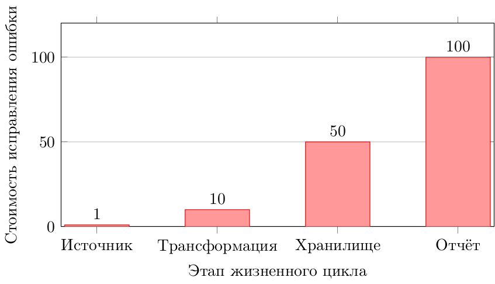

<span class="callout warn"><b>Правило 1-10-100:</b> стоимость исправления растёт на порядок с каждым этапом жизненного цикла.</span>


---

<!-- _class: section -->

# Раздел 1
## Автоматизация процессов очистки

<!-- ~20 мин -->

---

## Проблемы ручной очистки

- **Масштабируемость** — миллионы записей ежедневно
- **Консистентность** — разные подходы разработчиков
- **Повторяемость** — невозможность воспроизведения
- **Скорость** — часы работы вместо минут
- **Ошибки** — человеческий фактор

<span class="callout good">Ключевое: ручная очистка **не детерминирована** и **не воспроизводима**.</span>

---

## Таксономия «грязных» данных


**Ценность таксономии:** единый язык для описания проблем и выбора правил.

---

## Паттерны автоматической очистки

- **Rule-based** — предопределённые правила трансформации
- **ML-based** — обучение на исторических данных
- **Hybrid** — комбинация правил и моделей
- **Declarative** — декларативное описание требований
- **Streaming** — очистка в реальном времени

**Теоретическая ось:** императивный (`как`) ↔ декларативный (`что`).

---

## Императивный vs декларативный


|                   | Императивный   | Декларативный         |
| ----------------- | -------------- | --------------------- |
| Описывает         | **как** делать | **что** нужно         |
| Читаемость        | ниже           | выше                  |
| Переиспользование | слабое         | сильное               |
| Версионирование   | код            | конфигурация (данные) |

---

## Декларативный подход: пример

```python
# Декларативное описание очистки
cleaning_rules = {
    'email': [lowercase, trim, validate_email],
    'phone': [normalize_phone, validate_format],
    'age':   [to_int, clip(0, 120), fill_median],
    'name':  [trim, title_case, remove_special]
}
```

- Читаемость и поддерживаемость
- Переиспользование правил
- Версионирование конфигураций

**Идея:** правила — это **данные**, их можно хранить, тестировать и версионировать.

<!-- → семинар: реализация движка правил -->

---

## Идемпотентность и детерминизм

Требования к любой автоматической очистке:

- **Детерминизм** — одни данные → один результат
- **Идемпотентность** — повторный прогон не меняет результат
- **Чистота функции** — правило не зависит от внешнего состояния

```python
clean(clean(x)) == clean(x)   # идемпотентность
```

<span class="callout">Без этого очистку невозможно ни тестировать, ни откатывать.</span>

---

## Архитектура системы очистки


**Компоненты:** профилирование → правила → валидация → проверка → карантин.

**Паттерн Quarantine:** проблемные записи не блокируют весь поток.

---

## Масштабируемые решения

- **Партиционирование** — обработка по частям
- **Параллелизм** — многопоточная очистка
- **Распределённая обработка** — Spark, Dask
- **Инкрементальность** — только новые/изменённые данные
- **Кэширование** — повторное использование результатов

**Выбор зависит от:** объёма, латентности, бюджета, команды.

---

## Пример: Spark для очистки

```python
from pyspark.sql import functions as F

cleaned_df = (
    raw_df
    .withColumn('email', F.lower(F.trim('email')))
    .withColumn('age', F.when(F.col('age') < 0, None)
                        .otherwise(F.col('age')))
    .filter(F.col('email').rlike(r'^[\w\.-]+@[\w\.-]+\.\w+$'))
    .dropDuplicates(['user_id'])
)
```

**Преимущества:** распределённая обработка, ленивые вычисления.

<!-- → семинар: запуск на кластере -->

---

## Инкрементальная очистка


- Обработка только изменений
- Снижение вычислительных затрат
- Поддержка версионности

---

## Batch vs Streaming: теория выбора


| Критерий | Batch | Streaming |
|---|---|---|
| Латентность | минуты–часы | мс–секунды |
| Полнота контекста | полная | окно |
| Сложность правил | высокая | ограничена |
| Стоимость | ниже | выше |

---

## Очистка в реальном времени

- **Kafka Streams** — трансформации в потоке
- **Flink** — сложная логика очистки
- **Spark Streaming** — микро-батчи
- **Правила валидации** — на лету
- **Dead Letter Queue** — для проблемных записей

**Ключевая идея:** отбраковка на входе, а не на выходе (shift-left).

---

## Вопрос для обсуждения

**Когда предпочесть пакетную очистку потоковой?**

Обсудите по осям:

- Объём данных
- Требования к латентности
- Сложность правил
- Доступные ресурсы

*Обсудите в парах 2 минуты*

---

## Резюме раздела 1

- Автоматизация критична для масштаба
- Декларативный подход упрощает поддержку
- Идемпотентность и детерминизм обязательны
- Выбор стратегии зависит от требований
- Real-time требует специальных инструментов

---

<!-- _class: section -->

# Раздел 2
## Статистические методы выявления аномалий

<!-- ~22 мин -->

---

## Что такое аномалия? Разграничение понятий

| Термин                 | Определение                       | Задача      |
| ---------------------- | --------------------------------- | ----------- |
| **Выброс** (outlier)   | значение далеко от массы          | очистка     |
| **Новизна** (novelty)  | новый, не встречавшийся паттерн   | детекция    |
| **Аномалия** (anomaly) | отклонение, требующее реакции     | алерт       |
| **Дрейф** (drift)      | системное изменение распределения | мониторинг  |
| **Ошибка** (error)     | технический сбой сбора            | исправление |

<span class="callout">Это **разные задачи с разными методами** — не синонимы.</span>

---

## Робастность: почему Z-Score ломается

### Breakdown point — доля «испорченных» наблюдений, которую оценка выдерживает

| Оценка | Breakdown point |
|---|---|
| Среднее $\mu$ | 0% |
| Стандартное отклонение $\sigma$ | 0% |
| Медиана $\tilde{x}$ | 50% |
| MAD | 50% |

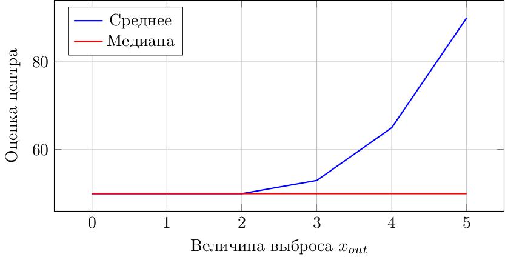

**Вывод:** среднее «уезжает» от одного выброса, медиана — нет.


---

## Z-Score метод

$$z = \frac{x - \mu}{\sigma}$$

```python
from scipy import stats
import numpy as np

z_scores = np.abs(stats.zscore(data))
outliers = data[z_scores > 3]
```

- **Порог:** обычно $|z| > 3$
- **Предположение:** нормальное распределение
- **Ограничение:** чувствителен к выбросам в $\mu$ и $\sigma$

---

## Модифицированный Z-Score

$$M_i = \frac{0.6745(x_i - \tilde{x})}{MAD},\qquad MAD = \operatorname{median}(|x_i - \tilde{x}|)$$

```python
def modified_z_score(data):
    median = np.median(data)
    mad = np.median(np.abs(data - median))
    return 0.6745 * (data - median) / mad
```

**Преимущество:** устойчивость к выбросам (робастность 50%).

**Константа 0.6745** связывает MAD с σ для нормального распределения.

---

## Нормальное распределение и пороги

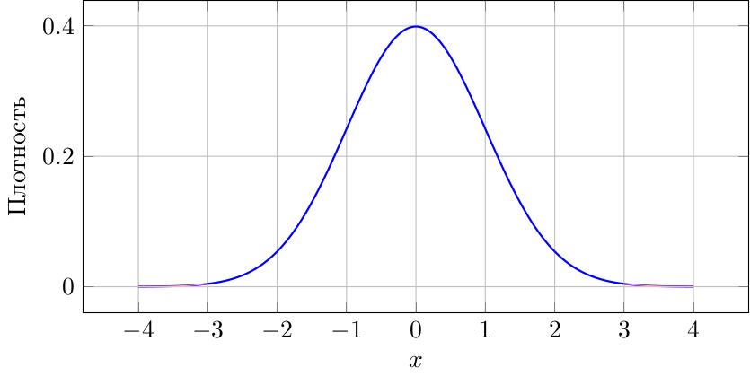

**Интерпретация:** закрашенные хвосты за $\pm 3\sigma$ — зона аномалий.


---

## IQR метод

$$IQR = Q_3 - Q_1$$

**Границы выбросов:**
- Нижняя: $Q_1 - 1.5 \times IQR$
- Верхняя: $Q_3 + 1.5 \times IQR$

```python
Q1 = data.quantile(0.25)
Q3 = data.quantile(0.75)
IQR = Q3 - Q1
outliers = data[(data < Q1 - 1.5*IQR) | (data > Q3 + 1.5*IQR)]
```

**Робастный:** опирается на квантили, не на моменты.

---

## Box Plot

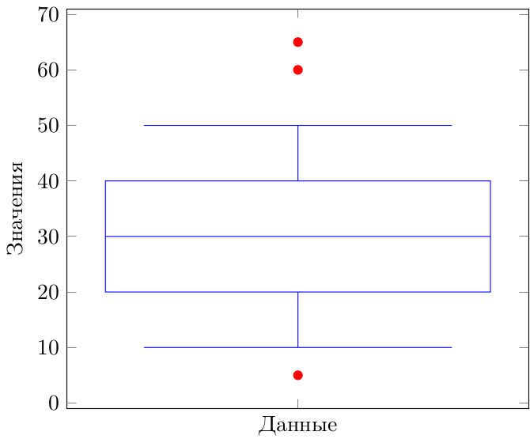

**Красные точки:** выбросы за пределами усов ($\pm 1.5\,IQR$).


---

## Таксономия методов детекции


**Единая рамка:** помогает осознанно выбирать метод.

---

## Расстояние Махаланобиса

Обобщение Z-Score на многомерный случай (учитывает корреляции):

$$D_M(x) = \sqrt{(x-\mu)^T \Sigma^{-1} (x-\mu)}$$

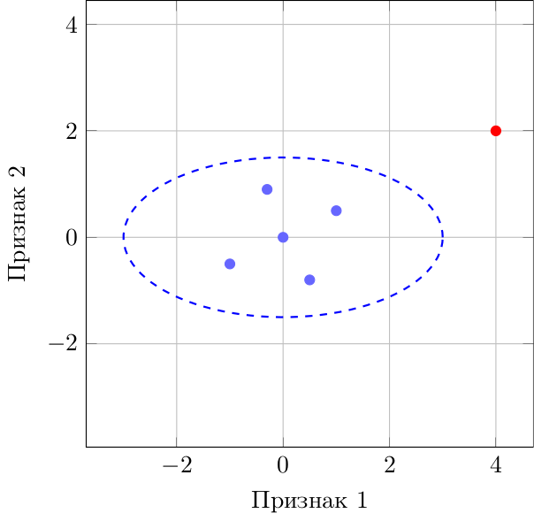

**Эллипс** — линия равного расстояния; красная точка — аномалия.


---

## DBSCAN

**Density-Based Spatial Clustering of Applications with Noise**

```python
from sklearn.cluster import DBSCAN

clustering = DBSCAN(eps=0.5, min_samples=5)
labels = clustering.fit_predict(data)
outliers = data[labels == -1]
```

- **eps** — радиус окрестности
- **min_samples** — минимум точек для кластера
- **-1** — аномалия (не в кластере)

**Идея:** точки вне плотных областей — аномалии.

---

## DBSCAN: визуализация

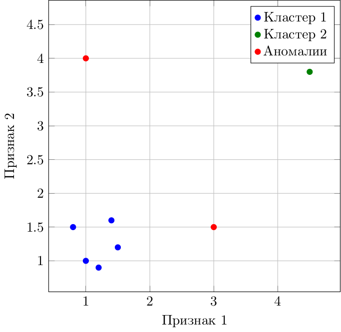

**Проклятие размерности:** плотность теряет смысл в высоких измерениях.


---

## Isolation Forest

- **Идея:** аномалии легче изолировать
- **Механизм:** случайные разбиения пространства
- **Метрика:** глубина изоляции (короткий путь → аномалия)
- **Преимущество:** эффективность на больших данных

```python
from sklearn.ensemble import IsolationForest

iso_forest = IsolationForest(contamination=0.1)
predictions = iso_forest.fit_predict(data)
outliers = data[predictions == -1]
```

<span class="callout">Аномалий **мало и они отдельные** → случайный разрез отделяет их быстрее.</span>

---

## One-Class SVM

```python
from sklearn.svm import OneClassSVM

svm = OneClassSVM(nu=0.1, kernel='rbf', gamma='auto')
predictions = svm.fit_predict(data)
outliers = data[predictions == -1]
```

- **nu** — ожидаемая доля выбросов
- **kernel** — функция ядра (rbf, linear, poly)
- **Применение:** высокоразмерные данные

<!-- → семинар: сравнение с Isolation Forest -->

---

## Временные ряды: скользящие средние

$$MA_t = \frac{1}{n}\sum_{i=0}^{n-1}x_{t-i}$$

```python
window = 7
rolling_mean = data.rolling(window=window).mean()
rolling_std  = data.rolling(window=window).std()

upper = rolling_mean + 3 * rolling_std
lower = rolling_mean - 3 * rolling_std
outliers = data[(data > upper) | (data < lower)]
```

**ARIMA** — для тренда и сезонности (residuals как сигнал).

---

## Ансамблевые методы


**Стратегии:** голосование, усреднение скоров, взвешивание.

<span class="callout">Комбинируем **аномальные скоры**, а не `VotingClassifier` (то для supervised).</span>

---

## Оценка детекторов без разметки

- **Precision / Recall / ROC-AUC** — нужна разметка
- **Imbalance:** аномалий мало → accuracy бесполезна
- **Без ground truth:** экспертиза, бэк-тест, согласие методов

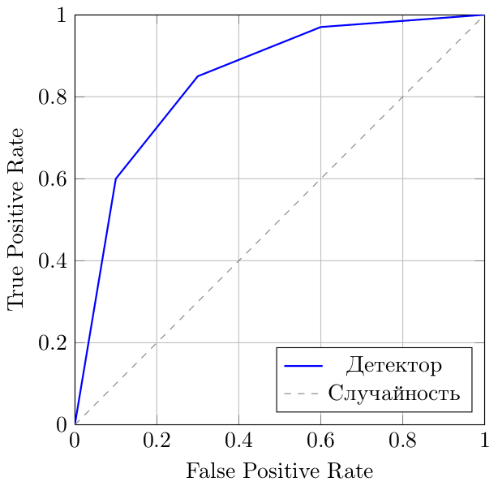


---

## Дерево выбора метода


---

## Вопрос для обсуждения

**Какой метод выбрать для:**

- Одномерных данных с нормальным распределением?
- Многомерных данных без предположений?
- Временных рядов с сезонностью?
- Данных с неизвестной долей аномалий?

*Обсудите в группах 3 минуты*

---

## Резюме раздела 2

- Выбор метода зависит от типа данных
- Z-Score для нормальных распределений
- IQR/MAD — робастная альтернатива
- ML-методы для сложных паттернов
- Ансамбли повышают надёжность
- Оценка без разметки — отдельная задача

---

<!-- _class: section -->

# Раздел 3
## Библиотеки для валидации данных

<!-- ~20 мин -->

---

## Зачем нужна валидация?

- Предотвращение ошибок в пайплайнах
- Раннее обнаружение проблем качества
- Документирование ожиданий от данных
- Автоматизация контроля качества
- Соответствие бизнес-требованиям

**Философия:** «тестирование для данных».

---

## Валидация vs верификация


| | Валидация | Верификация |
|---|---|---|
| Вопрос | «данные корректны по форме?» | «данные верны по смыслу?» |
| Уровень | синтаксис | семантика |
| Автоматизация | полная | частичная |

---

## Уровни проверок


**Дешевле ловить на нижних уровнях** (shift-left).

---

## Data Contracts и schema evolution

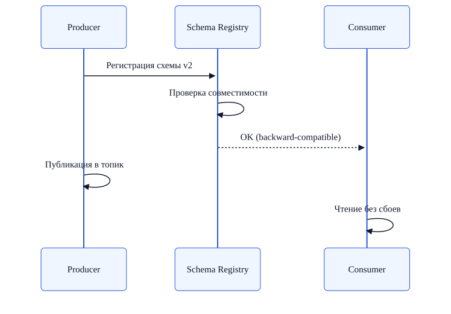

**Контракт** — соглашение о форме данных; **эволюция** — управляемое изменение схемы.

---

## Great Expectations: обзор

- Декларативные ожидания (expectations)
- Автоматическая генерация документации
- Интеграция с пайплайнами данных
- Профилирование и анализ
- Чекпоинты для валидации

**Философия:** «Тестирование для данных»

---

## Expectations: примеры

```python
import great_expectations as gx

validator.expect_column_values_to_not_be_null('user_id')
validator.expect_column_values_to_be_unique('email')
validator.expect_column_values_to_be_between('age', 0, 120)
validator.expect_column_values_to_match_regex(
    'phone', r'^\+?\d{10,15}$'
)
```

- Полнота, уникальность, диапазоны
- Форматы, паттерны, типы данных

<!-- Внимание: зафиксировать версию GX (1.x); примеры в едином стиле -->

---

## Great Expectations: архитектура


**Workflow:** источник → валидатор → ожидания → результаты.

---

## Checkpoint в GX

```python
checkpoint_config = {
    "name": "daily_data_check",
    "validations": [
        {"batch_request": batch_request,
         "expectation_suite_name": "user_data_suite"}
    ],
    "action_list": [
        {"name": "store_validation_result"},
        {"name": "update_data_docs"},
        {"name": "send_slack_notification"}
    ]
}
checkpoint = context.add_checkpoint(**checkpoint_config)
results = checkpoint.run()
```

<!-- → семинар: запуск на реальных данных -->

---

## Pandera: обзор

```python
import pandera as pa
from pandera import Column, Check

schema = pa.DataFrameSchema({
    'user_id': Column(int, Check.greater_than(0)),
    'email': Column(str, Check.str_matches(r'^[\w\.-]+@[\w\.-]+\.\w+$')),
    'age': Column(int, Check.in_range(0, 120)),
    'created_at': Column(pa.DateTime)
})

validated_df = schema.validate(df)
```

**Schema-based валидация** для Pandas/Spark.

---

## Pandera: статистические проверки

```python
schema = pa.DataFrameSchema({
    'revenue': Column(
        float,
        checks=[
            Check.greater_than(0),
            Check(lambda s: s.mean() > 100,
                  error="Средний доход слишком низкий"),
            Check(lambda s: s.std() < s.mean() * 0.5,
                  error="Слишком высокая дисперсия")
        ]
    )
})
```

- Пользовательские функции проверки
- Статистические метрики
- Бизнес-правила

---

## Pandera vs Great Expectations

| Критерий | Pandera | Great Expectations |
|----------|---------|-------------------|
| Подход | Schema-based | Expectation-based |
| Интеграция | Pandas/Spark | Многие источники |
| Документация | Код | Автогенерация |
| Кривая обучения | Низкая | Средняя |
| Гибкость | Средняя | Высокая |

**Правило:** Pandera — внутри Python-кода; GX — корпоративный контур.

---

## Pydantic для структурированных данных

```python
from pydantic import BaseModel, EmailStr, field_validator

class User(BaseModel):
    user_id: int
    email: EmailStr          # требует пакет email-validator
    age: int

    @field_validator('age')
    @classmethod
    def validate_age(cls, v):
        if not 0 <= v <= 120:
            raise ValueError('Недопустимый возраст')
        return v

user = User(**user_data)     # автоматическая валидация
```

<!-- Обновлено под Pydantic v2: field_validator вместо устаревшего validator -->

---

## Cerberus и Deequ

**Cerberus** — валидация словарей/JSON:

```python
schema = {'age': {'type': 'integer', 'min': 0, 'max': 120}}
v = Validator(schema)
if not v.validate(document):
    print(v.errors)
```

**Deequ** — валидация на Spark (миллиарды записей):

```python
check = Check(spark, CheckLevel.Error, "Data Quality") \
    .isComplete("user_id").isUnique("email") \
    .isContainedIn("status", ["active", "inactive"])
```

<!-- → семинар: оба инструмента -->

---

## Интеграция с ETL пайплайнами

```python
from great_expectations_provider.operators.great_expectations import \
    GreatExpectationsOperator

validate_task = GreatExpectationsOperator(
    task_id='validate_data',
    data_context_root_dir='/path/to/gx',
    checkpoint_name='daily_checkpoint',
    fail_task_on_validation_failure=True
)

extract >> transform >> validate_task >> load
```

**Валидация — отдельный этап пайплайна**, а не послесловие.

---

## Стратегия валидации


**Уровни:** схема → бизнес-правила → статистика.

---

## Вопрос для обсуждения

**Когда использовать:**

- Great Expectations vs Pandera?
- Pydantic vs Cerberus?
- Deequ vs другие инструменты?

**Критерии:** размер данных, сложность правил, интеграция с инфраструктурой.

*Обсудите 3 минуты*

---

## Резюме раздела 3

- Валидация — критичная часть пайплайна
- Валидация (форма) ≠ верификация (смысл)
- Great Expectations — комплексное решение
- Pandera — простота для Pandas/Spark
- Pydantic — для структурированных моделей
- Deequ — масштабируемость на Spark

---

<!-- _class: section -->

# Раздел 4
## Профилирование данных

<!-- ~18 мин -->

---

## Что такое профилирование?

- **Анализ структуры** — типы, схема, связи
- **Статистики** — распределения, выбросы, корреляции
- **Качество** — полнота, уникальность, консистентность
- **Паттерны** — тренды, аномалии, дубликаты
- **Метаданные** — происхождение, линейность, версии

**Профилирование = понимание данных до обработки.**

---

## Метрики качества данных

- **Completeness** — $\dfrac{\text{Non-null}}{\text{Total}}$
- **Uniqueness** — $\dfrac{\text{Unique}}{\text{Total}}$
- **Validity** — $\dfrac{\text{Valid}}{\text{Total}}$
- **Consistency** — согласованность между источниками
- **Timeliness** — актуальность данных

<span class="callout">**Accuracy** часто недоступна: требует эталонной истины.</span>

---

## Pandas Profiling

```python
from ydata_profiling import ProfileReport

profile = ProfileReport(df, title="User Data Profile")
profile.to_file("report.html")
```

**Генерирует:** обзор, статистики по колонкам, корреляции, предупреждения.

<!-- → семинар: интерпретация отчёта -->

---

## Структура отчёта профиля


**Разделы:** обзор → переменные → корреляции → пропуски.

---

## Sweetviz: сравнительный анализ

```python
import sweetviz as sv

report = sv.compare(
    [train_df, "Training Data"],
    [test_df, "Test Data"],
    target_feat='target'
)
report.show_html("comparison.html")
```

- Визуальное сравнение распределений
- Анализ целевой переменной
- Ассоциации признаков

<!-- → семинар: сравнение train/test -->

---

## Профилирование больших данных

- **Сэмплирование** — анализ репрезентативной выборки
- **Партиционирование** — профилирование по частям
- **Распределённые вычисления** — Spark, Dask
- **Инкрементальное обновление** — только изменения
- **Кэширование** — переиспользование результатов

---

## Spark для профилирования

```python
from pyspark.sql import functions as F

df.describe().show()

profile = df.select([
    F.count(F.when(F.col(c).isNull(), c)).alias(f'{c}_nulls'),
    F.countDistinct(c).alias(f'{c}_unique'),
    F.min(c).alias(f'{c}_min'),
    F.max(c).alias(f'{c}_max')
    for c in df.columns
])
```

**Масштаб:** терабайты данных.

<!-- → семинар: распределённое профилирование -->

---

## Дашборд качества

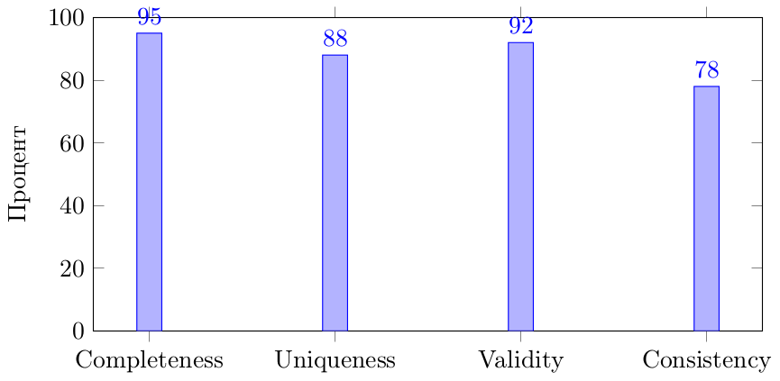


---

## Дрейф данных: формально

| Тип | Формулировка | Действие |
|---|---|---|
| **Data drift** | меняется $P(X)$ | переобучение, мониторинг |
| **Concept drift** | меняется $P(Y|X)$ | пересмотр модели |


---

## Статистические тесты дрейфа

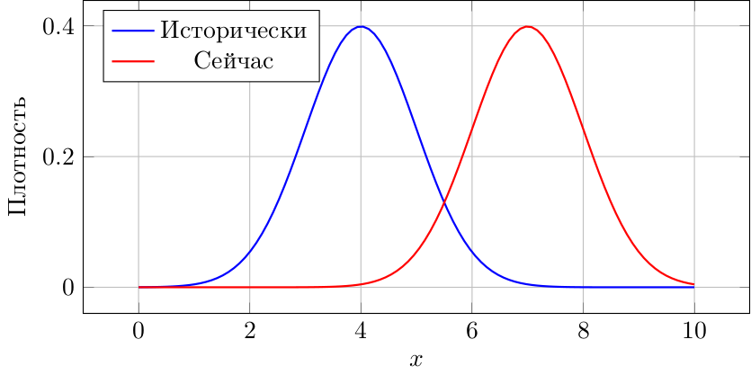

- **Kolmogorov–Smirnov** — тест на сдвиг распределения
- **PSI** (Population Stability Index) — сравнение бинов
- **Chi-square / Jensen–Shannon** — дискретные признаки


---

## Data Observability: 5 столпов


**Идея:** отслеживать здоровье данных, как здоровье систем.

---

## Data Lineage


**Инструменты:** Apache Atlas, Marquez, DataHub

- Откуда данные?
- Какие трансформации?
- Кто использует?

---

## Жизненный цикл качества данных


**Качество данных — процесс, а не разовая акция.**

---

## Вопрос для обсуждения

**Как использовать профилирование для:**

- Обнаружения проблем качества?
- Мониторинга дрейфа данных?
- Документирования датасетов?
- Оптимизации пайплайнов?

*Обсудите практические сценарии 3 минуты*

---

## Резюме раздела 4

- Профилирование — основа понимания данных
- Метрики качества формализуют «хорошие данные»
- Дрейф (data vs concept) требует разных действий
- Observability = постоянный мониторинг здоровья
- Lineage даёт доверие и root-cause анализ

---

<!-- _class: section -->

# Практический кейс
## E-commerce платформа

<!-- ~10 мин, сквозной синтез -->

---

## Кейс: постановка

- **10 млн транзакций** ежедневно
- **5 источников** данных
- Проблемы: дубликаты, пропуски, выбросы
- Требование: автоматизированная очистка

**Задача:** построить систему очистки и валидации end-to-end.

---

## Этапы решения


**Находки профилирования:** 15% дубликатов, 8% пропусков в amount.

<!-- → семинар: код каждого этапа -->

---

## Этап 2: правила очистки

```python
cleaning_rules = {
    'transaction_id': [remove_duplicates],
    'user_id':       [fill_forward, validate_exists_in_users],
    'amount':        [remove_negatives, clip(0, 10000),
                      fill_median_by_category],
    'timestamp':     [parse_datetime, validate_not_future],
    'category':      [lowercase, map_to_standard_categories]
}
```

**Ключ:** декларативность — правила читаемы и версионируемы.

---

## Этап 5: автоматизация Airflow

```python
with DAG('transaction_cleaning', schedule_interval='@daily') as dag:
    extract  = PythonOperator(task_id='extract', ...)
    profile  = PythonOperator(task_id='profile', ...)
    clean    = PythonOperator(task_id='clean', ...)
    detect   = PythonOperator(task_id='detect_anomalies', ...)
    validate = GreatExpectationsOperator(task_id='validate', ...)
    load     = PythonOperator(task_id='load', ...)

    extract >> profile >> clean >> detect >> validate >> load
```

---

## Результаты кейса

| Метрика | До | После | Улучшение |
|---------|-----|-------|-----------|
| Дубликаты | 15% | 0% | 100% |
| Пропуски | 8% | 0.5% | 94% |
| Аномалии | не обн. | 2% выявлено | — |
| Время обработки | 4 ч | 45 мин | 81% |
| Качество данных | 72% | 98% | 36% |

**ROI:** экономия 20 часов/неделю аналитиков.

---

## Архитектура решения


---

<!-- _class: section -->

# Итоги и связь с курсом

<!-- ~7 мин -->

---

## Связь с другими лекциями

**Лекция 1 (Архитектура):** микросервисы очистки, контейнеризация валидации.

**Лекция 2 (Сбор данных):** валидация при сборе из API, очистка потоков.

**Лекция 4 (Трансформация):** чистые данные → качественные признаки.

**Лекция 6 (ETL):** интеграция валидации в Airflow, мониторинг качества.

---

## Итоговое резюме

- **Автоматизация** очистки критична для масштаба
- **Статистические методы** — для аномалий (выбор по типу данных)
- **Библиотеки валидации** — формальный контроль качества
- **Профилирование** — основа понимания и мониторинга
- **Интеграция** в пайплайны обязательна

<span class="callout">**Качество данных = качество решений**</span>

---

## Ключевые вопросы лекции

1. В чём разница между пакетной и потоковой очисткой?
2. Когда использовать Z-Score vs IQR?
3. Валидация vs верификация: в чём разница?
4. Как обнаружить дрейф данных?
5. Зачем нужна линейность (lineage) данных?

---

## Домашнее задание

**Обязательные:**
1. Автоматизация очистки (декларативные правила, пропуски, дубликаты)
2. Валидация с Great Expectations (suite ≥15 ожиданий + checkpoint)

**По выбору:**
3. Обнаружение аномалий (3 метода + ансамбль)
4. Профилирование и мониторинг дрейфа

**Бонус:** PySpark, ML-imputation, real-time Kafka (+10–20 баллов)

<!-- Детали критериев — в исходном файле Лекции 3 и на портале -->

---

## Следующая лекция

**Лекция 4: Сложная предобработка и трансформация**

- Feature engineering для ML
- Работа с временными рядами
- Обработка текстовых данных (NLP)
- Работа с изображениями

**Подготовка:** повторите основы ML и статистики.

---

<!-- _class: title -->

# Спасибо за внимание!

## Следующая лекция: сложная предобработка и трансформация данных

**Материалы**
- Код-листинги → файл `Практикум_Лекция3.md`
- Схемы и источники диаграмм — рядом с презентацией

**Вопросы**
- Slack: `#data-engineering-course`
- Office Hours: вторник, 16:00–18:00

<div class="meta">Вопросы и материалы — в репозитории курса</div>
