<style>
@import url('https://fonts.googleapis.com/css2?family=Inter:wght@400;600;700;800&display=swap');

:root {
  --primary: #1d4ed8;
  --primary-dark: #1e3a8a;
  --accent: #0ea5e9;
  --ink: #0f172a;
  --muted: #64748b;
  --bg: #ffffff;
  --soft: #f1f5f9;
  --teal: #0d9488;
  --amber: #d97706;
  --rose: #e11d48;
}

section {
  font-family: 'Inter', 'Noto Sans', 'Segoe UI', system-ui, sans-serif;
  color: var(--ink);
  background: var(--bg);
  font-size: 22px;
  line-height: 1.3;
  padding: 72px 50px 40px;
}

h1 { font-size: 1.5em; color: var(--primary); margin: 0 0 .35em; font-weight: 800; letter-spacing: -.01em; }
h2 { font-size: 1.18em; color: var(--ink); margin: 0 0 .55em; font-weight: 700; }
h3 { font-size: .82em; color: var(--muted); margin: 0 0 .3em; font-weight: 600; text-transform: uppercase; letter-spacing: .04em; }

ul, ol { margin: 0 0 .55em; padding-left: 1.25em; }
li { margin: .1em 0; }
li strong, li b { color: var(--primary-dark); }
p { margin: 0 0 .5em; }

a { color: var(--primary); }

table { width: 100%; border-collapse: collapse; font-size: .66em; }
th { background: var(--primary); color: #fff; padding: 9px 14px; text-align: left; font-weight: 600; }
td { padding: 8px 14px; border-bottom: 1px solid #e2e8f0; vertical-align: top; }
tr:nth-child(even) td { background: #f8fafc; }

img { display: block; margin: .25em auto; max-width: 100%; max-height: 270px; }

code { background: var(--soft); border-radius: 4px; padding: 1px 6px; font-size: .82em; font-family: 'JetBrains Mono', ui-monospace, monospace; }
pre { background: #0f172a; color: #e2e8f0; border-radius: 10px; padding: 14px 20px; font-size: .54em; line-height: 1.4; }
pre code { background: transparent; color: inherit; padding: 0; }

/* подсветка кода: тёмная палитра под фон pre */
.hljs-comment, .hljs-quote { color: #94a3b8; font-style: italic; }
.hljs-keyword, .hljs-selector-tag, .hljs-built_in, .hljs-type { color: #93c5fd; }
.hljs-string, .hljs-attr, .hljs-regexp { color: #86efac; }
.hljs-number, .hljs-literal, .hljs-symbol { color: #fbbf24; }
.hljs-title, .hljs-section, .hljs-name { color: #f0abfc; }
.hljs-variable, .hljs-template-variable { color: #fca5a5; }
.hljs-meta { color: #cbd5e1; }

.columns { display: grid; grid-template-columns: 1fr 1fr; gap: 48px; align-items: start; }
.cols3 { display: grid; grid-template-columns: 1fr 1fr 1fr; gap: 30px; align-items: start; }

section.section {
  background: linear-gradient(135deg, #0f172a 0%, #1e3a8a 55%, #1d4ed8 100%);
  color: #fff; justify-content: center; text-align: center;
}
section.section h1 { color: #fff; font-size: 2.1em; border: none; }
section.section h2 { color: rgba(255,255,255,.85); font-weight: 400; font-size: 1.1em; }
section.section::after { content: ''; }

section.title {
  background: linear-gradient(135deg, #0f172a 0%, #1e3a8a 55%, #1d4ed8 100%);
  color: #fff; justify-content: center; text-align: center;
}
section.title h1 { color: #fff; font-size: 2.5em; border: none; }
section.title h2 { color: rgba(255,255,255,.9); font-weight: 400; }
section.title p { color: rgba(255,255,255,.8); }
section.title ul, section.title ol, section.section ul, section.section ol { display: inline-block; text-align: left; }
section.title code, section.section code { background: rgba(255,255,255,.16); color: #fff; }

section.title .meta { margin-top: 1.4em; font-size: .8em; color: rgba(255,255,255,.7); letter-spacing: .06em; text-transform: uppercase; }

.callout { display: block; border-left: 5px solid var(--accent); background: #eff6ff; border-radius: 6px; padding: 14px 20px; margin: .5em 0; }
.callout.warn { border-left-color: var(--amber); background: #fffbeb; }
.callout.good { border-left-color: var(--teal); background: #ecfdf5; }
.callout.bad { border-left-color: var(--rose); background: #fef2f2; }

.muted { color: var(--muted); font-size: .8em; }
.small { font-size: .8em; }
.badge { display: inline-block; background: var(--soft); border-radius: 999px; padding: 4px 14px; margin: 3px; font-size: .74em; font-weight: 600; color: var(--primary-dark); }
</style>

<!--
ОБЩИЕ ЗАМЕТКИ К ПРЕЗЕНТАЦИИ
- Хронометраж: ~95 минут. Блок 1 — 30 мин, Блок 2 — 25 мин, Блок 3 — 20 мин, Блок 4 — 20 мин + вступление и итоги
- Формат: теория + код. Слайды с кодом помечены «→ семинар», полные листинги разбираются на семинаре
- Схемы — PNG из папки Лекция4_figs/ (pdflatex + pdftocairo, 200 dpi, 63 шт.);
  исходники всех схем — в файле «Лекция 4 — TikZ источники.md»
- Математика рендерится KaTeX (math: katex)
- Главные выводы оформлены плашками `.callout` (ключевое — зелёная, предупреждение — красная)
- Слайды с пометкой «Дополнительно» выходят за рамки базовой программы и читаются по остатку времени
-->

<!-- _class: title -->

# Лекция 4
## Сложная предобработка и трансформация данных

<div class="meta">Инженерия данных · Магистратура ИТМО · Осень 2025</div>

---

<!-- _class: section -->

# План лекции

## 4 раздела · 95 минут

---

## План лекции

| Блок | Тема | Время |
|:-----|:-----|:------|
| 1 | Feature Engineering для ML | ~30 мин |
| 2 | Работа с временными рядами | ~25 мин |
| 3 | Обработка текстовых данных (NLP) | ~20 мин |
| 4 | Изображения, аудио, мультимодальность | ~20 мин |

**Формат:** теория + код → детальный разбор кода на семинаре

**Сквозная идея:** любой источник данных — числа, время, текст, изображение, звук — сводится к **матрице признаков** $X \in \mathbb{R}^{n \times d}$, которую понимает модель.

---

## Карта лекции

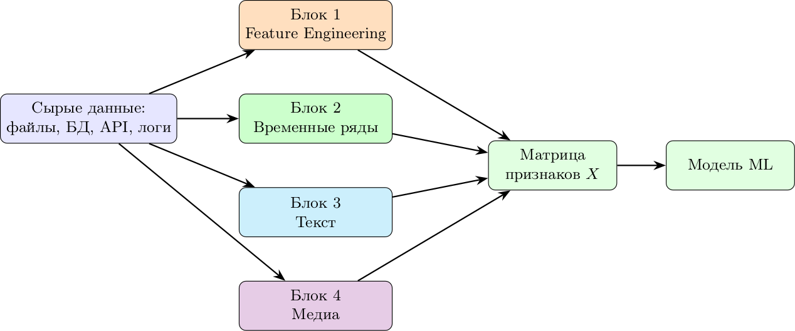

<span class="callout good">Ключевое: предобработка — **мост** между источником данных и моделью. Качество этого моста задаёт потолок качества модели.</span>

---

## Цели лекции

После лекции вы сможете:

- **Обосновать**, почему качество признаков важнее выбора конкретного алгоритма
- **Выбирать** метод масштабирования, кодирования и импутации под тип данных и алгоритм
- **Строить** признаки для временных рядов без утечки данных
- **Превращать** текст в числовые векторы — от TF-IDF до BERT
- **Проектировать** пайплайн подготовки изображений, аудио и мультимодальных данных
- **Диагностировать** утечки и ошибки валидации до того, как они попадут в прод

---

## Почему признаки важнее модели

<!-- 5 мин — мотивация -->

- **60–80% времени** data-специалиста уходит на подготовку данных, а не на модели
- Модель не может «вытащить» информацию, которой нет в признаках
- Один и тот же градиентный бустинг на хороших признаках обгоняет «продвинутую» модель на сырых данных

$$ \text{Качество} \approx \underbrace{\text{данные и признаки}}_{\text{потолок}} \;+\; \text{алгоритм} $$

<span class="callout good">Ключевое: **garbage in — garbage out**. Сначала признаки, потом тюнинг модели.</span>

---

## Главный враг: утечка данных (data leakage)

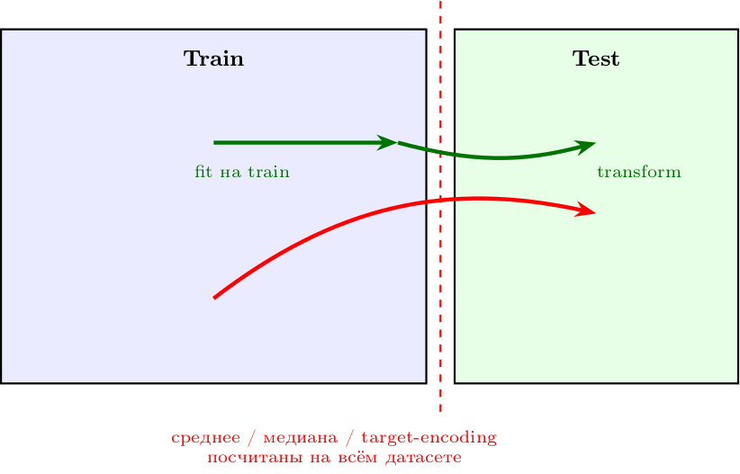

Три классических источника утечки:

- **Препроцессинг на всём датасете** до разбиения на train/test
- **Целевая переменная в признаках** (например, `сумма_платежей` при прогнозе оттока)
- **Временная утечка** — использование будущих данных для прошлых наблюдений

---

## Пайплайн как контракт

```python
from sklearn.pipeline import Pipeline
from sklearn.compose import ColumnTransformer
from sklearn.preprocessing import StandardScaler, OneHotEncoder
from sklearn.impute import SimpleImputer

num = Pipeline([("imp", SimpleImputer(strategy="median")),
                ("sc", StandardScaler())])
cat = Pipeline([("imp", SimpleImputer(strategy="most_frequent")),
                ("oh", OneHotEncoder(handle_unknown="ignore"))])

prep = ColumnTransformer([("num", num, num_cols),
                          ("cat", cat, cat_cols)])
model = Pipeline([("prep", prep), ("clf", clf)])

model.fit(X_train, y_train)   # fit только здесь
```

- Один объект `Pipeline` = **одна точка fit** → утечка структурно невозможна
- Пайплайн сериализуется (`joblib`) и переносится в прод без «ручных» преобразований
- `handle_unknown="ignore"` — обязательное условие для стабильного инференса

---

<!-- _class: section -->

# Раздел 1
## Feature Engineering для ML

<!-- ~30 мин -->

---

## Что такое Feature Engineering

**Определение:** превращение сырых данных в признаки, которые максимизируют предсказательную силу модели.

Пять составляющих:

- **Трансформация** — масштабирование, логарифм, биннинг
- **Кодирование** — категории → числа, векторы, эмбеддинги
- **Генерация** — комбинации, агрегаты, предметные признаки
- **Импутация** — заполнение пропусков
- **Отбор** — отсечение шума и избыточности

---

## Типы признаков

| Тип | Примеры | Типичная обработка |
|-----|---------|--------------------|
| Числовые | возраст, цена, метрики | масштабирование, биннинг, $\log$ |
| Категориальные | город, категория товара | One-Hot, Target Encoding |
| Бинарные | флаг подписки | уже $0/1$; индикаторы пропусков |
| Временные | дата, timestamp | лаги, цикличность, сезонность |
| Текстовые | отзывы, описания | TF-IDF, эмбеддинги |
| Производные | площадь, BMI, CTR | создаются вручную |

<span class="callout good">Ключевое: тип признака диктует **набор применимых методов** — сначала классифицируйте данные, потом выбирайте инструменты.</span>

---

## Шкалы измерения: почему это важно

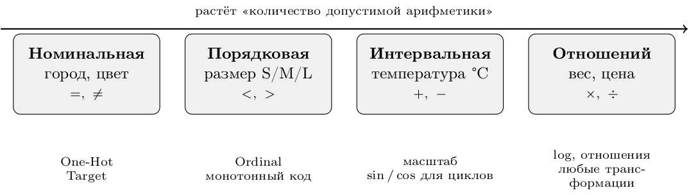

<span class="callout warn">Практика: половина ошибок кодирования — это применение арифметики к номинальной шкале (например, `город = 3` для линейной регрессии).</span>

---

## Зачем масштабировать числовые признаки

<!-- 4 мин -->

Чувствительны к масштабу: линейная/логистическая регрессия, SVM, kNN, кластеризация, нейросети (градиентный спуск).

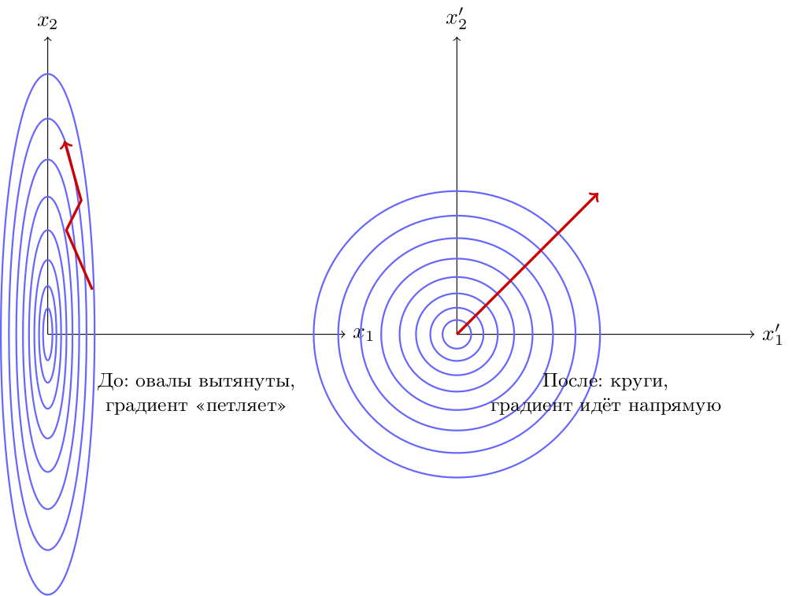

- Древесные модели (Random Forest, XGBoost, CatBoost) **не требуют** масштабирования — их сплиты инвариантны к монотонным преобразованиям
- Но масштаб важен для **регуляризации** и для расстояний (kNN, k-means, эмбеддинги)

---

## Методы масштабирования

| Метод | Формула | Выход | Устойчивость к выбросам |
|-------|---------|-------|--------------------------|
| Min-Max | $\dfrac{x - x_{\min}}{x_{\max} - x_{\min}}$ | $[0,1]$ | ✗ |
| Z-score | $\dfrac{x - \mu}{\sigma}$ | $\mu=0,\ \sigma=1$ | средняя |
| Robust | $\dfrac{x - \text{med}}{IQR}$ | центрирован | ✓ |
| Max-Abs | $\dfrac{x}{\max \lvert x\rvert}$ | $[-1,1]$ | ✗ |

<span class="callout good">Ключевое: **fit только на train**, transform — и на train, и на test. Параметры, оценённые на всей выборке, — классическая утечка данных.</span>

---

## Сравнение трансформаций

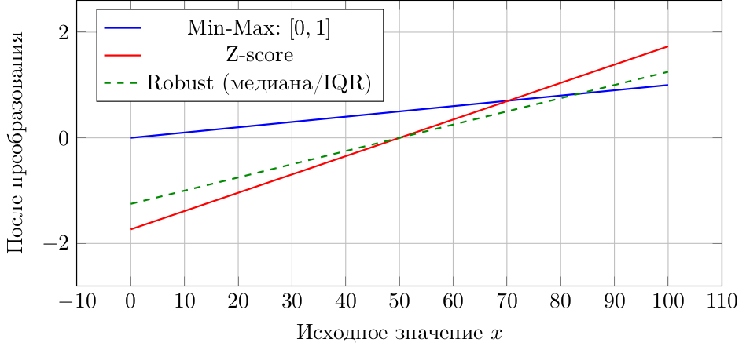

- Min-Max сохраняет форму распределения, но «сжимает» всё в $[0,1]$ и ломается от одного выброса
- Z-score не ограничивает диапазон — выбросы остаются заметными
- Robust ориентируется на квартили — оптимален при «грязных» данных

---

## Выбросы: что делать до масштабирования

<!-- 4 мин -->

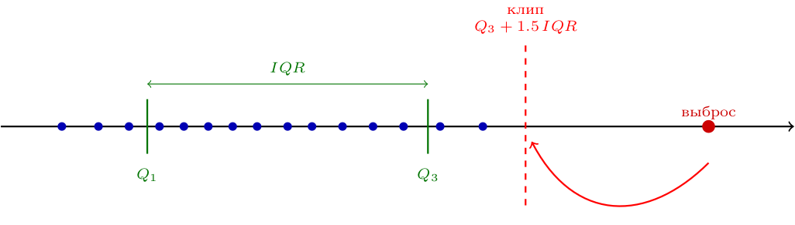

Стратегии:

- **Ничего не делать** — если выбросы реальны (покупки B2B, аварии)
- **Клиппинг / winsorizing** — обрезка на перцентилях (0.5%, 99.5%)
- **Отдельная модель / флаг** `is_outlier` — выброс как сигнал, а не как шум
- **Robust-методы** — медиана, IQR, Huber loss, квантильная регрессия

<span class="callout good">Ключевое: выброс — не всегда ошибка. Сначала выясните **механизм**, потом удаляйте.</span>

---

## Биннинг (дискретизация)

**Мотивация:** подавить шум, уменьшить влияние выбросов, добавить нелинейность в линейные модели, упростить интерпретацию.

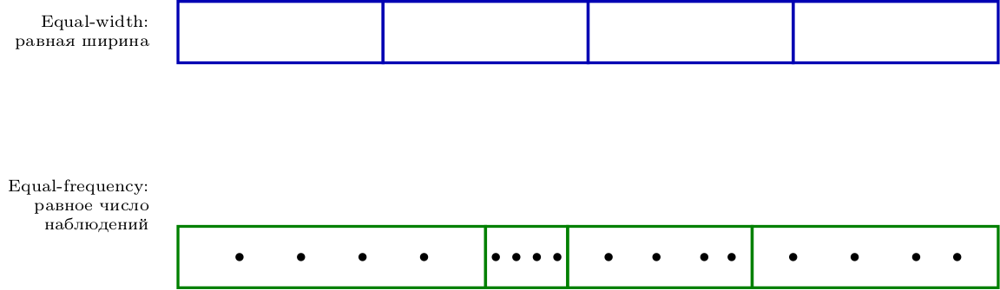

- **Equal-width** (`pd.cut`, `bins=5`) — чувствителен к выбросам
- **Equal-frequency** (`pd.qcut`, `q=5`) — чаще лучший выбор, но границы «прыгают» между выборками
- **Custom bins** — содержательные границы: $[0,18), [18,35), [35,60), [60,100]$
- **Supervised binning** — границы по WOE/IV (кредитный скоринг)

---

## Логарифмическая и степенная трансформация

<!-- 5 мин -->

Применяются к **скошенным** распределениям: доходы, цены, размеры аудиторий, число просмотров.

- Сжимают правый хвост → приближают распределение к нормальному
- Стабилизируют дисперсию (гомоскедастичность для линейных моделей)

$$ X_{\log} = \log(X + 1), \qquad \text{Box–Cox: } y^{(\lambda)} = \frac{y^\lambda - 1}{\lambda} $$

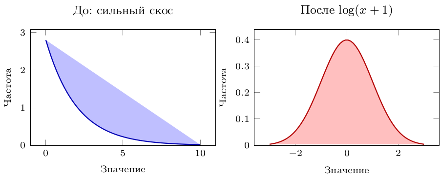

<span class="callout good">Ключевое: $\log(X+1)$ — для данных с нулями; Box–Cox — для строго положительных; Yeo–Johnson работает и с отрицательными.</span>

---

## Категориальные признаки: One-Hot Encoding

<!-- 6 мин -->

Принцип: каждая категория → отдельный бинарный столбец.

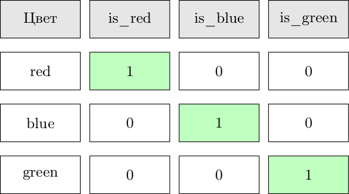

```python
pd.get_dummies(df['color'])          # → семинар
pd.get_dummies(df, drop_first=True)  # убираем избыточный столбец
```

<span class="callout">`drop_first=True` убирает ловушку фиктивных переменных (сумма столбцов = 1 → идеальная мультиколлинеарность).</span>

---

## Проблемы One-Hot и альтернативы

Проблемы при **высокой кардинальности** (город, IP, ID товара):

- Взрыв размерности: 100 тыс. категорий → 100 тыс. столбцов
- Разреженная матрица: почти одни нули, деревьям сложно найти сплиты
- Мультиколлинеарность: сумма dummy-столбцов равна константе
- Память и время обучения растут линейно по $K$

Решения:

- **Label Encoding** — порядковый номер (опасен: модель увидит ложный порядок)
- **Binary Encoding** — номер категории в двоичном виде, $\lceil\log_2 K\rceil$ столбцов
- **Frequency Encoding** — частота категории в выборке
- **Hashing Encoding** — хэш в фиксированное число столбцов (коллизии — плата за память)

---

## Target Encoding

<!-- 5 мин -->

Идея: заменить категорию средним значением целевой переменной по ней.

$$ TE(c) = \frac{n_c \cdot \bar{y}_c + m \cdot \bar{y}_{global}}{n_c + m} $$

- $n_c$ — число наблюдений категории, $\bar{y}_c$ — её средний таргет
- $m$ — параметр сглаживания: при малых $n_c$ тянем к глобальному среднему
- Один столбец на категорию → нет взрыва размерности

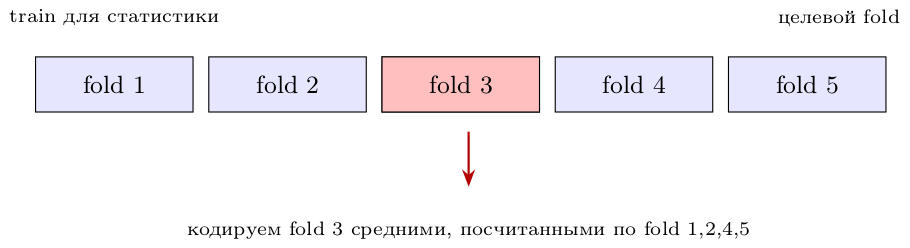

<span class="callout good">Ключевое: без сглаживания редкие категории переобучаются. Среднее таргета нужно считать **out-of-fold**, иначе — утечка.</span>

---

## Сравнение методов кодирования

| Метод | Столбцов | Связь с таргетом | Риск переобучения | Подходит для |
|-------|----------|------------------|-------------------|--------------|
| One-Hot | $K$ | нет | низкий | линейные модели |
| Label | $1$ | нет | средний | деревья (осторожно) |
| Binary | $\lceil\log_2 K\rceil$ | нет | низкий | высокая кардинальность |
| Frequency | $1$ | косвенно | низкий | деревья |
| Target | $1$ | да | **высокий** | бустинги с CV |
| Embedding | $d \ll K$ | обучается | средний | нейросети |

<span class="callout warn">Практика: для линейных моделей — One-Hot; для бустинга — target/catboost-кодирование с валидацией.</span>

---

## Embeddings для категорий

- Категория → плотный вектор размерности $d$ (обычно $d = 10\ldots100$)
- Веса эмбеддинга **обучаются вместе с моделью**
- Близкие категории (похожие города, товары) получают близкие векторы
- Кардинальность 1 млн категорий → таблица $10^6 \times 16$ вместо разреженной матрицы $10^6 \times 10^6$

```python
# → семинар: torch
emb = nn.Embedding(num_categories, dim=16)
```

- Альтернатива «с нуля»: предобученные векторы из графа знаний (Wikidata, geonames)
- В бустингах аналог — **CatBoost** с ordered target statistics

---

## Пропуски: три механизма

<!-- 5 мин -->

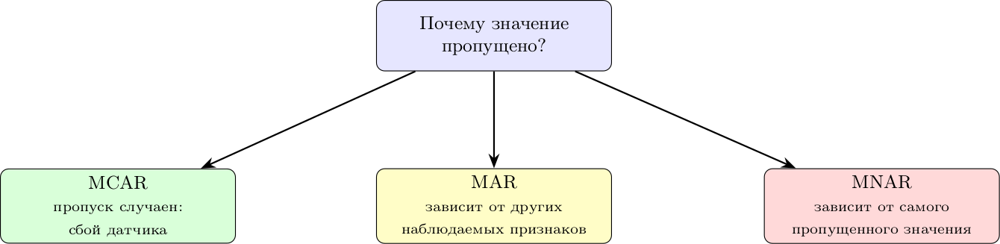

Примеры:

- **MCAR** — сбой системы сбора данных (пропуски неинформативны)
- **MAR** — женщины реже указывают возраст: пропуск объясним признаком «пол»
- **MNAR** — люди с высоким доходом не отвечают про доход: пропуск информативен сам по себе

<span class="callout good">Ключевое: механизм пропусков определяет **допустимые методы импутации** и то, можно ли просто удалить строки.</span>

---

## Как диагностировать механизм (дополнительно)

- Сравните распределение признака при `missing` и `not missing` (t-test / KS)
- Постройте корреляцию индикатора пропуска с остальными признаками
- Обучите модель «предсказать пропуск»: AUC $\approx 0.5$ → похоже на MCAR, AUC высокий → MAR/MNAR
- Проверьте пропуски во времени: кластеры по датам = сбой пайплайна, а не природа данных

```python
df['is_missing'] = df['income'].isna().astype(int)
# сравнение распределений
df.groupby('is_missing')[['age', 'tenure']].describe()
# модель на предсказание пропуска
roc_auc_score(df['is_missing'], model.predict_proba(X_other)[:, 1])
```

<span class="callout warn">Практика: в проде **пропуск — это событие**. Логируйте долю пропусков по признаку и алертите на скачки.</span>

---

## Простые методы импутации

| Метод | Плюсы | Минусы |
|-------|-------|--------|
| Удаление строк | просто | теряем данные; при MNAR — смещение |
| Константа ($0$, "Unknown") | быстро, честно | модель может «не понять» |
| Среднее/медиана | просто | занижает дисперсию, портит корреляции |
| Мода | для категорий | игнорирует связи |
| Forward/Backward fill | для временных рядов | искажает сезонность при больших дырах |

**Трюк:** добавьте бинарный признак-индикатор `is_missing` — часто пропуск сам по себе информативен.

<span class="callout">Медиана предпочтительнее среднего при скошенных распределениях: она не сдвигает центр из-за хвоста.</span>

---

## KNN Imputation

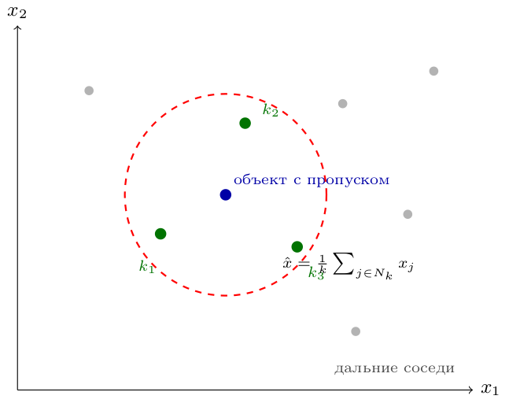

- Для объекта с пропуском ищем $k$ ближайших соседей по **полным** признакам
- Пропущенное значение = среднее (числа) или мода (категории) значений соседей
- Учитывает похожесть объектов, но чувствителен к масштабу признаков и дорог: $O(n^2)$

```python
from sklearn.impute import KNNImputer
imputer = KNNImputer(n_neighbors=5)
X_filled = imputer.fit_transform(X)   # → семинар
```

---

## MICE (Multiple Imputation by Chained Equations)

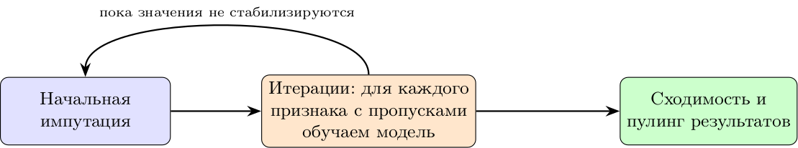

- Каждый признак с пропусками предсказывается моделью по остальным признакам
- Многократные запуски → честная оценка **неопределённости** импутации
- Дорого на больших данных; практическая альтернатива — `IterativeImputer`

<span class="callout">MICE предполагает MAR. При MNAR даже он даёт смещённые оценки — нужна модель механизма пропусков.</span>

---

## Генерация признаков: полиномиальные

$$ [x_1, x_2] \;\rightarrow\; [1,\ x_1,\ x_2,\ x_1^2,\ x_1x_2,\ x_2^2] $$

- Позволяют линейной модели захватывать нелинейные зависимости (граница решения — кривая)
- Размерность растёт как $C_{d+r}^{r}$: при $d=50$, $r=2$ — уже 1326 признаков

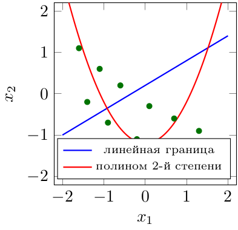

<span class="callout warn">Практика: degree 2–3 достаточно; дальше — переобучение. Комбинируйте с L1-регуляризацией.</span>

---

## Интерактивные и предметные признаки

Примеры «ручных» комбинаций:

- Площадь = длина × ширина
- BMI = вес / рост²
- Цена за единицу = цена / количество
- Доля отказов = число отказов / число операций

Предметные знания (domain knowledge):

- кредитный скоринг: отношение долга к доходу (DTI), утилизация кредитной линии
- e-commerce: средний чек за 30 дней, частота покупок, давность последней покупки (RFM)
- IoT: скорость = разность показаний / интервал, наработка на отказ

<span class="callout good">Ключевое: лучшие признаки рождаются из **понимания предметной области**, а не из библиотек.</span>

---

## Математические трансформации

| Семейство | Примеры | Когда помогает |
|-----------|---------|----------------|
| Степенные | $x^2,\ x^3,\ \sqrt{x}$ | нелинейности, сжатие хвостов |
| Логарифмические | $\log(x+1)$ | скошенные распределения |
| Экспоненциальные | $e^x$ | «перевёрнутая» скошенность |
| Обратные | $1/x,\ 1/(x+1)$ | асимптотические зависимости |
| Тригонометрические | $\sin,\ \cos$ | циклы (время суток, сезон) |
| Кусочные | $\max(0, x-\tau)$ | пороговые эффекты |

<span class="callout bad">Осторожно с $1/x$: нули и близкие к нулю значения дают выбросы. Берите $1/(x+1)$ или обрезайте.</span>

---

## Feature Selection: зачем

- **Переобучение** — лишние признаки дают модели возможность «запомнить» шум
- **Скорость** — обучение и инференс растут с числом признаков
- **Интерпретируемость** — модель с 10 признаками объяснима, с 10 000 — нет
- **Стоимость данных** — каждый признак надо собирать, хранить и мониторить

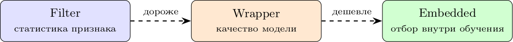

---

## Filter методы

Признак оценивается **без модели**: быстро, но не учитывает взаимодействия.

- **Корреляция** с таргетом (Pearson/Spearman)
- **Chi-square** — категориальный признак × категориальный таргет
- **ANOVA F** — числовой признак × категориальный таргет
- **Mutual Information** — ловит нелинейные зависимости
- **Variance threshold** — выброс константных и почти константных признаков

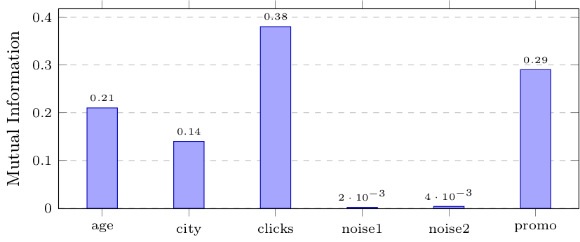

<span class="callout bad">Осторожно: корреляция ловит **линейные** связи; MI чувствителен к шумной оценке плотности при малых выборках.</span>

---

## Wrapper методы

Пробуем подмножества признаков и смотрим на качество модели.

- **RFE** (Recursive Feature Elimination): обучаем → ранжируем по важности → удаляем слабейший → повторяем
- **Forward/Backward Selection** — жадное добавление/удаление
- **Exhaustive Search** — полный перебор (реально только до ~15–20 признаков)

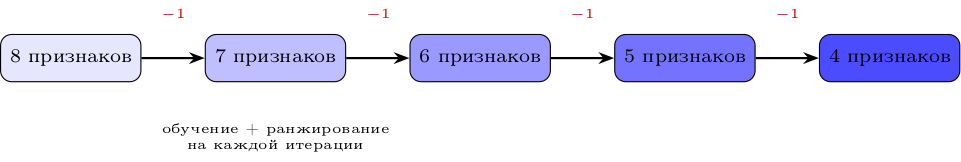

```python
from sklearn.feature_selection import RFE
rfe = RFE(estimator=LogisticRegression(), n_features_to_select=10)  # → семинар
```

Плюсы: учитывают взаимодействия. Минусы: $O(\text{моделей} \times \text{итераций})$ — дорого.

---

## Embedded методы

- **Lasso (L1)** — зануляет коэффициенты → признак исключён
- **Ridge (L2)** — лишь сжимает коэффициенты
- **Elastic Net** — комбинация L1 + L2
- **Tree-based importance** — impurity/Gain (LightGBM, XGBoost)

$$ \text{Lasso: } \min_w \|y - Xw\|_2^2 + \lambda \|w\|_1 $$

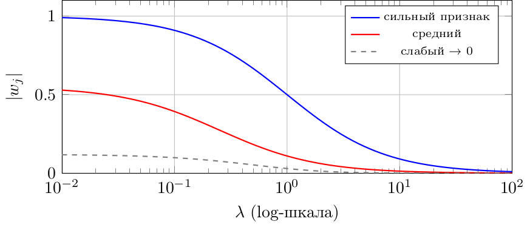

<span class="callout warn">Практика: скрининг — MI/корреляция, финальный отбор — Lasso или важность бустинга.</span>

---

## Сравнение методов отбора

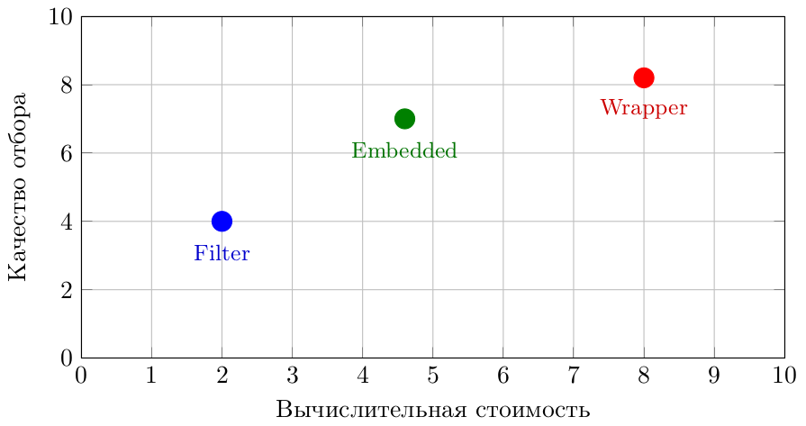

Компромисс «цена/качество»: на практике чаще всего — **Embedded**.

---

## Автоматический Feature Engineering

<!-- 4 мин -->

- **FeatureTools** — Deep Feature Synthesis: рекурсивно комбинирует примитивы (transform + aggregation) поверх реляционной схемы
- **tsfresh** — 700+ признаков для временных рядов + статистический отбор релевантных
- **AutoML (AutoGluon, H2O)** — генерация признаков как часть поиска модели

```python
import featuretools as ft
es = ft.EntitySet(id="shop")
es = es.add_dataframe(dataframe_name="tx", dataframe=df,
                      index="tx_id", time_index="ts")
features = ft.dfs(entityset=es, target_dataframe_name="tx", max_depth=2)  # → семинар
```

<span class="callout">Оба инструмента дают **сотни кандидатов** — дальше обязателен feature selection и проверка на утечки (агрегаты не должны смотреть в будущее).</span>

---

## Дисбаланс классов: в чём проблема

<!-- 5 мин -->

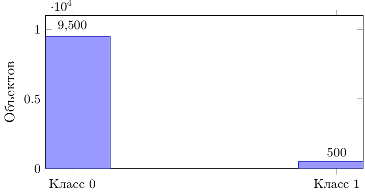

- Модель, всегда предсказывающая класс 0, получит accuracy 95% — и не поймает ни одного случая класса 1
- Смотрите не на accuracy, а на **precision/recall/F1**, **PR-AUC** и confusion matrix
- Проблема не только в классах, но и в **разной цене ошибок** (fraud, болезнь, отток)

---

## Метрики при дисбалансе (дополнительно)

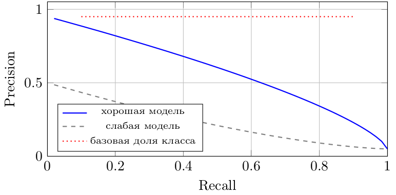

- **PR-AUC** информативнее ROC-AUC при сильном дисбалансе: ROC «приукрашивает» за счёт огромного числа истинно отрицательных
- Порог — гиперпараметр бизнеса: выбирайте по стоимости FP/FN, а не по 0.5
- Отчёт всегда с **доверительными интервалами**: при 500 объектах минорного класса recall шумит на ±4 п.п.

---

## Методы борьбы с дисбалансом

| Метод | Идея | Риск |
|-------|------|------|
| Undersampling | выкинуть часть мажоритарного класса | теряем данные |
| Oversampling | дублировать миноритарный | переобучение на дублях |
| SMOTE / ADASYN | синтетические примеры между соседями | шумовые связи |
| class\_weight / scale\_pos\_weight | штраф за ошибки минорного класса | настройка весов |
| Ансамбли (BalancedRandomForest) | балансировка внутри бутстрапа | — |
| Tomek links / ENN | чистка границ классов | сложно на больших данных |

<span class="callout good">Ключевое: **никогда** не балансируйте тестовую выборку — распределение теста должно отражать реальность.</span>

---

## SMOTE: синтетические примеры

$$ x_{new} = x_i + \lambda \cdot (x_{neighbor} - x_i), \quad \lambda \sim U[0,1] $$

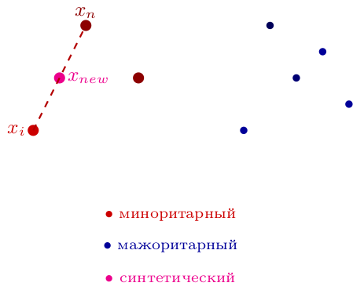

Шаги: взять объект миноритарного класса → найти $k$ ближайших соседей из него же → выбрать случайного соседа → создать точку на отрезке между ними.

<span class="callout">Ограничение: SMOTE интерполирует **в исходном пространстве**. Для категориальных признаков — SMOTENC, для текста/картинок — аугментация или взвешивание.</span>

---

## Вопросы для самопроверки (блок 1)

1. Когда выбрать стандартизацию, а когда — Robust-масштабирование?
2. В чём риск target encoding и как его контролировать?
3. Чем MICE лучше подстановки среднего?
4. Почему для оценки модели с импутацией нельзя просто удалить строки с пропусками в тесте?
5. Какие метрики использовать при сильном дисбалансе классов?
6. Где в вашем пайплайне может возникнуть утечка при One-Hot Encoding?

---

## Резюме блока 1

- Масштабирование ускоряет сходимость и влияет на линейные/метрические модели
- Кодирование категорий выбирается по кардинальности и алгоритму
- Импутация должна учитывать **механизм пропусков**
- Генерация признаков — сочетание техники и предметных знаний
- Отбор признаков — защита от переобучения и проклятия размерности
- Дисбаланс лечится на **тренировочной** части, метрики — под задачу
- Любое преобразование живёт **внутри Pipeline** и обучается только на train

---

<!-- _class: section -->

# Раздел 2
## Работа с временными рядами

<!-- ~25 мин -->

---

## Что такое временной ряд

**Определение:** последовательность наблюдений $y_1, \dots, y_T$, упорядоченная во времени, где порядок несёт информацию.

Чем отличается от обычной таблицы:

- **Зависимость от прошлого** — соседние точки коррелированы (автокорреляция)
- **Неравные интервалы** — пропуски, нерегулярные события, разная частота датчиков
- **Один объект, много моментов** — нельзя перемешивать строки
- **Дрейф** — распределение меняется во времени (ковид, смена сезона, релиз)

$$ y_t = f(y_{t-1}, y_{t-2}, \dots) + \varepsilon_t $$

<span class="callout good">Ключевое: в табличных задачах строка независима, в TS — **нет**. Отсюда все различия в валидации и генерации признаков.</span>

---

## Компоненты временного ряда

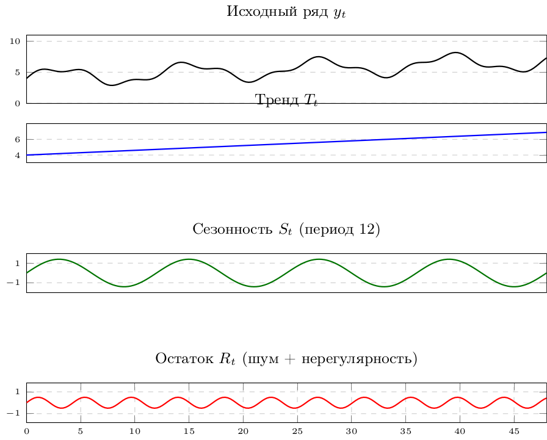

$$ y_t = T_t + S_t + C_t + R_t $$

---

## Аддитивная vs мультипликативная модель

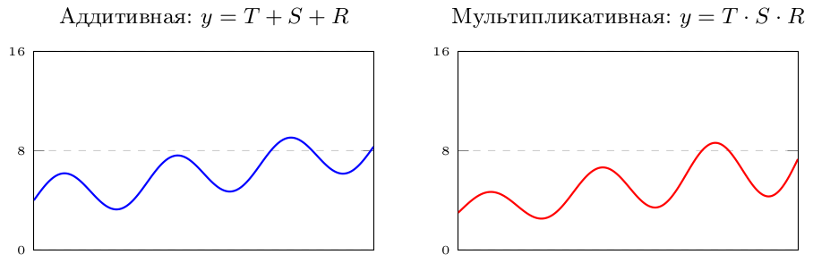

- **Аддитивная** — амплитуда сезонности постоянна (продажи с фиксированным сезонным приростом)
- **Мультипликативная** — амплитуда растёт вместе с уровнем (выручка: декабрьский пик пропорционален масштабу бизнеса)
- Выбор модели — по графику и по остаткам: правильная модель даёт остаток без структуры
- Логарифмирование превращает мультипликативную модель в аддитивную

---

## Стационарность

**Слабая стационарность:** постоянные среднее и дисперсия, автоковариация зависит только от лага.

Почему важно:

- Большинство классических моделей (ARIMA, VAR) требуют стационарности
- Нестационарный ряд даёт «ложные регрессии»: высокий $R^2$ без реальной связи
- Модель, обученная на растущем тренде, не умеет экстраполировать рост

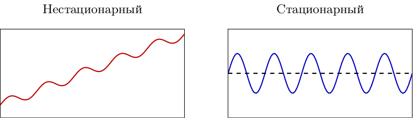

Тесты: **ADF** (нулевая гипотеза — есть единичный корень, ряд нестационарен), **KPSS** (нулевая — ряд стационарен). Их применяют парой: противоречие = ряд «почти нестационарен».

---

## Дифференцирование и преобразования

$$ \Delta y_t = y_t - y_{t-1}, \qquad \Delta_{12} y_t = y_t - y_{t-12} $$

- **Первая разность** убирает линейный тренд
- **Сезонная разность** (лаг = период) убирает сезонность
- **Логарифм + разность** ≈ темп прироста, стабилизирует дисперсию
- Избыточное дифференцирование **вносит** шум и ломает модель: проверяйте тестами

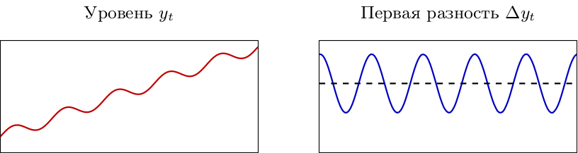

<span class="callout">В ML-подходе дифференцирование часто заменяют на **лаги и календарные признаки**: деревья справляются с трендом сами, а разность теряет уровень.</span>

---

## Ресемплинг: downsampling (агрегация)

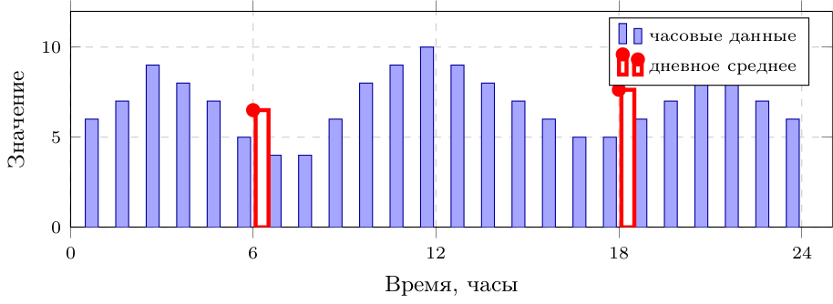

| Агрегация | Когда использовать |
|-----------|--------------------|
| `mean` | температуры, уровни, котировки |
| `sum` | выручка, осадки, число событий |
| `max` / `min` | пиковая нагрузка, экстремальные события |

```python
daily = hourly.resample("D").agg({"temp": "mean", "rain": "sum", "load": "max"})  # → семинар
```

<span class="callout">Агрегация уничтожает детали: пик нельзя восстановить из среднего — храните несколько агрегатов.</span>

---

## Ресемплинг: upsampling и интерполяция

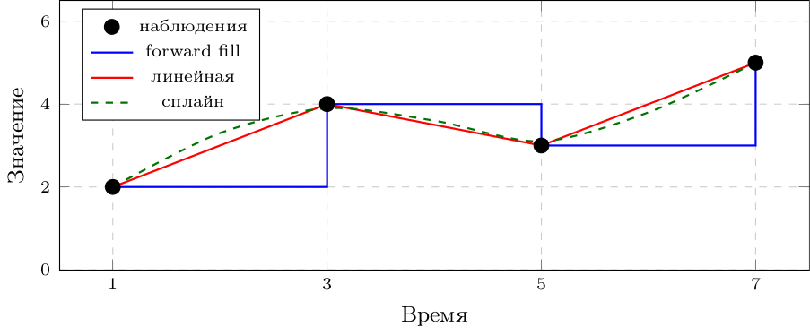

| Метод | Когда уместен | Риск |
|-------|---------------|------|
| Forward / backward fill | состояние, остаток, цена | «ступеньки», искажение сезонности |
| Линейная | плавные физические величины | сглаживает пики |
| Сплайн / полином | гладкие траектории | выбросы и колебания (Рунге) |
| Модельная (Kalman, ARIMA) | шумные датчики | сложность, требует валидации |

<span class="callout good">Ключевое: интерполяция **придумывает данные**. Если доля пропусков велика, честнее оставить пропуск и добавить индикатор.</span>

---

## Декомпозиция STL

**STL** = Seasonal-Trend decomposition using **Loess**.

- Тренд — локальная регрессия (loess), а не глобальный полином
- Сезонность может **меняться во времени** (в отличие от `seasonal_decompose`)
- Есть робастный режим: выбросы не «протекают» в тренд
- Параметры: `period`, `seasonal`, `trend`, `robust`

```python
from statsmodels.tsa.seasonal import STL
res = STL(series, period=12, robust=True).fit()
res.plot()
```

Компоненты используют как признаки:

- тренд → сглаженный уровень, отклонение от тренда
- сезонный остаток → «насколько месяц atypical»
- остаток → сигнал аномалии (3σ, MAD)

<span class="callout">Декомпозиция — инструмент **анализа**, а не прогноза. Модель строят на исходном ряде + признаки из компонент.</span>

---

## Лаговые признаки

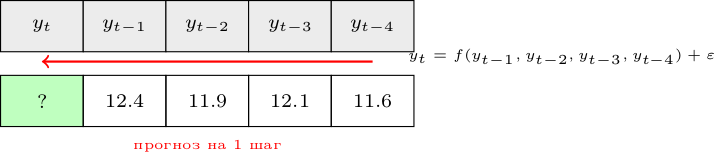

```python
for lag in range(1, 8):
    df[f"lag_{lag}"] = df["value"].shift(lag)     # → семинар
df["lag_7"] = df["value"].shift(7)                # недельная сезонность
```

- Лаг — простейший способ дать модели память
- Число лагов: минимум — период сезонности; больше — если есть длинная память (ACF/PACF)
- **Сдвиг всегда в прошлое.** `shift(-1)` = утечка таргета

---

## Скользящие окна

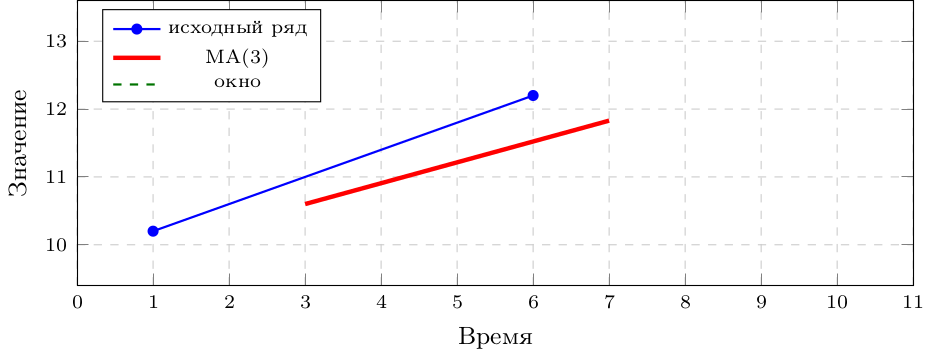

- `rolling_mean` — уровень, `rolling_std` — волатильность, `rolling_min/max` — диапазон, `rolling_median` — устойчивый уровень, `ewm` — EMA

```python
df["ma_7"]  = df["value"].shift(1).rolling(7).mean()   # shift(1) — обязательно
df["ema_7"] = df["value"].shift(1).ewm(span=7).mean()
```

<span class="callout">`.rolling()` **включает текущую точку**. Перед использованием в признаках всегда `.shift(1)`.</span>

---

## EMA: экспоненциальное сглаживание

$$ s_t = \alpha\, y_t + (1-\alpha)\, s_{t-1}, \qquad \alpha = \frac{2}{N+1} $$

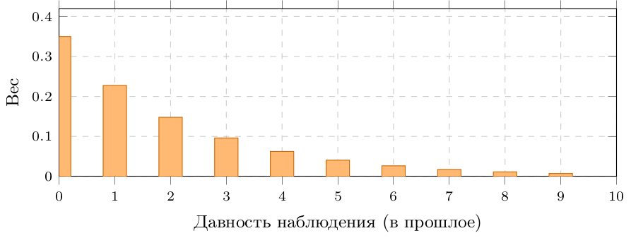

- EMA «помнит» прошлое экспоненциально — старые точки не исчезают резко, как в окне
- Малый $\alpha$ → сильное сглаживание, большой → быстрая реакция
- Работает онлайн: не нужно хранить всю историю
- В признаках — тоже со `shift(1)`

---

## Календарные признаки

Извлекаются из timestamp, не требуют модели:

- год, месяц, день, час, минута
- день недели, номер недели ISO, квартал
- выходной / рабочий день (производственный календарь!)
- начало/конец месяца, «зарплатные» дни
- праздники и **дни вокруг праздников** (мост, перенос)
- длительность периода (сколько дней прошло с события)

```python
df["dow"]       = df["ts"].dt.dayofweek
df["is_weekend"] = df["dow"].isin([5, 6]).astype(int)
df["is_holiday"] = df["ts"].dt.normalize().isin(ru_holidays).astype(int)
df["days_since_promo"] = (df["ts"] - last_promo_ts).dt.days
```

<span class="callout">Праздники — самая недооценённая группа признаков в ритейле и логистике. Производственный календарь РФ меняется каждый год — храните его как данные, а не в коде.</span>

---

## Циклические признаки

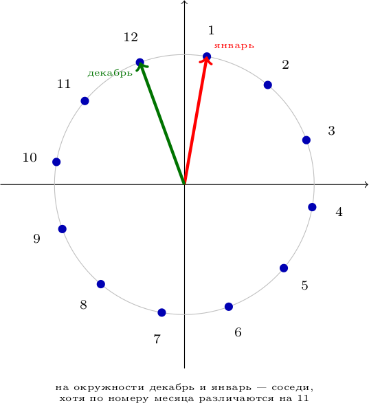

```python
df["month_sin"] = np.sin(2*np.pi*df["month"]/12)
df["month_cos"] = np.cos(2*np.pi*df["month"]/12)
```

- Для дерева `месяц = 12` и `месяц = 1` далеки; после $\sin/\cos$ — близки
- Для линейной модели пара $(\sin, \cos)$ задаёт гладкую зависимость
- Тот же приём: час (24), день недели (7), минута (60), направление ветра (360°)

---

## Fourier-признаки (дополнительно)

Вместо одного синуса — набор гармоник:

$$ \sin\!\left(\frac{2\pi k t}{P}\right),\ \cos\!\left(\frac{2\pi k t}{P}\right), \quad k = 1 \dots K $$

- Гибко описывают **сложную** сезонность (несколько пиков в сутках)
- $K$ контролирует гладкость: больше гармоник — точнее и рискованнее
- Особенно полезны для линейных моделей и нейросетей
- В бустингах часто достаточно номера часа/дня + циклического кодирования

```python
# 3 гармоники недельного цикла
t = np.arange(len(df))
for k in (1, 2, 3):
    df[f"sin_w{k}"] = np.sin(2*np.pi*k*t/7)
    df[f"cos_w{k}"] = np.cos(2*np.pi*k*t/7)
```

<span class="callout warn">Практика: Fourier + регуляризация часто заменяют «ручную» сезонность в регрессии, но проигрывают бустингу на коротких рядах.</span>

---

## Пропуски во временных рядах

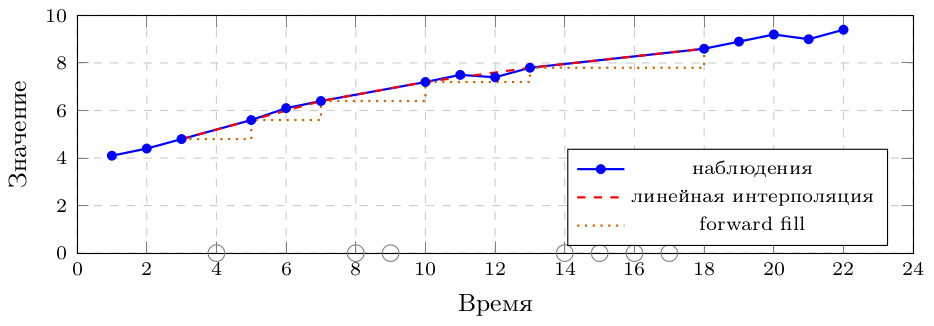

Особенности:

- Пропуск искажает **автокорреляцию** и лаговые признаки (лаг «перепрыгивает» дыру)
- `resample` в pandas **создаёт** строки с NaN — это удобно, но требует явной стратегии
- Длинные дыры нельзя заполнять интерполяцией: лучше флаг + модель
- Для датчиков: Kalman-фильтр даёт оценку состояния и её неопределённость

<span class="callout">Антипаттерн: `df.fillna(method="ffill")` на всём датасете до split — утечка будущего в прошлое.</span>

---

## Валидация: walk-forward (rolling origin)

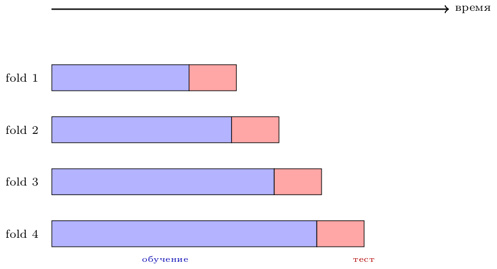

- **Нельзя** `train_test_split(shuffle=True)`: модель увидит будущее
- Нельзя и «просто последние 20%»: одна точка оценки → огромная дисперсия
- **Walk-forward**: обучаем на $[0, t]$, тестируем на $(t, t+h]$, сдвигаем $t$
- Расширяющееся окно (expanding) vs скользящее (sliding) — компромисс «данные / актуальность»
- Между train и test — **gap** = горизонт прогноза, иначе лаги теста окажутся в train

<span class="callout good">Ключевое: все преобразования (масштабирование, target encoding, импутация) фитятся **внутри** каждого фолда на его train-части.</span>

---

## Горизонты прогноза: recursive vs direct

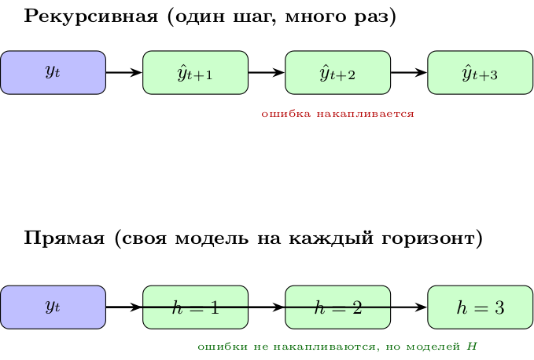

- **Recursive** — одна модель, прогноз подаётся ей же на вход; дёшево, но дрейф ошибки
- **Direct** — отдельная модель на каждый горизонт; устойчивее, но $H$ моделей и меньше данных на дальний горизонт
- **Multi-output** — одна модель предсказывает вектор $\hat{y}_{t+1..t+H}$
- **Гибрид (MIMO / DirRec)** — компромисс, часто лучший на практике

---

## Утечка в TS: как выглядит

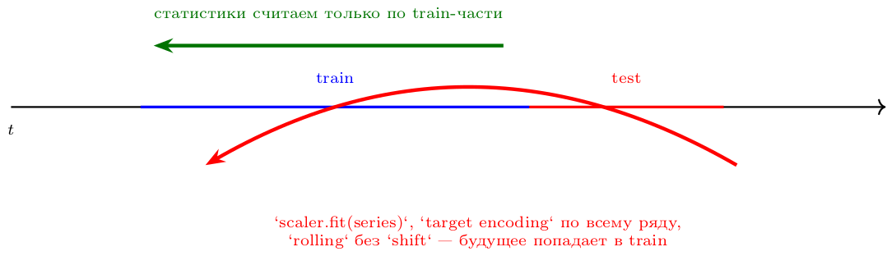

Частые ошибки:

1. `df.rolling(7).mean()` без `shift(1)` — текущее значение в признаке
2. Масштабирование по всей истории
3. Лаги, посчитанные после `resample` с заглядыванием вперёд
4. Признаки-агрегаты «за всё время» (средний чек клиента за всю историю)
5. Случайный `KFold` вместо walk-forward

<span class="callout">Проверка: если метрика на валидации **подозрительно** хороша — ищите утечку, а не радуйтесь.</span>

---

## Метрики прогноза

| Метрика | Формула | Особенность |
|---------|---------|-------------|
| MAE | $\frac{1}{n}\sum\lvert y-\hat{y}\rvert$ | в единицах ряда, устойчива к выбросам |
| RMSE | $\sqrt{\frac{1}{n}\sum (y-\hat{y})^2}$ | штрафует большие ошибки |
| MAPE | $\frac{100\%}{n}\sum\left\lvert\frac{y-\hat{y}}{y}\right\rvert$ | ломается при $y\approx 0$ |
| sMAPE | $\frac{200\%}{n}\sum\frac{\lvert y-\hat{y}\rvert}{\lvert y\rvert+\lvert\hat{y}\rvert}$ | симметричная, но смещена |
| MASE | MAE / MAE naïve | безразмерная, сравнима между рядами |

**Всегда сравнивайте с baseline:**

- naïve: $\hat{y}_{t+h} = y_t$
- seasonal naïve: $\hat{y}_{t+h} = y_{t+h-P}$
- moving average

<span class="callout good">Ключевое: метрика без baseline бессмысленна. MASE < 1 означает «лучше наивного прогноза».</span>

---

## Вопросы для самопроверки (блок 2)

1. Как отличить аддитивную сезонность от мультипликативной?
2. Зачем нужно циклическое кодирование времени, если есть номер месяца?
3. Как выбрать размер скользящего окна и число лагов?
4. Почему `train_test_split(shuffle=True)` недопустим для временного ряда?
5. Чем recursive-стратегия прогноза хуже direct и когда её всё же выбирают?
6. Назовите три способа получить утечку будущего в признаках.

---

## Резюме блока 2

- Декомпозиция (STL) помогает **понять** структуру, а не заменить модель
- Лаги и скользящие окна — основа признаков; всегда со `shift(1)`
- Циклическое кодирование сохраняет близость «краёв» цикла
- Ресемплинг и интерполяция — это **решения**, а не автоматические операции
- Валидация только walk-forward, с gap = горизонту
- Метрики сравниваются с naïve-baseline; MAPE — не универсальна

---

<!-- _class: section -->

# Раздел 3
## Обработка текстовых данных (NLP)

<!-- ~20 мин -->

---

## Задачи NLP в инженерии данных

- **Классификация** — тональность, спам, тема, интент
- **Извлечение информации** — NER, отношения, реквизиты документов
- **Поиск и ранжирование** — BM25, векторный поиск, RAG
- **Дедупликация** — поиск похожих обращений и товаров
- **Нормализация** — приведение справочников к канонической форме
- **Генерация** — суммаризация, ответы (чаще через LLM API)

Три уровня подхода:

1. **Разреженные векторы** (BoW, TF-IDF) — быстро, интерпретируемо, сильный baseline
2. **Статические эмбеддинги** (Word2Vec, GloVe, FastText) — семантика, но без контекста
3. **Контекстные** (BERT, sentence-transformers, LLM) — качество, дороже по ресурсам

---

## Пайплайн обработки текста

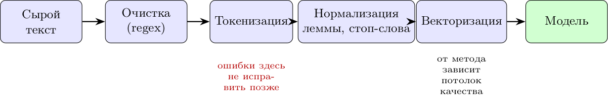

<span class="callout good">Ключевое: для BoW/TF-IDF нормализация обязательна; для BERT — **вредна** (модель обучена на «сыром» тексте с регистром и пунктуацией).</span>

---

## Очистка текста

Типовые операции:

- удаление HTML/XML-тегов, markdown-разметки
- удаление URL, email, телефонов, длинных чисел
- унификация пробелов, неразрывных пробелов, кавычек, дефисов
- приведение к нижнему регистру (не всегда!)
- нормализация Unicode (NFKC), замена ё→е (спорно)
- удаление служебных артефактов парсинга («Подписаться», «Читать далее»)

```python
import re, unicodedata

def clean(text: str) -> str:
    text = re.sub(r"<[^>]+>", " ", text)                 # HTML
    text = re.sub(r"https?://\S+|www\.\S+", " ", text)   # URL
    text = re.sub(r"\S+@\S+\.\S+", " ", text)            # email
    text = unicodedata.normalize("NFKC", text)
    text = re.sub(r"\s+", " ", text)
    return text.strip()
```

<span class="callout">Антипаттерн: агрессивный regex `[^а-яА-Яa-zA-Z0-9\s]` убивает **пунктуацию**, а с ней — границы предложений, эмодзи-тональность и десятичные числа.</span>

---

## Токенизация

| Уровень | Пример | Где применяется |
|---------|--------|-----------------|
| Символьный | `п р и в е т` | опечатки, языки без пробелов |
| Слово | `привет`, `мир` | BoW, TF-IDF |
| Предложение | `Привет! Как дела?` | суммаризация, NER |
| Подслово (BPE, WordPiece, Unigram) | `привет`, `##ствие` | BERT, GPT, LLM |

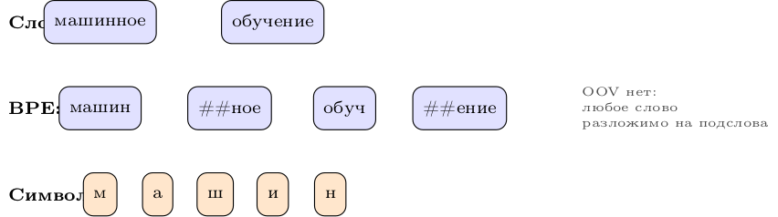

- BPE учит частые пары символов → «словарь компромисса» на 30–100 тыс. токенов
- Русский дороже английского: 1 слово ≈ 2–4 токена → больше стоимость API и длина контекста

---

## Стемминг и лемматизация

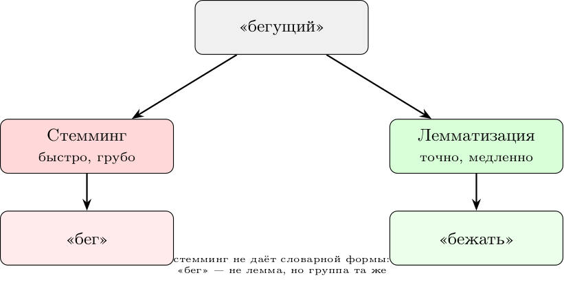

```python
# стемминг
from nltk.stem.snowball import SnowballStemmer
SnowballStemmer("russian").stem("бегущий")       # 'бегущ'

# лемматизация
import spacy
nlp = spacy.load("ru_core_news_sm")
nlp("бегущий")[0].lemma_                          # 'бежать'
```

- Стемминг: дешевле, для поиска и TF-IDF часто достаточно
- Лемматизация: нужна, когда важна семантика и интерпретируемость
- Для BERT **ни то, ни другое**: модель ждёт исходные словоформы

---

## Стоп-слова: когда удалять нельзя

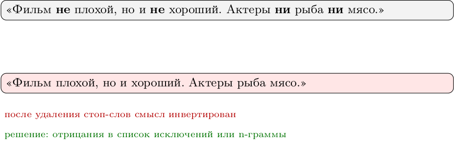

- Удаляйте стоп-слова только для **bag-of-words** моделей и поиска
- Для тональности, NER, NLI — **негации критичны** («не», «ни», «без»)
- В TF-IDF стоп-слова частично решаются через `max_df` (слишком частые слова)
- В BERT/LLM — никакого удаления: служебные слова несут синтаксис

<span class="callout warn">Практика: список стоп-слов — это **гиперпараметр**, проверяйте его на валидации, а не копируйте из туториала.</span>

---

## Bag of Words

$$\text{doc} \rightarrow [c_1, c_2, \dots, c_V]$$

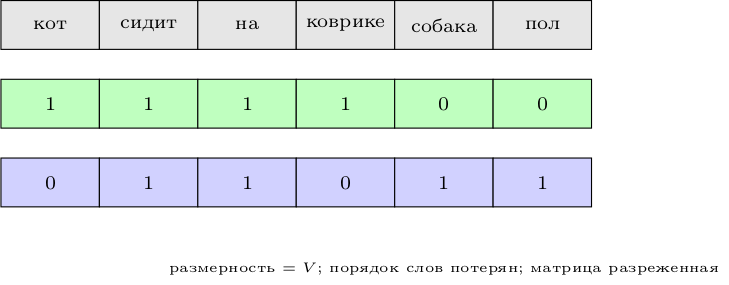

- Просто, быстро, интерпретируемо
- Теряет порядок слов и семантику («не люблю» = «люблю» по мешку)
- Разреженность: 99%+ нулей на реальных словарях
- Работает как baseline, особенно с линейными моделями и Naive Bayes

---

## TF-IDF

$$ \text{TF-IDF} = \text{TF}\cdot\text{IDF}, \qquad \text{TF} = \frac{n_{t,d}}{\sum_{t'} n_{t',d}}, \qquad \text{IDF} = \log\frac{1+N}{1+\text{df}(t)} + 1 $$

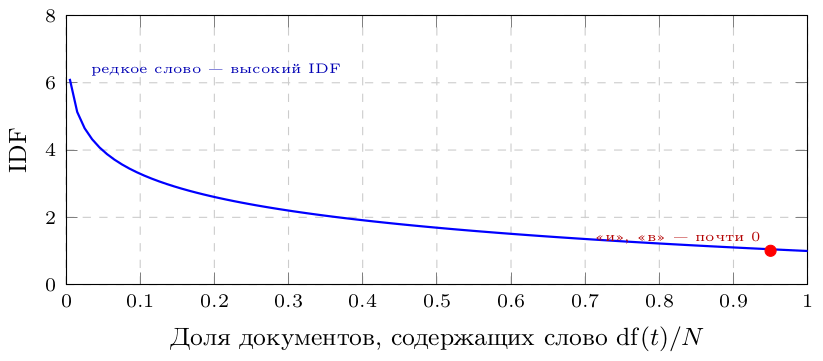

```python
from sklearn.feature_extraction.text import TfidfVectorizer
vec = TfidfVectorizer(max_features=50_000, min_df=3, max_df=0.8,
                      ngram_range=(1, 2), sublinear_tf=True)  # → семинар
X = vec.fit_transform(docs)
```

- **min_df** отсекает опечатки и редкий шум, **max_df** — служебные слова
- `sublinear_tf=True` заменяет $tf$ на $1+\log tf$ — сдерживает «переповтор»

---

## N-граммы

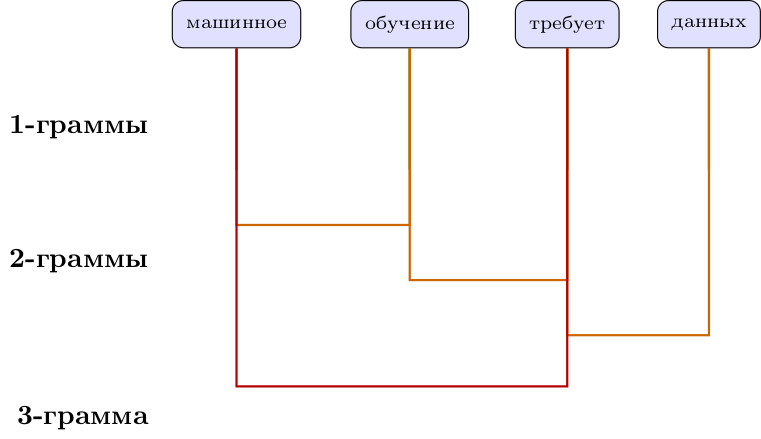

- Биграммы ловят «не плохо», «очень доволен», названия («Нью Йорк»)
- Цена: словарь растёт как $V^k$; нужны `min_df` и `max_features`
- `ngram_range=(1,2)` — почти всегда лучше, чем только униграммы
- Для long-range зависимостей n-граммы не работают — нужны эмбеддинги

---

## Word2Vec: CBOW и Skip-gram

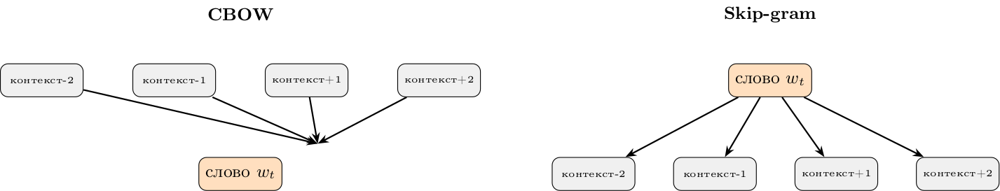

$$ \text{CBOW: } P(w_t \mid w_{t-2}, w_{t-1}, w_{t+1}, w_{t+2}), \qquad \text{Skip-gram: } P(w_{t+j} \mid w_t) $$

- **CBOW** — быстрее, лучше для частых слов
- **Skip-gram** — качественнее на редких словах и малых корпусах
- Обучение: negative sampling / hierarchical softmax вместо полного softmax по $V$
- Гиперпараметры: окно (2–10), размерность (100–300), `min_count`

---

## Что получается в пространстве эмбеддингов

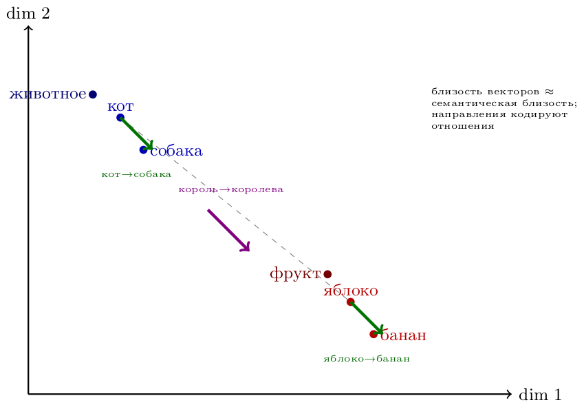

- Косинусное сходство — основная мера близости
- Vector arithmetic: $\vec{king} - \vec{man} + \vec{woman} \approx \vec{queen}$ (на больших корпусах)
- Кластеры отражают предметные области — но и **социальные стереотипы** корпуса
- Один вектор на слово → полисемия теряется («лук» — оружие и растение)

---

## GloVe и FastText

**GloVe** — глобальная факторизация матрицы совместной встречаемости:

$$ J = \sum_{i,j=1}^{V} f(X_{ij})\left(w_i^\top \tilde{w}_j + b_i + \tilde{b}_j - \log X_{ij}\right)^2 $$

- Использует **глобальную** статистику корпуса, а не только локальные окна
- $f(X_{ij})$ — вес, чтобы частые пары не доминировали
- Быстро обучается на больших корпусах, стабильные векторы

**FastText** — эмбеддинг слова как сумма векторов **символьных n-грамм**:

- Решает OOV: вектор «новоеслово» собирается из подслов
- Полезен для морфологически богатых языков (русский, турецкий, финский)
- Работает и как быстрый классификатор текстов

```python
from gensim.models import FastText
model = FastText(sentences, vector_size=100, window=5, min_count=1,
                 min_n=3, max_n=6)   # → семинар
model.wv["новоеслово"]              # вектор есть даже для OOV
```

---

## Контекстные эмбеддинги: BERT

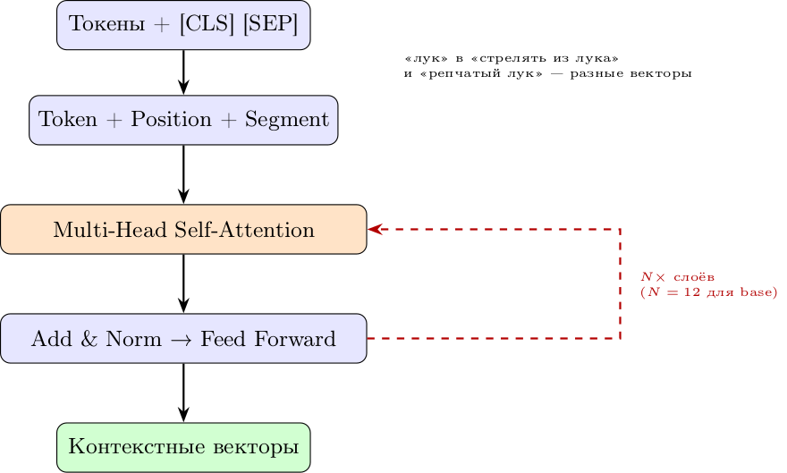

- **Двунаправленность**: контекст слева и справа одновременно (MLM-предобучение)
- Каждый слой даёт своё представление; для задач обычно берут последний или усредняют
- `[CLS]` — агрегированный вектор предложения (для классификации)
- Ограничение — **512 токенов**; длинные документы режутся на чанки

---

## Практика: от BERT к sentence embeddings

```python
from sentence_transformers import SentenceTransformer

model = SentenceTransformer("cointegrated/rubert-tiny2")   # лёгкая русская модель
emb = model.encode(["доставка пришла вовремя", "посылка опоздала"],
                   normalize_embeddings=True)             # → семинар
```

- `[CLS]`-вектор BERT **плохо** работает как вектор предложения без дообучения
- Sentence-transformers обучают на парах (siamese) → косинус осмыслен
- Модели для русского: `rubert-tiny2`, `sberbank-ai/sbert_large_nlu_ru`, `intfloat/multilingual-e5`
- **E5 / BGE** требуют префиксов: `query: ...` и `passage: ...` — иначе качество падает

<span class="callout good">Ключевое: эмбеддинги — тоже преобразование. Их нельзя фитить на тесте, а версию модели нужно версионировать вместе с индексом.</span>

---

## LLM-эмбеддинги и RAG (дополнительно)

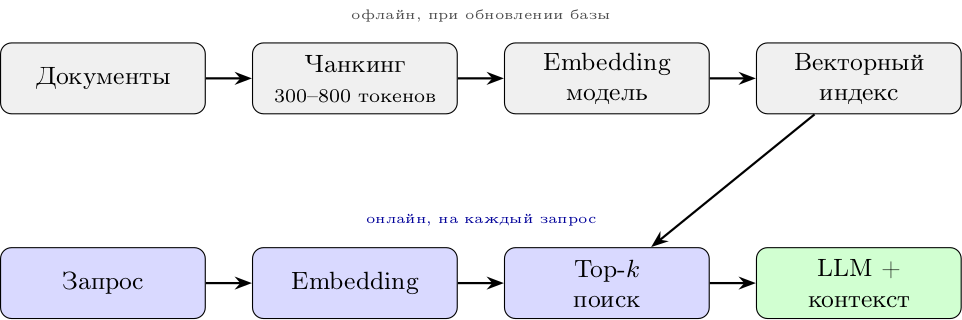

Инженерные решения, влияющие на качество сильнее модели:

- **Чанкинг** по структуре (заголовки, абзацы), с перекрытием 10–20%
- **Гибридный поиск**: BM25 + векторный (RRF) — ловит и точные термины, и перефразы
- **Метаданные и фильтры**: дата, источник, права доступа
- **Reranker** (cross-encoder) на top-50 → top-5
- Оценка — не «нравится/не нравится», а retrieval-метрики: Recall@k, MRR, nDCG

---

## Сравнение методов векторизации

| Метод | Контекст | Размерность | OOV | Обучение | Когда выбирать |
|-------|----------|-------------|-----|----------|----------------|
| BoW | нет | $V$ (большая) | нет | мгновенно | baseline, малые данные |
| TF-IDF | нет | $V$ (большая) | нет | мгновенно | поиск, классика, интерпретация |
| Word2Vec | окно | 100–300 | нет | минуты | сжатие словаря |
| GloVe | глобальная статистика | 100–300 | нет | минуты–часы | стабильные векторы |
| FastText | окно + подслова | 100–300 | **да** | минуты | морфология, опечатки |
| BERT | полный | 768+ | да | часы (fine-tune) | качество на задаче |
| Sentence-transformers | полный | 384–1024 | да | готовые | поиск, кластеризация |
| LLM API | полный | 1024–3072 | да | нет | RAG без своей инфраструктуры |

<span class="callout warn">Практика: сначала TF-IDF + линейная модель. Если не хватает — эмбеддинги. BERT «с нуля» почти никогда не нужен.</span>

---

## NER: извлечение сущностей

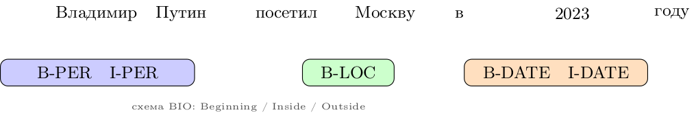

```python
import spacy
nlp = spacy.load("ru_core_news_sm")
doc = nlp("Владимир Путин посетил Москву в 2023 году")
for ent in doc.ents:
    print(ent.text, ent.label_, ent.start_char, ent.end_char)
# Владимир Путин PER 0 14 | Москву LOC 23 29 | 2023 году DATE 32 41
```

- Типы: PER, ORG, LOC, DATE, MONEY, GPE, PRODUCT
- Для домена (медицина, юриспруденция) — дообучение или правила + словари
- NER часто дешевле и точнее делать правилами на регулярках + справочниках

<span class="callout">Важно для пайплайна: сущности → нормализация (к справочнику), иначе «Москва», «г. Москва», «Moscow» — три разных значения.</span>

---

## Тематическое моделирование (LDA)

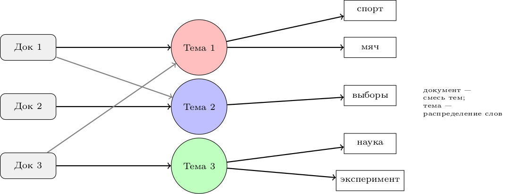

- LDA: документ = смесь тем, тема = распределение слов, всё байесовское
- Вход — мешок слов (TF-IDF обычно не нужен, достаточно счётчиков)
- Число тем $k$ выбирают по когерентности $C_v$ и человеческой интерпретируемости
- Альтернативы: NMF (быстрее), BERTopic (эмбеддинги + кластеризация), Top2Vec
- Для коротких текстов (твиты, заголовки) LDA нестабилен

---

## Вопросы для самопроверки (блок 3)

1. Когда стемминг предпочтительнее лемматизации?
2. В чём преимущество TF-IDF перед «сырыми» счётчиками BoW?
3. Почему для BERT не применяют стоп-слова и лемматизацию?
4. Почему `[CLS]`-вектор BERT без дообучения плох для поиска?
5. Как FastText решает проблему OOV?
6. Как выбрать число тем в LDA и почему perplexity — не лучший критерий?

---

## Резюме блока 3

- Предобработка критична для BoW/TF-IDF и **вредна** для контекстных моделей
- TF-IDF — обязательный baseline, часто недооценённый
- Эмбеддинги захватывают семантику, но требуют нормализации и версионирования
- BERT и sentence-transformers — разные инструменты: классификация vs поиск
- NER и тематическое моделирование дают **признаки**, а не только отчёты
- Для RAG важнее чанкинг и гибридный поиск, чем «самая большая» модель

---

<!-- _class: section -->

# Раздел 4
## Изображения, аудио, мультимодальные данные

<!-- ~20 мин -->

---

## Задачи компьютерного зрения

- **Классификация** — что на изображении (одна метка)
- **Детекция** — что и где (bbox + класс): YOLO, Faster R-CNN, DETR
- **Сегментация** — попиксельная маска: U-Net, Mask R-CNN, SAM
- **OCR** — текст с документов: Tesseract, PaddleOCR, TrOCR
- **Metric learning** — похожесть объектов (поиск по фото, face ID)
- **Генерация** — diffusion-модели (реже в инженерных пайплайнах)

Инженерная реальность:

- 80% качества даёт **данные и разметка**, а не архитектура
- Предобученная модель + правильный препроцессинг почти всегда лучше «своей CNN»
- Основные ошибки — несовпадение препроцессинга train/inference и утечка аугментаций в валидацию

---

## Представление изображения

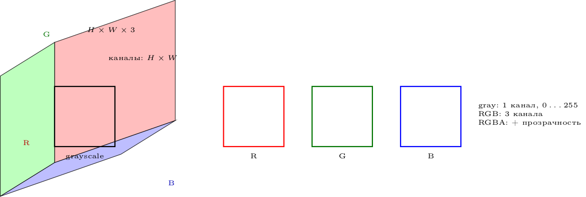

- Пиксель — число $0\dots255$ (`uint8`); модель ждёт `float32`, нормированный
- **Порядок каналов** критичен: OpenCV — BGR, PIL/torchvision — RGB
- Альтернативные пространства: HSV (цвет), LAB (перцептивное), YCbCr (видео)

---

## Изменение размера и интерполяция


| Метод | Скорость | Качество | Когда |
|-------|----------|----------|-------|
| Nearest | самая быстрая | низкое (пикселизация) | маски, метки, `uint8` |
| Bilinear | быстрая | среднее | инференс в реальном времени |
| Bicubic | средняя | хорошее | стандарт для train |

<span class="callout good">Ключевое: одинаковые `Resize` + `Normalize` в train и inference — ошибка №1 при переносе в прод.</span>

---

## Нормализация пикселей и стандарты

$$ x' = \frac{x/255 - \mu}{\sigma} $$

| Вариант | Формула | Где используется |
|---------|---------|------------------|
| $[0,1]$ | $x/255$ | простые CNN, собственные модели |
| $[-1,1]$ | $x/127.5 - 1$ | GAN, diffusion (часто) |
| ImageNet | $\mu=[0.485,0.456,0.406]$, $\sigma=[0.229,0.224,0.225]$ | torchvision, ResNet, ViT |
| Свои статистики | по train-выборке | доменные данные (медицина, спутники) |

```python
import numpy as np
mean = np.array([0.485, 0.456, 0.406], dtype=np.float32)
std  = np.array([0.229, 0.224, 0.225], dtype=np.float32)
x = (img.astype(np.float32) / 255.0 - mean) / std   # HWC
```

<span class="callout">Если брать предобученную модель — **обязательно** её родная нормализация. Она указана в карточке модели (`pretrained_cfg`).</span>

---

## Аугментация: зачем и что меняем


Аугментация создаёт **новые обучающие примеры** из существующих: модель видит инварианты, а не запоминает пиксели.

<span class="callout good">Ключевое: аугментация — часть **train**-пайплайна. Валидация и тест — только `Resize` + `Normalize` (+ `CenterCrop`).</span>

---

## Аугментация: семейства преобразований

| Семейство | Примеры | Типичный риск |
|:----------|:--------|:--------------|
| Геометрия | поворот, сдвиг, масштаб, flip, crop, perspective | обрезка объекта, ложная ориентация |
| Цвет | яркость, контраст, насыщенность, hue, gamma | домены, где цвет = метка (медицина) |
| Искажения | шум, blur, JPEG-артефакты | маскируют мелкие дефекты |
| Регуляризация | cutout, mixup, cutmix | «склеенные» объекты, мягкие метки |
| Политики | RandAugment, TrivialAugment, AutoAugment | подбор под чужой датасет |

```python
transform = transforms.Compose([
    transforms.RandomResizedCrop(224),
    transforms.RandomHorizontalFlip(),
    transforms.ColorJitter(0.2, 0.2, 0.2),
    transforms.ToTensor(),
    transforms.Normalize(MEAN, STD),
])
```

<span class="callout warn">Практика: 2–4 преобразования покрывают большинство задач. Каждое новое проверяйте глазами на 20 примерах.</span>

---

## Когда аугментация вредит

| Ситуация | Опасная аугментация | Почему |
|----------|---------------------|--------|
| Медицина (рентген) | flip, произвольный поворот | левая/правая сторона, ориентация органа |
| OCR, документы | rotation > 5°, crop | текст перестаёт быть читаемым |
| Спутники | flip | привязка к сторонам света |
| Промышленный контроль | color jitter | дефект определяется цветом |
| Числа/знаки | small crop | «6» → «9» |

Ещё две ловушки:

- **Аугментация до split** → идентичные копии в train и val (утечка)
- **Слишком сильная аугментация** на малом датасете → модель учится на нереалистичных данных

<span class="callout warn">Практика: аугментации подбирают по **физике задачи**, а не по списку из туториала. Проверяйте: может ли человек по аугментированной картинке поставить верную метку?</span>

---

## Классические признаки: HOG и SIFT


- **HOG** — гистограммы направлений градиентов по ячейкам + нормализация блоками; основа детектора пешеходов (Dalal–Triggs, 2005)
- **SIFT/SURF/ORB** — ключевые точки, инвариантные к масштабу и повороту; для matching, панорам, SLAM
- Плюсы: работают без GPU и больших данных, интерпретируемы
- Минусы: хуже CNN на сложных классах; чувствительны к освещению (HOG) и требуют текстур (SIFT)

```python
import cv2
sift = cv2.SIFT_create()
kp, desc = sift.detectAndCompute(gray, None)
```

---

## Свёрточная сеть: что происходит с размерностью


- Каждый `conv` — **локальность + разделяемые веса** → меньше параметров, чем у FC
- `stride`/`pool` уменьшают пространство, число каналов растёт
- `GAP` (global average pooling) заменяет огромный FC и снижает переобучение
- Рецептивное поле растёт с глубиной → глубокие слои «видят» объект целиком

<span class="callout">Ошибка новичка: считать, что «больше слоёв = лучше». На малых данных глубокая сеть проигрывает предобученной.</span>

---

## Трансферное обучение


- Низкоуровневые признаки (края, текстуры) универсальны — их не нужно учить заново
- Работает при **любом** размере данных, но выигрыш максимален при малых датасетах
- Чем ближе домен к ImageNet, тем лучше перенос; для рентгена/спутников — доменное предобучение
- Аналогия в NLP: BERT → fine-tune; в аудио: AST, wav2vec2

---

## Стратегии fine-tuning


| Стратегия | Данных | Когда |
|-----------|--------|-------|
| Feature extraction (заморозить всё) | очень мало (<1k) | быстрый baseline, признаки для классики |
| Fine-tune верхних блоков | 1k–10k | домен близок к ImageNet |
| Fine-tune всё, малый LR | >10k | домен далёк |
| Discriminative LR | >10k | нижние слои — LR в 10–100 раз меньше |

<span class="callout warn">Практика: начинайте с feature extraction, затем размораживайте последний блок.</span>

---

## ViT и self-supervised обучение (дополнительно)


- **ViT** режет изображение на патчи и применяет Transformer — та же архитектура, что в NLP
- Без большого предобучения ViT проигрывает CNN (нет индуктивного смещения локальности)
- **Self-supervised**: SimCLR (контрастивные пары), MAE (маскированная реконструкция), DINO
- Для инженерии данных это означает: появились модели **без разметки**, но с эмбеддингами хорошего качества

---

## Аудио: от волны к признакам


$$ \text{mel}(f) = 2595 \log_{10}\!\left(1 + \frac{f}{700}\right) $$

- **Waveform** — сырой сигнал, 16–48 кГц; 1 минута ≈ 5–10 МБ
- **STFT / спектрограмма** — окно 20–40 мс, hop 10–20 мс → картинка «частота × время»
- **Mel** — перцептивная шкала: человек различает низкие частоты точнее
- **MFCC** — DCT от лог-mel-спектра: компактные коэффициенты, хороши для классики

---

## MFCC и практика работы с аудио


```python
import librosa
y, sr = librosa.load("audio.wav", sr=16_000)          # → семинар
mel = librosa.feature.melspectrogram(y=y, sr=sr, n_mels=64)
mfcc = librosa.feature.mfcc(S=librosa.power_to_db(mel), n_mfcc=13)
feat = np.concatenate([mfcc.mean(1), mfcc.std(1)])    # 26 признаков
```

- Усреднение по времени «убивает» динамику: для речи/музыки лучше **покадровые** признаки или CNN/Transformer
- Для классики: MFCC + статистики (mean, std, max, min, skew) — сильный baseline
- Для DL: mel-спектрограмма как изображение → CNN (AST, PANNs)
- Нормализация: `per-channel` по лог-mel, а не по сырому сигналу

---

## Видео


- **Кадры**: `fps`, шаг (каждый 5–10-й кадр), разрешение — компромисс «информация / стоимость»
- **Оптический поток** (Lucas–Kanade, Farnebäck) — движение между кадрами
- **3D-CNN** (I3D, C3D) — свёртка по времени и пространству
- **Two-stream**: RGB + поток; **video transformers** (TimeSformer, VideoMAE)
- Учитывайте **аудио-дорожку**: часто она информативнее картинки

---

## Три стратегии объединения модальностей


Объединять можно **до** модели, **после** моделей или **внутри** (attention). Это три разные инженерные стратегии, а не «уровни качества».

---

## Что выбирать: сравнение стратегий

| Стратегия | Плюсы | Минусы | Когда |
|:----------|:------|:-------|:------|
| Early | просто, одна модель, мало параметров | требует выравнивания по времени, чувствительна к масштабу модальностей | однородные синхронные сенсоры |
| Late | устойчива к пропаже модальности, легко отлаживать | теряет кросс-модальные взаимодействия | разные модели уже готовы |
| Hybrid | учитывает взаимодействия, качество | сложность, дороже обучение | текст + изображение/аудио |
| Cross-attention | модель учит «куда смотреть» | много данных, нестабильное обучение | CLIP-подобные задачи |

Обязательные проверки:

- **Пропуск модальности** на инференсе — модель должна деградировать, а не падать
- **Разная частота** — аудио 16 кГц, видео 30 fps, текст — события: нужна синхронизация
- **Дисбаланс модальностей** — модель может «сесть» на одну и игнорировать остальные
- **Утечка через модальность** — например, метка класса видна на фоне изображения

---

## CLIP: совместное пространство текста и изображения


$$ \mathcal{L} = -\frac{1}{N}\sum_{i=1}^{N} \log \frac{\exp(\langle t_i, v_i\rangle / \tau)}{\sum_{j} \exp(\langle t_i, v_j\rangle / \tau)} $$

- Обучение на 400M пар «картинка–подпись» → общее пространство
- **Zero-shot классификация**: сравнить изображение с текстами «a photo of a cat», «a photo of a dog»
- Для инженерии: быстрый zero-shot фильтр, поиск по изображениям, авторазметка
- Ограничения: плохо с мелким текстом, подсчётом, пространственными отношениями

---

## Вопросы для самопроверки (блок 4)

1. Зачем нужна аугментация и когда она вредит?
2. В чём преимущество трансферного обучения перед обучением «с нуля»?
3. Почему MFCC компактнее сырого сигнала и что при этом теряется?
4. Как объединять модальности и как тестировать отсутствие одной из них?
5. Почему предобученная модель требует **своего** препроцессинга?
6. Где в пайплайне изображений чаще всего возникает утечка?

---

## Резюме блока 4

- Предобработка изображений стандартизирована — соблюдайте её буквально
- Аугментация критична для малых датасетов и опасна при неверной физике
- Трансферное обучение экономит данные, время и GPU
- Спектрограммы и mel — основа аудио-признаков; MFCC — для классики
- Видео = пространство + время; агрегация кадров часто достаточна
- Мультимодальность даёт качество, но требует тестов на пропуск модальности

---

<!-- _class: section -->

# Итоги и практика

---

## Чек-лист пайплайна предобработки


Порядок важен: **сначала split, потом любые статистики**. Всё, что оценивается по данным, обучается только на train.

---

## Типичные ошибки

| Ошибка | Симптом | Исправление |
|--------|---------|-------------|
| Препроцессинг до split | метрика «слишком хорошая» | Pipeline, fit на train |
| `rolling()` без `shift` | утечка таргета | `.shift(1)` перед окном |
| Случайный KFold для TS | завышенное качество | walk-forward + gap |
| Target encoding без OOF | переобучение на редких категориях | out-of-fold + сглаживание |
| Импутация средним при MNAR | смещение, потеря сигнала | индикатор + модель |
| Аугментация в val | метрика не отражает прод | только resize + normalize |
| Балансировка теста | искажённая оценка | балансировать только train |
| Одна точка оценки | огромная дисперсия | CV / несколько фолдов |

<span class="callout good">Ключевое: почти все «необъяснимые» результаты в ML — это утечка или неверная валидация.</span>

---

## Практикум: четыре задания

| № | Тема | Датасет | Ключевое требование |
|---|------|---------|---------------------|
| 1 | Feature Engineering | Titanic / Housing | 5+ новых признаков, сравнение с baseline |
| 2 | Временные ряды | продажи / погода | walk-forward, лаги, календарь |
| 3 | Текст | отзывы / новости | TF-IDF vs эмбеддинги, NER или LDA |
| 4 | Изображения | CIFAR-10 / свои | аугментация + transfer learning |

Общее для всех:

1. EDA и фиксация проблем данных
2. Воспроизводимый `Pipeline` (seed, версии)
3. Сравнение «до/после» на одной и той же валидации
4. Отчёт: что сработало, что нет и **почему**
5. Проверка на утечки (чек-лист со слайда выше)

---

## Критерии оценки

| Критерий | Вес | Что смотрим |
|----------|-----|-------------|
| Корректность методологии | 30% | split, отсутствие утечек, честная валидация |
| Качество решения | 30% | метрики vs baseline, устойчивость |
| Качество кода | 20% | Pipeline, читаемость, воспроизводимость |
| Анализ и визуализация | 10% | графики, интерпретация ошибок |
| Документация | 10% | README, выводы, ограничения |

**Дедлайн:** 2 недели. Сдача — ноутбук + README в репозитории курса.

<span class="callout">Бонус: воспроизводимость «с нуля» на чистом окружении (`requirements.txt` + `make`).</span>

---

## Связь с последующими лекциями

| Лекция | Что из неё вырастает |
|--------|----------------------|
| 5. Разметка данных | предразметка моделью, активное обучение на признаках |
| 6. ETL-пайплайны | трансформации как код, версионирование схем |
| 7. Хранилища | feature store, партиционирование по времени |
| 8. Мониторинг и DevOps | дрейф признаков, тесты трансформаций, CI/CD |

Сквозная линия курса: **признак → пайплайн → хранилище → мониторинг**. Ошибка на первом шаге не исправляется на последнем.

---

## Дополнительные материалы: литература

**Книги**

1. Zheng, A., Casari, A. *Feature Engineering for Machine Learning*. O'Reilly, 2018.
2. Hyndman, R., Athanasopoulos, G. *Forecasting: Principles and Practice* (3rd ed.). OTexts, 2021. — бесплатно: otexts.com/fpp3
3. Kuhn, M., Johnson, K. *Feature Engineering and Selection*. CRC Press, 2019.
4. Géron, A. *Hands-On Machine Learning* (3rd ed.). O'Reilly, 2022.
5. Jurafsky, D., Martin, J. *Speech and Language Processing* (3rd ed. draft). — бесплатно
6. Szeliski, R. *Computer Vision: Algorithms and Applications* (2nd ed.). Springer, 2022.

**Статьи**

7. Vaswani, A. et al. *Attention Is All You Need*. NeurIPS, 2017.
8. Devlin, J. et al. *BERT*. NAACL, 2019. arXiv:1810.04805
9. He, K. et al. *Deep Residual Learning*. CVPR, 2016.
10. Radford, A. et al. *CLIP*. ICML, 2021.
11. Chawla, N. et al. *SMOTE*. JAIR, 2002.
12. Van den Broeck, G. et al. *MICE*. 2006; Stekhoven, D., Bühlmann, P. *missForest*. Bioinformatics, 2012.

---

## Дополнительные материалы: курсы и инструменты

**Курсы и практика**

- Fast.ai — *Practical Deep Learning for Coders*
- Kaggle Learn — *Feature Engineering*, *Time Series*, *NLP*
- Coursera — *Natural Language Processing Specialization* (DeepLearning.AI)
- Hugging Face Course — transformers и datasets
- Google ML Crash Course — базовые концепции

**Библиотеки**

| Задача | Инструменты |
|--------|-------------|
| Таблицы | `scikit-learn`, `category_encoders`, `feature-engine`, `polars` |
| Время | `statsmodels`, `sktime`, `prophet`, `tsfresh`, `nixtla` |
| Текст | `nltk`, `spaCy`, `gensim`, `transformers`, `sentence-transformers` |
| Медиа | `torchvision`, `albumentations`, `librosa`, `OpenCV`, `decord` |
| Пайплайны | `pandas`/`polars`, `dbt`, `MLflow`, `Feast` |

**Данные для практики:** Kaggle Datasets, UCI ML Repository, Hugging Face Datasets, Common Crawl, AudioSet, Open Images.

---

## Вопросы и ответы

**Q:** Как выбрать метод масштабирования?
**A:** От алгоритма: деревьям не нужно; линейным/метрическим — Z-score; при выбросах — Robust.

**Q:** Всегда ли нужна аугментация?
**A:** При малых датасетах — почти всегда; при больших — как регуляризация. Но только если аугментация физически осмысленна.

**Q:** Какой метод векторизации текста лучший?
**A:** TF-IDF как baseline; sentence-transformers для поиска; BERT/fine-tune — когда нужна точность на задаче.

**Q:** Сколько признаков создавать?
**A:** Начните с базовых, добавляйте по гипотезам, проверяйте на валидации, отсекайте feature selection.

**Q:** Как понять, что признак «плохой»?
**A:** Нулевая/нестабильная важность, высокая корреляция с другим, недоступность в проде в момент предсказания.

---

## Ключевые выводы

- **Feature engineering** — искусство и инженерия одновременно: гипотеза → проверка → отбор
- **Утечка данных** — главный риск; лечится структурой (Pipeline, split, walk-forward)
- **Тип данных** определяет методы: числа, категории, время, текст, медиа
- **Baseline обязателен** — иначе непонятно, есть ли прогресс
- **Автоматизация** (FeatureTools, tsfresh, AutoML) экономит время, но не отменяет валидацию
- **Мониторинг** признаков в проде — продолжение лекции 4, а не отдельная задача

---

## Следующие шаги

1. Выполнить практикум (4 задания, дедлайн 2 недели)
2. Воспроизвести 2–3 TikZ-схемы из лекции на своих данных
3. Разобрать один пайплайн из `scikit-learn` целиком и найти в нём потенциальные утечки
4. Прочитать главы 1–3 Hyndman (время) и главу 3 Zheng (текст)
5. Подготовиться к лекции 5 — разметка данных

**Контакты курса:** чат в Telegram/Slack, консультации по пятницам 14:00–16:00, репозиторий с материалами.

---

<!-- _class: title -->

# Спасибо за внимание!

## Вопросы?

**Материалы**
- Схемы: папка `Лекция4_figs/`
- Исходники диаграмм: «Лекция 4 — TikZ источники.md»
- Практикум: 4 задания, дедлайн 2 недели

**Контакты**
- Telegram / Slack курса
- Консультации: пятница, 14:00–16:00

<div class="meta">Следующая лекция — системы разметки и аннотации данных</div>
