<style>
@import url('https://fonts.googleapis.com/css2?family=Inter:wght@400;600;700;800&display=swap');

:root {
  --primary: #1d4ed8;
  --primary-dark: #1e3a8a;
  --accent: #0ea5e9;
  --ink: #0f172a;
  --muted: #64748b;
  --bg: #ffffff;
  --soft: #f1f5f9;
  --teal: #0d9488;
  --amber: #d97706;
  --rose: #e11d48;
}

section {
  font-family: 'Inter', 'Noto Sans', 'Segoe UI', system-ui, sans-serif;
  color: var(--ink);
  background: var(--bg);
  font-size: 22px;
  line-height: 1.3;
  padding: 72px 56px 40px;
}

h1 { font-size: 1.5em; color: var(--primary); margin: 0 0 .35em; font-weight: 800; letter-spacing: -.01em; }
h2 { font-size: 1.18em; color: var(--ink); margin: 0 0 .55em; font-weight: 700; }
h3 { font-size: .82em; color: var(--muted); margin: 0 0 .3em; font-weight: 600; text-transform: uppercase; letter-spacing: .04em; }

ul, ol { margin: 0 0 .55em; padding-left: 1.25em; }
li { margin: .1em 0; }
li strong, li b { color: var(--primary-dark); }
p { margin: 0 0 .5em; }

a { color: var(--primary); }

table { width: 100%; border-collapse: collapse; font-size: .66em; }
th { background: var(--primary); color: #fff; padding: 9px 14px; text-align: left; font-weight: 600; }
td { padding: 8px 14px; border-bottom: 1px solid #e2e8f0; vertical-align: top; }
tr:nth-child(even) td { background: #f8fafc; }

img { display: block; margin: .25em auto; max-width: 100%; max-height: 380px; }

code { background: var(--soft); border-radius: 4px; padding: 1px 6px; font-size: .82em; font-family: 'JetBrains Mono', ui-monospace, monospace; }
pre { background: #0f172a; color: #e2e8f0; border-radius: 10px; padding: 14px 20px; font-size: .52em; line-height: 1.4; }
pre code { background: transparent; color: inherit; padding: 0; }

/* подсветка кода: тёмная палитра под фон pre */
.hljs-comment, .hljs-quote { color: #94a3b8; font-style: italic; }
.hljs-keyword, .hljs-selector-tag, .hljs-built_in, .hljs-type { color: #93c5fd; }
.hljs-string, .hljs-attr, .hljs-regexp { color: #86efac; }
.hljs-number, .hljs-literal, .hljs-symbol { color: #fbbf24; }
.hljs-title, .hljs-section, .hljs-name { color: #f0abfc; }
.hljs-variable, .hljs-template-variable { color: #fca5a5; }
.hljs-meta { color: #cbd5e1; }

.columns { display: grid; grid-template-columns: 1fr 1fr; gap: 48px; align-items: start; }
.cols3 { display: grid; grid-template-columns: 1fr 1fr 1fr; gap: 30px; align-items: start; }

section.section {
  background: linear-gradient(135deg, #0f172a 0%, #1e3a8a 55%, #1d4ed8 100%);
  color: #fff; justify-content: center; text-align: center;
}
section.section h1 { color: #fff; font-size: 2.1em; border: none; }
section.section h2 { color: rgba(255,255,255,.85); font-weight: 400; font-size: 1.1em; }
section.section::after { content: ''; }

section.title {
  background: linear-gradient(135deg, #0f172a 0%, #1e3a8a 55%, #1d4ed8 100%);
  color: #fff; justify-content: center; text-align: center;
}
section.title h1 { color: #fff; font-size: 2.5em; border: none; }
section.title h2 { color: rgba(255,255,255,.9); font-weight: 400; }
section.title p { color: rgba(255,255,255,.8); }
section.title ul, section.title ol, section.section ul, section.section ol { display: inline-block; text-align: left; }
section.title code, section.section code { background: rgba(255,255,255,.16); color: #fff; }

section.title .meta { margin-top: 1.4em; font-size: .8em; color: rgba(255,255,255,.7); letter-spacing: .06em; text-transform: uppercase; }

.callout { display: block; border-left: 5px solid var(--accent); background: #eff6ff; border-radius: 6px; padding: 14px 20px; margin: .5em 0; }
.callout.warn { border-left-color: var(--amber); background: #fffbeb; }
.callout.good { border-left-color: var(--teal); background: #ecfdf5; }
.callout.bad { border-left-color: var(--rose); background: #fef2f2; }

.muted { color: var(--muted); font-size: .8em; }
.small { font-size: .8em; }
.badge { display: inline-block; background: var(--soft); border-radius: 999px; padding: 4px 14px; margin: 3px; font-size: .74em; font-weight: 600; color: var(--primary-dark); }
</style>

<!--
ОБЩИЕ ЗАМЕТКИ К ПРЕЗЕНТАЦИИ
- Хронометраж: ~95 минут. Введение — 10, Блок 1 (платформы) — 20, Блок 2 (активное обучение) — 20,
  Блок 3 (качество) — 20, Блок 4 (автоматизация) — 15, кейсы + итоги — 10
- Баланс: теория ↔ код. Полные листинги разбираются на семинаре, на слайдах — только суть API
- Схемы — PNG из папки Лекция5_figs/ (pdflatex + pdftocairo, 200 dpi);
  исходники всех схем — в файле «Лекция 5 — источники диаграмм.md»
- Mermaid в этой колоде не используется — все схемы переведены в TikZ
- Математика рендерится KaTeX (math: katex)
- Главные выводы оформлены плашками `.callout`
- Слайды с пометкой «доп.» — материал сверх исходной колоды (расширение темы)
- Числа на иллюстративных графиках — синтетические, для демонстрации формы кривой, не результат эксперимента
-->

<!-- _class: title -->

# Лекция 5
## Системы разметки и аннотации данных

<div class="meta">Инженерия данных · Магистратура ИТМО · Осень 2025</div>

---

<!-- _class: section -->

# План лекции

## 4 раздела · 95 минут

---

## План лекции

| Блок | Тема | Время |
|:-----|:-----|:------|
| 0 | Зачем нужна разметка и сколько она стоит | ~10 мин |
| 1 | Платформы для разметки | ~20 мин |
| 2 | Активное обучение и weak supervision | ~20 мин |
| 3 | Контроль качества и агрегация меток | ~20 мин |
| 4 | Автоматизация и HITL | ~15 мин |
| 5 | Кейсы, ML-пайплайн, этика | ~10 мин |

**Формат:** теория + код → детальный разбор кода на семинаре

**Сквозная идея:** разметка — это **производственный процесс**, у которого есть стоимость, пропускная способность, качество и версии. Модель — лишь один из его потребителей.

---

## Карта лекции

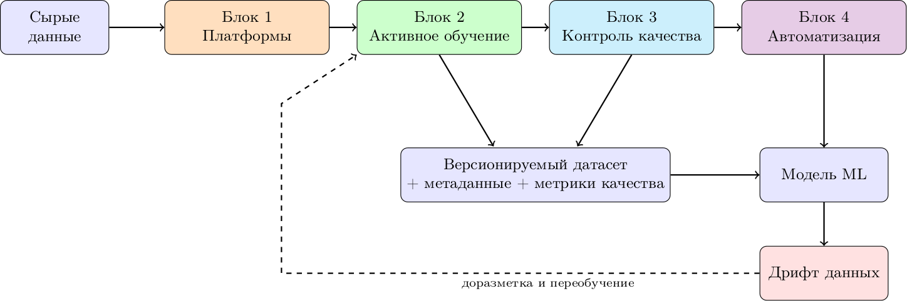

<span class="callout good">Ключевое: разметка — не «одноразовая акция перед обучением», а **замкнутый контур**, который живёт столько же, сколько модель в продакшене.</span>

---

## Цели лекции

После лекции вы сможете:

- **Оценить** стоимость и сроки проекта разметки до его старта
- **Выбрать** платформу и формат задачи под тип данных
- **Спроектировать** цикл активного обучения и посчитать экономию
- **Измерить** качество разметки — согласием, эталонами, моделями
- **Собрать** пайплайн «предразметка → проверка человеком → версия датасета»
- **Аргументировать** решения по этике и оплате труда разметчиков

---

<!-- _class: section -->

# Блок 0
## Зачем нужна разметка

<!-- ~10 мин -->

---

## Три роли разметки

| Роль | Что даёт | Пример |
|:-----|:---------|:-------|
| **Обучение** | целевая переменная $y$ | классы, боксы, сущности |
| **Оценка** | ground truth для метрик | тест-сет 2–5 тыс. примеров |
| **Спецификация** | формализация требований | «что считается оскорблением» |

- Разметка — это **перевод человеческого суждения в данные**
- Значительная часть «требований» к ML-системе существует только в виде инструкции разметчику
- Датасет — такой же артефакт производства, как код: у него есть автор, версия и дефекты

---

## Типы задач разметки

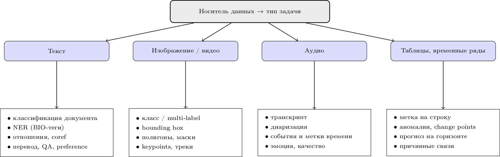

<span class="callout good">Ключевое: **дорогие** задачи — там, где один объект требует много решений (маски, треки). Дешёвые — одна метка на объект.</span>

---

## Анатомия одного объекта разметки

<!-- доп. -->

- **Единица разметки** (unit): документ, предложение, окно 10 с, кадр, пара «запрос-ответ»
- **Схема** (schema): набор допустимых меток + правила их применения
- **Контекст**: что разметчик видит рядом с объектом (история, метаданные, соседние кадры)
- **Неоднозначность**: что делать, если объект не подходит ни под одну метку

| Решение | Хорошо | Плохо |
|:--------|:-------|:------|
| Единица | короткая, самодостаточная | требует весь документ в голове |
| Схема | 5–15 взаимоисключающих меток | 60 меток «на всякий случай» |
| Неоднозначность | явная метка `unknown` + правило | «разметчик разберётся» |

---

## Сколько стоит разметка: модель затрат

<!-- доп. -->

$$
C_{\text{total}} = N \cdot \big(c_{\text{annot}} + k \cdot c_{\text{review}} + c_{\text{rework}}\big) + C_{\text{setup}} + C_{\text{infra}}
$$

- $N$ — число объектов, $k$ — кратность перекрёстной проверки
- $C_{\text{setup}}$ — инструкции, пилот, обучение команды: **обычно 15–30% бюджета**
- $c_{\text{rework}} = p_{\text{err}} \cdot c_{\text{annot}}$ — переделка после QA
- Скрытые статьи: онбординг, калибровка, споры, тулинг, простой

<span class="callout good">Ключевое: в смете «на разметку» обычно забывают **QA и переделку**. Без них цифра занижается в 1,5–2 раза.</span>

---

## Видимая и скрытая часть проекта

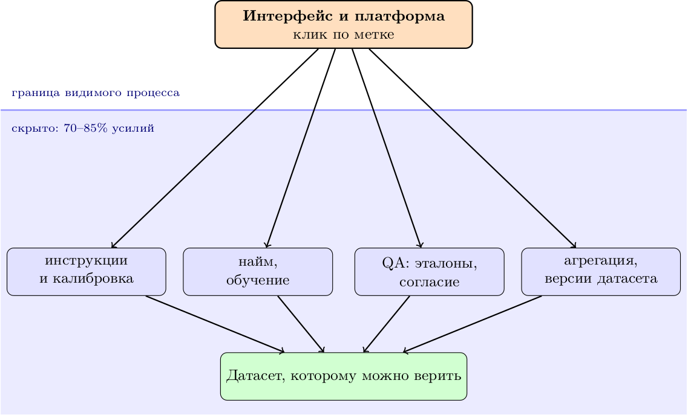

<span class="callout good">Ключевое: платформа — это **10% проблемы**. Остальное — процесс, люди и контроль качества.</span>

---

## Вызовы, с которыми вы точно столкнётесь

- **Стоимость**: ручная работа масштабируется линейно, бюджет — нет
- **Субъективность**: нет «истины», есть распределение суждений
- **Согласованность**: два разметчика дают разные метки на одном объекте
- **Дрейф инструкций**: правила меняются, старые метки уже невалидны
- **Утечки**: разметчик видит тест-сет; одна и та же сущность в train и test
- **Хрупкость процесса**: ушёл ведущий разметчик — ушло знание

<span class="callout good">Ключевое: почти все проблемы разметки — **не про инструмент, а про неопределённость задачи**. Побеждает тот, кто управляет неопределённостью, а не тот, кто купил платформу.</span>

---

## Вопрос для обсуждения

**Какие проблемы возникают при разметке данных в ваших проектах?**

Что из этого — про инструмент, а что — про постановку задачи?

---

<!-- _class: section -->

# Блок 1
## Платформы для разметки

<!-- ~20 мин -->

---

## Что должна уметь платформа

<!-- доп.: критерии выбора вместо простого списка -->

| Требование | Зачем | Проверка на пилоте |
|:-----------|:------|:-------------------|
| Формат задачи | NER ≠ боксы ≠ аудио | 5 минут реальной разметки |
| Управление проектом | очередь, назначения, роли | распределить 100 задач на 3 человека |
| QA встроенный | эталоны, доля проверок, согласие | включить 10% двойной разметки |
| API / SDK | автозагрузка и выгрузка | выгрузить в нужном формате за час |
| ML-бэкенд | предразметка, активное обучение | подклеить модель с порогом |
| Развёртывание | on-prem / облако / GDPR | развернуть там, где можно данные |

<span class="callout good">Ключевое: критерий выбора — **не список фич, а время до первого валидного датасета** на вашей задаче.</span>

---

## Label Studio

<div class="columns">
<div>

- Open-source (Apache 2.0), self-hosted, есть облачная версия
- Один конфиг-файл (XML-подобный `label_config`) описывает интерфейс
- Мультимодальность: текст, изображения, аудио, видео, HTML, PDF, временные ряды
- REST API + Python SDK; webhooks на события разметки
- ML-backend: предразметка, активное обучение, авто-приём предсказаний

</div>
<div>

```python
from label_studio_sdk import Client

ls = Client(url="http://localhost:8080", api_key="...")
project = ls.start_project(
    title="NER для новостей",
    label_config="""
    <View>
      <Text name="text" value="$text"/>
      <Labels name="label" toName="text">
        <Label value="PER" background="#e74c3c"/>
        <Label value="ORG" background="#3498db"/>
        <Label value="LOC" background="#2ecc71"/>
      </Labels>
    </View>
    """
)
```

</div>
</div>

<span class="callout warn">Практика: начинайте с `label_config` в git — интерфейс разметки тоже версионируется.</span>

---

## Prodigy

- От создателей spaCy (Explosion), коммерческая лицензия (per-seat)
- Фокус — **NLP и потоковая разметка**: NER, классификация, spans, relations, coref
- Активное обучение и `ner.teach` / `textcat.teach` «из коробки»
- Конфигурация — Python-скриптами (`prodigy.json`, рецепты), а не XML
- Данные — JSONL, легко склеиваются с пайплайном spaCy

```bash
# потоковая разметка с активным обучением
prodigy ner.teach news_ner ./model ./data/news.jsonl \
        --label PER,ORG,LOC --unsegmented
```

<span class="callout good">Ключевое: Prodigy продаёт не интерфейс, а **рецепт «модель в цикле»**. Если у вас NLP и Python-команда — это самый короткий путь.</span>

---

## Labelbox

- Enterprise-платформа (SaaS, on-prem по запросу)
- Сильный блок **операционного управления**: команды, роли, ёмкость, SLA
- Встроенная аналитика: скорость, качество, стоимость по проектам и людям
- Model-assisted labeling, автоматизация QA (consensus, benchmark-наборы)
- Интеграции с CV-стеком: маски, полигоны, видео-трекинг, 3D-облака точек

| Плюс | Минус |
|:-----|:------|
| Готовый процесс на 50+ разметчиков | Цена и vendor lock-in |
| Аудит и отчётность для заказчика | Избыточно для пилота |

---

## Amazon SageMaker Ground Truth

- Управляемый сервис AWS: инфраструктура, воркфлоу, аудит — на стороне провайдера
- Три источника труда: **private workforce**, **vendor workforce**, **Mechanical Turk**
- Automatic data labeling: предразметка моделью + порог уверенности → человеку только спорное
- Pay-per-use: платите за размеченный объект, а не за место
- Ground Truth Plus — полностью управляемая команда разметки

<span class="callout good">Ключевое: покупая Ground Truth, вы покупаете **не софт, а операционный процесс**. Это правильный выбор, когда команды разметки нет и не планируется.</span>

---

## Сравнение платформ

| | Label Studio | Prodigy | Labelbox | Ground Truth |
|:--|:--|:--|:--|:--|
| Лицензия | OSS / Cloud | Commercial | Enterprise SaaS | AWS, pay-per-use |
| Развёртывание | self-host | локально | облако | облако AWS |
| Сильные данные | мультимодальные | текст | CV, видео | любые, «под ключ» |
| Активное обучение | через ML-backend | встроено | есть | встроено |
| Операционный QA | базовый | минимальный | сильный | сильный |
| Барьер входа | низкий | средний (Python) | высокий (деньги) | средний (AWS) |
| Кому | пилот, research | NLP-команда | enterprise CV | нет своей команды |

---

## Дерево выбора платформы

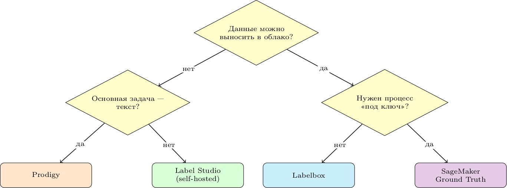

- Бюджет ограничен → OSS (Label Studio, CVAT, Doccano) + свои руки
- Много CV и большая команда → Labelbox / Supervisely / CVAT
- Нет команды разметки вообще → managed-сервис

---

## Интерфейсы для текста

| Задача | Что видит разметчик | Формат метки |
|:-------|:--------------------|:-------------|
| Классификация | документ + кнопки классов | `label` |
| Multi-label | документ + чекбоксы | набор меток |
| NER | текст + подсветка span | `(start, end, type)` |
| Relations | две сущности + стрелка | `(head, tail, rel)` |
| Coreference | цепочки упоминаний | кластеры |
| QA | вопрос + контекст + ответ | `(start, end)` |
| Preference | два ответа модели | `A / B / tie` |

- BIO-схема: `B-PER`, `I-PER`, `O` — стандарт де-факто для последовательностей
- Span-разметка устойчивее к переносу строк, token-level — к токенизатору

---

## Интерфейсы для изображений и видео

| Задача | Инструмент | Стоимость объекта |
|:-------|:-----------|:------------------|
| Классификация | кнопки классов | низкая |
| Детекция | bounding box | средняя |
| Instance segmentation | полигон / маска | высокая |
| Semantic segmentation | маска по пикселям | очень высокая |
| Keypoints | точки + скелет | средняя |
| Tracking | бокс + ID между кадрами | очень высокая |

- Полигон из 40 точек стоит в 5–10 раз дороже бокса — выбирайте минимально достаточный формат
- В видео размечают **каждый $k$-й кадр**, остальное — интерполяцией (её надо валидировать)

<span class="callout good">Ключевое: формат разметки должен совпадать с **выходом модели**: лишняя точность масок не улучшит детектор боксов.</span>

---

## Интерфейсы для аудио и временных рядов

- **Транскрипция**: сегменты + текст; диаризация — «кто говорит»
- **События**: интервалы с метками (кашель, музыка, речь)
- **Качество**: MOS-оценки, наличие шума, клиппинг
- **Временные ряды**: аномалии, change points, режимы работы оборудования
- Ключевая сложность — **границы**: где кончается событие, решается субъективно

```
# формат аннотации аудио (упрощённо)
{"file": "call_0412.wav", "start": 12.4, "end": 15.9,
 "speaker": "SPK_2", "text": "перезагрузите роутер", "event": null}
```

<span class="callout good">Ключевое: договоритесь о **допуске на границу** (например, ±100 мс) и запишите его в инструкцию — иначе согласие никогда не сойдётся.</span>

---

## Пайплайн разметки в общем виде

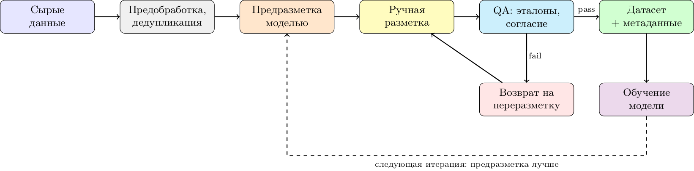

<span class="callout good">Ключевое: на второй итерации меняется только одно звено — **качество предразметки**. Остальной процесс должен быть неизменным, иначе вы не измерите улучшение.</span>

---

## Управление проектом разметки

**До старта**

- Цели и метрики: какое качество модели считается достаточным?
- Инструкция (guidelines) с примерами **и антипримерами**
- Пилот на 100–300 объектах: замер времени, согласия, неоднозначностей
- Смета: часы × ставка + QA + переделка

**В процессе**

- Онбординг: тестовое задание + разбор ошибок
- Распределение: стратификация по сложности, не «всё подряд»
- Мониторинг: скорость, согласие, доля `unknown`
- Еженедельная калибровка: разбор спорных случаев → правка инструкции

<span class="callout good">Ключевое: инструкция — **живой документ**. Если за месяц она не изменилась, вы либо не смотрите на ошибки, либо задача тривиальна.</span>

---

## Инструкция разметчика: что в ней должно быть

<!-- доп. -->

1. **Определение метки** через критерий, а не через пример («содержит прямую просьбу о действии»)
2. **Границы**: что входит в объект, что нет (включая границы span/бокса)
3. **Приоритет меток** при конфликте: какая побеждает
4. **Правило для неоднозначного**: `unknown`, `skip`, эскалация
5. **10–20 пограничных примеров** с объяснением решения
6. **Чего делать нельзя**: гуглить, додумывать, исправлять текст

| Антипаттерн | Почему плохо |
|:------------|:-------------|
| «Размечайте спам» | нет критерия → каждый понимает своё |
| 40 примеров без контрпримеров | разметчик не видит границу класса |
| Молчание про неоднозначность | скрытая метка «на усмотрение» |

---

## Пример: проект в Label Studio целиком

```python
import pandas as pd
from label_studio_sdk import Client

ls = Client(url="http://localhost:8080", api_key=API_KEY)
project = ls.start_project(title="Sentiment v1", label_config=open("config.xml").read())

# 1. загрузка задач пачками
tasks = [{"data": {"text": t, "meta": {"src": s}}} for t, s in df[["text", "src"]].values]
project.import_tasks(tasks)

# 2. предразметка из модели (predictions)
project.create_predictions([{
    "task": task_id,
    "result": [{"from_name": "label", "to_name": "text", "type": "choices",
                "value": {"choices": ["positive"]}}],
    "score": 0.93
}])

# 3. выгрузка готового
exported = project.export_tasks(export_type="JSON")
```

<span class="callout warn">Практика: храните `label_config.xml`, инструкцию и скрипт загрузки **в одном репозитории** с версией датасета.</span>

---

## Вопрос для размышления

**Как выбрать платформу разметки для проекта с ограниченным бюджетом?**

Подсказка: считайте не стоимость лицензии, а стоимость часа работы разметчика, умноженную на часы до готового датасета.

---

## Резюме блока 1

- Платформа — это **ускоритель процесса**, а не замена процессу
- Выбор определяется типом данных, масштабом и наличием команды
- Ключевые критерии: формат задачи, API, встроенный QA, ML-бэкенд
- Open-source решения конкурентоспособны для пилотов и research
- Управление проектом (инструкции, пилот, калибровка) важнее выбора софта

---

<!-- _class: section -->

# Блок 2
## Активное обучение и weak supervision

<!-- ~20 мин -->

---

## Основная идея активного обучения

- Модель сама выбирает, **какие примеры размечать следующими**
- Цель — максимум прироста качества на единицу бюджета, а не максимум данных
- Работает, когда: данных много, разметка дорогая, классов немного
- Не работает, когда: данных мало, шум в фичах, классы сильно разбалансированы без стратификации

$$
\max_{\mathcal{L}} \; \mathbb{E}_{(x,y)\sim \mathcal{D}}\big[\text{quality}(f_{\mathcal{L}\cup\{(x,y)\}})\big]
\quad \text{при} \quad |\mathcal{L}| \le B
$$

- $\mathcal{L}$ — размеченное множество, $B$ — бюджет разметки
- На практике задачу решают **жадно**: на каждом шаге выбираем батч $Q$ из пула $\mathcal{U}$

<span class="callout good">Ключевое: активное обучение меняет не модель, а **порядок поступления данных**. Это самый дешёвый способ сэкономить на разметке.</span>

---

## Цикл активного обучения

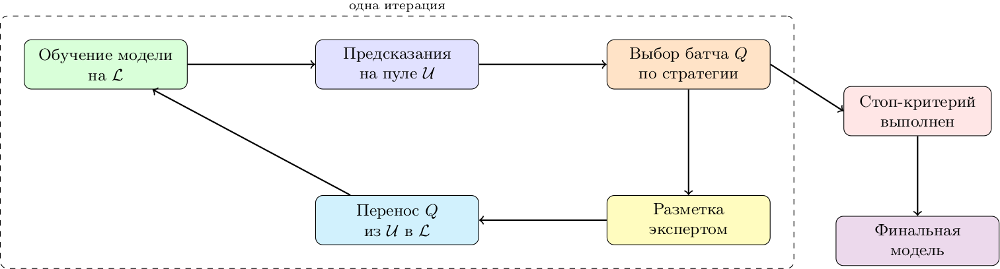

<span class="callout good">Ключевое: активное обучение — это **цикл**, а не функция. Ценность появляется, когда цикл автоматизирован и запускается без ручной сборки.</span>

---

## Uncertainty sampling: три классических правила

Для одного объекта $x$ с предсказанием $p(y\mid x)$:

**Least confidence** — берём там, где модель менее уверена в лучшем классе:

$$
x^* = \arg\max_{x} \Big(1 - \max_{y} p(y\mid x)\Big)
$$

**Margin sampling** — минимальная разница между топ-1 и топ-2:

$$
x^* = \arg\min_{x} \Big( p(y_1\mid x) - p(y_2\mid x) \Big)
$$

**Entropy** — максимальная неопределённость всего распределения:

$$
x^* = \arg\max_{x} H(y\mid x) = -\sum_{k} p(y_k\mid x)\log p(y_k\mid x)
$$

- Margin лучше работает при многих классах, entropy — универсальнее
- Все три требуют **откалиброванных** вероятностей (см. слайд про калибровку)

---

## Как выглядят три правила

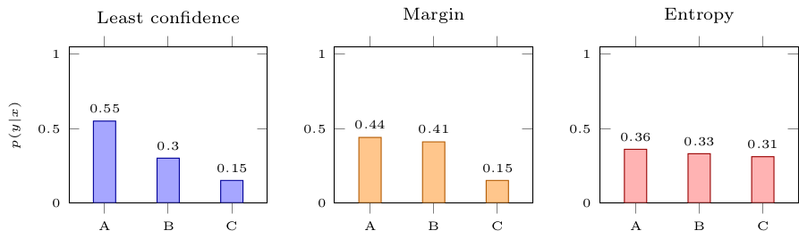

- Слева LC и margin согласны, в центре margin точнее, справа максимум у entropy

---

## Diversity sampling: покрытие, а не сомнение

- Uncertainty игнорирует **дубликаты**: 200 почти одинаковых «сомнительных» объектов
- Diversity выбирает **представителей** облака неразмеченных данных
- Методы: k-means по эмбеддингам, k-center greedy, DBSCAN, иерархическая кластеризация, core-set

$$
\text{k-center greedy:}\quad x^* = \arg\max_{x \in \mathcal{U}} \; \min_{s \in \mathcal{L}} \; \| \phi(x) - \phi(s) \|_2
$$

- $\phi(x)$ — эмбеддинг (BERT, CLIP, ResNet, TF-IDF/SVD)
- Жадно берём самый далёкий от уже размеченных — покрываем пространство
- Дешёво по вычислениям, устойчиво к дисбалансу

<span class="callout good">Ключевое: uncertainty отвечает «где модель ошибается», diversity — «чего модель ещё не видела». Нужны оба ответа.</span>

---

## Diversity на картинке

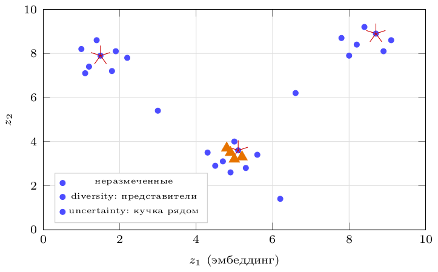

- Uncertainty «залипает» в одной неопределённой области
- Diversity даёт три разных региона — больше информации на батч
- Компромисс: **кластеризация → uncertainty внутри кластера** (BADGE, k-means + margin)

---

## Query-by-Committee и байесовские подходы

**QBC**: ансамбль моделей $f_1,\dots,f_M$, обученных на разных подвыборках/инициализациях

$$
\text{vote entropy} = -\sum_{k} \frac{V(y_k)}{M}\log\frac{V(y_k)}{M},
\qquad
\text{KL} = \frac{1}{M}\sum_{m} D_{KL}\big(p_m \,\|\, \bar{p}\big)
$$

- Выбираем объект **максимального разногласия** комитета
- Дороже: нужно $M$ моделей или MC-dropout

**BALD** (Bayesian Active Learning by Disagreement) — взаимная информация:

$$
x^* = \arg\max_x \; H\big(y\mid x, \mathcal{L}\big) - \mathbb{E}_{p(\theta\mid \mathcal{L})}\big[H\big(y\mid x,\theta\big)\big]
$$

- Первое слагаемое — общая неопределённость, второе — «шум» модели
- Максимум там, где модели **уверены по-разному**, а не там, где все растеряны

---

## Другие критерии: что ещё оптимизируют

| Критерий | Идея | Цена |
|:---------|:-----|:-----|
| Expected Error Reduction | ожидаемое снижение ошибки после разметки | очень высокая |
| Expected Model Change | ожидаемое изменение градиента/параметров | высокая |
| Core-set / k-center | покрытие пространства эмбеддингов | низкая |
| BADGE | k-means++ по градиентным эмбеддингам | средняя |
| Cost-sensitive | максимум пользы на рубль, а не на объект | зависит от задачи |
| Cold-start (warm-up) | первые $n_0$ — случайно/стратифицированно | обязательный приём |

$$
\text{Expected Model Change:}\quad x^* = \arg\max_x \mathbb{E}_{y}\big[\|\nabla_\theta \ell(x,y)\|\big]
$$

<span class="callout good">Ключевое: на старте модель **не умеет** оценивать свою неопределённость. Первые 50–200 объектов берите случайно — иначе получите смещённый датасет.</span>

---

## Сколько это экономит: learning curves

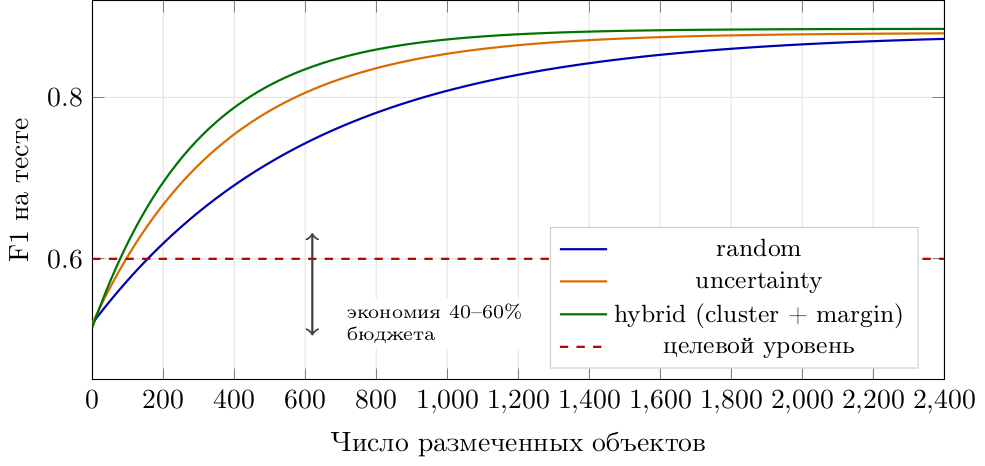

- Форма кривой универсальна: $\text{quality}(n) \approx q_{\max} - a e^{-n/\tau}$
- Выигрыш активного обучения — сдвиг $\tau$, а не $q_{\max}$: **потолок задаёт разметка и признаки**
- Кривые нужно строить на **своей** задаче: литературные цифры переносятся плохо

---

## Батчи, остановка и бюджетирование

**Размер батча** — компромисс:

- $|Q|=1$ — оптимально по информации, невыносимо по накладным расходам
- $|Q|$ = 50–500 — практичный диапазон, но внутри батча нужна диверсификация
- Большой батч «залипает» в одной области → чередуйте стратегии

**Стоп-критерии:**

- Модель достигла целевой метрики → дальше не тратим
- Прирост за итерацию $< \varepsilon$ (например, $\Delta F1 < 0.002$)
- Бюджет исчерпан по часам, а не по объектам
- Согласие модели с человеком на свежих данных стабилизировалось

**Распределение бюджета:** 60–70% — активное обучение, 15–20% — эталоны и QA, 15% — пилот и инструкции.

<span class="callout good">Ключевое: «сколько ещё размечать» — это **решение о остановке**, и принимать его надо по кривой, а не по ощущению.</span>

---

## Semi-supervised learning: используем неразмеченное

| Подход | Идея | Пример |
|:-------|:-----|:-------|
| Self-training | свои же предсказания как метки | `SelfTrainingClassifier` |
| Co-training | два «взгляда» на данные учат друг друга | текст + метаданные |
| Consistency | предсказание не должно меняться от аугментации | FixMatch, UDA |
| Graph-based | метки распространяются по графу близости | label propagation |
| Generative | модель данных + метки | VAE, смеси |

- Ключевое допущение: **кластеры согласованы с классами** (cluster assumption)
- Ошибки псевдометок усиливаются итеративно → нужен порог и валидация

---

## Self-training: цикл

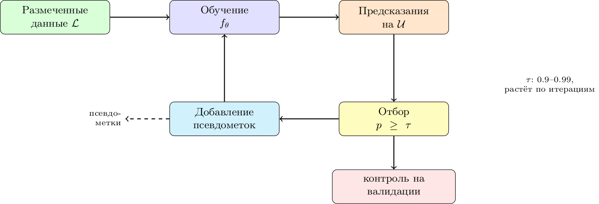

<span class="callout good">Ключевое: псевдометки — **не бесплатная разметка**, а регуляризация. Если модель ошибается систематически, self-training закрепляет ошибку.</span>

---

## Псевдоразметка в коде

```python
from sklearn.semi_supervised import SelfTrainingClassifier
from sklearn.ensemble import RandomForestClassifier

# y = -1 для объектов без метки
base = RandomForestClassifier(n_estimators=300, class_weight="balanced")
st = SelfTrainingClassifier(base, threshold=0.9, max_iter=10, verbose=True)

st.fit(X_combined, y_combined)   # y_combined: классы и -1

# что именно «дометнулось» — видно по атрибуту
pseudo_mask = st.transduction_ != -1
print(f"псевдометок: {pseudo_mask.sum()} из {(y_combined == -1).sum()}")
```

- Порог 0.9 на несбалансированных данных пропустит редкий класс → начинайте с 0.8 и смотрите per-class precision
- Всегда держите **чистый** отложенный набор: псевдометки не должны попасть в оценку

---

## Weak supervision: разметка программами

**Идея:** вместо ручных меток пишем **функции разметки** (labeling functions, LF) — эвристики, словари, регулярки, вызовы моделей — и объединяем их шумные голоса вероятностной моделью.

- LF возвращает метку или `ABSTAIN` (воздержался)
- Каждая LF **несовершенна**: у неё есть покрытие, точность, конфликты
- Label model оценивает точности LF **без разметки** и выдаёт вероятностные метки
- End model учится на этих вероятностных метках

```python
from snorkel.labeling import labeling_function, ABSTAIN
@labeling_function()
def has_urgent_words(x):
    words = {"срочно", "критично", "авария"}
    return SPAM if words & set(x.text.lower().split()) else ABSTAIN

@labeling_function()
def too_long(x):
    return HAM if len(x.text.split()) > 120 else ABSTAIN
```

<span class="callout good">Ключевое: weak supervision сдвигает труд с «размечать объекты» на «писать и отлаживать правила». Это выгодно, когда правило живёт долго.</span>

---

## Snorkel: от функций к вероятностным меткам

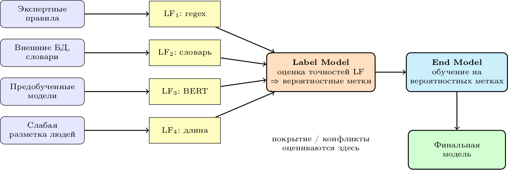

- Диагностика LF: **coverage**, **overlap**, **conflict**; LF хуже случайной лучше удалить
- Классика: Snorkel (Ratner et al.), развитие — Snorkel Flow, weak supervision + LLM

---

## Когда что применять

| Ситуация | Инструмент | Почему |
|:---------|:-----------|:-------|
| Много данных, дорогая разметка | active learning | экономия 40–60% бюджета |
| Есть сильные правила/словари | weak supervision | правила дешевле людей |
| Есть немного меток и много сырья | self-training | использует структуру данных |
| Метки нужны быстро и «примерно» | предразметка LLM + выборочная проверка | скорость |
| Высокая цена ошибки | только люди + QA | control |

<span class="callout good">Ключевое: подходы **комбинируются**. Типичный продакшн-рецепт: правила → предразметка моделью → активное обучение на остатке → QA.</span>

---

## Вопрос для обсуждения

**В каких случаях активное обучение может быть неэффективным?**

Обсудите: холодный старт, шумные признаки, разбалансированные классы, дрейф, задачи с дорогим inference.

---

## Резюме блока 2

- Активное обучение снижает затраты, меняя **порядок** поступления данных
- Стратегии: uncertainty, diversity, QBC/BALD, cost-sensitive; на старте — случайная выборка
- Экономию измеряют learning curve, а не обещаниями статьи
- Semi-supervised использует неразмеченные данные, но усиливает систематические ошибки
- Weak supervision превращает правила в вероятностные метки
- Лучший результат — **комбинация** подходов, а не один «серебряный патрон»

---

<!-- _class: section -->

# Блок 3
## Контроль качества и агрегация меток

<!-- ~20 мин -->

---

## Почему качество меток — это деньги

- Шум в метках **снижает потолок** любой модели: даже идеальный алгоритм учится на испорченных $y$
- 5–10% случайного шума терпимо; **систематический** шум (смещение) не исправляется объёмом данных
- Ошибки разметки попадают в тест-сет → метрики врут → решения принимаются неверно
- Переделка датасета дороже, чем QA на входе: переразметка = полная стоимость + потерянное время

$$
\text{quality}_{\text{system}} \le \text{quality}_{\text{labels}} \cdot \text{quality}_{\text{model}}
$$

- «Data cascades» (Sambasivan et al., CHI 2021): мелкие дефекты данных накапливаются и всплывают на поздних стадиях — там, где исправление дороже всего

<span class="callout good">Ключевое: QA — не бюрократия, а **страховка от переделки**. Дешевле проверить 10%, чем переразмечать 100%.</span>

---

## Источники ошибок

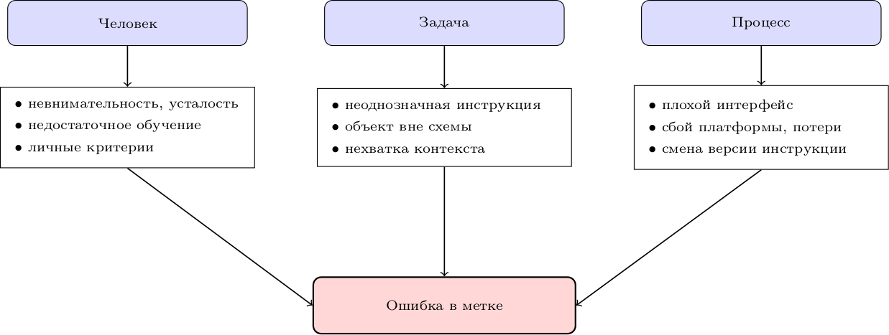

- Человеческие ошибки **случайны** → лечатся агрегацией
- Ошибки задачи и процесса **систематические** → не лечатся агрегацией, только переделкой инструкции

---

## Две разные вещи: надёжность и валидность

| | Надёжность (reliability) | Валидность (validity) |
|:--|:--|:--|
| Вопрос | «согласны ли разметчики?» | «правильно ли мы измеряем?» |
| Метрика | Cohen/Fleiss/Krippendorff | эталон, внешний критерий, связь с целевым исходом |
| Бывает высокой при | единодушном заблуждении | — |
| Проверка | двойная разметка | эксперт-эталон, аудит, связь с бизнес-метрикой |

- 10 разметчиков могут **согласованно** ставить неверную метку
- Высокое согласие — необходимое, но **не достаточное** условие
- Поэтому нужны и согласие, и **золотой стандарт**

<span class="callout good">Ключевое: согласие измеряет консистентность, а не истину. Ошибка в инструкции даёт идеальный kappa и бесполезный датасет.</span>

---

## Cohen's Kappa: согласие с поправкой на случай

$$
\kappa = \frac{p_o - p_e}{1 - p_e}
$$

- $p_o$ — наблюдаемая доля совпадений
- $p_e$ — ожидаемая доля совпадений **при случайном угадывании** с теми же маргинальными частотами

$$
p_e = \sum_{k} p_{1k}\, p_{2k}
$$

- $\kappa = 1$ — полное согласие, $\kappa = 0$ — не лучше случая, $\kappa < 0$ — хуже случая
- Только для **двух** разметчиков и номинальной шкалы (для порядковой — weighted kappa)

---

## Интерпретация (Landis & Koch, 1977)

| Значение $\kappa$ | Интерпретация | Что делать |
|:------------------|:--------------|:-----------|
| < 0.00 | хуже случайного | инструкция не работает |
| 0.00 – 0.20 | слабое | пересмотреть схему меток |
| 0.21 – 0.40 | удовлетворительное | нужны калибровки |
| 0.41 – 0.60 | умеренное | приемлемо для черновой разметки |
| 0.61 – 0.80 | существенное | рабочий уровень |
| 0.81 – 1.00 | почти полное | обычно цель для продакшена |

- Порог зависит от задачи: для субъективных оценок (токсичность, эмоция) $\kappa \approx 0.6$ уже хорошо
- Для формальных задач (есть ли подпись в документе) ждите $\ge 0.9$
- Держите порог **в контракте с командой**: «$\kappa < 0.7$ → стоп и разбор инструкции»

---

## Ловушка kappa: зависимость от распространённости

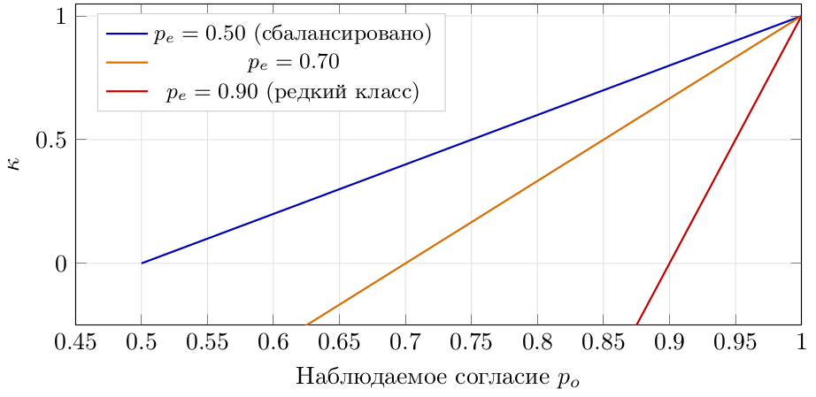

- При редком классе (1% положительных) $p_e \approx 0.98$: даже 95% согласия даёт $\kappa \approx 0$
- «Kappa paradox»: высокое согласие, низкий kappa — метрика наказывает за дисбаланс
- Альтернативы: **Gwet's AC1**, **Krippendorff's $\alpha$**, **PABAK**, отдельный расчёт по классам (per-class $\kappa$)

<span class="callout good">Ключевое: всегда смотрите на $p_o$ **и** $\kappa$ вместе, плюс на распределение классов. Одна цифра врёт.</span>

---

## Fleiss' Kappa: больше двух разметчиков

Для $n$ объектов, $m$ разметчиков, $K$ категорий, $n_{ij}$ — сколько разметчиков дали объекту $i$ метку $j$:

$$
P_i = \frac{1}{m(m-1)}\sum_{j=1}^{K} n_{ij}(n_{ij}-1),
\qquad
\bar{P} = \frac{1}{n}\sum_{i=1}^{n} P_i,
\qquad
P_e = \sum_{j=1}^{K} p_j^2
$$

$$
\kappa_F = \frac{\bar{P} - P_e}{1 - P_e},
\qquad p_j = \frac{1}{nm}\sum_{i=1}^{n} n_{ij}
$$

- Не требует парных сравнений: считает сразу по всем
- Требует **одинакового числа** разметчиков на каждом объекте — иначе нужен $\alpha$
- Не различает «кто именно» ошибается — только общий уровень

---

## Krippendorff's Alpha: самый универсальный

$$
\alpha = 1 - \frac{D_o}{D_e}
$$

- $D_o$ — наблюдаемое расхождение, $D_e$ — ожидаемое при случайной перестановке меток
- Работает при: любом числе разметчиков, **пропусках** (не все размечают всё), любых шкалах
- Метрика расхождения задаётся под шкалу: номинальная, порядковая, интервальная, ratio
- Для непрерывных меток (оценка качества 1–5) — $D_o$ как квадрат разности

| Шкала | $D$ для пары значений |
|:------|:----------------------|
| Номинальная | $1$, если значения разные |
| Порядковая | квадрат разности рангов |
| Интервальная | $(v_1 - v_2)^2$ |

<span class="callout good">Ключевое: если в проекте есть пропуски или смешанные шкалы — берите $\alpha$, а не kappa.</span>

---

## Расчёт согласия в коде

```python
import numpy as np
from sklearn.metrics import cohen_kappa_score
from statsmodels.stats.inter_rater import fleiss_kappa

a1 = [0, 1, 2, 0, 1, 2, 0, 1, 2, 2]
a2 = [0, 1, 2, 0, 2, 2, 0, 1, 1, 2]

print("Cohen  :", round(cohen_kappa_score(a1, a2), 3))
print("weighted:", round(cohen_kappa_score(a1, a2, weights="quadratic"), 3))

# Fleiss: строки — объекты, столбцы — счётчики по категориям
def to_counts(annots, k=3):
    m = np.zeros((len(annots[0]), k), dtype=int)
    for a in annots:
        for i, v in enumerate(a):
            m[i, v] += 1
    return m

print("Fleiss :", round(fleiss_kappa(to_counts([a1, a2])), 3))

# альтернатива: pip install krippendorff  (работает с пропусками)
import krippendorff
print("alpha  :", round(krippendorff.alpha(
            reliability_data=np.array([a1, a2]), level_of_measurement="nominal"), 3))
```

---

## Сколько объектов проверять: доверительный интервал

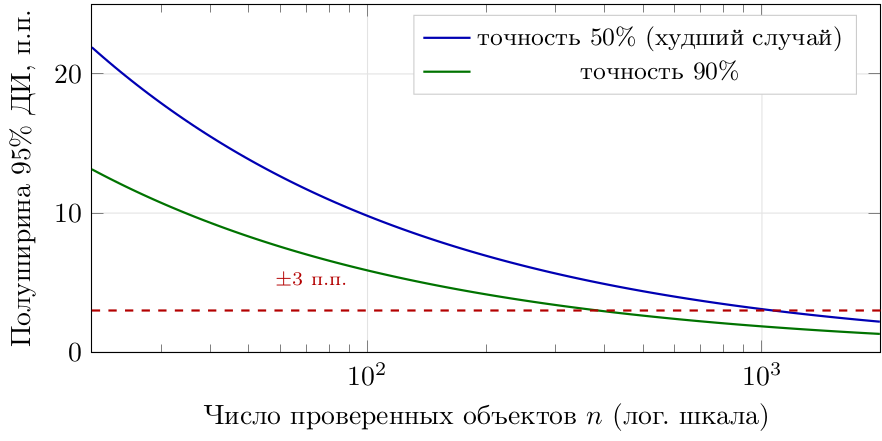

$$
\text{полуширина} = z_{1-\alpha/2}\sqrt{\frac{p(1-p)}{n}}
$$

- Хотите знать точность автоматической разметки $\pm 3$ п.п. → нужно **~400–1000** проверенных объектов
- Планируйте долю двойной разметки от **ожидаемого** числа ошибок, а не от объёма данных
- Оценивать качество по 50 объектам бессмысленно: интервал шире самого эффекта

---

## Золотые стандарты и «ловушки»

**Gold standard (эталон)**

- 100–500 объектов, размеченных экспертами с консенсусом
- Покрывает редкие и пограничные случаи
- Обновляется при изменении инструкции → **версионируется**
- Разметчику не показывается, что это эталон (иначе — имитация работы)

**Honeypots (контрольные вкрапления)**

- 3–10% задач в очереди — эталонные объекты
- Автоматический расчёт точности каждого разметчика
- Триггеры: точность < порога, аномальная скорость, однообразие ответов
- Обратная связь: разбор ошибок, при систематике — дообучение или отстранение

<span class="callout good">Ключевое: эталон нужен не для наказания, а для **раннего обнаружения** того, что инструкция перестала работать.</span>

---

## Профиль разметчика: что смотреть

| Метрика | Норма | Тревожный сигнал |
|:--------|:------|:-----------------|
| Точность на эталоне | $\ge 0.85$ | $< 0.7$ две недели подряд |
| Скорость (объект/час) | в коридоре команды | в 3 раза выше медианы |
| Доля `unknown` | 2–10% | > 30% (избегание решений) |
| Согласие с консенсусом | $\kappa \ge 0.7$ | ниже остальных на 0.2 |
| Распределение меток | близко к общему | одна метка > 80% |


---

## Разметчик: точность на эталоне

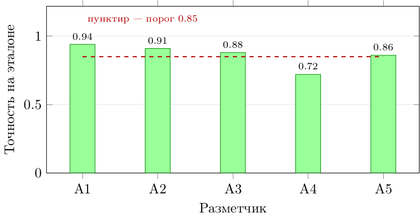

- Один «плохой» разметчик из пяти может испортить до 20% датасета
- Смотрите на **тренд**, а не на неделю: падение точности обычно следует за сменой инструкции

---

## Агрегация: от голосов к метке

**1. Простое большинство (majority vote)**

- Робастно при $\ge 3$ независимых разметчиках и случайных ошибках
- Не учитывает компетентность и сложность объекта
- При чётном числе голосов нужен tie-break (случайный / эксперт)

**2. Взвешенное голосование** — веса из точности на эталоне:

$$
\hat{y}_i = \arg\max_{k} \sum_{j \in \mathcal{A}_i} w_j \, \mathbf{1}[y_{ij} = k],
\qquad w_j = \frac{\text{acc}_j}{\sum_{l} \text{acc}_l}
$$

**3. Вероятностные модели** — оценивают компетентность **и** сложность одновременно

- **Dawid–Skene (1979)**: EM по матрицам ошибок разметчиков
- **MACE** (Hovy et al., 2013): добавлена сложность объектов и спам-модель
- **IRT-подходы**: способность разметчика × трудность объекта; общее ограничение — предположение о независимости разметчиков

---

## Dawid–Skene: модель и EM

Пусть $y_i$ — истинная метка объекта $i$, $y_{ij}$ — ответ разметчика $j$,
а $\pi_j^{(c,k)} = P(y_{ij}=k \mid y_i=c)$ — его матрица ошибок.

**E-шаг** — posterior истинной метки:

$$
q_{ic} \;\propto\; p_c \prod_{j \in \mathcal{A}_i} \pi_j^{(c,\, y_{ij})}
$$

**M-шаг** — обновление параметров по мягким меткам:

$$
\pi_j^{(c,k)} = \frac{\sum_{i:\, y_{ij}=k} q_{ic}}{\sum_{i} q_{ic}},
\qquad
p_c = \frac{1}{n}\sum_{i} q_{ic}
$$

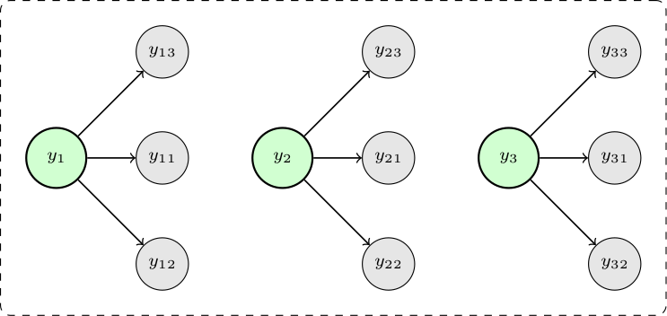


---

## Взвешенное голосование: код

```python
import numpy as np

def weighted_vote(annotations, weights, n_classes):
    """annotations: (n_annotators, n_items); -1 = пропуск"""
    n_items = annotations.shape[1]
    scores = np.zeros((n_items, n_classes))
    for j, w in enumerate(weights):
        mask = annotations[j] >= 0
        np.add.at(scores, (np.where(mask)[0], annotations[j][mask]), w)
    return scores.argmax(axis=1), scores.max(axis=1) / scores.sum(axis=1)

ann = np.array([[1, 1, 0, 1, 0],
                [1, 0, 0, 1, -1],
                [0, 1, 0, 1, 1]])
w = np.array([0.94, 0.88, 0.72])

labels, confidence = weighted_vote(ann, w, n_classes=2)
print(labels, confidence.round(2))
```

- Возвращайте **и** метку, **и** уверенность: низкая уверенность → очередь на аудит
- Пропуски (`-1`) не должны превращаться в голос за класс 0 — частая ошибка

---

## Обучение и мотивация разметчиков

**Онбординг**

- Инструкция + 20 разобранных примеров, включая пограничные
- Тестовое задание: допуск к работе при точности $\ge 0.85$ на эталоне
- Первая неделя — 100% проверка, затем 20%, затем 10%

**Непрерывное улучшение**

- Еженедельная калибровка: 30 минут разбора спорных кейсов
- Правка инструкции по итогам → новая версия → переразметка затронутых объектов
- Ротация типов задач против выгорания

**Мотивация**

- Прозрачная оплата и понятная связь «качество ↔ бонус»
- Видимый прогресс (личная статистика), но **не соревнование по скорости**
- Признание экспертизы: лучшие разметчики становятся авторами инструкции

<span class="callout good">Ключевое: разметчик — **эксперт по границам задачи**, а не исполнитель кликов. Кто это понял, получает датасеты лучше.</span>

---

## PDCA-цикл улучшения процесса

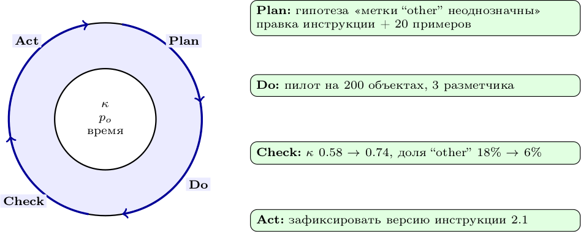

<span class="callout good">Ключевое: улучшайте процесс **измеримо** — одна гипотеза, один пилот, одна метрика. Иначе калибровки превращаются в разговоры.</span>

---

## Вопрос для размышления

**Как балансировать скорость разметки и её качество?**

Что вы готовы отдать: объём, согласие или сроки? И как это измерить?

---

## Резюме блока 3

- Качество меток задаёт **потолок** качества системы
- Согласие (kappa, alpha) измеряет надёжность, но не валидность
- kappa чувствителен к распространённости класса — смотрите $p_o$ и распределение
- Эталоны и honeypots дают раннее обнаружение проблем
- Агрегация (majority → weighted → Dawid–Skene) повышает качество меток
- Обучение и мотивация разметчиков — часть инженерного процесса

---

<!-- _class: section -->

# Блок 4
## Автоматизация разметки и HITL

<!-- ~15 мин -->

---

## Что автоматизируют в разметке

| Шаг | Автоматизация | Экономия |
|:----|:--------------|:---------|
| Дедупликация, отбор | эмбеддинги, MinHash | 5–20% объектов |
| Предразметка | модель/LLM | 30–70% времени |
| Маршрутизация | порог уверенности | фокус людей на сложном |
| Проверка | правила валидации, cleanlab | 10–30% QA-часов |
| Агрегация | Dawid–Skene и аналоги | убирает ручные споры |
| Пополнение датасета | continuous annotation | постоянный прирост |

- Автоматизация **не убирает** человека — она меняет его роль с «создателя» на «арбитра»
- KPI автоматизации всегда парный: **доля автоматики** и **точность автоматики**

<span class="callout good">Ключевое: автоматизация без измерения её точности — это просто ускоренное производство ошибок.</span>

---

## Маршрутизация по уверенности

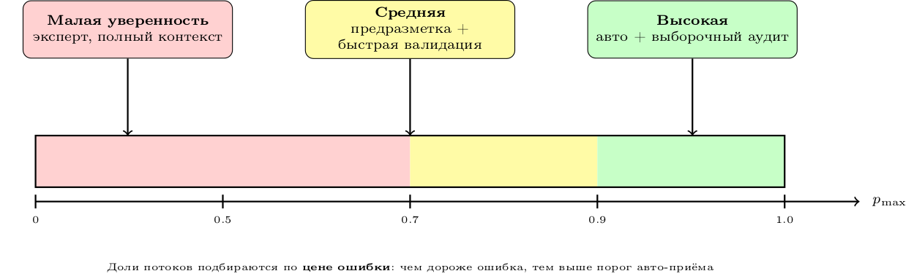

- Пороги ставятся не «0.9 по умолчанию», а по **precision** авто-приёма на валидационной выборке
- Три уровня лучше двух: «средний» поток обрабатывается быстрее, чем «сложный»
- Пересматривайте пороги при смене модели и при дрейфе данных

---

## Ловушка: вероятности не откалиброваны

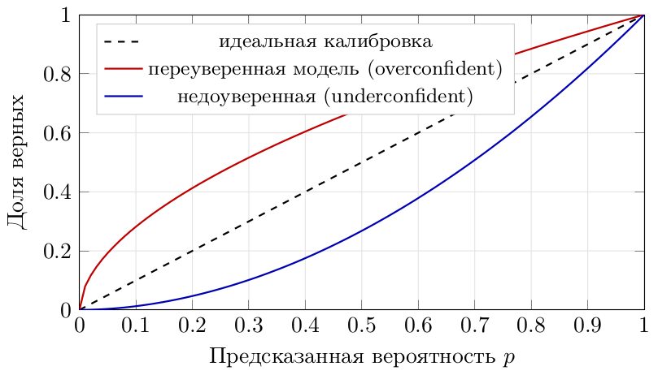

$$
\text{ECE} = \sum_{b=1}^{B} \frac{|S_b|}{n}\,\Big|\text{acc}(S_b) - \text{conf}(S_b)\Big|
$$

- Нейросети и LLM часто **переуверены**: $p=0.95$ при реальной точности 0.75
- Порог 0.9 на такой модели пропустит ошибки в «авто»
- Лечение: temperature scaling на отложенной выборке, затем пороги

---

## Программные правила: где они сильны

<div class="columns">
<div>

- Регулярные выражения и словари — для форматов (ИНН, email, артикул, дата)
- Пороговые правила — для числовых данных и метрик
- Справочники и базы знаний — для нормативных сущностей
- Логические комбинации — «если A и не B»
- Внешние API — геокодирование, проверка контрагента

</div>
<div>

```python
import re

class Rules:
    def __init__(self):
        self.spam = {"виагра", "казино", "выигрыш"}
        self.patterns = {
            "email": re.compile(r"\b[\w.+-]+@[\w-]+\.[\w.]+\b"),
            "inn":   re.compile(r"\b\d{10,12}\b"),
            "caps":  re.compile(r"\b[А-ЯЁ]{4,}\b"),
        }

    def spam_score(self, text: str) -> float:
        t = text.lower()
        hits = sum(w in t for w in self.spam)
        return min(1.0, hits / 3)          # мягкая, а не бинарная метка

    def extract(self, text: str) -> dict:
        return {k: p.findall(text) for k, p in self.patterns.items()}
```

</div>
</div>

<span class="callout good">Ключевое: правила дают **точность** на узком классе и нулевое покрытие вне него. Используйте их как LF с `ABSTAIN`, а не как «истину».</span>

---

## Confident Learning: поиск ошибок в метках

**Идея cleanlab:** если модель уверенно предсказывает класс $k$ там, где стоит метка $c \neq k$ — вероятна ошибка в метке.

1. Оценить $\hat{Q}(y=k, \tilde{y}=c)$ по out-of-fold предсказаниям
2. Обрезать порогом $\bar{p}_k$ (средняя уверенность по классу) и нормировать → **confident joint**
3. Ранжировать объекты по *self-confidence* $p_{\tilde{y}}(x)$: снизу — подозрительные

$$
\hat{Q}_{k,c} = \frac{1}{n}\sum_{i:\, \tilde{y}_i = c} \mathbb{1}\big[\hat{p}_k(x_i) \ge \bar{p}_k\big],
\qquad
\text{self-confidence}_i = \hat{p}_{\tilde{y}_i}(x_i)
$$

```python
from cleanlab.filter import find_label_issues

issues = find_label_issues(
    labels=y_train,
    pred_probs=model.predict_proba(X_train),   # out-of-fold!
    return_indices_ranked_by="normalized_margin",
    frac_noise=0.05,                            # ожидаемая доля ошибок
)
suspect_idx = issues[:200]                      # в первую очередь на переразметку
```

- Порядок важнее числа: первые 200 подозрительных полезнее случайных 200
- Валидируйте на эталоне: там бывают спорные кейсы, а не ошибки

---

## Confident learning на картинке

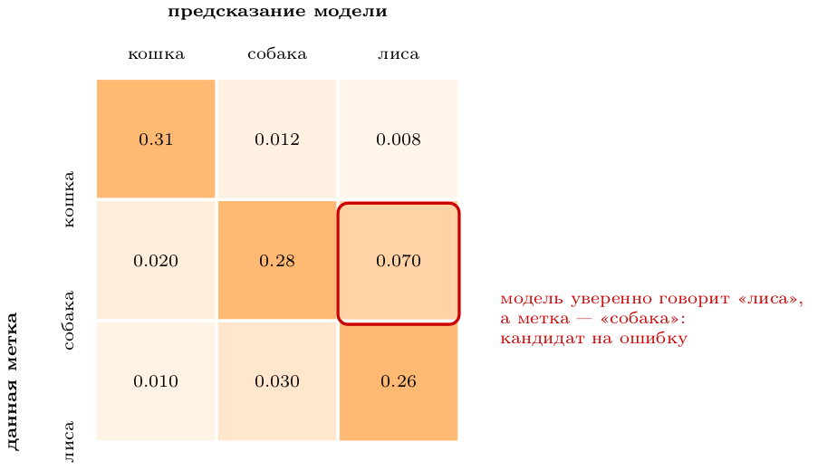

- Диагональ — согласие модели и метки; недиагональные ячейки — подозрительные
- Большой недиагональный блок = систематическая путаница классов, а не случайный шум
- Отсюда сразу видно, **какие пары классов** надо разбирать в инструкции

---

## HITL: паттерны взаимодействия

| Паттерн | Когда применять | Что делает человек |
|:--------|:----------------|:-------------------|
| Pre-labeling | старт проекта | правит предсказание |
| Active learning | есть базовая модель | размечает выбранное |
| Review | высокая цена ошибки | подтверждает/отклоняет |
| Escalation | неуверенность модели | решает сложное |
| Disagreement mining | модель и человек спорят | разбирает систематику |


---

## HITL: архитектура

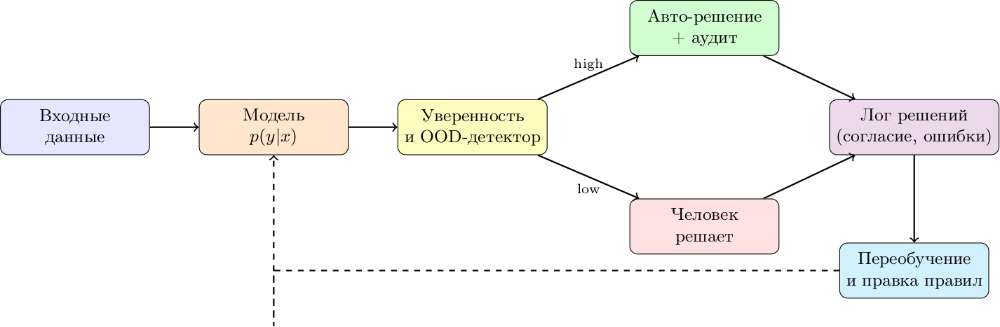

- Ключевая метрика — **доля ручных решений** при заданном качестве
- «Человек на цикле» (аудит) дешевле, «человек в цикле» (каждое решение) надёжнее

---

## Масштабирование процесса

**Технически**

- Очереди задач (Celery/RabbitMQ, SQS), идемпотентные обработчики
- Шардирование по проектам: разные модели — разные пайплайны
- Батчевый inference (GPU), кэш предсказаний по хешу объекта

**Организационно**

- Балансировка нагрузки по сложности, а не по количеству
- Отдельные очереди: «быстрое» (валидация) и «сложное» (эксперт)
- Метрики потока: throughput, WIP, время в очереди, доля возвратов

```python
@app.task(bind=True, max_retries=3)
def annotate_batch(self, task_ids: list[str]):
    items = load_items(task_ids)
    preds = model.predict_batch(items)          # один вызов на батч
    auto, manual = [], []
    for it, p in zip(items, preds):
        (auto if p.confidence >= THRESHOLD else manual).append((it, p))

    save_annotations([(it, p.label, "auto") for it, p in auto])
    enqueue_human([(it, p) for it, p in manual])
    metrics.incr("auto_accepted", len(auto))
    return {"auto": len(auto), "manual": len(manual)}
```

---

## Синтетические данные и аугментация

| Подход | Когда помогает | Риск |
|:-------|:---------------|:-----|
| Аугментация (flip, crop, noise) | CV, аудио | не создаёт новых классов |
| Парафразы, back-translation | текст | меняет смысл, ломает NER |
| Генерация LLM | дефицитные классы | фактическое правдоподобие, утечка стиля |
| Симуляция (правила, движок) | редкие события, аварии | domain gap |
| Mixup/CutMix | регуляризация | артефакты на границах |

```python
import albumentations as A

train_tf = A.Compose([
    A.HorizontalFlip(p=0.5),
    A.RandomBrightnessContrast(p=0.3),
    A.Rotate(limit=15, p=0.5, border_mode=0),
    A.GaussNoise(p=0.2),
])   # ВАЖНО: bbox_params / ключевые точки нужно передавать явно
```

<span class="callout good">Ключевое: синтетика расширяет **покрытие**, но не заменяет проверку. Синтетический тест-сет — прямая дорога к самообману.</span>

---

## KPI автоматизации

| Метрика | Формула / смысл | Ориентир |
|:--------|:----------------|:---------|
| Automation rate | доля объектов без человека | 40–80% |
| Auto-label precision | точность принятых автоматически | $\ge$ качества ручной |
| Review time | секунд на объект при проверке | в 3–10 раз меньше ручной |
| Cost per label | полная стоимость / число меток | падает с итерациями |
| Coverage | доля классов/сценариев с метками | все целевые классы |
| Rework rate | доля возвратов из QA | < 10% |

- Считайте **стоимость на валидную метку**, а не на клик: дешёвая, но неверная метка дороже
- Стройте график «automation rate vs precision»: рост автоматизации обычно стоит точности

---

## Дашборд проекта разметки

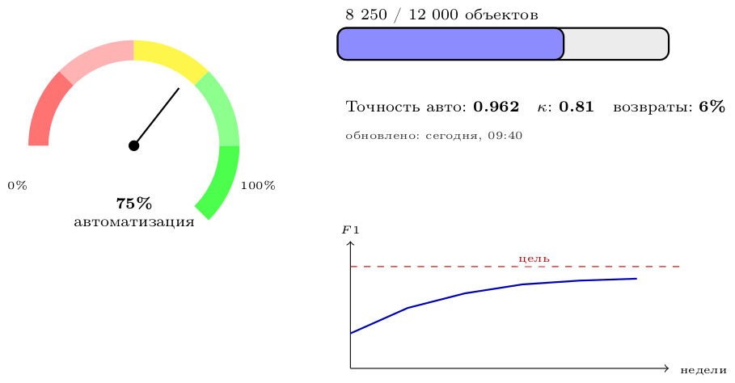

- Показывайте **три вещи**: сколько сделано, насколько хорошо, что с трендом
- Дашборд без владельца и порогов — декорация

---

## Best practices автоматизации

- Начинайте с **простых правил**, затем добавляйте модель: правила — бесплатный baseline
- Валидируйте автоматику на **стратифицированной** выборке, а не на случайных 100 объектах
- Отслеживайте дрейф: точность авто падает раньше, чем метрика модели
- Храните для каждой метки **происхождение** (rule / model / human) и версию
- Документируйте пороги и причины их выбора
- Не автоматизируйте то, что не умеете измерять

<span class="callout good">Ключевое: автоматизация — это **продукт с SLA**. У него есть точность, покрытие, стоимость и владелец.</span>

---

## Вопрос для обсуждения

**Какой процент автоматизации разметки приемлем для вашей задачи?**

От чего зависит ответ: цена ошибки, объём, обратимость решения?

---

## Резюме блока 4

- Предразметка ускоряет процесс, но требует калибровки и порогов по precision
- Правила и эвристики дополняют ML: узкая точность + `ABSTAIN`
- Confident learning находит ошибки в метках, а не только в модели
- HITL концентрирует людей на сложном и измеряет долю ручного труда
- Масштабирование — вопрос очередей, батчей и организационных ролей
- Синтетика расширяет покрытие, но не заменяет валидацию

---

<!-- _class: section -->

# Блок 5
## Кейсы, пайплайн, этика

<!-- ~10 мин -->

---

## Кейс 1: NER для новостей

**Дано:** 10 000 статей, классы PER/ORG/LOC/MISC, бюджет ограничен, срок — 2 месяца

**Ограничение:** ручная разметка всех статей = $\approx$ 1 500 часов, бюджет не выдержит

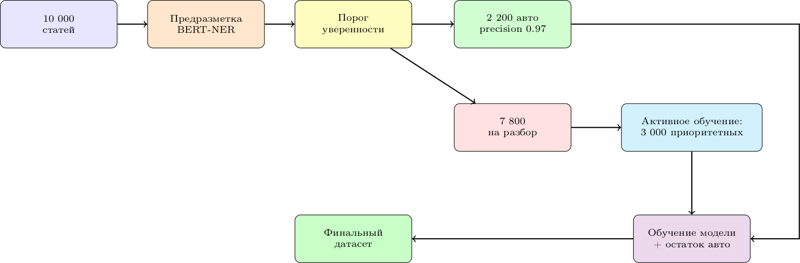

**Итог:** 3 200 ручных объектов вместо 10 000 → бюджет $\approx$ 32% от исходного; $\kappa = 0.84$; F1 0.89

---

## Кейс 2: детекция объектов на дорогах

**Дано:** 50 000 изображений, bounding boxes, команда 5 разметчиков, высокая цена ошибки

**Процесс качества**

- Пилот на 100 эталонах: договорились о границах боксов («видимо на 30%»)
- 10% двойной разметки: IoU-согласие + $\kappa$ по классам
- Автопроверка геометрии: box в кадре, площадь $\ge$ 25 px², без дублей (IoU > 0.9)
- Еженедельная калибровка; контракт — $\kappa \ge 0.8$, иначе переразметка партии

| Метрика | Пилот | Через месяц |
|:--------|:------|:------------|
| $\kappa$ (по классам) | 0.61 | 0.85 |
| IoU-согласие | 0.72 | 0.88 |
| Доля возвратов | 22% | 7% |
| Скорость, изобр./час | 45 | 78 |

<span class="callout good">Ключевое: рост скорости пришёл **после** калибровки, а не вместо неё.</span>

---

## Кейс 3: sentiment на 100 000 отзывов

**Дано:** 100 000 отзывов, 3 класса, краудсорсинг, минимальный бюджет

**Стратегия: weak supervision + выборочная ручная разметка**

<div class="columns">
<div>

```python
from snorkel.labeling import labeling_function, ABSTAIN

POS, NEG, NEU = 1, 0, 2

@labeling_function()
def positive_words(x):
    words = {"отлично", "супер", "рекомендую", "доволен"}
    return POS if words & set(x.text.lower().split()) else ABSTAIN

@labeling_function()
def negative_words(x):
    words = {"ужасно", "плохо", "не советую", "разочарован"}
    return NEG if words & set(x.text.lower().split()) else ABSTAIN

@labeling_function()
def no_emotion(x):
    return NEU if not any(c in x.text for c in "!?") else ABSTAIN
```

</div>
<div>

- 6 LF + предобученный ruBERT-классификатор как LF с `ABSTAIN` при низкой уверенности

</div>
</div>- Label model даёт вероятностные метки → обучение end-модели
- Ручная разметка — только 8% объектов, где LF конфликтуют или все воздержались
- Итог: F1 0.83 при стоимости $\approx$ 12% от полной ручной разметки

---

## Жизненный цикл данных

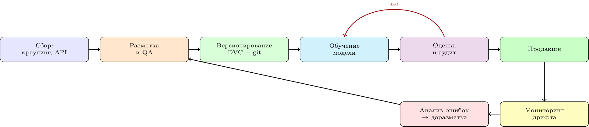

- Данные и модель версионируются **вместе**: коммит, датасет, чекпоинт, метрики
- Без версии датасета воспроизводимость обучения невозможна — метрики становятся анекдотом

---

## Версионирование датасета

```bash
dvc init
dvc add data/annotations.parquet        # сам файл — в remote, хеш — в git
git add data/annotations.parquet.dvc data/.gitignore
git commit -m "annotations v1.2: kappa 0.81, guidelines 2.3"

dvc tag -a v1.2 -m "annotated 12k, QA passed"   # или git tag
dvc push                                          # в S3/GCS/локальный remote
```

- В git — только **метаданные и хеши**, данные — в remote storage
- Воспроизведение: `git checkout <tag> && dvc pull` → ровно тот датасет
- Дополнительно фиксируйте: версию инструкции, версию схемы, список разметчиков
- Сплиты **тоже** версионируются: иначе сравнение метрик между версиями бессмысленно

---

## Метаданные разметки: минимум

```json
{
  "dataset_version": "1.2",
  "guidelines_version": "2.3",
  "schema_hash": "8f14e45f",
  "items": [
    {
      "id": "img_000412",
      "labels": ["car", "person"],
      "geometry": {"type": "bbox", "boxes": [[12, 40, 210, 260]]},
      "annotator_id": "user_42",
      "timestamp": "2026-01-15T10:30:00Z",
      "source": "model_prelabel+human_edit",
      "model_version": "det-v7",
      "confidence": 0.95,
      "time_spent_sec": 45,
      "qa_status": "gold_checked"
    }
  ]
}
```

- `source` и `model_version` — без них нельзя отделить ошибку модели от ошибки человека
- `guidelines_version` — позволяет найти все метки, сделанные по устаревшему правилу
- `time_spent_sec` — дешёвый детектор «кликов на скорость»

---

## Мониторинг в продакшене

| Что | Как | Триггер |
|:----|:----|:--------|
| Распределение предсказаний | доля классов по дням | сдвиг > 10 п.п. |
| Уверенность модели | средняя $p_{\max}$, доля < порога | падение среднего |
| Доля ручных решений | HITL-метрика | рост > 20% |
| Согласие с людьми | выборочный аудит 1% | $\kappa$ падает |
| Дрифт входов | эмбеддинги, PSI, KS-тест | статистически значимо |
| Обратная связь | жалобы, корректировки | всплеск |

- Метрики **данных** падают раньше метрик модели: мониторьте вход и разметку
- Автоматический триггер → задача на доразметку, а не «посмотрим потом»

---

## Continuous annotation

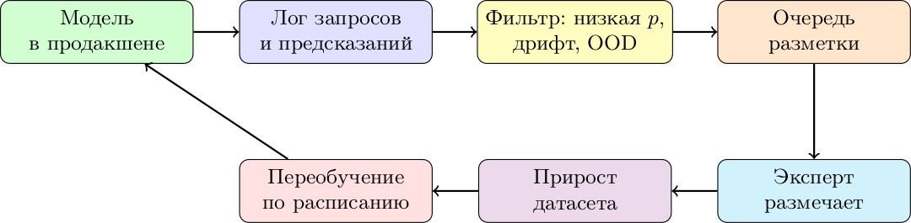

- Отбирайте в очередь **не случайные** логи: низкая уверенность + новые кластеры + OOD
- Ограничивайте объём: 50–200 объектов в неделю достаточно для большинства задач
- Храните «отказы» модели — это самый ценный ресурс для следующей версии

---

## Экосистема инструментов

| Инструмент | Ниша | Лицензия |
|:-----------|:-----|:---------|
| Label Studio | универсальная платформа | OSS / Cloud |
| CVAT | компьютерное зрение, видео | OSS (OpenVINO) |
| Doccano | текст, NER, перевод | OSS |
| Labelme | простые маски и боксы | OSS |
| Prodigy | NLP, активное обучение | Commercial |
| Labelbox | enterprise, CV | Commercial |
| Supervisely | CV, managed | Commercial |
| Scale AI | полный цикл «под ключ» | Commercial |
| SageMaker Ground Truth | AWS managed | Pay-per-use |
| Argilla | текст, LLM-разметка, ревью | OSS |

**Библиотеки:** `modAL`, `alipy` (активное обучение), `snorkel` (weak supervision), `cleanlab` (ошибки меток), `krippendorff`, `statsmodels` (согласие)

---

## Код: активное обучение за 20 строк

```python
from modAL.models import ActiveLearner
from modAL.uncertainty import uncertainty_sampling
from sklearn.ensemble import RandomForestClassifier
from sklearn.metrics import f1_score

learner = ActiveLearner(
    estimator=RandomForestClassifier(n_estimators=200, random_state=0),
    query_strategy=uncertainty_sampling,
    X_training=X_init, y_training=y_init,
)

scores = []
for _ in range(20):
    idx, x = learner.query(X_pool, n_instances=100)   # батч из 100
    y_new = oracle(x)                                  # человек/эталон
    learner.teach(x, y_new)
    X_pool, y_pool = np.delete(X_pool, idx, 0), np.delete(y_pool, idx, 0)
    scores.append(f1_score(y_val, learner.predict(X_val), average="macro"))
```

- `oracle` — это функция: в эксперименте берёт из отложенного набора, в проде — очередь разметки
- Логируйте каждый запрос: потом посчитаете экономию «объекты → метрика»

---

## Этика: труд разметчиков

- **Оплата:** прозрачная ставка за час, а не «за клик» — иначе скорость важнее качества
- **Условия:** перерывы, ротация задач, эргономичный интерфейс, отсутствие штрафов за «медленно»
- **Содержание:** модерация травмирующего контента требует психологической поддержки и лимитов
- **Права:** NDA не отменяет права на достойные условия; краудсорсинг — не «дешёвый ресурс»
- **Видимость:** указывайте в данных и статьях, кто и как размечал (Gray & Suri, «Ghost Work»)

$$
\text{качество данных} \;\propto\; \text{условия труда разметчиков}
$$

<span class="callout good">Ключевое: «дешёвая разметка» почти всегда означает, что кто-то платит разницей — временем, здоровьем или точностью.</span>

---

## Этика: смещение (bias)

**Источники смещения**

- Состав команды (демография, культура, язык, опыт домена)
- Формулировка инструкции (что считаем «нормой»)
- Данные: чьи голоса и лица попали в выборку
- Обратная связь: чьи жалобы доходят до правки схемы

| Мера | Что даёт |
|:-----|:---------|
| Разнообразная команда | меньше слепых зон |
| Слепая разметка | нет эффекта ожиданий |
| Несколько разметчиков | агрегация вместо мнения одного |
| Аудит по подгруппам | видно смещение по срезам |
| Документирование решений | воспроизводимость |

Каждая мера дешевле переделки модели, обученной на смещённых метках.

---

## Этика: конфиденциальность

**Чек-лист перед отправкой данных на разметку**

- **Анонимизация** до передачи: удалить или заменить PII (имена, телефоны, адреса, номера)
- **Минимизация**: отдавать только поля, нужные для решения, без лишнего контекста
- **Контроль доступа**: роли, NDA, журнал того, кто видел какие объекты
- **Сроки хранения**: данные и копии удаляются по регламенту, а не «когда-нибудь»
- **Юридическая база**: GDPR / 152-ФЗ, основание обработки, договор поручения
- **LLM-предразметка**: отдельная политика — данные уходят вендору, часто за пределы контура

---

## Разметка в эпоху LLM

<!-- доп. -->

- LLM снижают стоимость **создания** метки, но повышают стоимость **проверки**
- Роли: zero/few-shot классификатор, извлечение сущностей, «судья» для сравнения ответов
- Риски: переуверенность, чувствительность к промпту, позиционное смещение, дрейф версии модели
- 2024–2025: согласие LLM с людьми иногда не ниже межлюдского, но **сильно зависит от схемы** (ALPS; «Alternative Annotator Test», ACL 2025)

**Практические правила**

1. Не заменяйте людей — заменяйте **первый проход**, оставляя выборочную валидацию
2. Всегда отчитывайтесь согласием с человеческим эталоном, а не «looks good»
3. Фиксируйте версию модели и промпта в метаданных (как `model_version`)
4. Не отправляйте PII и закрытые данные во внешние API без договора
5. Проверяйте на **подгруппах**: средняя точность скрывает провалы на редких классах

<span class="callout good">Ключевое: LLM не отменяет разметку — она смещает узкое место с производства меток на **контроль их качества**.</span>

---

## Вопрос для размышления

**Исчезнет ли потребность в ручной разметке с развитием AI?**

Что останется человеку: определение схемы, арбитраж, редкие классы, этические решения?

---

## Тренды

- **AI-assisted annotation**: предразметка как норма, человек — арбитр
- **Мультимодальная разметка**: текст + изображение + аудио в одном объекте
- **Real-time collaborative annotation**: несколько экспертов одновременно, консенсус на лету
- **Федеративная и приватная разметка**: данные не покидают контур
- **Декларативные пайплайны**: правила, модели и ревью описываются конфигом

```python
# иллюстрация идеи: пайплайн разметки как декларация
pipeline = AnnotationPipeline()
pipeline.add_rule("regex_spam", confidence=0.8)
pipeline.add_model("bert_classifier", threshold=0.9, version="v3")
pipeline.add_human_review(when="confidence < 0.7 or conflict")
pipeline.add_validation(metric="cohen_kappa", min_value=0.75)
results = pipeline.run(data)          # аудит, версия, метрики — автоматически
```

---

## Ключевые выводы

1. Разметка — **производственный процесс** с бюджетом, пропускной способностью и качеством
2. Платформа — 10% успеха; остальное — инструкции, люди, QA
3. Активное обучение экономит 40–60% бюджета — при холодном старте и кривых обучения
4. Надёжность ($\kappa$, $\alpha$) ≠ валидность: нужны эталоны и аудит
5. Агрегация (Dawid–Skene и др.) выжимает качество из шумных голосов
6. Автоматизация работает при калиброванных вероятностях и измеренной точности
7. Датасет — версионируемый артефакт с метаданными и владельцем

---

## Рекомендации для практики

**Старт проекта**

- Определите метрику качества **разметки** (не только модели): $\kappa$, точность на эталоне
- Напишите инструкцию с примерами и антипримерами, проведите пилот на 100–300 объектах
- Посчитайте смету с QA и переделкой (×1,5–2 к «наивной»)

**Масштабирование**

- Внедрите предразметку и пороги по precision на валидации
- Автоматизируйте QA: эталоны в очереди, скрипты валидации, отчёт по разметчикам
- Версионируйте данные, инструкции и сплиты; логируйте происхождение каждой метки
- Пересматривайте пороги и инструкции по расписанию, а не по инциденту

---

## Домашнее задание

**1. Платформа.** Развернуть Label Studio (Docker), создать проект NER/классификации, загрузить 100 объектов, настроить `label_config`, выгрузить результат. Документировать установку и конфиг в git.

**2. Активное обучение.** Реализовать цикл (modAL или свой) на открытом датасете. Сравнить random / uncertainty / diversity, построить learning curves, оценить экономию при целевом F1. Отчёт с графиками.

**3. Контроль качества.** Реализовать расчёт Cohen и Fleiss, генератор honeypots, отчёт по разметчикам. Порог $\kappa$, при котором партия уходит на переразметку, обосновать.

**4. Автоматизация (опционально).** Пайплайн: предразметка моделью → порог по precision → очередь ручной проверки → метрики automation rate / auto-precision / cost per label.

---

## Литература

**Основная**

1. **Settles, B.** (2012). *Active Learning*. Synthesis Lectures on AI and ML. — канон по стратегиям выбора
2. **Ratner, A. et al.** (2020). *Snorkel: Rapid Training Data Creation with Weak Supervision*. VLDB J.
3. **Northcutt, C. et al.** (2021). *Confident Learning: Estimating Uncertainty in Dataset Labels*. JAIR
4. **Monarch, R.** (2021). *Human-in-the-Loop Machine Learning*. Manning

**Метрики согласия и агрегация**

5. **Cohen, J.** (1960). *A coefficient of agreement for nominal scales*. — оригинал $\kappa$
6. **Fleiss, J.** (1971). *Measuring nominal scale agreement among many raters*.
7. **Krippendorff, K.** (2004). *Content Analysis: An Introduction to Its Methodology*.
8. **Dawid, A., Skene, A.** (1979). *Maximum likelihood estimation of observer error-rates*.

---

## Литература: контекст и этика

9. **Sambasivan, N. et al.** (2021). *"Everyone wants to do the model work, not the data work": Data Cascades in High-Stakes AI*. CHI

10. **Gray, M., Suri, S.** (2019). *Ghost Work: How to Stop Silicon Valley from Building a New Global Underclass*

11. **Zhu, Y. et al.** (2024). *Assessing LLMs for Data Annotation* (ALPS)

12. **Calderon, N. et al.** (2025). *The Alternative Annotator Test for LLM-as-a-Judge*. ACL

13. **Northcutt, C. et al.** (2021). *Pervasive Label Errors in Test Sets Destabilize ML Benchmarks*

<span class="callout good">Ключевое: читайте не только про методы, но и про **производство данных** — там больше всего неожиданного.</span>

---

## Ресурсы

- Label Studio: https://labelstud.io/guide/
- CVAT: https://docs.cvat.ai/
- Snorkel: https://www.snorkel.org/get-started/
- cleanlab: https://docs.cleanlab.ai/
- Argilla: https://docs.argilla.io/
- Google «Data Labeling Best Practices»
- Курсы: *Data-Centric AI* (DeepLearning.AI), *Human-Centered ML* (Google, Coursera)

---

## Темы для дискуссии

- Опыт разметки в ваших проектах: что сломалось первым?
- Выбор между платформой и «своими скриптами + таблица»
- Когда активное обучение **не** окупается
- Этические дилеммы: дешёвый краудсорсинг vs качество и условия труда
- Заменит ли LLM разметчиков — и что тогда считать эталоном

---

## Связь с курсом

| Лекция | Связь |
|:-------|:------|
| Лекция 3 | валидация данных **после** разметки |
| Лекция 4 | признаки на размеченных данных |
| **Лекция 5** | производство и контроль разметки |
| Лекция 6 | разметка как шаг ETL/ELT-пайплайна |
| Лекция 8 | мониторинг качества разметки в продакшене |

---

<!-- _class: title -->

# Спасибо за внимание!

## Следующая лекция: ETL/ELT пайплайны и оркестрация

**Вопросы и материалы**
- Office Hours: четверг, 14:00–16:00
- Канал курса: Telegram / Slack
- Схемы: папка `Лекция5_figs/`

<div class="meta">Вопросы и материалы — в репозитории курса</div>
