<style>
@import url('https://fonts.googleapis.com/css2?family=Inter:wght@400;600;700;800&display=swap');

:root {
  --primary: #1d4ed8;
  --primary-dark: #1e3a8a;
  --accent: #0ea5e9;
  --ink: #0f172a;
  --muted: #64748b;
  --bg: #ffffff;
  --soft: #f1f5f9;
  --teal: #0d9488;
  --amber: #d97706;
  --rose: #e11d48;
}

section {
  font-family: 'Inter', 'Noto Sans', 'Segoe UI', system-ui, sans-serif;
  color: var(--ink);
  background: var(--bg);
  font-size: 27px;
  line-height: 1.35;
  padding: 72px 68px 40px;
}

h1 { font-size: 1.5em; color: var(--primary); margin: 0 0 .35em; font-weight: 800; letter-spacing: -.01em; }
h2 { font-size: 1.18em; color: var(--ink); margin: 0 0 .55em; font-weight: 700; }
h3 { font-size: .82em; color: var(--muted); margin: 0 0 .3em; font-weight: 600; text-transform: uppercase; letter-spacing: .04em; }

ul, ol { margin: 0 0 .55em; padding-left: 1.25em; }
li { margin: .16em 0; }
li strong, li b { color: var(--primary-dark); }
p { margin: 0 0 .5em; }

a { color: var(--primary); }

table { width: 100%; border-collapse: collapse; font-size: .72em; }
th { background: var(--primary); color: #fff; padding: 9px 14px; text-align: left; font-weight: 600; }
td { padding: 8px 14px; border-bottom: 1px solid #e2e8f0; vertical-align: top; }
tr:nth-child(even) td { background: #f8fafc; }

img { display: block; margin: .25em auto; max-width: 100%; max-height: 400px; }

code { background: var(--soft); border-radius: 4px; padding: 1px 6px; font-size: .82em; font-family: 'JetBrains Mono', ui-monospace, monospace; }
pre { background: #0f172a; color: #e2e8f0; border-radius: 10px; padding: 16px 22px; font-size: .6em; line-height: 1.5; }
pre code { background: transparent; color: inherit; padding: 0; }

.hljs-comment, .hljs-quote { color: #94a3b8; font-style: italic; }
.hljs-keyword, .hljs-selector-tag, .hljs-built_in, .hljs-type { color: #93c5fd; }
.hljs-string, .hljs-attr, .hljs-regexp { color: #86efac; }
.hljs-number, .hljs-literal, .hljs-symbol { color: #fbbf24; }
.hljs-title, .hljs-section, .hljs-name { color: #f0abfc; }
.hljs-variable, .hljs-template-variable { color: #fca5a5; }
.hljs-meta { color: #cbd5e1; }

.columns { display: grid; grid-template-columns: 1fr 1fr; gap: 48px; align-items: start; }
.cols3 { display: grid; grid-template-columns: 1fr 1fr 1fr; gap: 30px; align-items: start; }

section.section {
  background: linear-gradient(135deg, #0f172a 0%, #1e3a8a 55%, #1d4ed8 100%);
  color: #fff; justify-content: center; text-align: center;
}
section.section h1 { color: #fff; font-size: 2.1em; border: none; }
section.section h2 { color: rgba(255,255,255,.85); font-weight: 400; font-size: 1.1em; }
section.section::after { content: ''; }

section.title {
  background: linear-gradient(135deg, #0f172a 0%, #1e3a8a 55%, #1d4ed8 100%);
  color: #fff; justify-content: center; text-align: center;
}
section.title h1 { color: #fff; font-size: 2.5em; border: none; }
section.title h2 { color: rgba(255,255,255,.9); font-weight: 400; }
section.title p { color: rgba(255,255,255,.8); }
section.title ul, section.title ol, section.section ul, section.section ol { display: inline-block; text-align: left; }
section.title code, section.section code { background: rgba(255,255,255,.16); color: #fff; }

section.title .meta { margin-top: 1.4em; font-size: .8em; color: rgba(255,255,255,.7); letter-spacing: .06em; text-transform: uppercase; }

.callout { display: block; border-left: 5px solid var(--accent); background: #eff6ff; border-radius: 6px; padding: 14px 20px; margin: .5em 0; }
.callout.warn { border-left-color: var(--amber); background: #fffbeb; }
.callout.good { border-left-color: var(--teal); background: #ecfdf5; }
.callout.bad { border-left-color: var(--rose); background: #fef2f2; }

.muted { color: var(--muted); font-size: .8em; }
.small { font-size: .8em; }
.badge { display: inline-block; background: var(--soft); border-radius: 999px; padding: 4px 14px; margin: 3px; font-size: .74em; font-weight: 600; color: var(--primary-dark); }
</style>

<!-- _class: title -->

# Лекция 6
## ETL/ELT пайплайны и оркестрация

<div class="meta">Инженерия данных · Магистратура ИТМО · Осень 2025</div>

---

<!-- _class: section -->

# План лекции

## 4 блока · 80 минут

---

## План лекции

### Структура занятия

1. **Apache Airflow и оркестрация** — 20 мин
2. **Надежные пайплайны** — 20 мин
3. **Мониторинг и логирование** — 20 мин
4. **Обработка ошибок и восстановление** — 20 мин

<br/>

<div class="callout good">
<b>Формат:</b> теория + код; после каждого блока — <b>проверка понимания</b>.
</div>

---

<!-- _class: section -->

# Раздел 1
## Apache Airflow и оркестрация

---

## Что такое оркестрация?

- Управление последовательностью задач
- Автоматизация запусков по расписанию
- Обработка зависимостей между задачами
- Централизованный контроль выполнения

---

## Почему без оркестрации нельзя?

- Ручные запуски - источник ошибок
- Сложность отслеживания зависимостей
- Отсутствие единого лога
- Невозможность масштабирования

---

## Классическая проблема

- 50+ источников данных
- 200+ ежедневных задач
- 30+ разработчиков
- 0 общего видения процессов

---

## Apache Airflow - что это?

- Платформа для оркестрации workflows
- Python-код как основа пайплайнов
- Визуальный интерфейс
- Масштабируемость через распределение

---

## Архитектура Airflow


---

## Основные компоненты

- DAG: Directed Acyclic Graph
- Operator: выполняемая задача
- Task: экземпляр оператора
- Task Instance: конкретное выполнение

---

## DAG на практике

```python
from airflow import DAG
from datetime import datetime

dag = DAG(
    'etl_sales',
    start_date=datetime(2024, 1, 1),
    schedule_interval='@daily',
    catchup=False
)
```

---

## Типы операторов

- PythonOperator: любой Python-код
- BashOperator: shell-команды
- SQL операторы: Postgres, BigQuery
- Sensor-ы: ожидание событий

---

## Пример DAG


---

## Запуск и триггеры

- По расписанию (cron-выражения)
- По событию (sensor)
- Ручной запуск
- По завершению другого DAG

---

## Cron-выражения

- `0 8 * * *` - каждый день в 8:00
- `0 */2 * * *` - каждые 2 часа
- `0 0 * * 1` - каждый понедельник
- `0 0 1 * *` - первое число месяца

---

## Параметризация DAG

- Variables для конфигурации
- Templates для динамических значений
- Jinja2 в параметрах
- Runtime context

---

## Templates пример

```python
sql_query = """
SELECT * FROM orders
WHERE date = '{{ ds }}'
"""
```

---

## XCom - обмен данными

- Task A сохраняет результат
- Task B получает значение
- JSON-сериализация
- Ограничение 48KB

---

## XCom код

```python
# В task1
return {"processed": 1000}

# В task2
value = task_instance.xcom_pull(task_ids='task1')
```

---

## Масштабирование Airflow

- SequentialExecutor: для разработки
- LocalExecutor: много ядер
- CeleryExecutor: распределенные воркеры
- KubernetesExecutor: контейнеры

---

## CeleryExecutor архитектура



---

## Проблема масштабирования

- 1000+ задач в час
- 50GB оперативной памяти
- 500 воркеров
- Решение: KubernetesExecutor

---

## Мониторинг DAG-ов

- UI в Airflow
- Email-уведомления
- Slack/Teams интеграция
- Custom callbacks

---

## Отладка DAG-ов

- Graph view в UI
- Task logs
- Task Instance details
- Retry логика

---

## Проверка понимания 1

### Обсудите в парах

- Что такое DAG?
- Какие бывают trigger-ы?
- Для чего нужен XCom?
- Чем отличается Executor-ы?

---

<!-- _class: section -->

# Раздел 2
## Надежные пайплайны

<!-- ~20 мин -->

---

## Идемпотентность

- Повторный запуск без эффекта
- Проверка существования данных
- UPSERT вместо INSERT
- Уникальные ключи

---

## Идемпотентный пример

```sql
INSERT INTO daily_stats (date, revenue)
SELECT DATE('{{ ds }}'), SUM(amount)
FROM orders
WHERE DATE(created_at) = DATE('{{ ds }}')
ON CONFLICT (date) DO UPDATE
SET revenue = EXCLUDED.revenue
```

---

## Атомарность

- Все или ничего
- Транзакции в БД
- Временные таблицы
- Rollback при ошибке

---

## Инкрементальная обработка

- Чтение только новых данных
- Чекпоинты и курсоры
- Watermark-и времени
- Экономия ресурсов

---

## Чекпоинт пример

```python
def get_last_processed_id():
    return Variable.get("last_order_id", 0)

def save_checkpoint(max_id):
    Variable.set("last_order_id", max_id)
```

---

## Паттерны проектирования

- Task-перезапуски
- Retry логика
- Таймауты
- Graceful degradation

---

## Retry конфигурация

```python
task = PythonOperator(
    task_id='process_data',
    python_callable=process_data,
    retries=3,
    retry_delay=timedelta(minutes=5),
    email_on_failure=True
)
```

---

## Структура надежного DAG



---

## Тестирование пайплайнов

- Unit тесты задач
- Integration тесты DAG
- Test datasets
- Mock external services

---

## Unit тест пример

```python
def test_transform_data():
    input_data = [{"id": 1, "value": 100}]
    result = transform_data(input_data)
    assert result[0]["value"] == 200
```

---

## Проверка понимания 2

### Обсудите в парах

- Что такое идемпотентность?
- Как реализовать checkpoint?
- Зачем нужен retry?
- Как тестировать DAG?

---

<!-- _class: section -->

# Раздел 3
## Мониторинг и логирование

<!-- ~20 мин -->

---

## Ключевые метрики

- Время выполнения задач
- Количество успешных/проваленных
- Размер обработанных данных
- Задержка данных

---

## Prometheus + Grafana


---

## Custom метрики

```python
from airflow.metrics import Stats

Stats.incr('orders_processed', count=len(orders))
Stats.timing('processing_time', duration)
```

---

## Структурированное логирование

- JSON формат логов
- Correlation ID
- Уровни логирования
- Centralized logging

---

## Пример структурированного лога

```json
{
  "timestamp": "2024-01-15T10:30:00Z",
  "level": "INFO",
  "dag_id": "etl_sales",
  "task_id": "process_orders",
  "message": "Processed 5000 orders"
}
```

---

## Алерты

- Email уведомления
- Slack Webhooks
- PagerDuty интеграция
- Severity levels

---

## Дашборд пример

- Gantt chart задач
- Статистика за последние 24ч
- Топ-5 самых долгих задач
- Error rate по DAG-ам

---

## Проверка понимания 3

### Обсудите в парах

- Какие метрики отслеживать?
- Что такое structured logging?
- Зачем нужен Correlation ID?
- Какие бывают severity levels?

---

<!-- _class: section -->

# Раздел 4
## Обработка ошибок и восстановление

<!-- ~20 мин -->

---

## Типы ошибок

- Временные сетевые ошибки
- Ошибки валидации данных
- Ресурсы недоступны
- Бизнес-логика нарушена

---

## Retry стратегии

- Экспоненциальная задержка
- Максимальное количество попыток
- Circuit breaker
- Fallback механизмы

---

## Exponential backoff

```python
delay = base_delay * (2 ** attempt)
time.sleep(min(delay, max_delay))
```

---

## Graceful degradation

- Отключение не критичных функций
- Использование кеша
- Упрощенная обработка
- Пользовательские уведомления

---

## Dead letter queue



---

## Восстановление после сбоев

- Identification проблемы
- Data replay
- State recovery
- Validation результатов

---

## Автоматическое восстановление

- Self-healing scripts
- Health checks
- Auto-restart policies
- Escalation procedures

---

<!-- _class: section -->

# Практический кейс
## E-commerce платформа

<!-- ~10 мин -->

---

## Архитектура кейса



---

## Реализация DAG

```python
default_args = {
    'owner': 'data-team',
    'depends_on_past': False,
    'start_date': datetime(2024, 1, 1),
    'retries': 2,
    'retry_delay': timedelta(minutes=10)
}
```

---

## Тесты для кейса

- Проверка idempotency
- Mock API responses
- Test data validation
- Performance benchmarks

---

## Мониторинг кейса

- Gantt chart
- Data quality checks
- Business metrics
- Alert channels

---

## Проверка понимания 4

### Обсудите в парах

- Как восстановить после сбоя?
- Что такое DLQ?
- Зачем нужен exponential backoff?
- Как реализовать graceful degradation?

---

## Резюме лекции

<div class="callout good">

- Airflow - основной инструмент оркестрации
- Надежность через идемпотентность
- Мониторинг критичен для SLA
- Ошибки - это норма, планируй заранее

</div>

---

## Связи с лекцией 7

- Пайплайны используют разные хранилища
- Monitoring влияет на выбор СУБД
- ETL/ELT влияет на архитектуру
- Следующий шаг: оптимизация хранения

---

## Ссылки и литература

- Apache Airflow Documentation
- "Data Pipelines with Python" - H. Weber
- "Designing Data-Intensive Applications" - M. Kleppmann
- Airflow Best Practices Guide
- Monitoring and Observability - Cindy Sridharan

---

## Домашнее задание

**Part 1:** Реализуйте DAG с 5 задачами  
**Part 2:** Добавьте idempotency для всех задач  
**Part 3:** Настройте monitoring через Grafana  
**Part 4:** Реализуйте retry с exponential backoff  

---

## Детали домашки

- Используйте public dataset
- SLA: 30 минут
- Покройте unit тестами
- Сделайте презентацию решения

---

<!-- _class: title -->

# Спасибо за внимание!

## Следующая лекция: современные хранилища данных

**Материалы**
- Схемы: папка `Лекция6_figs/`
- Исходники диаграмм: «Лекция 6 — источники диаграмм.md»

**Подготовка**
- Docker и docker-compose
- Основы SQL

<div class="meta">Вопросы и материалы — в репозитории курса</div>
