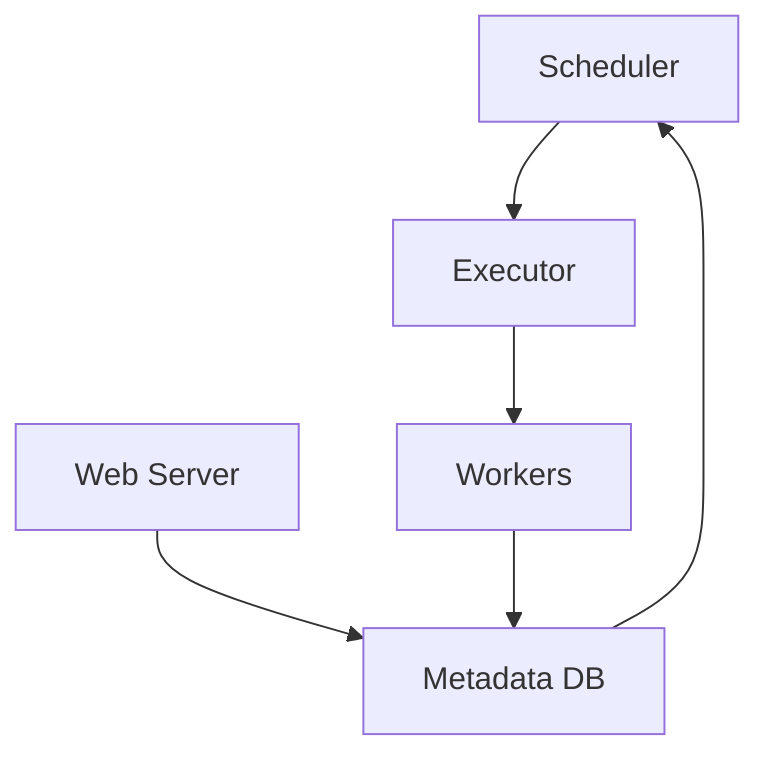
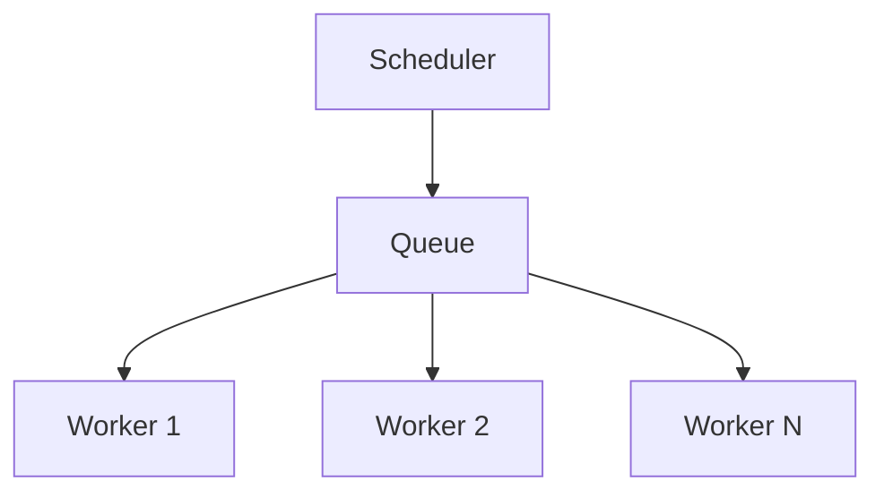
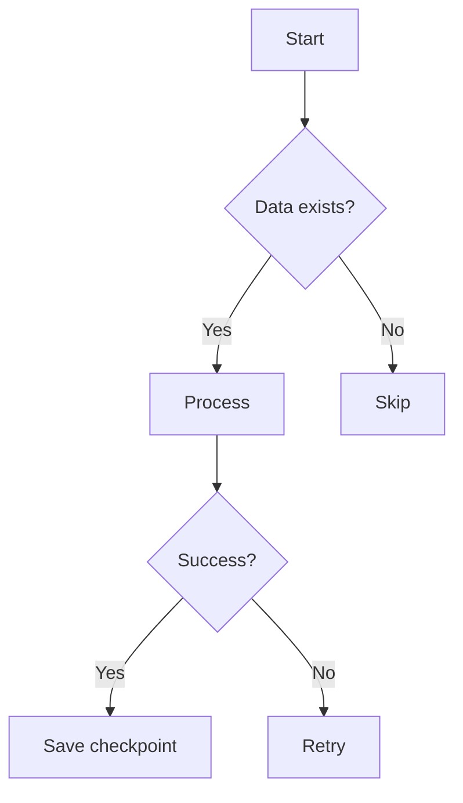
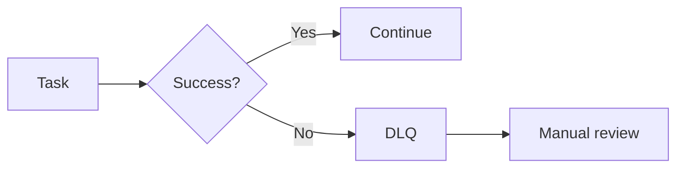
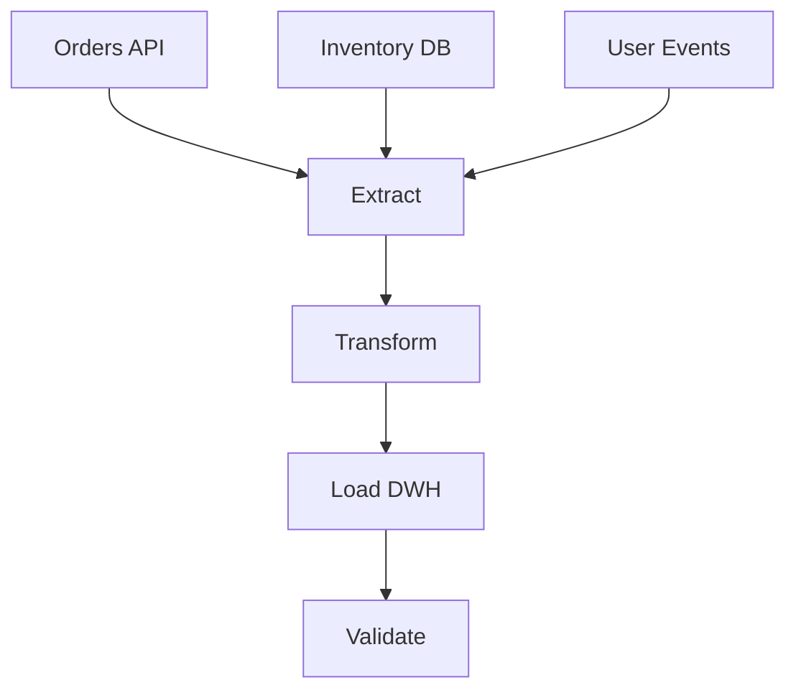

# Лекция 6: ETL/ELT пайплайны и оркестрация

---

## Слайд 1: План лекции

- Теория: Apache Airflow и оркестрация
- Практика: надежные пайплайны
- Мониторинг и логирование
- Обработка ошибок

---

## Слайд 2: Что такое оркестрация?

- Управление последовательностью задач
- Автоматизация запусков по расписанию
- Обработка зависимостей между задачами
- Централизованный контроль выполнения

---

## Слайд 3: Почему без оркестрации нельзя?

- Ручные запуски - источник ошибок
- Сложность отслеживания зависимостей
- Отсутствие единого лога
- Невозможность масштабирования

---

## Слайд 4: Классическая проблема

- 50+ источников данных
- 200+ ежедневных задач
- 30+ разработчиков
- 0 общего видения процессов

---

## Слайд 5: Apache Airflow - что это?

- Платформа для оркестрации workflows
- Python-код как основа пайплайнов
- Визуальный интерфейс
- Масштабируемость через распределение

---

## Слайд 6: Архитектура Airflow



---

## Слайд 7: Основные компоненты

- DAG: Directed Acyclic Graph
- Operator: выполняемая задача
- Task: экземпляр оператора
- Task Instance: конкретное выполнение

---

## Слайд 8: DAG на практике

```python
from airflow import DAG
from datetime import datetime

dag = DAG(
    'etl_sales',
    start_date=datetime(2024, 1, 1),
    schedule_interval='@daily',
    catchup=False
)
```

---

## Слайд 9: Типы операторов

- PythonOperator: любой Python-код
- BashOperator: shell-команды
- SQL операторы: Postgres, BigQuery
- Sensor-ы: ожидание событий

---

## Слайд 10: Пример DAG


---

## Слайд 11: Запуск и триггеры

- По расписанию (cron-выражения)
- По событию (sensor)
- Ручной запуск
- По завершению другого DAG

---

## Слайд 12: Cron-выражения

- `0 8 * * *` - каждый день в 8:00
- `0 */2 * * *` - каждые 2 часа
- `0 0 * * 1` - каждый понедельник
- `0 0 1 * *` - первое число месяца

---

## Слайд 13: Параметризация DAG

- Variables для конфигурации
- Templates для динамических значений
- Jinja2 в параметрах
- Runtime context

---

## Слайд 14: Templates пример

```python
sql_query = """
SELECT * FROM orders
WHERE date = '{{ ds }}'
"""
```

---

## Слайд 15: XCom - обмен данными

- Task A сохраняет результат
- Task B получает значение
- JSON-сериализация
- Ограничение 48KB

---

## Слайд 16: XCom код

```python
# В task1
return {"processed": 1000}

# В task2
value = task_instance.xcom_pull(task_ids='task1')
```

---

## Слайд 17: Масштабирование Airflow

- SequentialExecutor: для разработки
- LocalExecutor: много ядер
- CeleryExecutor: распределенные воркеры
- KubernetesExecutor: контейнеры

---

## Слайд 18: CeleryExecutor архитектура



---

## Слайд 19: Проблема масштабирования

- 1000+ задач в час
- 50GB оперативной памяти
- 500 воркеров
- Решение: KubernetesExecutor

---

## Слайд 20: Мониторинг DAG-ов

- UI в Airflow
- Email-уведомления
- Slack/Teams интеграция
- Custom callbacks

---

## Слайд 21: Отладка DAG-ов

- Graph view в UI
- Task logs
- Task Instance details
- Retry логика

---

## Слайд 22: Проверка понимания #1

- Что такое DAG?
- Какие бывают trigger-ы?
- Для чего нужен XCom?
- Чем отличается Executor-ы?

---

## Слайд 23: Теория: надежные пайплайны

- Идемпотентность
- Атомарность
- Инкрементальная обработка
- Обработка ошибок

---

## Слайд 24: Идемпотентность

- Повторный запуск без эффекта
- Проверка существования данных
- UPSERT вместо INSERT
- Уникальные ключи

---

## Слайд 25: Идемпотентный пример

```sql
INSERT INTO daily_stats (date, revenue)
SELECT DATE('{{ ds }}'), SUM(amount)
FROM orders
WHERE DATE(created_at) = DATE('{{ ds }}')
ON CONFLICT (date) DO UPDATE
SET revenue = EXCLUDED.revenue
```

---

## Слайд 26: Атомарность

- Все или ничего
- Транзакции в БД
- Временные таблицы
- Rollback при ошибке

---

## Слайд 27: Инкрементальная обработка

- Чтение только новых данных
- Чекпоинты и курсоры
- Watermark-и времени
- Экономия ресурсов

---

## Слайд 28: Чекпоинт пример

```python
def get_last_processed_id():
    return Variable.get("last_order_id", 0)

def save_checkpoint(max_id):
    Variable.set("last_order_id", max_id)
```

---

## Sлайд 29: Паттерны проектирования

- Task-перезапуски
- Retry логика
- Таймауты
- Graceful degradation

---

## Слайд 30: Retry конфигурация

```python
task = PythonOperator(
    task_id='process_data',
    python_callable=process_data,
    retries=3,
    retry_delay=timedelta(minutes=5),
    email_on_failure=True
)
```

---

## Слайд 31: Структура надежного DAG



---

## Слайд 32: Тестирование пайплайнов

- Unit тесты задач
- Integration тесты DAG
- Test datasets
- Mock external services

---

## Слайд 33: Unit тест пример

```python
def test_transform_data():
    input_data = [{"id": 1, "value": 100}]
    result = transform_data(input_data)
    assert result[0]["value"] == 200
```

---

## Слайд 34: Проверка понимания #2

- Что такое идемпотентность?
- Как реализовать checkpoint?
- Зачем нужен retry?
- Как тестировать DAG?

---

## Слайд 35: Теория: мониторинг

- Метрики производительности
- Бизнес-метрики
- Инструменты мониторинга
- Алерты и дашборды

---

## Слайд 36: Ключевые метрики

- Время выполнения задач
- Количество успешных/проваленных
- Размер обработанных данных
- Задержка данных

---

## Слайд 37: Prometheus + Grafana


---

## Слайд 38: Custom метрики

```python
from airflow.metrics import Stats

Stats.incr('orders_processed', count=len(orders))
Stats.timing('processing_time', duration)
```

---

## Слайд 39: Структурированное логирование

- JSON формат логов
- Correlation ID
- Уровни логирования
- Centralized logging

---

## Слайд 40: Пример структурированного лога

```json
{
  "timestamp": "2024-01-15T10:30:00Z",
  "level": "INFO",
  "dag_id": "etl_sales",
  "task_id": "process_orders",
  "message": "Processed 5000 orders"
}
```

---

## Слайд 41: Алерты

- Email уведомления
- Slack Webhooks
- PagerDuty интеграция
- Severity levels

---

## Слайд 42: Дашборд пример

- Gantt chart задач
- Статистика за последние 24ч
- Топ-5 самых долгих задач
- Error rate по DAG-ам

---

## Слайд 43: Проверка понимания #3

- Какие метрики отслеживать?
- Что такое structured logging?
- Зачем нужен Correlation ID?
- Какие бывают severity levels?

---

## Слайд 44: Теория: обработка ошибок

- Стратегии обработки
- Graceful degradation
- Восстановление после сбоев
- Dead letter queues

---

## Слайд 45: Типы ошибок

- Временные сетевые ошибки
- Ошибки валидации данных
- Ресурсы недоступны
- Бизнес-логика нарушена

---

## Слайд 46: Retry стратегии

- Экспоненциальная задержка
- Максимальное количество попыток
- Circuit breaker
- Fallback механизмы

---

## Слайд 47: Exponential backoff

```python
delay = base_delay * (2 ** attempt)
time.sleep(min(delay, max_delay))
```

---

## Слайд 48: Graceful degradation

- Отключение не критичных функций
- Использование кеша
- Упрощенная обработка
- Пользовательские уведомления

---

## Слайд 49: Dead letter queue



---

## Слайд 50: Восстановление после сбоев

- Identification проблемы
- Data replay
- State recovery
- Validation результатов

---

## Слайд 51: Автоматическое восстановление

- Self-healing scripts
- Health checks
- Auto-restart policies
- Escalation procedures

---

## Слайд 52: Практический кейс

- E-commerce платформа
- 5 источников данных
- 12 задач в DAG
- SLA: 2 часа

---

## Слайд 53: Архитектура кейса



---

## Слайд 54: Реализация DAG

```python
default_args = {
    'owner': 'data-team',
    'depends_on_past': False,
    'start_date': datetime(2024, 1, 1),
    'retries': 2,
    'retry_delay': timedelta(minutes=10)
}
```

---

## Слайд 55: Тесты для кейса

- Проверка idempotency
- Mock API responses
- Test data validation
- Performance benchmarks

---

## Слайд 56: Мониторинг кейса

- Gantt chart
- Data quality checks
- Business metrics
- Alert channels

---

## Слайд 57: Проверка понимания #4

- Как восстановить после сбоя?
- Что такое DLQ?
- Зачем нужен exponential backoff?
- Как реализовать graceful degradation?

---

## Слайд 58: Резюме лекции

- Airflow - основной инструмент оркестрации
- Надежность через идемпотентность
- Мониторинг критичен для SLA
- Ошибки - это норма, планируй заранее

---

## Слайд 59: Связи с лекцией 7

- Пайплайны используют разные хранилища
- Monitoring влияет на выбор СУБД
- ETL/ELT влияет на архитектуру
- Следующий шаг: оптимизация хранения

---

## Слайд 60: Ссылки и литература

- Apache Airflow Documentation
- "Data Pipelines with Python" - H. Weber
- "Designing Data-Intensive Applications" - M. Kleppmann
- Airflow Best Practices Guide
- Monitoring and Observability - Cindy Sridharan

---

## Слайд 61: Домашнее задание

**Part 1:** Реализуйте DAG с 5 задачами  
**Part 2:** Добавьте idempotency для всех задач  
**Part 3:** Настройте monitoring через Grafana  
**Part 4:** Реализуйте retry с exponential backoff  

---

## Слайд 62: Детали домашки

- Используйте public dataset
- SLA: 30 минут
- Покройте unit тестами
- Сделайте презентацию решения