<style>
@import url('https://fonts.googleapis.com/css2?family=Inter:wght@400;500;600;700;800&family=JetBrains+Mono:wght@400;600&display=swap');

:root {
  --primary: #1d4ed8;
  --primary-dark: #1e3a8a;
  --accent: #0ea5e9;
  --ink: #0f172a;
  --muted: #64748b;
  --soft: #f1f5f9;
  --teal: #0d9488;
  --amber: #d97706;
  --rose: #e11d48;
  --violet: #7c3aed;
  --line: #e2e8f0;
}

section {
  font-family: 'Inter', 'Noto Sans', 'Segoe UI', system-ui, sans-serif;
  color: var(--ink);
  background-color: #ffffff;
  background-image:
    linear-gradient(90deg, #0ea5e9 0%, #1d4ed8 48%, #7c3aed 100%),
    radial-gradient(900px 380px at 94% -10%, rgba(29,78,216,.08), transparent 65%);
  background-size: 100% 4px, auto;
  background-position: top left, top right;
  background-repeat: no-repeat;
  font-size: 24px;
  line-height: 1.34;
  padding: 58px 60px 44px;
}

header {
  position: absolute; top: 17px; left: 60px; right: 60px;
  font-size: 10.5px; letter-spacing: .14em; text-transform: uppercase;
  color: #94a3b8; font-weight: 600;
}
footer {
  position: absolute; bottom: 15px; left: 60px; right: 60px;
  font-size: 10.5px; color: #94a3b8;
}
section::after {
  right: 60px; bottom: 15px;
  font-size: 11px; color: #94a3b8; font-weight: 700;
}

h1 { font-size: 1.55em; line-height: 1.1; color: var(--primary-dark); margin: 0 0 .38em; font-weight: 800; letter-spacing: -.02em; }
h2 { font-size: 1.22em; line-height: 1.16; color: var(--ink); margin: 0 0 .5em; font-weight: 800; letter-spacing: -.015em; padding-left: .42em; border-left: 5px solid var(--accent); }
h3 { font-size: .68em; color: var(--accent); margin: 0 0 .5em; font-weight: 700; text-transform: uppercase; letter-spacing: .14em; }

ul, ol { margin: 0 0 .5em; padding-left: 1.15em; }
li { margin: .19em 0; }
li::marker { color: var(--primary); }
li strong, li b { color: var(--primary-dark); }
p { margin: 0 0 .45em; }
a { color: var(--primary); }

table { display: table !important; width: 100% !important; border-collapse: collapse; font-size: .67em; line-height: 1.28; border-radius: 12px; overflow: hidden; box-shadow: 0 8px 22px rgba(15,23,42,.06); }
th { background: linear-gradient(90deg, var(--primary-dark), var(--primary)); color: #fff; padding: 9px 12px; text-align: left; font-weight: 600; }
td { padding: 7px 12px; border-bottom: 1px solid var(--line); vertical-align: top; background: #fff; }
tr:nth-child(even) td { background: #f8fafc; }
tr:last-child td { border-bottom: none; }

img { display: block; margin: .25em auto .3em; max-width: 100%; max-height: 430px; background: #fff; border: 1px solid var(--line); border-radius: 14px; padding: 8px; box-shadow: 0 12px 28px rgba(15,23,42,.07); }
section.fig-tall img { max-height: 520px; }
section.no-frame img { border: none; box-shadow: none; padding: 0; }

code { background: var(--soft); border-radius: 4px; padding: 1px 6px; font-size: .82em; font-family: 'JetBrains Mono', ui-monospace, monospace; }
pre { background: #0b1220; color: #e2e8f0; border-radius: 12px; padding: 15px 20px; font-size: .54em; line-height: 1.46; box-shadow: 0 14px 30px rgba(15,23,42,.16); }
pre code { background: transparent; color: inherit; padding: 0; font-size: 1em; }

.hljs-comment, .hljs-quote { color: #94a3b8; font-style: italic; }
.hljs-keyword, .hljs-selector-tag, .hljs-built_in, .hljs-type { color: #93c5fd; }
.hljs-string, .hljs-attr, .hljs-regexp { color: #86efac; }
.hljs-number, .hljs-literal, .hljs-symbol { color: #fbbf24; }
.hljs-title, .hljs-section, .hljs-name { color: #f0abfc; }
.hljs-variable, .hljs-template-variable { color: #fca5a5; }
.hljs-meta { color: #cbd5e1; }

.columns { display: grid; grid-template-columns: 1fr 1fr; gap: 40px; align-items: start; }
.cols3 { display: grid; grid-template-columns: 1fr 1fr 1fr; gap: 22px; align-items: start; }
.split { display: grid; grid-template-columns: 1.12fr .88fr; gap: 38px; align-items: start; }
.split-r { display: grid; grid-template-columns: .88fr 1.12fr; gap: 38px; align-items: start; }
.wide-left { display: grid; grid-template-columns: 1.45fr .55fr; gap: 30px; align-items: start; }

section.section, section.title {
  background-color: #0b1220;
  background-image:
    radial-gradient(700px 420px at 88% 12%, rgba(14,165,233,.22), transparent 60%),
    radial-gradient(600px 420px at 12% 92%, rgba(124,58,237,.18), transparent 60%),
    linear-gradient(135deg, #0b1220 0%, #172554 48%, #1d4ed8 100%);
  background-size: auto;
  color: #fff;
  display: flex; flex-direction: column; justify-content: center;
  padding: 66px 84px;
}
section.section h1, section.title h1 { color: #fff; border: none; font-size: 2.45em; letter-spacing: -.03em; }
section.section h2, section.title h2 { color: rgba(255,255,255,.82); font-weight: 400; border-left: none; padding-left: 0; font-size: 1.02em; letter-spacing: 0; }
section.section p, section.title p { color: rgba(255,255,255,.78); }
section.section header, section.title header,
section.section footer, section.title footer { color: rgba(255,255,255,.42); }
section.section::after { color: rgba(255,255,255,.5); }

section.section::before {
  content: ''; position: absolute; inset: 0;
  background-image: radial-gradient(rgba(255,255,255,.17) 1px, transparent 1px);
  background-size: 28px 28px; opacity: .22; pointer-events: none;
}
section.title::before {
  content: ''; position: absolute; width: 620px; height: 620px; border-radius: 50%;
  right: -180px; top: -240px; border: 1px solid rgba(255,255,255,.14);
  box-shadow: 0 0 0 60px rgba(255,255,255,.035), 0 0 0 140px rgba(255,255,255,.02);
}
section.title::after, section.section::after { content: '' !important; }

.section-no {
  position: absolute; right: 72px; top: 58px;
  font-size: 9em; font-weight: 800; line-height: 1;
  color: rgba(255,255,255,.07); letter-spacing: -.07em;
}

.callout { display: block; border-left: 5px solid var(--accent); background: #eff6ff; border-radius: 8px; padding: 12px 18px; margin: .5em 0; font-size: .84em; }
.callout.warn { border-left-color: var(--amber); background: #fffbeb; }
.callout.good { border-left-color: var(--teal); background: #ecfdf5; }
.callout.bad { border-left-color: var(--rose); background: #fef2f2; }
.callout b { color: var(--primary-dark); }
.callout p:last-child { margin-bottom: 0; }

.muted { color: var(--muted); }
.small { font-size: .82em; }
.tiny { font-size: .7em; }
.badge { display: inline-block; background: var(--soft); border-radius: 999px; padding: 4px 13px; margin: 3px; font-size: .7em; font-weight: 600; color: var(--primary-dark); }
.tag { display: inline-block; border: 1px solid rgba(255,255,255,.28); border-radius: 999px; padding: 5px 15px; margin: 4px; font-size: .62em; color: rgba(255,255,255,.9); letter-spacing: .02em; }

.cards { display: grid; grid-template-columns: repeat(3, 1fr); gap: 15px; margin: .45em 0; }
.cards.two { grid-template-columns: repeat(2, 1fr); gap: 18px; }
.cards.four { grid-template-columns: repeat(4, 1fr); gap: 12px; }
.card { border: 1px solid var(--line); border-radius: 14px; padding: 14px 16px; background: #fff; box-shadow: 0 8px 20px rgba(15,23,42,.05); font-size: .72em; line-height: 1.32; }
.card h4 { margin: 0 0 .35em; font-size: 1.04em; color: var(--primary-dark); font-weight: 700; }
.card .num { font-size: 1.7em; font-weight: 800; color: var(--primary); line-height: 1; }
.card.teal { border-top: 4px solid var(--teal); }
.card.amber { border-top: 4px solid var(--amber); }
.card.rose { border-top: 4px solid var(--rose); }
.card.violet { border-top: 4px solid var(--violet); }
.card.blue { border-top: 4px solid var(--primary); }
.card p:last-child { margin-bottom: 0; }

.kpis { display: grid; grid-template-columns: repeat(4, 1fr); gap: 13px; margin: .55em 0; }
.kpi { text-align: center; padding: 14px 10px; border-radius: 12px; background: var(--soft); border: 1px solid var(--line); }
.kpi b { display: block; font-size: 1.75em; color: var(--primary); line-height: 1.05; letter-spacing: -.02em; }
.kpi span { display: block; font-size: .61em; color: var(--muted); margin-top: 4px; }

.quote { border-left: 5px solid var(--violet); background: #f5f3ff; border-radius: 8px; padding: 13px 19px; font-size: .9em; color: #312e81; font-style: italic; margin: .55em 0; }
.formula { background: var(--soft); border: 1px solid var(--line); border-radius: 12px; padding: 9px 17px; margin: .4em 0; font-size: .88em; }
.formula p { margin: 0; }
.kicker { color: var(--muted); font-size: .82em; margin-top: -.2em; }
.divider { height: 1px; background: linear-gradient(90deg, var(--line), transparent); margin: .5em 0; }

.steps { display: grid; gap: 8px; margin: .4em 0; }
.step { display: grid; grid-template-columns: 34px 1fr; gap: 12px; align-items: start; font-size: .78em; }
.step .n { width: 30px; height: 30px; border-radius: 50%; background: var(--primary); color: #fff; font-weight: 700; font-size: .75em; display: flex; align-items: center; justify-content: center; }
.step p { margin: 0; }

.fig-note { text-align: center; font-size: .62em; color: var(--muted); margin-top: -.15em; }

section.title .meta, section.section .meta {
  margin-top: 1.7em; font-size: .56em; font-weight: 600;
  color: rgba(255,255,255,.55); letter-spacing: .12em; text-transform: uppercase;
}
section.title .tag-row { margin-top: 1.3em; }

section.centered { display: flex; flex-direction: column; justify-content: center; }
section.centered .cards .card { font-size: .8em; padding: 18px 20px; }
section.centered .callout { font-size: .92em; }
section.centered h3 { margin-bottom: .8em; }

section.tight pre { font-size: .47em; line-height: 1.4; }
</style>

<!-- _class: title -->

# Современные хранилища данных

## от таблицы в PostgreSQL до озера на S3

<div class="meta">Лекция 7 · Инженерия данных · Магистратура ИТМО · Осень 2025</div>

<div class="tag-row">
<span class="tag">ACID</span>
<span class="tag">DWH и Lake</span>
<span class="tag">ClickHouse</span>
<span class="tag">CAP</span>
<span class="tag">HDFS и S3</span>
</div>

---

<!-- _class: section -->
<div class="section-no">00</div>

# План лекции

## 5 разделов · 80 минут · один вопрос: где хранить данные

---

## Маршрут лекции

### Что разберём и в каком порядке

| Блок | Тема | Время | Вопрос, на который ответим |
|:-----|:-----|:------|:---------------------------|
| 1 | Реляционные БД и SQL | ~18 мин | Когда таблица и транзакции — лучший выбор? |
| 2 | Data Warehouse и Data Lake | ~15 мин | Где живут аналитические данные? |
| 3 | Колоночные базы | ~15 мин | Почему ClickHouse читает миллиарды строк? |
| 4 | NoSQL | ~20 мин | Чем платим за отказ от схемы? |
| 5 | Распределённые ФС | ~12 мин | На чём всё это физически лежит? |

<div class="callout good">

<b>Идея лекции:</b> нет «лучшего» хранилища — есть соответствие модели данных, паттерна доступа и цены ошибки. Всё остальное — следствия.
</div>

---

## Спектр хранилищ

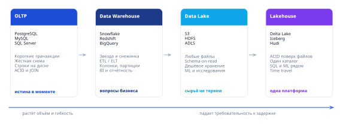

<div class="callout">

<b>Ось слева направо</b> — это не «прогресс», а смена приоритетов: строгость и задержка уступают объёму, гибкости и цене за гигабайт.
</div>

---

<!-- _class: section -->
<div class="section-no">01</div>

# Реляционные БД и SQL

## Таблицы, транзакции и цена индексов

---

<!-- _class: centered -->

## Что вы унесёте из раздела

<div class="cards">
<div class="card blue">
<h4>Модель</h4>
<p>Отношения, ключи, схема. Почему схема-при-записи — это контракт, а не бюрократия.</p>
</div>
<div class="card teal">
<h4>Гарантии</h4>
<p>ACID, уровни изоляции и аномалии, которые они закрывают. Что реально обещает <code>COMMIT</code>.</p>
</div>
<div class="card violet">
<h4>Скорость</h4>
<p>Индексы, планы запросов и нормализация: где заканчивается теория и начинается EXPLAIN.</p>
</div>
</div>

<div class="callout warn">

<b>Дисклеймер:</b> синтаксис в примерах — PostgreSQL. В MySQL, Oracle и SQL Server отличия есть, но принципы те же.
</div>

---

## Анатомия таблицы

<div class="split">
<div>

**Отношение** — множество кортежей, а не список строк. Порядок строк не определён, пока вы не написали `ORDER BY`.

- **Кортеж** (строка) — один факт
- **Атрибут** (столбец) — типизированное поле
- **Домен** — допустимые значения
- **Ключ** — минимальный набор атрибутов, различающий строки

<div class="callout">

<b>Схема</b> фиксирует типы и ограничения. Вставка данных, не подходящих под схему, невозможна — это и есть schema-on-write.
</div>

</div>
<div>

| user_id | username | email | created_at |
|:--|:--|:--|:--|
| 1 | alice | a@ex.com | 2025-09-01 |
| 2 | bob | b@ex.com | 2025-09-02 |
| 3 | carol | c@ex.com | 2025-09-04 |

<div class="tiny muted" style="margin-top:.6em">
Первичный ключ — <code>user_id</code>. Уникальность <code>email</code> — отдельное ограничение, а не «само собой».
</div>

</div>
</div>

---

## ACID: что именно гарантируется

<div class="cards four">
<div class="card blue">
<h4>A — Atomicity</h4>
<p>Транзакция применяется целиком или не применяется вовсе. Промежуточных состояний не видно никому.</p>
</div>
<div class="card teal">
<h4>C — Consistency</h4>
<p>Данные переходят из одного корректного состояния в другое: ограничения, внешние ключи, триггеры.</p>
</div>
<div class="card amber">
<h4>I — Isolation</h4>
<p>Параллельные транзакции не видят незавершённых изменений друг друга.</p>
</div>
<div class="card violet">
<h4>D — Durability</h4>
<p>После <code>COMMIT</code> данные переживут падение процесса и машины: WAL уже на диске.</p>
</div>
</div>

```sql
BEGIN;
UPDATE accounts SET balance = balance - 100 WHERE id = 1;
UPDATE accounts SET balance = balance + 100 WHERE id = 2;
COMMIT;   -- либо ROLLBACK: ни одна из строк не изменится
```

<div class="callout good">

<b>Цена:</b> WAL, блокировки и проверки ограничений. Поэтому OLTP-системы плохо переносят «аналитические» запросы на всю таблицу.
</div>

---

## Архитектура РСУБД

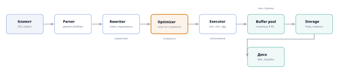

<div class="columns">
<div>

**Ключевая мысль:** запрос проходит шесть слоёв, и на каждом можно потерять порядок величины производительности.

</div>
<div>

<div class="callout">

<b>Оптимизатор</b> выбирает план по статистике. Плохая статистика — плохой план, даже при идеальных индексах.
</div>

</div>
</div>

---

## MVCC: как читать, не блокируя запись

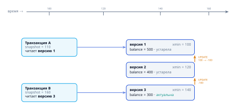

<div class="columns">
<div>

**Версионность строк** даёт читателю согласованный снимок без ожидания писателей: каждая транзакция видит версии, созданные до её старта.

</div>
<div>

<div class="callout warn">

<b>Обратная сторона:</b> старые версии занимают место. Долгая транзакция тормозит очистку и раздувает таблицу — это классическая причина «внезапно медленной» базы.
</div>

</div>
</div>

---

## Популярные РСУБД

### Выбор почти всегда про экосистему, а не про бенчмарки

| СУБД | Сильная сторона | Где встретите | Осторожно |
|:-----|:----------------|:--------------|:----------|
| **PostgreSQL** | расширяемость, JSONB, rich SQL | продукт, аналитика, GIS | тюнинг требует знаний |
| **MySQL** | простота, огромная база знаний | веб, legacy-продукты | исторические сюрпризы в семантике |
| **Oracle** | производительность, RAC, поддержка | enterprise, банки | стоимость лицензий |
| **SQL Server** | интеграция с Microsoft, BI-стек | корпоративный контур | привязка к платформе |
| **SQLite** | встраиваемость, ноль администрирования | мобильные, edge, тесты | один писатель за раз |

<div class="callout">

<b>Практика:</b> PostgreSQL — разумный default. Отказ от него должен иметь причину, а не привычку.
</div>

---

## SQL: пять семейств команд


<div class="callout good">

<b>Порядок выполнения</b> не совпадает с порядком написания: <code>FROM → WHERE → GROUP BY → HAVING → SELECT → ORDER BY → LIMIT</code>. Отсюда запрет ссылаться на алиас <code>SELECT</code> в <code>WHERE</code>.
</div>

---

## DDL: описание структуры

### Data Definition Language

```sql
CREATE TABLE users (
    user_id     SERIAL PRIMARY KEY,
    username    VARCHAR(50) UNIQUE NOT NULL,
    email       VARCHAR(100) NOT NULL,
    is_active   BOOLEAN DEFAULT true,
    created_at  TIMESTAMP DEFAULT now()
);

ALTER TABLE users ADD COLUMN last_login TIMESTAMP;
CREATE INDEX idx_users_email ON users (email);

DROP TABLE users;   -- необратимо, если нет бэкапа
```

<div class="callout warn">

<b>Миграции</b> — это DDL в продакшене. <code>ALTER TABLE ... ADD COLUMN DEFAULT</code> на большой таблице может заблокировать запись: планируйте окно и проверяйте версию СУБД.
</div>

---

## DML: изменение данных

### Data Manipulation Language

```sql
INSERT INTO users (username, email)
VALUES ('john_doe', 'john@example.com');

UPDATE users
SET last_login = now()
WHERE username = 'john_doe';

DELETE FROM users
WHERE user_id = 5;

-- Массовая загрузка: в разы быстрее, чем INSERT в цикле
COPY users FROM '/data/users.csv' WITH (FORMAT csv, HEADER true);
```

<div class="callout bad">

<b>Классическая ошибка:</b> <code>UPDATE</code> или <code>DELETE</code> без <code>WHERE</code>. Проверяйте условие через <code>SELECT</code>, а лучше — в транзакции с <code>ROLLBACK</code>.
</div>

---

## DQL: чтение и оконные функции

### Data Query Language

```sql
-- Топ-3 заказа на пользователя, без GROUP BY и подзапросов
SELECT user_id, order_id, total,
       ROW_NUMBER() OVER (PARTITION BY user_id ORDER BY total DESC) AS rn
FROM orders
WHERE status = 'paid';

-- Только топ-3: оконная функция вычисляется до фильтра
SELECT * FROM (
  SELECT user_id, order_id, total,
         ROW_NUMBER() OVER (PARTITION BY user_id ORDER BY total DESC) AS rn
  FROM orders WHERE status = 'paid'
) t
WHERE rn <= 3;
```

<div class="callout">

<b>Оконные функции</b> — главный инструмент аналитика внутри SQL: ранжирование, накопительные суммы, сравнение с предыдущей строкой без самоджойнов.
</div>

---

## JOIN: что происходит с несовпавшими строками

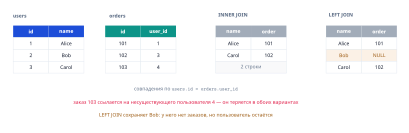

<div class="callout warn">

<b>Главный вопрос при JOIN:</b> что делать со строками без пары. <code>INNER</code> — выбросить, <code>LEFT</code> — сохранить слева и заполнить <code>NULL</code>. Ошибка здесь тихо искажает отчёты.
</div>

---

## Примеры JOIN

```sql
-- INNER JOIN: только пользователи с заказами
SELECT u.username, o.order_id, o.total
FROM users u
JOIN orders o ON u.user_id = o.user_id;

-- LEFT JOIN: все пользователи, у кого нет заказов — NULL
SELECT u.username, COUNT(o.order_id) AS order_count
FROM users u
LEFT JOIN orders o ON u.user_id = o.user_id
GROUP BY u.username;

-- Анти-джойн: пользователи без единого заказа
SELECT u.username
FROM users u
LEFT JOIN orders o ON u.user_id = o.user_id
WHERE o.order_id IS NULL;
```

<div class="callout good">

<b>Правило:</b> <code>COUNT(o.order_id)</code>, а не <code>COUNT(*)</code> — иначе пользователь без заказов посчитается как один заказ.
</div>

---

## Индексы: B-Tree под микроскопом

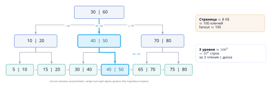

<div class="columns">
<div>

Индекс — отдельная структура, упорядоченная по ключу. Поиск идёт сверху вниз: несколько чтений страниц вместо просмотра всей таблицы.

</div>
<div>

<div class="callout warn">

<b>Цена:</b> каждая вставка обновляет и индекс. Десяток индексов на write-heavy таблице — прямой путь к деградации записи.
</div>

</div>
</div>

---

## Типы индексов и когда они помогают

| Тип | Для чего | Пример |
|:----|:---------|:-------|
| **B-Tree** | равенство, диапазоны, сортировка | 90% случаев по умолчанию |
| **Hash** | только равенство | редко нужен в PostgreSQL |
| **GIN** | массивы, JSONB, полнотекст | `WHERE tags @> ARRAY['sql']` |
| **GiST** | геометрия, диапазоны, близость | PostGIS, `tsrange` |
| **BRIN** | огромные таблицы, коррелированные с порядком | логи по времени |

**Селективность** — доля строк, которые проходит условие. Индекс выгоден, когда отношение
$\text{строк всего} : \text{строк после фильтра}$ велико: читаем единицы страниц вместо тысяч.

<div class="callout">

<b>Практика:</b> индекс на колонку с двумя значениями (пол, статус) почти бесполезен — планировщик выберет seq scan. Для таких случаев есть частичные индексы.
</div>

---

## Создание индексов

```sql
-- Простой индекс
CREATE INDEX idx_username ON users (username);

-- Составной: работает для (user_id), (user_id, order_date),
-- но не для (order_date) в отдельности — важен порядок
CREATE INDEX idx_user_date ON orders (user_id, order_date);

-- Уникальный: гарантия, а не только скорость
CREATE UNIQUE INDEX idx_email ON users (email);

-- Частичный: индексируем только нужное подмножество
CREATE INDEX idx_active_users ON users (username) WHERE is_active;

-- Проверить, используется ли индекс
EXPLAIN (ANALYZE, BUFFERS) SELECT * FROM users WHERE username = 'alice';
```

<div class="callout warn">

<b>Порядок колонок в составном индексе</b> — это не деталь: индекс читается слева направо. <code>(a, b)</code> помогает запросам по <code>a</code> и по <code>a, b</code>, но не по одному <code>b</code>.
</div>

---

## Нормализация: зачем разбивать таблицы

<div class="callout">

<b>Цель</b> — один факт хранится в одном месте. Каждая форма устраняет свой класс аномалий, а не «просто красиво раскладывает».
</div>

| Форма | Что требует | Симптом нарушения |
|:------|:------------|:------------------|
| **1NF** | атомарные значения в каждой ячейке | в поле `products` лежит `'Laptop, Mouse'` |
| **2NF** | неключевой атрибут зависит от **всего** составного ключа | в `order_items` хранится `product_name` — он зависит только от `product_id` |
| **3NF** | нет транзитивных зависимостей | `customer_city` зависит от клиента, а клиент — от заказа |
| **BCNF** | каждый детерминант — суперключ | преподаватель и курс определяют аудиторию, но оба не ключи |

<div class="cards three">
<div class="card teal">
<h4>Аномалия обновления</h4>
<p>Одно значение живёт в сотнях строк: правим все или получаем противоречие.</p>
</div>
<div class="card teal">
<h4>Аномалия вставки</h4>
<p>Нельзя добавить факт, пока нет другого: товар без заказа, клиент без покупки.</p>
</div>
<div class="card teal">
<h4>Аномалия удаления</h4>
<p>Удалив заказ, теряем единственную запись о клиенте или товаре.</p>
</div>
</div>

<div class="callout good">

<b>На практике</b> обычно достаточно 3NF: дальше начинается борьба за производительность, а не за корректность.
</div>

---

## Антипаттерн: всё в одной таблице

```sql
CREATE TABLE orders_bad (
    order_id       INT,
    customer_name  VARCHAR(100),   -- дублируется в каждом заказе
    customer_email VARCHAR(100),
    customer_city  VARCHAR(100),   -- зависит от клиента, не от заказа
    product_names  TEXT,           -- 'Laptop, Mouse, Keyboard'
    product_prices TEXT            -- '1000, 25, 75'
);
```

<div class="cards two">
<div class="card rose">
<h4>Аномалия обновления</h4>
<p>Клиент сменил город — нужно править сотни строк. Одну забыли: в отчёте два разных города.</p>
</div>
<div class="card rose">
<h4>Аномалия вставки</h4>
<p>Нельзя добавить товар в каталог, пока на него нет заказа: нет места без <code>order_id</code>.</p>
</div>
</div>

---

## Нормализованная схема (3NF)

```sql
CREATE TABLE customers (
    customer_id SERIAL PRIMARY KEY,
    name  VARCHAR(100),
    email VARCHAR(100) UNIQUE
);
CREATE TABLE products (
    product_id SERIAL PRIMARY KEY,
    name  VARCHAR(100),
    price NUMERIC(10,2)
);
CREATE TABLE orders (
    order_id    SERIAL PRIMARY KEY,
    customer_id INT REFERENCES customers(customer_id),
    order_date  TIMESTAMP
);
CREATE TABLE order_items (
    order_id   INT REFERENCES orders(order_id),
    product_id INT REFERENCES products(product_id),
    quantity   INT,
    PRIMARY KEY (order_id, product_id)   -- составной ключ
);
```

<div class="callout good">

<b>Результат:</b> один факт хранится один раз. Цена — больше таблиц и JOIN'ов при чтении.
</div>

---

## Денормализация: осознанный долг

<div class="cards four">
<div class="card amber">
<h4>Меньше JOIN</h4>
<p>Витрины и read-модели с уже собранными данными: отчёт читается в разы быстрее.</p>
</div>
<div class="card amber">
<h4>Предагрегация</h4>
<p>Итоги по дням и категориям считаются один раз, а не на каждый запрос.</p>
</div>
<div class="card amber">
<h4>Кэш и снимки</h4>
<p>Материализованные представления и таблицы-снимки как замена дорогим вычислениям.</p>
</div>
<div class="card amber">
<h4>OLAP-модели</h4>
<p>Звезда и снежинка — нормализация «наоборот», под аналитические вопросы.</p>
</div>
</div>

<div class="quote">
Денормализация — это кредит: вы берёте скорость сегодня и обязуетесь обслуживать долг согласованностью завтра.
</div>

---

## Транзакции: границы и изоляция

```sql
BEGIN;

SET TRANSACTION ISOLATION LEVEL READ COMMITTED;

UPDATE accounts SET balance = balance - 100 WHERE id = 1;
UPDATE accounts SET balance = balance + 100 WHERE id = 2;

COMMIT;     -- или ROLLBACK: оба UPDATE откатятся вместе
```

<div class="columns">
<div>

**Savepoint** — частичный откат внутри транзакции:

```sql
SAVEPOINT before_charge;
-- ... попытка списания ...
ROLLBACK TO before_charge;
```

</div>
<div>

<div class="callout warn">

<b>Держите транзакции короткими.</b> Внешний HTTP-вызов внутри транзакции — это блокировки на время чужой сети.
</div>

</div>
</div>

---

## Уровни изоляции и аномалии


| Уровень | Dirty read | Non-repeatable read | Phantom read |
|:--|:--:|:--:|:--:|
| Read Uncommitted | возможно | возможно | возможно |
| Read Committed | нет | возможно | возможно |
| Repeatable Read | нет | нет | возможно* |
| Serializable | нет | нет | нет |

<div class="tiny muted">*В PostgreSQL Repeatable Read реализован через снимок и фантомов не допускает; в теории SQL-стандарта — допускает.</div>

---

## Оптимизация: сначала план, потом индекс

```sql
EXPLAIN (ANALYZE, BUFFERS)
SELECT u.username, COUNT(o.order_id)
FROM users u
LEFT JOIN orders o ON u.user_id = o.user_id
WHERE u.created_at > '2025-01-01'
GROUP BY u.username;
```

**Что читать в плане:**
- **Seq Scan** на большой таблице → вероятно, нужен индекс
- **Nested Loop** при больших объёмах → рассмотрите Hash Join
- **Rows** (оценка) vs **actual rows** → устаревшая статистика
- **Buffers: shared hit/read** → сколько реально читалось с диска

<div class="callout">

<b>Правило:</b> оптимизируйте запрос, который действительно медленный и действительно важный. <code>EXPLAIN</code> без <code>ANALYZE</code> показывает оценку, а не факт.
</div>

---

## OLTP и OLAP: два разных мира

| | **OLTP** | **OLAP** |
|:--|:--|:--|
| Запросы | короткие, точечные | длинные, по миллионам строк |
| Строк на запрос | единицы | миллионы |
| Колонок в ответе | почти все | 2–5 |
| Операции | INSERT/UPDATE | агрегаты, сканы |
| Хранение | по строкам | по столбцам |
| Изоляция | строгая | допустима задержка |
| Примеры | PostgreSQL, MySQL | ClickHouse, BigQuery |

<div class="callout good">

<b>Отсюда весь следующий раздел:</b> одна и та же таблица, разложенная по-разному, даёт разницу в десятки раз на аналитическом запросе.
</div>

---

<!-- _class: centered -->

## Проверка 1

### Проверьте себя

<div class="callout warn">

<b>Вопрос:</b> какой JOIN вернёт всех пользователей, даже если у них нет ни одного заказа?
</div>

<div class="cards four" style="margin-top:.7em">
<div class="card"><h4>A</h4><p>INNER JOIN</p></div>
<div class="card"><h4>B</h4><p>LEFT JOIN</p></div>
<div class="card"><h4>C</h4><p>RIGHT JOIN</p></div>
<div class="card"><h4>D</h4><p>CROSS JOIN</p></div>
</div>

---

<!-- _class: centered -->

## Проверка 2

### Проверьте себя

<div class="callout warn">

<b>Вопрос:</b> какое свойство ACID гарантирует, что списание и зачисление денег произойдут вместе?
</div>

<div class="cards four" style="margin-top:.7em">
<div class="card"><h4>A</h4><p>Atomicity</p></div>
<div class="card"><h4>B</h4><p>Consistency</p></div>
<div class="card"><h4>C</h4><p>Isolation</p></div>
<div class="card"><h4>D</h4><p>Durability</p></div>
</div>

---

<!-- _class: centered -->

## Резюме раздела 1

<div class="cards">
<div class="card blue">
<h4>Модель</h4>
<p>Таблицы, ключи, 3NF. Схема как контракт, а не как формальность.</p>
</div>
<div class="card teal">
<h4>Гарантии</h4>
<p>ACID и уровни изоляции. MVCC даёт чтение без блокировок.</p>
</div>
<div class="card violet">
<h4>Скорость</h4>
<p>B-Tree, селективность, EXPLAIN. Индекс — это компромисс чтения и записи.</p>
</div>
</div>

<div class="callout good">

<b>Когда RDBMS — правильный выбор:</b> данные структурированы, важна согласованность, запросы разнообразны и заранее неизвестны.
</div>

---

<!-- _class: section -->
<div class="section-no">02</div>

# Data Warehouse и Data Lake

## Где живут аналитические данные

---

## Data Warehouse: определение

<div class="quote">
Хранилище данных — предметно-ориентированное, интегрированное, неизменяемое и привязанное ко времени собрание данных для поддержки управленческих решений. — Б. Инмон
</div>

<div class="cards two">
<div class="card blue">
<h4>Подход Инмона</h4>
<p>Сначала корпоративная нормализованная модель (3NF) на всё предприятие, витрины — уже над ней. Дороже старт, согласованнее результат.</p>
</div>
<div class="card teal">
<h4>Подход Кимбалла</h4>
<p>Сначала витрины под бизнес-процессы (звезда), затем — общий слой измерений. Быстрее первые результаты.</p>
</div>
</div>

<div class="callout">

<b>Общее у обоих:</b> данные сначала очищаются и моделируются, потом попадают к аналитику. Схема фиксируется при записи.
</div>

---

## Архитектура DWH

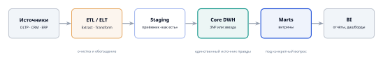

<div class="columns">
<div>

- **Staging** — приёмник «как есть», быстрый и временный
- **Core** — нормализованное или звёздное ядро: единственный источник правды
- **Marts** — витрины под конкретный бизнес-вопрос

</div>
<div>

<div class="callout warn">

<b>Антипаттерн:</b> аналитики ходят напрямую в OLTP — нагрузка на продуктивную базу, разные определения метрик, ручные выгрузки.
</div>

</div>
</div>

---

## ETL или ELT

| | **ETL** | **ELT** |
|:--|:--|:--|
| Порядок | трансформация до загрузки | загрузка, затем трансформация |
| Где считается | отдельный движок | внутри хранилища |
| Сырые данные | теряются после очистки | остаются навсегда |
| Гибкость | новая логика — новый пайплайн | новая логика — новый SQL |
| Когда выбирать | жёсткие требования к данным, чувствительные ПДн | облачное эластичное хранилище |

<div class="callout good">

<b>ELT стал нормой</b> там, где хранение дешёвое, а вычисления эластичные: сначала складываем сырьё, потом пересобираем витрины SQL-ом. Пересчитать историю можно без повторной выгрузки из источника.
</div>

---

## Схема «звезда»

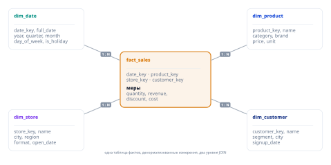

<div class="columns">
<div>

Одна таблица фактов, вокруг — денормализованные измерения. Два уровня JOIN, предсказуемый план запроса.

</div>
<div>

<div class="callout good">

<b>Плюсы:</b> простота для аналитика, быстрые JOIN'ы, понятная модель для BI-инструментов.
</div>

</div>
</div>

---

## Схема «снежинка»

<div class="split-r">
<div>

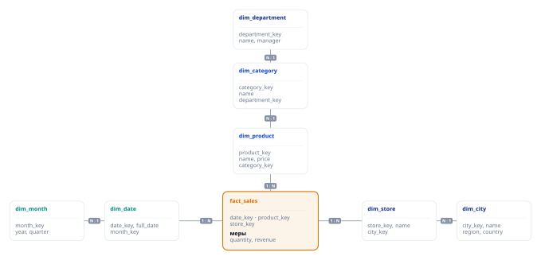
</div>
<div>

Измерения нормализованы: категория товара вынесена в отдельную таблицу, город — в регион.

<div class="callout">

<b>Компромисс:</b> меньше избыточности и проще поддерживать иерархии, но больше JOIN'ов и сложнее запросы для бизнеса.
</div>

<div class="callout warn">

<b>Совет:</b> по умолчанию — звезда. Снежинка оправдана, когда иерархии действительно большие и часто меняются.
</div>

</div>
</div>

---

## Факты, измерения и гранулярность

<div class="cards">
<div class="card amber">
<h4>Факт</h4>
<p>Измеримое событие: продажа, клик, платёж. Ключи + числовые меры. Растёт быстро.</p>
</div>
<div class="card teal">
<h4>Измерение</h4>
<p>Контекст: кто, что, где, когда. Относительно стабильно, имеет атрибуты и иерархии.</p>
</div>
<div class="card violet">
<h4>Гранулярность</h4>
<p>Одна строка факта = один факт. «Продажа позиции чека» и «чек» — разные факты.</p>
</div>
</div>

<div class="callout warn">

<b>Гранулярность выбирается до загрузки.</b> Если сложить позиции в чек, вернуть детализацию обратно уже нельзя: агрегат необратим.
</div>

| Тип факта | Пример | Особенность |
|:--|:--|:--|
| Транзакционный | строка заказа | одна строка = одно событие |
| Периодический снимок | остаток на конец дня | регулярные срезы состояния |
| Накапливающийся | заказ → оплата → доставка | строка обновляется по мере этапов |

---

## Медленно меняющиеся измерения (SCD)

| Тип | Что делаем | Плюс | Минус |
|:----|:-----------|:-----|:------|
| **SCD 1** | перезаписываем атрибут | просто | история потеряна |
| **SCD 2** | новая строка + `valid_from`/`valid_to` | полная история | таблица растёт, сложнее запросы |
| **SCD 3** | колонка «предыдущее значение» | видно одно изменение | годится только для одного шага |

```sql
-- SCD 2: закрываем старую версию и открываем новую
UPDATE dim_customer
SET valid_to = now(), is_current = false
WHERE customer_key = 42 AND is_current;

INSERT INTO dim_customer (customer_key, name, city, valid_from, is_current)
VALUES (nextval('dim_customer_seq'), 'Alice', 'Kazan', now(), true);
```

---

## Data Lake: озеро данных

<div class="quote">
Озеро данных хранит сырьё в его исходном виде и накладывает схему в момент чтения. Сначала — сложить, потом — понять.
</div>

<div class="split">
<div>

</div>
<div>

- **Raw / Bronze** — данные как пришли, без интерпретации
- **Processed / Silver** — очистка, типизация, дедупликация
- **Curated / Gold** — бизнес-агрегаты и витрины
- **Sandbox** — эксперименты, ML-фичи
- **Archive** — история и регуляторные требования

<div class="callout warn">

<b>Риск:</b> без каталога и слоёв озеро превращается в «болото данных», где никто не знает, что где лежит и можно ли этому верить.
</div>

</div>
</div>

---

## Schema-on-Write против Schema-on-Read

<div class="cards two">
<div class="card blue">
<h4>Schema-on-Write</h4>
<p>Схема проверяется при загрузке. Ошибка видна сразу, запросы быстрые, но новые источники требуют миграции.</p>
<p class="tiny muted">DWH, классические RDBMS</p>
</div>
<div class="card teal">
<h4>Schema-on-Read</h4>
<p>Файлы лежат как есть, схема применяется при чтении. Гибко, но ошибки данных всплывают у потребителя.</p>
<p class="tiny muted">Data Lake, S3 + Parquet</p>
</div>
</div>

<div class="callout">

<b>Это не «лучше/хуже», а перенос момента проверки.</b> В Lakehouse оба режима сосуществуют: запись через табличный формат с валидацией, чтение — по схеме из метаданных.
</div>

---

## Data Lakehouse

<div class="cards">
<div class="card violet">
<h4>ACID на файлах</h4>
<p>Транзакционный лог поверх Parquet в объектном хранилище: конкурентная запись, откаты, повторные запуски.</p>
</div>
<div class="card violet">
<h4>Один каталог</h4>
<p>SQL-аналитик и ML-инженер видят одни и те же таблицы — без копирования данных между системами.</p>
</div>
<div class="card violet">
<h4>Time travel</h4>
<p>Чтение состояния на версию или дату: воспроизводимость экспериментов и разбор инцидентов.</p>
</div>
</div>

| Формат | Ключевая идея | Экосистема |
|:--|:--|:--|
| **Delta Lake** | JSON-лог + Parquet, tight Spark | Databricks, Spark |
| **Apache Iceberg** | дерево метаданных, скрытые партиции | Spark, Trino, Snowflake |
| **Apache Hudi** | copy-on-write / merge-on-read, upserts | потоковая загрузка |

<div class="callout good">

<b>Фактически</b> Lakehouse = дешёвое объектное хранилище + открытый табличный формат + движок запросов. Отдельный «дорогой DWH» становится необязательным.
</div>

---

## Метаданные: каталог, lineage, контракты

<div class="cards four">
<div class="card blue">
<h4>Data Catalog</h4>
<p>Поиск датасетов, владелец, описание, теги. «Что у нас есть про клиентов?»</p>
</div>
<div class="card teal">
<h4>Lineage</h4>
<p>Откуда пришла цифра и какие отчёты сломаются, если изменить поле.</p>
</div>
<div class="card amber">
<h4>Schema Registry</h4>
<p>Версии схем и правила совместимости для потоков и таблиц.</p>
</div>
<div class="card violet">
<h4>Качество</h4>
<p>Тесты свежести, объёма и полноты — прямо в пайплайне, а не в голове дежурного.</p>
</div>
</div>

<div class="callout">

<b>Инструменты:</b> Apache Atlas, DataHub, OpenMetadata, AWS Glue Catalog, Unity Catalog. Выбор вторичен — важен процесс владения.
</div>

---

<!-- _class: centered -->

## Проверка 3

### Проверьте себя

<div class="callout warn">

<b>Вопрос:</b> в какой зоне Data Lake лежат сырые, ещё не проверенные данные?
</div>

<div class="cards four" style="margin-top:.7em">
<div class="card"><h4>A</h4><p>Curated Zone</p></div>
<div class="card"><h4>B</h4><p>Processed Zone</p></div>
<div class="card"><h4>C</h4><p>Raw Zone</p></div>
<div class="card"><h4>D</h4><p>Sandbox</p></div>
</div>

---

<!-- _class: centered -->

## Резюме раздела 2

<div class="cards">
<div class="card blue">
<h4>DWH</h4>
<p>Схема при записи, модель звезда/снежинка, предсказуемая производительность для BI.</p>
</div>
<div class="card teal">
<h4>Data Lake</h4>
<p>Сырьё в файлах, схема при чтении, дешёвое масштабирование и ML.</p>
</div>
<div class="card violet">
<h4>Lakehouse</h4>
<p>ACID и каталог поверх объектного хранилища: одно место для SQL и ML.</p>
</div>
</div>

<div class="callout good">

<b>Критерий выбора:</b> если нужен строгий, стабильный отчёт — DWH. Если нужно хранить всё и экспериментировать — Lake. Если нужно и то и другое без копий — Lakehouse.
</div>

---

<!-- _class: section -->
<div class="section-no">03</div>

# Колоночные базы данных

## Почему аналитика любит столбцы

---

## Строки против столбцов

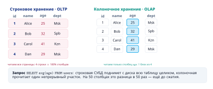

<div class="callout">

<b>Разница не в «формате файла», а в том, что попадает в один блок чтения.</b> Строковая СУБД читает строку целиком, колоночная — непрерывный кусок одного столбца.
</div>

---

## Арифметика ввода-вывода

<div class="kpis">
<div class="kpi"><b>50</b><span>столбцов в таблице</span></div>
<div class="kpi"><b>3</b><span>нужны в запросе</span></div>
<div class="kpi"><b>94%</b><span>лишних байт у строковой СУБД</span></div>
<div class="kpi"><b>10–50×</b><span>разница на сканах</span></div>
</div>

<div class="formula">

Стоимость запроса примерно пропорциональна прочитанным байтам:
$$T \approx \frac{\text{строк} \times \sum \text{ширин прочитанных столбцов}}{\text{пропускная способность}}$$
</div>

<div class="columns">
<div>

**Сжатие усиливает эффект.** Столбец однотипен: города повторяются, даты идут по порядку, числа близки. Кодирование уменьшает объём ещё в 3–10 раз — и чтение становится дешевле.

</div>
<div>

<div class="callout good">

<b>Но:</b> точечное чтение одной строки по ключу в колоночной СУБД дороже. OLTP-нагрузка — не её сценарий.
</div>

</div>
</div>

---

## Сжатие: три приёма, которые дают больше всего

| Приём | Как работает | Где выигрывает |
|:------|:-------------|:---------------|
| **RLE** (run-length) | подряд идущие одинаковые значения → пара «значение, количество» | статусы, флаги, сортированные данные |
| **Словарь** | уникальные значения → компактные коды | города, категории, страны |
| **Delta** | хранится разница с предыдущим значением | timestamps, счётчики, id |
| **Bit-packing** | целые в минимальном числе бит | небольшие домены значений |

```text
RLE:      [Msk, Msk, Msk, Msk, Spb, Spb]  →  [(Msk,4), (Spb,2)]
Словарь:  [Msk, Spb, Kzn, Msk]            →  [0,1,2,0] + словарь
Delta:    [1000, 1003, 1007, 1010]        →  [1000, +3, +4, +3]
```

<div class="callout">

<b>Сортировка по колонке</b> — это тоже оптимизация сжатия: чем длиннее серии похожих значений, тем лучше работают RLE и delta.
</div>

---

## Векторизация и почему это важно

<div class="cards">
<div class="card blue">
<h4>Батчи вместо строк</h4>
<p>Операторы обрабатывают блоки по 1024–65536 значений, а не по одной строке: меньше накладных расходов на вызов.</p>
</div>
<div class="card teal">
<h4>SIMD</h4>
<p>Одна инструкция — несколько значений: сравнение, сумма, фильтр выполняются параллельно на уровне CPU.</p>
</div>
<div class="card violet">
<h4>Late materialization</h4>
<p>Сначала фильтруем по узким колонкам, и только для прошедших строк читаем широкие.</p>
</div>
</div>

<div class="callout good">

<b>Итог:</b> колоночная СУБД выигрывает трижды — меньше читает, лучше сжимает, эффективнее считает. Именно поэтому ClickHouse держит миллиарды строк в секунду на одном сервере.
</div>

---

## ClickHouse: что это

<div class="kpis">
<div class="kpi"><b>2016</b><span>open source, Apache 2.0</span></div>
<div class="kpi"><b>~10×</b><span>быстрее классических DWH на сканах</span></div>
<div class="kpi"><b>1 млрд</b><span>строк в секунду на кластере</span></div>
<div class="kpi"><b>SQL</b><span>диалект с расширениями</span></div>
</div>

- Разработан в **Яндексе** для Метрики, затем открыт
- **Колоночный** движок, агрессивное сжатие, векторизованное исполнение
- **MergeTree** — семейство движков, основа всей модели
- Горизонтальное масштабирование: шардирование + репликация
- Слабое место — точечные `UPDATE`/`DELETE`, зато есть `ALTER ... UPDATE` и лёгкие удаления

<div class="callout warn">

<b>Не замена PostgreSQL.</b> ClickHouse — аналитический движок: нет полноценных транзакций и внешних ключей, JOIN'ы требуют дисциплины.
</div>

---

## MergeTree: как устроена таблица

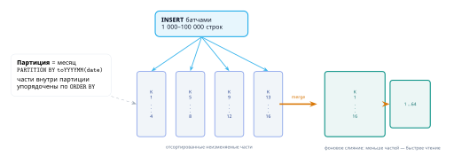

<div class="columns">
<div>

Данные пишутся **частями**, отсортированными по `ORDER BY`. Части неизменяемы, фон сливает их в более крупные.

</div>
<div>

<div class="callout warn">

<b>Следствие:</b> слишком частые мелкие вставки создают тысячи частей и «too many parts». Вставляйте батчами по 10–100 тысяч строк.
</div>

</div>
</div>

---

## ClickHouse: кластер и репликация

<div class="split">
<div>

</div>
<div>

- **Шард** — часть данных, определяется ключом шардирования
- **Реплика** — копия шарда для отказоустойчивости
- **ZooKeeper / ClickHouse Keeper** — координация реплик
- Запрос идёт на все шарды, результат собирается на инициаторе

<div class="callout">

<b>Проектное решение:</b> ключ шардирования должен давать равномерное распределение и позволять локальные JOIN'ы. Иначе сеть съест весь выигрыш.
</div>

</div>
</div>

---

## ClickHouse: движки и код

```sql
-- Основной движок: партиции по месяцу, сортировка по (date, user_id)
CREATE TABLE events (
    date       Date,
    user_id    UInt32,
    event_type LowCardinality(String),
    value      Float64
) ENGINE = MergeTree()
PARTITION BY toYYYYMM(date)
ORDER BY (date, user_id);

-- Реплицированный вариант: путь в Keeper + имя реплики
CREATE TABLE events_repl ON CLUSTER main (
    date Date, user_id UInt32, event_type String, value Float64
) ENGINE = ReplicatedMergeTree('/clickhouse/tables/{shard}/events', '{replica}')
PARTITION BY toYYYYMM(date)
ORDER BY (date, user_id);

-- Распределённая таблица-фасад над шардами
CREATE TABLE events_dist ON CLUSTER main AS events
ENGINE = Distributed('main', 'default', 'events', rand());
```

<div class="callout good">

<b>Правила:</b> в <code>ORDER BY</code> — сначала колонки для фильтра, затем для сортировки. <code>LowCardinality</code> для строк с малым числом уникальных значений экономит память и диск.
</div>

---

## Материализованные представления

```sql
CREATE MATERIALIZED VIEW daily_stats
ENGINE = SummingMergeTree()
PARTITION BY toYYYYMM(date)
ORDER BY (date, event_type)
AS SELECT
    date,
    event_type,
    count()          AS event_count,
    sum(value)       AS total_value
FROM events
GROUP BY date, event_type;
```

<div class="columns">
<div>

В ClickHouse это **триггер на вставку**: новые строки сразу агрегируются и попадают в целевую таблицу.

</div>
<div>

<div class="callout warn">

<b>Важно:</b> представление не пересчитывает историю. Если оно создано позже данных — старые периоды нужно досчитать отдельно.
</div>

</div>
</div>

---

## BigQuery: serverless-хранилище

<div class="split-r">
<div>

</div>
<div>

- Полностью управляемый сервис: нет серверов и индексов
- **Разделение** вычислений и хранения (Colossus + Dremel)
- Оплата за объём просканированных данных или за слоты
- Встроенный ML: `CREATE MODEL ... OPTIONS(model_type='linear_reg')`
- Партиционирование и кластеризация — главные рычаги стоимости

<div class="callout">

<b>Ментальная модель:</b> вы платите не за время работы, а за байты, которые движок прочитал. `SELECT *` — самая дорогая привычка.
</div>

</div>
</div>

---

## Партиции и кластеризация

```sql
-- Партиция по дате: запрос с фильтром по дате читает только нужные партиции
CREATE TABLE mydataset.events
PARTITION BY DATE(event_timestamp)
CLUSTER BY user_id, event_type
AS SELECT event_timestamp, user_id, event_type, value
FROM source_table;

-- Партиция по диапазону целых чисел
CREATE TABLE mydataset.users
PARTITION BY RANGE_BUCKET(user_id, GENERATE_ARRAY(0, 1000000, 10000))
AS SELECT * FROM source_users;
```

<div class="cards two">
<div class="card blue">
<h4>Партиция</h4>
<p>Физическое разделение таблицы. Ограничивает объём сканирования: чем точнее фильтр, тем меньше байт.</p>
</div>
<div class="card teal">
<h4>Кластеризация</h4>
<p>Сортировка внутри партиции. Ускоряет фильтры и агрегаты по кластерным колонкам, не сокращая объём партиции.</p>
</div>
</div>

---

## Сколько стоит запрос

<div class="formula">

$$\text{стоимость} = \frac{\text{просканировано ТБ} \times \$6.25}{\text{1 ТБ}}$$
</div>

<div class="kpis">
<div class="kpi"><b>1 ТБ</b><span>полный скан таблицы</span></div>
<div class="kpi"><b>12 ГБ</b><span>одна дневная партиция</span></div>
<div class="kpi"><b>0.4%</b><span>доля нужного столбца</span></div>
<div class="kpi"><b>~$0.003</b><span>вместо $6.25</span></div>
</div>

<div class="callout good">

<b>Вывод:</b> партиции, кластеризация и выбор колонок снижают счёт не на проценты, а на порядки. Это не микрооптимизация — это архитектура запроса.
</div>

---

## Оптимизация аналитических запросов

<div class="cards">
<div class="card amber">
<h4>Не читайте лишнее</h4>
<p>Явный список колонок вместо <code>SELECT *</code>; фильтр по партиционной колонке — до агрегаций.</p>
</div>
<div class="card amber">
<h4>Считайте один раз</h4>
<p>Материализованные представления и предагрегаты вместо повторных сканов сырья.</p>
</div>
<div class="card amber">
<h4>Меньше JOIN'ов</h4>
<p>Денормализация в витринах; если JOIN неизбежен — маленькая таблица справа и фильтр до соединения.</p>
</div>
</div>

<div class="callout">

<b>Проверяйте:</b> `EXPLAIN` / Query Plan показывает прочитанные байты и время по стадиям. Оптимизация без замера — это гадание.
</div>

---

<!-- _class: centered -->

## Проверка 4

### Проверьте себя

<div class="callout warn">

<b>Вопрос:</b> почему колоночная СУБД быстрее на запросе `SELECT avg(price) FROM sales`?
</div>

<div class="cards four" style="margin-top:.7em">
<div class="card"><h4>A</h4><p>хранит меньше строк</p></div>
<div class="card"><h4>B</h4><p>читает только нужный столбец</p></div>
<div class="card"><h4>C</h4><p>не поддерживает JOIN</p></div>
<div class="card"><h4>D</h4><p>использует более быстрые диски</p></div>
</div>

---

<!-- _class: centered -->

## Резюме раздела 3

<div class="cards">
<div class="card blue">
<h4>Принцип</h4>
<p>Данные лежат по столбцам: читаем только нужное, сжимаем однотипное.</p>
</div>
<div class="card teal">
<h4>ClickHouse</h4>
<p>MergeTree, части и фоновые слияния, материализованные представления.</p>
</div>
<div class="card violet">
<h4>BigQuery</h4>
<p>Serverless, разделение хранения и вычислений, оплата за байты.</p>
</div>
</div>

<div class="callout good">

<b>Выбор:</b> OLAP-нагрузка и большие объёмы — колоночная СУБД. OLTP и точечные обновления — остаются за реляционной.
</div>

---

<!-- _class: section -->
<div class="section-no">04</div>

# NoSQL решения

## Четыре модели и их компромиссы

---

## Теорема CAP

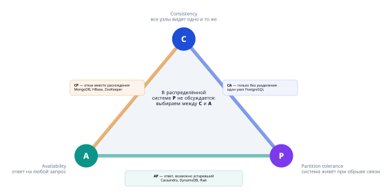

<div class="callout warn">

<b>Формулировка, которая полезна на практике:</b> при обрыве сети система либо отвечает ошибкой (CP), либо отвечает устаревшими данными (AP). «CA» возможно только без разделения — то есть на одном узле.
</div>

---

## PACELC: что происходит без аварии

<div class="formula">

**Если P** (разделение) — выбираем **A** или **C**.<br>
**Иначе E** (всё работает) — выбираем **L** (latency) или **C** (consistency).
</div>

<div class="cards four">
<div class="card blue">
<h4>PC / EC</h4>
<p>MongoDB, HBase: согласованность и в норме, и при аварии.</p>
</div>
<div class="card teal">
<h4>PA / EL</h4>
<p>Cassandra, DynamoDB: доступность и низкая задержка ценой свежести.</p>
</div>
<div class="card amber">
<h4>PC / EL</h4>
<p>PNUTS: согласованность при аварии, скорость в норме.</p>
</div>
<div class="card violet">
<h4>PA / EC</h4>
<p>Редкая комбинация: доступность при аварии, согласованность в норме.</p>
</div>
</div>

<div class="callout">

<b>Почему это важнее CAP:</b> аварии редки, а задержка — каждый день. PACELC заставляет признать, что даже без сбоев репликация стоит времени.
</div>

---

## Четыре типа NoSQL


<div class="callout good">

<b>Выбор идёт от паттерна доступа:</b> документ целиком по ключу → MongoDB; счётчики и кэш → Redis; временные ряды и высокая запись → Cassandra; обход связей → Neo4j.
</div>

---

## MongoDB: документная модель

<div class="cards">
<div class="card teal">
<h4>Документ</h4>
<p>JSON-подобная структура (BSON). Вложенность вместо JOIN'ов, разные поля в разных документах.</p>
</div>
<div class="card teal">
<h4>Индексы</h4>
<p>На любые поля, включая вложенные: <code>profile.city</code>. Без индекса — полный скан коллекции.</p>
</div>
<div class="card teal">
<h4>Горизонтальность</h4>
<p>Реплика-сет для отказоустойчивости, шардирование по ключу.</p>
</div>
</div>

```javascript
// Документ самодостаточен: заказ и его позиции лежат рядом
{
  "_id": ObjectId("507f1f77bcf86cd799439011"),
  "username": "john_doe",
  "profile": { "firstName": "John", "lastName": "Doe", "city": "Moscow" },
  "interests": ["coding", "music"],
  "orders": [
    { "orderId": 1, "total": 99.99,  "date": ISODate("2025-01-15") },
    { "orderId": 2, "total": 149.99, "date": ISODate("2025-02-20") }
  ]
}
```

---

## Вложить или сослаться

<div class="cards two">
<div class="card teal">
<h4>Embedding</h4>
<p>Данные читаются вместе и меняются вместе. Один запрос — весь объект.</p>
<p class="tiny muted">Плюс: быстрее чтение. Минус: документ растёт, дублирование, лимит 16 МБ.</p>
</div>
<div class="card amber">
<h4>Referencing</h4>
<p>Сущности живут отдельно, связь — по идентификатору.</p>
<p class="tiny muted">Плюс: нет дублей, независимые обновления. Минус: несколько запросов или <code>$lookup</code>.</p>
</div>
</div>

```javascript
// Правило большого пальца
// 1:1 и 1:few, читаются вместе   → embed
// 1:many без границы, общие данные → reference
db.orders.aggregate([
  { $match: { status: "completed" } },
  { $group: { _id: "$customerId", spent: { $sum: "$total" }, orders: { $sum: 1 } } },
  { $sort:  { spent: -1 } },
  { $limit: 10 }
]);
```

---

## Cassandra: запись важнее чтения

<div class="cards">
<div class="card amber">
<h4>Peer-to-peer</h4>
<p>Нет мастера: все узлы равны, данные распределены по токенам кольца.</p>
</div>
<div class="card amber">
<h4>Write-optimized</h4>
<p>Запись в memtable и commit log; чтение позже собирает данные из SSTable.</p>
</div>
<div class="card amber">
<h4>Настраиваемая кворумность</h4>
<p>Консистентность выбирается на запрос: <code>ONE</code>, <code>QUORUM</code>, <code>ALL</code>.</p>
</div>
</div>

<div class="callout warn">

<b>Модель проектируется под запрос.</b> Сначала таблица запросов, потом ключ партиции. Один запрос — одна таблица, без JOIN'ов и без ad-hoc аналитики.
</div>

---

## Cassandra: ключи решают всё

```sql
CREATE KEYSPACE ecommerce
WITH replication = { 'class': 'SimpleStrategy', 'replication_factor': 3 };

CREATE TABLE ecommerce.orders_by_user (
    user_id     UUID,
    order_date  timestamp,
    order_id    UUID,
    total       decimal,
    status      text,
    PRIMARY KEY ((user_id), order_date, order_id)
) WITH CLUSTERING ORDER BY (order_date DESC);
```

<div class="columns">
<div>

**Partition key** `(user_id)` определяет узел: все заказы пользователя лежат вместе и читаются одним запросом.

</div>
<div>

**Clustering columns** задают порядок внутри партиции — отсюда бесплатная сортировка по дате.

</div>
</div>

<div class="callout bad">

<b>Антипаттерн:</b> партиция на миллионы строк («hot partition») и запросы не по ключу партиции — полный обход кластера.
</div>

---

## Redis: структуры данных, а не просто кэш

| Структура | Команды | Типичное применение |
|:----------|:--------|:--------------------|
| **String** | `SET`, `GET`, `INCR` | кэш, счётчики, флаги |
| **Hash** | `HSET`, `HGETALL` | объект целиком (профиль) |
| **List** | `LPUSH`, `BRPOP` | очереди, лента |
| **Set** | `SADD`, `SINTER` | уникальные, пересечения |
| **Sorted Set** | `ZADD`, `ZRANGE` | лидерборды, приоритеты |
| **Stream** | `XADD`, `XREAD` | события, лёгкий event sourcing |

```python
import redis
r = redis.Redis(host='localhost', port=6379, decode_responses=True)

r.set('user:1000:name', 'John Doe')
r.hset('user:1000', mapping={'name': 'John', 'email': 'j@ex.com'})
r.zadd('leaderboard', {'player1': 1000, 'player2': 1500})
r.expire('user:1000', 3600)          # TTL обязателен для кэша
```

---

## Кэширование: cache-aside

<div class="split">
<div>

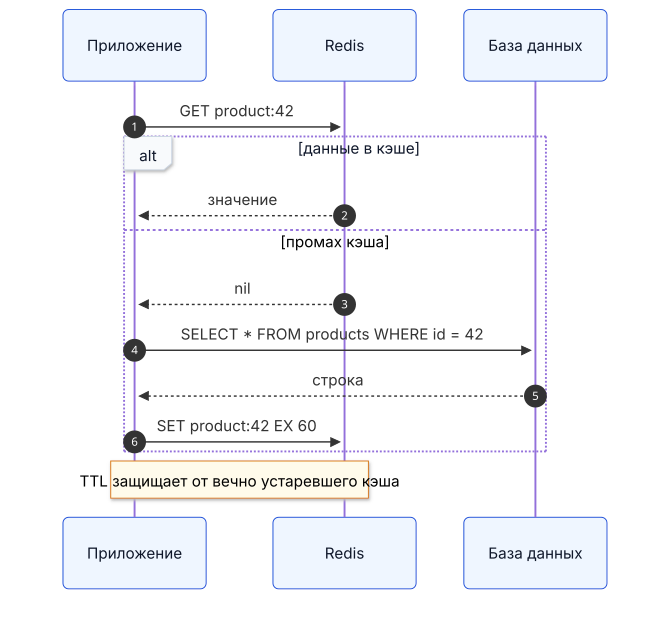

</div>
<div>

**Почему паттерн стал стандартом:**

- приложение контролирует и кэш, и базу
- сбой Redis не ломает систему: все идут в базу
- `TTL` ограничивает время жизни устаревших данных

<div class="callout warn">

<b>Три классические проблемы:</b> лавина (много промахов сразу), протухание (горячий ключ истёк) и рассинхронизация (запись в БД без инвалидации кэша).
</div>

</div>
</div>

---

## Neo4j: когда связи — это данные

```cypher
CREATE (alice:Person {name: 'Alice'})
CREATE (bob:Person   {name: 'Bob'})
CREATE (corp:Company {name: 'TechCorp'})
CREATE (alice)-[:WORKS_AT {since: 2020}]->(corp)
CREATE (bob)-[:WORKS_AT   {since: 2018}]->(corp)
CREATE (alice)-[:KNOWS {since: 2015}]->(bob);

// Коллеги Alice: обход двух рёбер вместо JOIN'а трёх таблиц
MATCH (a:Person {name: 'Alice'})-[:WORKS_AT]->(c:Company)<-[:WORKS_AT]-(colleague)
RETURN colleague.name;
```

<div class="columns">
<div>

**Графовая модель** хранит рёбра как первоклассные объекты: обход не зависит от размера графа, а зависит от глубины.

</div>
<div>

<div class="callout good">

<b>Когда граф:</b> рекомендации, антифрод, доступы, зависимости, маршруты. Когда не граф: обычные агрегаты и отчёты.
</div>

</div>
</div>

---

## Как выбрать NoSQL

<div class="split">
<div>

</div>
<div>

<div class="steps">
<div class="step"><div class="n">1</div><p><b>Опишите запросы.</b> Не сущности, а именно запросы и их частоту.</p></div>
<div class="step"><div class="n">2</div><p><b>Проверьте объём и рост.</b> Петабайты и потоки — другой класс решений.</p></div>
<div class="step"><div class="n">3</div><p><b>Решите про согласованность.</b> Что дешевле: подождать или показать устаревшее?</p></div>
<div class="step"><div class="n">4</div><p><b>Посчитайте стоимость эксплуатации.</b> Новая СУБД — это новые навыки и новые инциденты.</p></div>
</div>

<div class="callout">

<b>Polyglot persistence</b> — норма: PostgreSQL для транзакций, ClickHouse для аналитики, Redis для кэша. Плохо, когда каждая команда заводит свой зоопарк без владельца.
</div>

</div>
</div>

---

<!-- _class: centered -->

## Проверка 5

### Проверьте себя

<div class="callout warn">

<b>Вопрос:</b> какое хранилище лучше подходит для социального графа с обходом связей на несколько уровней?
</div>

<div class="cards four" style="margin-top:.7em">
<div class="card"><h4>A</h4><p>MongoDB</p></div>
<div class="card"><h4>B</h4><p>Redis</p></div>
<div class="card"><h4>C</h4><p>Cassandra</p></div>
<div class="card"><h4>D</h4><p>Neo4j</p></div>
</div>

---

<!-- _class: centered -->

## Резюме раздела 4

<div class="cards four">
<div class="card teal">
<h4>Документы</h4>
<p>MongoDB: гибкая схема, вложенность, агрегации.</p>
</div>
<div class="card amber">
<h4>Колоночные KV</h4>
<p>Cassandra: линейная запись, кворумы, партиции.</p>
</div>
<div class="card blue">
<h4>Ключ-значение</h4>
<p>Redis: структуры данных, TTL, кэш и очереди.</p>
</div>
<div class="card violet">
<h4>Графы</h4>
<p>Neo4j: связи как объекты, обход без JOIN'ов.</p>
</div>
</div>

<div class="callout good">

<b>Цена гибкости:</b> схема переезжает в приложение, целостность — в код, аналитика — в отдельную систему. Это нужно осознанно.
</div>

---

<!-- _class: section -->
<div class="section-no">05</div>

# Распределённые файловые системы

## На чём физически лежат все предыдущие системы

---

## HDFS: архитектура

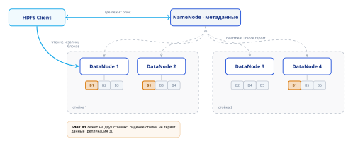

<div class="columns">
<div>

**NameNode** хранит метаданные: какие блоки где лежат. **DataNode** хранят сами блоки. Клиент читает данные напрямую с узлов.

</div>
<div>

<div class="callout warn">

<b>Единая точка отказа:</b> без HA-пары падение NameNode останавливает кластер. Именно поэтому HDFS потеснили объектные хранилища.
</div>

</div>
</div>

---

## HDFS: блоки, реплики, отказоустойчивость

<div class="kpis">
<div class="kpi"><b>128 МБ</b><span>размер блока по умолчанию</span></div>
<div class="kpi"><b>3×</b><span>коэффициент репликации</span></div>
<div class="kpi"><b>2 стойки</b><span>минимум для реплики</span></div>
<div class="kpi"><b>append</b><span>запись; файл не меняется</span></div>
</div>

- Файл режется на блоки, каждый блок реплицируется независимо
- **Rack awareness**: копии разносятся по стойкам — падение стойки не теряет данные
- Модель **write-once**: удобно для пакетной обработки, неудобно для `UPDATE`
- **Data locality**: вычисления едут к данным, а не наоборот (идея Hadoop/MapReduce)

<div class="callout">

<b>Почему большие блоки:</b> меньше обращений к NameNode и меньше накладных расходов на seek. Цена — «хвост» последнего блока и гранулярность параллелизма.
</div>

---

## Amazon S3: объектное хранилище

<div class="cards">
<div class="card blue">
<h4>Объект, не файл</h4>
<p>Ключ → байты + метаданные. Нет иерархии каталогов, есть префиксы ключей.</p>
</div>
<div class="card blue">
<h4>Практически бесконечно</h4>
<p>Не нужно планировать ёмкость. Платите за хранение и операции.</p>
</div>
<div class="card blue">
<h4>HTTP API</h4>
<p>Любой язык и любой движок: Spark, Trino, Python читают S3 как файловую систему.</p>
</div>
</div>

| Класс | Доступ | Латентность | Относительная цена | Сценарий |
|:------|:-------|:------------|:-------------------|:---------|
| **Standard** | частый | миллисекунды | $$$ | рабочие данные |
| **Standard-IA** | редкий | миллисекунды | $$ | бэкапы, архив отчётов |
| **Glacier** | минуты | минуты | $ | долгосрочный архив |
| **Deep Archive** | часы | часы | ¢ | регуляторное хранение |

---

## S3: что важно знать до проектирования

<div class="cards two">
<div class="card teal">
<h4>Долговечность 11 девяток</h4>
<p>99.999999999% — это про сохранность объекта, а не про доступность сервиса (она — 99.9%).</p>
</div>
<div class="card amber">
<h4>Согласованность</h4>
<p>Сейчас S3 даёт strong consistency на чтение после записи для новых объектов и перезаписей.</p>
</div>
<div class="card violet">
<h4>Префиксы и throttling</h4>
<p>Нагрузка распределяется по префиксам ключей. Монотонные ключи вида <code>2025/01/01/...</code> работают хорошо.</p>
</div>
<div class="card rose">
<h4>Не файловая система</h4>
<p>Переименование = копирование. Нет блокировок и дозаписи. Для таблиц нужен формат с логом.</p>
</div>
</div>

<div class="callout">

<b>Практика:</b> lifecycle-политики переносят объекты между классами автоматически. Настраивайте их сразу — потом про это забывают на годы.
</div>

---

## Delta Lake: ACID поверх файлов

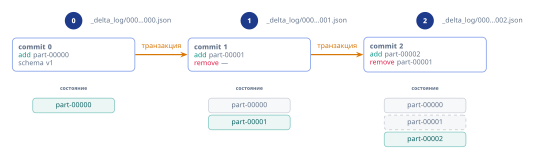

<div class="columns">
<div>

**Идея:** рядом с Parquet-файлами лежит журнал транзакций. Любое изменение — новая запись в лог, а не перезапись данных.

</div>
<div>

<div class="callout good">

<b>Что получаем:</b> конкурентная запись, откат неудачных запусков, time travel, инкрементальные обновления.
</div>

</div>
</div>

---

<!-- _class: tight -->

## Delta Lake: пример

```python
from delta import DeltaTable

# Запись из сырья в Delta-таблицу
df = spark.read.json("s3://bucket/raw/events/")
df.write.format("delta").mode("append").save("s3://bucket/delta/events")

# Time travel: состояние на версии 1
df_v1 = (spark.read.format("delta")
         .option("versionAsOf", 1)
         .load("s3://bucket/delta/events"))

# Upsert (merge): обновляем совпавшие, вставляем новые
(DeltaTable.forPath(spark, "s3://bucket/delta/events")
    .alias("t")
    .merge(updates.alias("s"), "t.id = s.id")
    .whenMatchedUpdateAll()
    .whenNotMatchedInsertAll()
    .execute())

# История и очистка старых версий
dt = DeltaTable.forPath(spark, "s3://bucket/delta/events")
dt.history().show(5)
dt.vacuum(retentionHours=168)
```

---

## Форматы файлов

| Формат | Раскладка | Сжатие | Схема | Где уместен |
|:-------|:----------|:-------|:------|:------------|
| **Parquet** | колоночная | отличное | в футере, есть эволюция | аналитика, Spark, Trino |
| **ORC** | колоночная | отличное | в футере | Hive, экосистема Hadoop |
| **Avro** | строковая | хорошее | в схеме, реестр схем | Kafka, потоковая передача |
| **JSON** | текст | слабое | нет | отладка, обмен, API |
| **CSV** | текст | слабое | нет типов | обмен, ручные выгрузки |

<div class="callout good">

<b>Правило:</b> храните данные в Parquet (или ORC), передавайте в Avro, отлаживайте в JSON. CSV — только на границе с внешним миром.
</div>

---

## Parquet изнутри

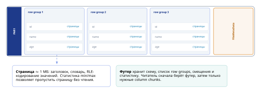

<div class="columns">
<div>

**Row group** — горизонтальный срез таблицы (обычно 128–512 МБ). Внутри — **column chunks**, внутри — **страницы** по ~1 МБ.

</div>
<div>

<div class="callout">

<b>Зачем:</b> статистика min/max по странице позволяет пропустить её целиком. Чем лучше отсортированы данные, тем больше страниц отсекается.
</div>

</div>
</div>

---

<!-- _class: centered -->

## Проверка 6

### Проверьте себя

<div class="callout warn">

<b>Вопрос:</b> почему HDFS плохо подходит для частых обновлений отдельных строк?
</div>

<div class="cards four" style="margin-top:.7em">
<div class="card"><h4>A</h4><p>не поддерживает репликацию</p></div>
<div class="card"><h4>B</h4><p>блоки слишком маленькие</p></div>
<div class="card"><h4>C</h4><p>файлы неизменяемы (write-once)</p></div>
<div class="card"><h4>D</h4><p>нет поддержки сжатия</p></div>
</div>

---

<!-- _class: centered -->

## Резюме раздела 5

<div class="cards">
<div class="card blue">
<h4>HDFS</h4>
<p>Блоки по 128 МБ, репликация 3×, NameNode как каталог метаданных.</p>
</div>
<div class="card teal">
<h4>S3</h4>
<p>Объекты, классы хранения, lifecycle, отсутствие блокировок.</p>
</div>
<div class="card violet">
<h4>Табличные форматы</h4>
<p>Delta / Iceberg / Hudi добавляют ACID и time travel к файлам.</p>
</div>
</div>

<div class="callout good">

<b>Итог:</b> современное хранилище — это объектное хранилище + формат с логом + движок запросов. Отдельная «файловая система для больших данных» больше не обязательна.
</div>

---

<!-- _class: centered -->

## Общее резюме лекции

<div class="cards">
<div class="card blue">
<h4>Реляционные БД</h4>
<p>ACID, SQL, нормализация. Ставка на корректность и универсальность запросов.</p>
</div>
<div class="card teal">
<h4>DWH и Lake</h4>
<p>Модель под вопрос, сырьё под исследование. Lakehouse снимает выбор «или-или».</p>
</div>
<div class="card amber">
<h4>Колоночные БД</h4>
<p>Читаем меньше, сжимаем лучше, считаем векторами. ClickHouse и BigQuery.</p>
</div>
<div class="card violet">
<h4>NoSQL</h4>
<p>Модель под паттерн доступа. Гибкость оплачивается целостностью.</p>
</div>
<div class="card rose">
<h4>Распределённые ФС</h4>
<p>S3 и HDFS как фундамент; ACID добавляют табличные форматы.</p>
</div>
<div class="card blue">
<h4>Главный критерий</h4>
<p>Не «самая быстрая БД», а соответствие данным, запросам и цене ошибки.</p>
</div>
</div>

---

## Связи с другими лекциями


<div class="callout">

<b>Куда дальше:</b> лекция 8 — мониторинг и качество данных; практика — сравнение хранилищ на одном датасете и замер стоимости запросов.
</div>

---

<!-- _class: centered -->

## Домашнее задание

<div class="cards">
<div class="card blue">
<h4>Задача 1 · SQL (3 балла)</h4>
<p>Спроектировать схему интернет-магазина в 3NF и написать 5 аналитических запросов: JOIN, GROUP BY, оконные функции, подзапрос.</p>
</div>
<div class="card teal">
<h4>Задача 2 · Выбор хранилища (4 балла)</h4>
<p>Разобрать кейс, обосновать выбор класса хранилища, нарисовать архитектуру и оценить стоимость на своих объёмах.</p>
</div>
<div class="card violet">
<h4>Задача 3 · NoSQL (3 балла)</h4>
<p>Реализовать сценарий на MongoDB или Redis, сравнить с реляционным вариантом по задержке и сложности кода.</p>
</div>
</div>

<div class="callout good">

<b>Срок:</b> две недели. <b>Формат:</b> репозиторий с кодом, схемой и коротким README с выводами.
</div>

---

## Литература

<div class="columns">
<div>

**Основное**

1. **Kleppmann, M.** Designing Data-Intensive Applications (2017) — главы 2–3, 5, 6
2. **Kimball, R., Ross, M.** The Data Warehouse Toolkit (2013)
3. **Sadalage, P., Fowler, M.** NoSQL Distilled (2012)

</div>
<div>

**Документация и практика**

4. ClickHouse Docs — clickhouse.com/docs
5. BigQuery Best Practices — cloud.google.com/bigquery
6. Delta Lake — docs.delta.io
7. Apache Iceberg — iceberg.apache.org
8. Use The Index, Luke — use-the-index-luke.com

</div>
</div>

<div class="callout">

<b>Совет:</b> читайте документацию своей СУБД про планы запросов. Это даёт больше, чем три статьи с общими советами.
</div>

---

<!-- _class: centered -->

## Вопросы для обсуждения

<div class="cards two">
<div class="card">
<h4>1</h4>
<p>Когда NoSQL действительно лучше SQL — и чем вы за это платите?</p>
</div>
<div class="card">
<h4>2</h4>
<p>Data Lake или Data Warehouse для проекта, который вы делаете сейчас?</p>
</div>
<div class="card">
<h4>3</h4>
<p>Что в вашей системе уже стало «болотом данных» и почему?</p>
</div>
<div class="card">
<h4>4</h4>
<p>Какая метрика стоимости хранения и запросов у вас измеряется, а какая — нет?</p>
</div>
</div>

<div class="callout">

<b>Контакты:</b> почта и канал курса — в репозитории. Консультации по расписанию на странице курса.
</div>

---

## Ответы на проверочные вопросы

| № | Вопрос | Ответ |
|:--|:-------|:------|
| 1 | JOIN, сохраняющий всех пользователей | **B) LEFT JOIN** |
| 2 | Свойство ACID для списания и зачисления | **A) Atomicity** |
| 3 | Зона сырых данных в Data Lake | **C) Raw Zone** |
| 4 | Почему колоночная БД быстрее | **B) читает только нужный столбец** |
| 5 | Хранилище для социального графа | **D) Neo4j** |
| 6 | Почему HDFS не для обновлений | **C) файлы неизменяемы** |

---

<!-- _class: title -->

# Спасибо за внимание

## Следующая лекция: мониторинг и качество данных

<div class="tag-row">
<span class="tag">повторите EXPLAIN</span>
<span class="tag">принесите кейс</span>
<span class="tag">посчитайте свои объёмы</span>
</div>

<div class="meta">Материалы и запись — в репозитории курса</div>
