<style>
@import url('https://fonts.googleapis.com/css2?family=Inter:wght@400;600;700;800&display=swap');

:root {
  --primary: #1d4ed8;
  --primary-dark: #1e3a8a;
  --accent: #0ea5e9;
  --ink: #0f172a;
  --muted: #64748b;
  --bg: #ffffff;
  --soft: #f1f5f9;
  --teal: #0d9488;
  --amber: #d97706;
  --rose: #e11d48;
}

section {
  font-family: 'Inter', 'Noto Sans', 'Segoe UI', system-ui, sans-serif;
  color: var(--ink);
  background: var(--bg);
  font-size: 24px;
  line-height: 1.35;
  padding: 72px 56px 40px;
}

h1 { font-size: 1.5em; color: var(--primary); margin: 0 0 .35em; font-weight: 800; letter-spacing: -.01em; }
h2 { font-size: 1.18em; color: var(--ink); margin: 0 0 .55em; font-weight: 700; }
h3 { font-size: .82em; color: var(--muted); margin: 0 0 .3em; font-weight: 600; text-transform: uppercase; letter-spacing: .04em; }

ul, ol { margin: 0 0 .55em; padding-left: 1.25em; }
li { margin: .16em 0; }
li strong, li b { color: var(--primary-dark); }
p { margin: 0 0 .5em; }

a { color: var(--primary); }

table { width: 100%; border-collapse: collapse; font-size: .68em; }
th { background: var(--primary); color: #fff; padding: 9px 14px; text-align: left; font-weight: 600; }
td { padding: 8px 14px; border-bottom: 1px solid #e2e8f0; vertical-align: top; }
tr:nth-child(even) td { background: #f8fafc; }

img { display: block; margin: .25em auto; max-width: 100%; max-height: 360px; }

code { background: var(--soft); border-radius: 4px; padding: 1px 6px; font-size: .82em; font-family: 'JetBrains Mono', ui-monospace, monospace; }
pre { background: #0f172a; color: #e2e8f0; border-radius: 10px; padding: 16px 22px; font-size: .56em; line-height: 1.5; }
pre code { background: transparent; color: inherit; padding: 0; }

.hljs-comment, .hljs-quote { color: #94a3b8; font-style: italic; }
.hljs-keyword, .hljs-selector-tag, .hljs-built_in, .hljs-type { color: #93c5fd; }
.hljs-string, .hljs-attr, .hljs-regexp { color: #86efac; }
.hljs-number, .hljs-literal, .hljs-symbol { color: #fbbf24; }
.hljs-title, .hljs-section, .hljs-name { color: #f0abfc; }
.hljs-variable, .hljs-template-variable { color: #fca5a5; }
.hljs-meta { color: #cbd5e1; }

.columns { display: grid; grid-template-columns: 1fr 1fr; gap: 48px; align-items: start; }
.cols3 { display: grid; grid-template-columns: 1fr 1fr 1fr; gap: 30px; align-items: start; }

section.section {
  background: linear-gradient(135deg, #0f172a 0%, #1e3a8a 55%, #1d4ed8 100%);
  color: #fff; justify-content: center; text-align: center;
}
section.section h1 { color: #fff; font-size: 2.1em; border: none; }
section.section h2 { color: rgba(255,255,255,.85); font-weight: 400; font-size: 1.1em; }
section.section::after { content: ''; }

section.title {
  background: linear-gradient(135deg, #0f172a 0%, #1e3a8a 55%, #1d4ed8 100%);
  color: #fff; justify-content: center; text-align: center;
}
section.title h1 { color: #fff; font-size: 2.5em; border: none; }
section.title h2 { color: rgba(255,255,255,.9); font-weight: 400; }
section.title p { color: rgba(255,255,255,.8); }
section.title ul, section.title ol, section.section ul, section.section ol { display: inline-block; text-align: left; }
section.title code, section.section code { background: rgba(255,255,255,.16); color: #fff; }

section.title .meta { margin-top: 1.4em; font-size: .8em; color: rgba(255,255,255,.7); letter-spacing: .06em; text-transform: uppercase; }

.callout { display: block; border-left: 5px solid var(--accent); background: #eff6ff; border-radius: 6px; padding: 14px 20px; margin: .5em 0; }
.callout.warn { border-left-color: var(--amber); background: #fffbeb; }
.callout.good { border-left-color: var(--teal); background: #ecfdf5; }
.callout.bad { border-left-color: var(--rose); background: #fef2f2; }

.muted { color: var(--muted); font-size: .8em; }
.small { font-size: .8em; }
.badge { display: inline-block; background: var(--soft); border-radius: 999px; padding: 4px 14px; margin: 3px; font-size: .74em; font-weight: 600; color: var(--primary-dark); }
</style>
<!-- _class: title -->

# Лекция 7
## Современные хранилища данных

<div class="meta">Инженерия данных · Магистратура ИТМО · Осень 2025</div>

---

<!-- _class: section -->

# План лекции

## 5 разделов · 80 минут

---

## План лекции

### Структура лекции

1. **Реляционные БД и SQL** (20 мин)
2. **Data Lakes vs Data Warehouses** (15 мин)
3. **Колоночные базы данных** (15 мин)
4. **NoSQL решения** (20 мин)
5. **Распределенные файловые системы** (10 мин)

---

<!-- _class: section -->

# Раздел 1
## Реляционные БД и SQL

---

## Введение в реляционные БД

### Что такое реляционная база данных?

- Данные организованы в **таблицы** (relations)
- Строки = записи, столбцы = атрибуты
- Связи между таблицами через **ключи**
- Строгая схема данных (schema-on-write)
- Гарантии ACID для транзакций

---

## ACID свойства

### Гарантии надежности транзакций

- **A**tomicity - атомарность операций
- **C**onsistency - согласованность данных
- **I**solation - изолированность транзакций
- **D**urability - долговечность результатов

<span class="callout">**Пример:** Банковский перевод между счетами</span>

---

## Архитектура РСУБД


<span class="callout">**Основные компоненты:** Parser → Optimizer → Executor → Storage</span>

---

## Популярные РСУБД

### Основные представители

- **PostgreSQL** - открытая, расширяемая, JSONB
- **MySQL** - популярная, быстрая, веб-приложения
- **Oracle** - enterprise, производительность, стоимость
- **MS SQL Server** - интеграция с Microsoft
- **SQLite** - встраиваемая, мобильные приложения

---

## Основы SQL - DDL

### Data Definition Language

```sql
-- Создание таблицы
CREATE TABLE users (
    user_id SERIAL PRIMARY KEY,
    username VARCHAR(50) UNIQUE NOT NULL,
    email VARCHAR(100) NOT NULL,
    created_at TIMESTAMP DEFAULT CURRENT_TIMESTAMP
);

-- Изменение структуры
ALTER TABLE users ADD COLUMN last_login TIMESTAMP;

-- Удаление таблицы
DROP TABLE users;
```

---

## Основы SQL - DML

### Data Manipulation Language

```sql
-- Вставка данных
INSERT INTO users (username, email) 
VALUES ('john_doe', 'john@example.com');

-- Обновление данных
UPDATE users SET last_login = NOW() 
WHERE username = 'john_doe';

-- Удаление данных
DELETE FROM users WHERE user_id = 5;
```

---

## Основы SQL - DQL

### Data Query Language

```sql
-- Простая выборка
SELECT username, email FROM users;

-- Фильтрация
SELECT * FROM users WHERE created_at > '2024-01-01';

-- Сортировка
SELECT * FROM users ORDER BY created_at DESC LIMIT 10;

-- Агрегация
SELECT COUNT(*) as total_users FROM users;
```

---

## SQL JOIN операции


---

## Примеры JOIN

### Объединение таблиц

```sql
-- INNER JOIN
SELECT u.username, o.order_id, o.total
FROM users u
INNER JOIN orders o ON u.user_id = o.user_id;

-- LEFT JOIN
SELECT u.username, COUNT(o.order_id) as order_count
FROM users u
LEFT JOIN orders o ON u.user_id = o.user_id
GROUP BY u.username;
```

---

## Индексы в РСУБД

### Ускорение поиска данных

- **B-Tree** индексы - универсальные, по умолчанию
- **Hash** индексы - только для равенства
- **GiST/GIN** - полнотекстовый поиск, JSON
- **Bitmap** индексы - низкая кардинальность
- Компромисс: скорость чтения vs запись

---

## Создание индексов

```sql
-- Простой индекс
CREATE INDEX idx_username ON users(username);

-- Составной индекс
CREATE INDEX idx_user_date 
ON orders(user_id, order_date);

-- Уникальный индекс
CREATE UNIQUE INDEX idx_email ON users(email);

-- Частичный индекс
CREATE INDEX idx_active_users 
ON users(username) WHERE is_active = true;
```

---

## Нормализация БД


<span class="callout">**На практике:** Обычно достаточно 3NF</span>

---

## Пример нормализации

### Ненормализованная таблица

```sql
CREATE TABLE orders_bad (
    order_id INT,
    customer_name VARCHAR(100),
    customer_email VARCHAR(100),
    product_names TEXT, -- "Laptop, Mouse, Keyboard"
    product_prices TEXT -- "1000, 25, 75"
);
```

<span class="callout">**Проблемы:** Повторение данных клиента, списки в полях</span>

---

## Нормализованная структура

### 3NF схема

```sql
CREATE TABLE customers (
    customer_id SERIAL PRIMARY KEY,
    name VARCHAR(100),
    email VARCHAR(100) UNIQUE
);
CREATE TABLE products (
    product_id SERIAL PRIMARY KEY,
    name VARCHAR(100),
    price DECIMAL(10,2)
);
CREATE TABLE orders (
    order_id SERIAL PRIMARY KEY,
    customer_id INT REFERENCES customers(customer_id),
    order_date TIMESTAMP
);
CREATE TABLE order_items (
    order_id INT REFERENCES orders(order_id),
    product_id INT REFERENCES products(product_id),
    quantity INT,
    PRIMARY KEY (order_id, product_id)
);
```

---

## Денормализация

### Когда нарушать правила?

- **Производительность** - меньше JOIN'ов
- **Аналитические запросы** - предагрегированные данные
- **Кэширование** - материализованные представления
- **OLAP системы** - звезда, снежинка
- Компромисс: скорость vs избыточность

---

## Транзакции и изоляция

### Уровни изоляции

```sql
-- Начало транзакции
BEGIN;

-- Установка уровня изоляции
SET TRANSACTION ISOLATION LEVEL READ COMMITTED;

-- Операции
UPDATE accounts SET balance = balance - 100 WHERE id = 1;
UPDATE accounts SET balance = balance + 100 WHERE id = 2;

-- Фиксация или откат
COMMIT; -- или ROLLBACK;
```

---

## Уровни изоляции


<span class="callout">**Выбор зависит от:** требований к консистентности vs производительности</span>

---

## Оптимизация запросов

### Инструменты анализа

```sql
-- План выполнения запроса
EXPLAIN ANALYZE
SELECT u.username, COUNT(o.order_id)
FROM users u
LEFT JOIN orders o ON u.user_id = o.user_id
WHERE u.created_at > '2024-01-01'
GROUP BY u.username;
```

**Обращайте внимание на:**
- Seq Scan vs Index Scan
- Nested Loop vs Hash Join
- Время выполнения

---

## Вопрос для проверки 1

### Проверьте себя

<span class="callout warn">**Вопрос:** Какой тип JOIN вернет все записи из левой таблицы, даже если нет совпадений в правой?</span>

A) INNER JOIN  
B) LEFT JOIN  
C) RIGHT JOIN  
D) CROSS JOIN

---

## Вопрос для проверки 2

### Проверьте себя

<span class="callout warn">**Вопрос:** Какое свойство ACID гарантирует, что транзакция либо выполнится полностью, либо не выполнится вообще?</span>

A) Atomicity  
B) Consistency  
C) Isolation  
D) Durability

---

## Резюме раздела 1

### Реляционные БД и SQL

<div class="callout good">

- **Структура:** Таблицы, связи, схемы
- **ACID:** Надежность транзакций
- **SQL:** DDL, DML, DQL операции
- **Индексы:** Ускорение поиска данных
- **Нормализация:** Устранение избыточности
- **Оптимизация:** EXPLAIN, правильные индексы

</div>

---

<!-- _class: section -->

# Раздел 2
## Data Lakes vs Data Warehouses

---

## Эволюция хранилищ

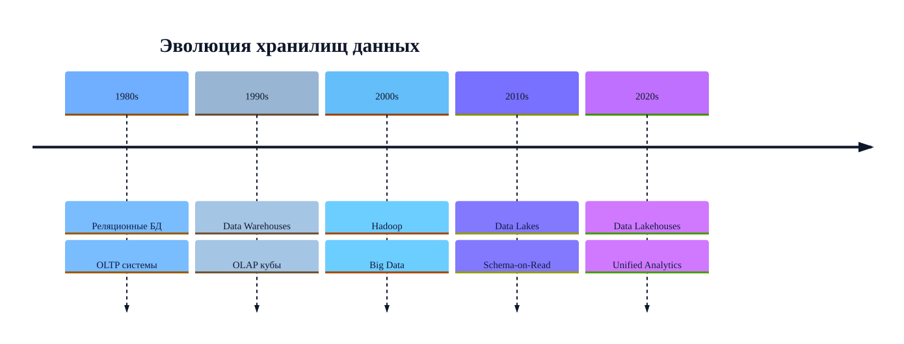

---

## Data Warehouse

### Хранилище данных

- **Структурированные** данные с четкой схемой
- Оптимизировано для **аналитических** запросов
- **ETL** процессы для загрузки
- **Schema-on-Write** - схема при записи
- **Высокая производительность** для BI

---

## Архитектура DWH


---

## Схемы DWH - Звезда


<span class="callout">**Преимущества:** Простота, производительность JOIN'ов</span>

---

## Схемы DWH - Снежинка


<span class="callout">**Преимущества:** Нормализация, меньше избыточности</span>

---

## Data Lake

### Озеро данных

- **Любые типы** данных (структурированные, неструктурированные)
- Хранение в **сыром виде**
- **Schema-on-Read** - схема при чтении
- **Масштабируемость** для петабайтов
- Гибкость для **ML и исследований**

---

## Архитектура Data Lake


---

## Зоны Data Lake

### Организация данных

- **Raw/Bronze** - сырые данные как есть
- **Processed/Silver** - очищенные, валидированные
- **Curated/Gold** - бизнес-агрегаты, витрины
- **Sandbox** - экспериментальная зона
- **Archive** - исторические данные

---

## Data Lakehouse

### Лучшее из двух миров

- **ACID транзакции** как в DWH
- **Гибкость схемы** как в Data Lake
- **Производительность** для аналитики
- **Единая платформа** для всех данных
- Технологии: Delta Lake, Apache Iceberg, Apache Hudi

---

## Сравнение подходов


---

## Метаданные и каталоги

### Управление знаниями о данных

- **Data Catalog** - каталог всех датасетов
- **Lineage** - происхождение и трансформации
- **Schema Registry** - версионирование схем
- **Data Discovery** - поиск нужных данных
- Инструменты: Apache Atlas, AWS Glue, Alation

---

## Вопрос для проверки 3

### Проверьте себя

<span class="callout warn">**Вопрос:** В какой зоне Data Lake хранятся сырые, необработанные данные?</span>

A) Curated Zone  
B) Processed Zone  
C) Raw Zone  
D) Sandbox

---

## Резюме раздела 2

### Data Lakes vs Data Warehouses

<div class="callout good">

- **DWH:** Структура, производительность, BI
- **Data Lake:** Гибкость, масштабируемость, ML
- **Lakehouse:** Объединение преимуществ
- **Схемы:** Звезда, снежинка для DWH
- **Зоны:** Raw → Processed → Curated
- **Метаданные:** Каталоги, lineage, discovery

</div>

---

<!-- _class: section -->

# Раздел 3
## Колоночные базы данных

---

## Строковое vs Колоночное хранение


**Запрос:** `SELECT AVG(age) FROM users;`  
**Колоночное:** Читает только столбец `age`

---

## Преимущества колоночного хранения

### Почему быстрее для аналитики?

- **Компрессия** - похожие данные сжимаются лучше
- **I/O оптимизация** - читаем только нужные столбцы
- **Векторизация** - параллельная обработка
- **Агрегации** - быстрые SUM, AVG, COUNT
- **Партиционирование** - по столбцам и строкам

---

## ClickHouse - обзор

### Быстрая колоночная СУБД

- Разработана **Яндексом** для аналитики
- **Open Source** под Apache 2.0
- **Скорость:** миллиарды строк в секунду
- **SQL** совместимость
- **Горизонтальное** масштабирование

---

## ClickHouse - архитектура


---

## ClickHouse - типы таблиц

### Table Engines

```sql
-- MergeTree - основной движок
CREATE TABLE events (
    date Date,
    user_id UInt32,
    event_type String,
    value Float64
) ENGINE = MergeTree()
PARTITION BY toYYYYMM(date)
ORDER BY (date, user_id);

-- ReplicatedMergeTree - с репликацией
CREATE TABLE events_replicated (
    -- ... поля ...
) ENGINE = ReplicatedMergeTree('/clickhouse/tables/events', '{replica}')
PARTITION BY toYYYYMM(date)
ORDER BY (date, user_id);
```

---

## ClickHouse - материализованные представления

```sql
-- Создание материализованного представления
CREATE MATERIALIZED VIEW daily_stats
ENGINE = SummingMergeTree()
PARTITION BY toYYYYMM(date)
ORDER BY (date, event_type)
AS SELECT
    date,
    event_type,
    count() as event_count,
    sum(value) as total_value
FROM events
GROUP BY date, event_type;
```

<span class="callout">**Преимущество:** Предагрегированные данные для быстрых запросов</span>

---

## BigQuery - обзор

### Serverless Data Warehouse от Google

- **Полностью управляемый** сервис
- **Автоматическое масштабирование**
- **Оплата за запросы** (on-demand или flat-rate)
- **Интеграция** с GCP экосистемой
- **ML встроенный** (BigQuery ML)

---

## BigQuery - архитектура


<span class="callout">**Разделение:** Вычисления и хранение независимы</span>

---

## BigQuery - партиционирование

```sql
-- Партиционирование по дате
CREATE TABLE mydataset.events
PARTITION BY DATE(event_timestamp)
AS SELECT
    event_timestamp,
    user_id,
    event_type,
    value
FROM source_table;

-- Партиционирование по целому числу
CREATE TABLE mydataset.users
PARTITION BY RANGE_BUCKET(user_id, GENERATE_ARRAY(0, 1000000, 10000))
AS SELECT * FROM source_users;
```

<span class="callout">**Преимущество:** Сканирование только нужных партиций</span>

---

## BigQuery - кластеризация

```sql
-- Кластеризация для оптимизации запросов
CREATE TABLE mydataset.events
PARTITION BY DATE(event_timestamp)
CLUSTER BY user_id, event_type
AS SELECT
    event_timestamp,
    user_id,
    event_type,
    value
FROM source_table;
```

<span class="callout">**Эффект:** Данные физически сортируются по указанным столбцам</span>

---

## Оптимизация запросов

### Лучшие практики

- **Избегайте SELECT *** - выбирайте только нужные столбцы
- **Используйте партиции** - WHERE DATE(ts) = '2024-01-01'
- **Денормализуйте** - меньше JOIN'ов
- **Материализованные представления** - предагрегация
- **Анализируйте стоимость** - EXPLAIN и Query Plan

---

## Вопрос для проверки 4

### Проверьте себя

<span class="callout warn">**Вопрос:** Почему колоночные БД быстрее для аналитических запросов?</span>

A) Хранят меньше данных  
B) Читают только нужные столбцы  
C) Не поддерживают JOIN  
D) Используют быстрые диски

---

## Резюме раздела 3

### Колоночные базы данных

<div class="callout good">

- **Принцип:** Хранение по столбцам, не по строкам
- **Преимущества:** Компрессия, I/O, агрегации
- **ClickHouse:** Open source, очень быстрый
- **BigQuery:** Serverless, автомасштабирование
- **Оптимизация:** Партиции, кластеризация, индексы
- **Применение:** OLAP, аналитика, отчетность

</div>

---

<!-- _class: section -->

# Раздел 4
## NoSQL решения

---

## Теорема CAP


**Выбирайте 2 из 3**

---

## Типы NoSQL БД


---

## MongoDB - обзор

### Документо-ориентированная БД

- **JSON/BSON** документы
- **Гибкая схема** - разные поля в документах
- **Индексы** на любые поля
- **Агрегации** - мощный pipeline
- **Репликация** и шардирование

---

## MongoDB - структура данных

```javascript
// Пример документа
{
  "_id": ObjectId("507f1f77bcf86cd799439011"),
  "username": "john_doe",
  "email": "john@example.com",
  "profile": {
    "firstName": "John",
    "lastName": "Doe",
    "age": 30
  },
  "interests": ["coding", "music", "travel"],
  "orders": [
    { "orderId": 1, "total": 99.99, "date": ISODate("2024-01-15") },
    { "orderId": 2, "total": 149.99, "date": ISODate("2024-02-20") }
  ]
}
```

<span class="callout">**Преимущество:** Вложенные структуры без JOIN'ов</span>

---

## MongoDB - агрегации

```javascript
// Aggregation Pipeline
db.orders.aggregate([
  // Фильтрация
  { $match: { status: "completed" } },
  
  // Группировка
  { $group: {
      _id: "$customerId",
      totalSpent: { $sum: "$total" },
      orderCount: { $sum: 1 }
  }},
  
  // Сортировка
  { $sort: { totalSpent: -1 } },
  
  // Ограничение
  { $limit: 10 }
]);
```

---

## Cassandra - обзор

### Распределенная колоночная БД

- **Линейная масштабируемость**
- **Отказоустойчивость** - нет single point of failure
- **Настраиваемая консистентность**
- **CQL** - язык похожий на SQL
- **Write-оптимизированная** архитектура

---

## Cassandra - архитектура


<span class="callout">**Peer-to-peer:** Все узлы равноправны</span>

---

## Cassandra - модель данных

```sql
-- Создание keyspace
CREATE KEYSPACE ecommerce 
WITH replication = {
  'class': 'SimpleStrategy',
  'replication_factor': 3
};

-- Создание таблицы
CREATE TABLE ecommerce.orders (
    user_id UUID,
    order_date timestamp,
    order_id UUID,
    total decimal,
    status text,
    PRIMARY KEY (user_id, order_date, order_id)
) WITH CLUSTERING ORDER BY (order_date DESC);
```

<span class="callout good">**Ключ:** Partition key + Clustering columns</span>

---

## Redis - обзор

### In-Memory Key-Value Store

- **Структуры данных:** Strings, Lists, Sets, Hashes, Sorted Sets
- **Персистентность:** RDB snapshots, AOF logs
- **Pub/Sub** для обмена сообщениями
- **Redis Streams** для event sourcing
- **Кластеризация** и репликация

---

## Redis - структуры данных

```python
import redis

r = redis.Redis(host='localhost', port=6379)

# Strings
r.set('user:1000:name', 'John Doe')
r.get('user:1000:name')

# Hashes
r.hset('user:1000', mapping={
    'name': 'John Doe',
    'email': 'john@example.com',
    'age': 30
})

# Lists
r.lpush('queue:tasks', 'task1', 'task2', 'task3')

# Sorted Sets (leaderboard)
r.zadd('leaderboard', {'player1': 1000, 'player2': 1500})
```

---

## Neo4j - графовая БД

### Работа со связями

```cypher
// Создание узлов и связей
CREATE (alice:Person {name: 'Alice', age: 30})
CREATE (bob:Person {name: 'Bob', age: 35})
CREATE (company:Company {name: 'TechCorp'})
CREATE (alice)-[:WORKS_AT {since: 2020}]->(company)
CREATE (bob)-[:WORKS_AT {since: 2018}]->(company)
CREATE (alice)-[:KNOWS {since: 2015}]->(bob)

// Запрос: Найти коллег Alice
MATCH (alice:Person {name: 'Alice'})-[:WORKS_AT]->(c:Company)
      <-[:WORKS_AT]-(colleague:Person)
RETURN colleague.name
```

---

## Выбор NoSQL решения


---

## Вопрос для проверки 5

### Проверьте себя

<span class="callout warn">**Вопрос:** Какая NoSQL БД лучше всего подходит для хранения социального графа с множеством связей?</span>

A) MongoDB  
B) Redis  
C) Cassandra  
D) Neo4j

---

## Резюме раздела 4

### NoSQL решения

<div class="callout good">

- **Типы:** Document, Key-Value, Column-Family, Graph
- **CAP теорема:** Выбор между C, A, P
- **MongoDB:** Гибкие документы, агрегации
- **Cassandra:** Масштабируемость, write-оптимизация
- **Redis:** In-memory, структуры данных
- **Neo4j:** Графы и связи

</div>

---

<!-- _class: section -->

# Раздел 5
## Распределенные файловые системы

---

## HDFS - архитектура


---

## Amazon S3 - обзор

### Object Storage

- **Объектное хранилище** - не файловая система
- **Бесконечная масштабируемость**
- **Классы хранения:** Standard, IA, Glacier
- **Версионирование** и жизненный цикл
- **Интеграция** с AWS сервисами

---

## S3 - классы хранения


<span class="callout">**Выбор зависит от:** частоты доступа и требований к latency</span>

---

## Delta Lake - ACID на озере

### Транзакционный слой

- **ACID транзакции** на S3/HDFS
- **Time Travel** - версионирование данных
- **Schema Evolution** - изменение схем
- **Upserts и Deletes** - обновление данных
- **Streaming + Batch** в одной таблице

---

## Delta Lake - пример

```python
from delta import *

# Создание Delta таблицы
df = spark.read.json("s3://bucket/raw-data/")
df.write.format("delta").save("s3://bucket/delta/events")

# Time Travel
df_yesterday = spark.read.format("delta") \
    .option("versionAsOf", 1) \
    .load("s3://bucket/delta/events")

# Upsert (Merge)
deltaTable = DeltaTable.forPath(spark, "s3://bucket/delta/events")
deltaTable.alias("target").merge(
    updates.alias("source"),
    "target.id = source.id"
).whenMatchedUpdateAll() \
 .whenNotMatchedInsertAll() \
 .execute()
```

---

## Форматы файлов

### Оптимизация хранения

- **Parquet** - колоночный, сжатие, Spark/Hive
- **ORC** - колоночный, оптимизирован для Hive
- **Avro** - строковый, schema evolution, Kafka
- **JSON** - текстовый, читаемый, неэффективный
- **CSV** - простой, но без типов данных

---

## Сравнение форматов


---

## Резюме раздела 5

### Распределенные файловые системы

<div class="callout good">

- **HDFS:** Hadoop, блоки, репликация
- **S3:** Object storage, классы хранения
- **Delta Lake:** ACID, time travel, upserts
- **Форматы:** Parquet, ORC, Avro
- **Выбор:** Зависит от паттернов доступа
- **Оптимизация:** Партиции, компрессия, формат

</div>

---

## Общее резюме лекции

### Современные хранилища данных

<div class="columns">
<div>

**Реляционные БД**
<div class="callout good">

- ACID, SQL, нормализация
- OLTP-системы

</div>

**Data Lakes & Warehouses**
- DWH для BI, Lake для гибкости
- Lakehouse — лучшее из обоих

**Колоночные БД**
- ClickHouse, BigQuery
- Оптимизация для аналитики

</div>
<div>

**NoSQL**
- Document, Key-Value, Column, Graph
- Выбор по типу данных

**Распределённые ФС**
- HDFS, S3, Delta Lake
- Масштабируемость и надёжность

</div>
</div>

---

## Связи с другими лекциями


---

## Домашнее задание

### Практические задачи

**Задача 1: SQL практика** (3 балла)
- Создать нормализованную схему БД для интернет-магазина
- Написать 5 аналитических запросов с JOIN, GROUP BY, подзапросами

**Задача 2: Выбор хранилища** (4 балла)
- Проанализировать кейс (будет предоставлен)
- Обосновать выбор типа хранилища
- Спроектировать архитектуру

**Задача 3: Практика с NoSQL** (3 балла)
- Реализовать простое приложение с MongoDB или Redis
- Сравнить производительность с реляционной БД

<span class="callout">**Срок сдачи:** 2 недели</span>

---

## Список литературы

### Основная литература

1. **Kleppmann, M.** "Designing Data-Intensive Applications" (2017)
2. **Kimball, R., Ross, M.** "The Data Warehouse Toolkit" (2013)
3. **Sadalage, P., Fowler, M.** "NoSQL Distilled" (2012)

### Дополнительная литература

4. **ClickHouse Documentation** - clickhouse.com/docs
5. **Google BigQuery Best Practices** - cloud.google.com/bigquery
6. **MongoDB University** - university.mongodb.com
7. **Delta Lake Documentation** - delta.io

### Онлайн ресурсы

- AWS Big Data Blog
- Google Cloud Blog
- DataEngineering.wiki

---

## Вопросы и обсуждение

### Обсудим вместе

**Вопросы для дискуссии:**

1. Когда стоит выбрать NoSQL вместо SQL?
2. Data Lake vs Data Warehouse для вашего проекта?
3. Опыт работы с колоночными БД?
4. Проблемы с масштабированием данных?

**Контакты для вопросов:**
- Email: [преподаватель]
- Telegram: [канал курса]
- Консультации: [время и место]

---

<!-- _class: title -->

# Спасибо за внимание!

## Следующая лекция: построение дашбордов и обзор BI-систем

**Подготовьтесь**
- Установите Docker
- Зарегистрируйтесь в облачном провайдере (trial)
- Повторите основы Git

<div class="meta">Вопросы и материалы — в репозитории курса</div>

---

## Ответы на вопросы для проверки

**Вопрос 1:** B) LEFT JOIN  
**Вопрос 2:** A) Atomicity  
**Вопрос 3:** C) Raw Zone  
**Вопрос 4:** B) Читают только нужные столбцы  
**Вопрос 5:** D) Neo4j