<style>
@import url('https://fonts.googleapis.com/css2?family=Inter:wght@400;600;700;800&display=swap');

:root {
  --primary: #1d4ed8;
  --primary-dark: #1e3a8a;
  --accent: #0ea5e9;
  --ink: #0f172a;
  --muted: #64748b;
  --bg: #ffffff;
  --soft: #f1f5f9;
  --teal: #0d9488;
  --amber: #d97706;
  --rose: #e11d48;
}

section {
  font-family: 'Inter', 'Noto Sans', 'Segoe UI', system-ui, sans-serif;
  color: var(--ink);
  background: var(--bg);
  font-size: 24px;
  line-height: 1.35;
  padding: 72px 56px 40px;
}

h1 { font-size: 1.5em; color: var(--primary); margin: 0 0 .35em; font-weight: 800; letter-spacing: -.01em; }
h2 { font-size: 1.18em; color: var(--ink); margin: 0 0 .55em; font-weight: 700; }
h3 { font-size: .82em; color: var(--muted); margin: 0 0 .3em; font-weight: 600; text-transform: uppercase; letter-spacing: .04em; }

ul, ol { margin: 0 0 .55em; padding-left: 1.25em; }
li { margin: .16em 0; }
li strong, li b { color: var(--primary-dark); }
p { margin: 0 0 .5em; }

a { color: var(--primary); }

table { width: 100%; border-collapse: collapse; font-size: .68em; }
th { background: var(--primary); color: #fff; padding: 9px 14px; text-align: left; font-weight: 600; }
td { padding: 8px 14px; border-bottom: 1px solid #e2e8f0; vertical-align: top; }
tr:nth-child(even) td { background: #f8fafc; }

img { display: block; margin: .25em auto; max-width: 100%; max-height: 340px; }

code { background: var(--soft); border-radius: 4px; padding: 1px 6px; font-size: .82em; font-family: 'JetBrains Mono', ui-monospace, monospace; }
pre { background: #0f172a; color: #e2e8f0; border-radius: 10px; padding: 16px 22px; font-size: .56em; line-height: 1.5; }
pre code { background: transparent; color: inherit; padding: 0; }

.hljs-comment, .hljs-quote { color: #94a3b8; font-style: italic; }
.hljs-keyword, .hljs-selector-tag, .hljs-built_in, .hljs-type { color: #93c5fd; }
.hljs-string, .hljs-attr, .hljs-regexp { color: #86efac; }
.hljs-number, .hljs-literal, .hljs-symbol { color: #fbbf24; }
.hljs-title, .hljs-section, .hljs-name { color: #f0abfc; }
.hljs-variable, .hljs-template-variable { color: #fca5a5; }
.hljs-meta { color: #cbd5e1; }

.columns { display: grid; grid-template-columns: 1fr 1fr; gap: 48px; align-items: start; }
.cols3 { display: grid; grid-template-columns: 1fr 1fr 1fr; gap: 30px; align-items: start; }

section.section {
  background: linear-gradient(135deg, #0f172a 0%, #1e3a8a 55%, #1d4ed8 100%);
  color: #fff; justify-content: center; text-align: center;
}
section.section h1 { color: #fff; font-size: 2.1em; border: none; }
section.section h2 { color: rgba(255,255,255,.85); font-weight: 400; font-size: 1.1em; }
section.section::after { content: ''; }

section.title {
  background: linear-gradient(135deg, #0f172a 0%, #1e3a8a 55%, #1d4ed8 100%);
  color: #fff; justify-content: center; text-align: center;
}
section.title h1 { color: #fff; font-size: 2.5em; border: none; }
section.title h2 { color: rgba(255,255,255,.9); font-weight: 400; }
section.title p { color: rgba(255,255,255,.8); }
section.title ul, section.title ol, section.section ul, section.section ol { display: inline-block; text-align: left; }
section.title code, section.section code { background: rgba(255,255,255,.16); color: #fff; }

section.title .meta { margin-top: 1.4em; font-size: .8em; color: rgba(255,255,255,.7); letter-spacing: .06em; text-transform: uppercase; }

.callout { display: block; border-left: 5px solid var(--accent); background: #eff6ff; border-radius: 6px; padding: 14px 20px; margin: .5em 0; }
.callout.warn { border-left-color: var(--amber); background: #fffbeb; }
.callout.good { border-left-color: var(--teal); background: #ecfdf5; }
.callout.bad { border-left-color: var(--rose); background: #fef2f2; }

.muted { color: var(--muted); font-size: .8em; }
.small { font-size: .8em; }
.badge { display: inline-block; background: var(--soft); border-radius: 999px; padding: 4px 14px; margin: 3px; font-size: .74em; font-weight: 600; color: var(--primary-dark); }
</style>
---

<!-- _class: title -->

# Лекция 8
## Построение дашбордов и обзор современных BI-систем

<div class="meta">Инженерия данных · Магистратура ИТМО · Осень 2025</div>

---

<!-- _class: section -->

# План лекции

## 4 раздела · 80 минут

---

## План лекции

### Основные разделы

- Основы визуализации данных и дашбордов (20 мин)
- Современные BI-системы и их возможности (20 мин)
- Построение и оптимизация дашбордов (25 мин)
- Расширенные темы в BI (15 мин)

---

## Цели лекции

### Что вы узнаете

- Принципы эффективной визуализации данных
- Архитектуру современных BI-платформ
- Методы оптимизации дашбордов
- Тренды развития BI-технологий

---

<!-- _class: section -->

# Раздел 1
## Основы визуализации данных и дашбордов

---

## Зачем нужна визуализация?

### От данных к решениям

- Человек воспринимает визуальную информацию в 60 000 раз быстрее текста
- 90% информации, поступающей в мозг, — визуальная
- Визуализация выявляет паттерны, скрытые в таблицах
- Дашборды ускоряют принятие бизнес-решений

---

## Принципы эффективной визуализации

### Три кита визуализации

- **Ясность:** информация понятна с первого взгляда
- **Точность:** данные представлены без искажений
- **Информативность:** показаны важные инсайты, а не шум

<span class="callout good">**Правило:** если дашборд требует инструкции — он плох</span>

---

## Принципы Эдварда Тафти

### Классика теории визуализации

- **Максимизация data-ink ratio:** убрать всё лишнее
- **Избегать chartjunk:** украшения мешают восприятию
- **Показывать сравнения:** контекст важнее абсолютных значений
- **Честность:** не искажать данные масштабом или углами

---

## Принципы Берта

### Правила восприятия

- Длина линий воспринимается точнее площади
- Площадь точнее угла и цвета
- Избегайте 3D-графиков для количественных данных
- Используйте цвет для категорий, а не количества

---

## Типы визуализаций: Барчарты

### Столбчатые и горизонтальные диаграммы

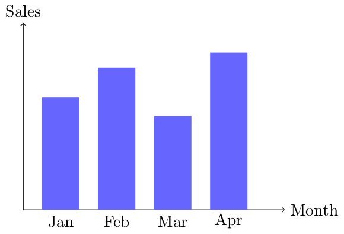

<span class="callout">**Когда использовать:** сравнение категорий, временные ряды (короткие периоды)</span>

---

## Типы визуализаций: Линейные графики

### Тренды и динамика

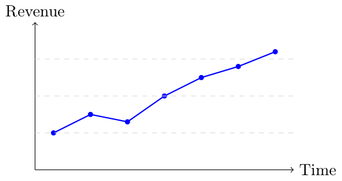

<span class="callout">**Когда использовать:** временные ряды, тренды, непрерывные данные</span>

---

## Типы визуализаций: Тепловые карты

### Корреляции и плотность


<span class="callout">**Когда использовать:** многомерные данные, паттерны в матрицах</span>

---

## Типы визуализаций: Scatter plots

### Взаимосвязи переменных

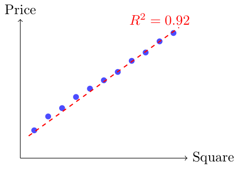

<span class="callout">**Когда использовать:** корреляции, выбросы, кластеры</span>

---

## Типы визуализаций: Геовизуализация

### Пространственные данные


<span class="callout">**Инструменты:** Mapbox, Leaflet, Kepler.gl, Deck.gl</span>

---

## Дизайн дашбордов: Структура

### Иерархия информации


---

## Дизайн дашбордов: F-паттерн

### Как пользователь читает экран

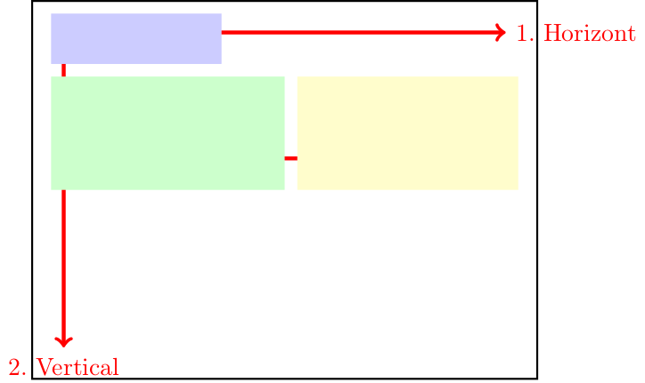

<span class="callout good">**Правило:** самое важное — в верхний левый угол</span>

---

## Дизайн дашбордов: Интерактивность

### Уровни взаимодействия

- **Фильтры:** дата, регион, категория продукта
- **Drill-down:** от общего к частному (страна → город → магазин)
- **Кросс-хайлайтинг:** выбор на одном графике подсвечивает другие
- **Параметры:** динамическое изменение метрик

---

## Дизайн дашбордов: Мобильная адаптация

### Responsive дизайн


<span class="callout">**Тренд:** mobile-first подход в современных BI</span>

---

## Метрики успеха дашбордов

### Как оценить эффективность

- **Скорость загрузки:** < 3 секунд для первого экрана
- **Adoption rate:** % пользователей, использующих регулярно
- **Time to insight:** как быстро находят ответ
- **Удовлетворенность:** опросы пользователей (NPS)

---

## Интеграция в бизнес-процессы

### От аналитики к действиям


<span class="callout">**Пример:** дашборд оттока → анализ сегментов → кампания удержания → отслеживание эффекта</span>

---

## Вопрос для проверки 1

### Проверьте себя

<span class="callout warn">**Вопрос:** Какой тип визуализации лучше всего подходит для отображения корреляции между двумя числовыми переменными?</span>

A) Барчарт  
B) Линейный график  
C) Scatter plot  
D) Тепловая карта

---

## Резюме раздела 1

### Основы визуализации

<div class="callout good">

- Визуализация — мост между данными и решениями
- Принципы: ясность, точность, информативность
- Выбор типа графика зависит от задачи
- Дизайн дашборда следует психологии восприятия
- Успех измеряется скоростью получения инсайтов

</div>

---

<!-- _class: section -->

# Раздел 2
## Современные BI-системы и их возможности

---

## Что такое BI-система?

### Business Intelligence платформа

- **Определение:** инструмент для сбора, обработки и визуализации данных
- **Цель:** превратить данные в бизнес-инсайты
- **Пользователи:** от аналитиков до топ-менеджеров
- **Компоненты:** подключение к данным, трансформация, визуализация, дистрибуция

---

## Архитектура типичной BI-системы

### Слои платформы


---

## Обзор платформ: Tableau

### Лидер визуализации

- **Сильные стороны:** интуитивный drag-and-drop, богатая визуализация
- **Архитектура:** Tableau Desktop (разработка) + Tableau Server (публикация)
- **Подключения:** 100+ нативных коннекторов
- **Цена:** от $70/пользователь/месяц (Creator)
- **Use case:** ad-hoc анализ, красивые презентационные дашборды

---

## Обзор платформ: Power BI

### Microsoft экосистема

- **Сильные стороны:** интеграция с Microsoft 365, доступная цена
- **Архитектура:** Power BI Desktop + Power BI Service (облако)
- **DAX язык:** для создания вычисляемых мер
- **Цена:** от $10/пользователь/месяц (Pro)
- **Use case:** корпоративная аналитика в Microsoft-среде

---

## Обзор платформ: Looker (Google)

### Код-ориентированный подход

- **Сильные стороны:** LookML для версионирования логики, Git-интеграция
- **Архитектура:** облачная, тесная интеграция с BigQuery
- **Подход:** "single source of truth" через семантический слой
- **Цена:** enterprise (индивидуально)
- **Use case:** data-driven компании с инженерной культурой

---

## Обзор платформ: Qlik Sense

### Ассоциативный движок

- **Сильные стороны:** уникальный движок поиска связей в данных
- **Архитектура:** in-memory обработка, Qlik Cloud
- **Особенность:** зеленый/белый/серый цвет для связанных/несвязанных данных
- **Цена:** от $30/пользователь/месяц
- **Use case:** сложный многомерный анализ

---

## Обзор платформ: Metabase

### Open-source решение

- **Сильные стороны:** бесплатно, простота, SQL-редактор
- **Архитектура:** Java-приложение, PostgreSQL для метаданных
- **Ограничения:** меньше функций, чем у коммерческих
- **Цена:** бесплатно (Enterprise от $85/месяц)
- **Use case:** стартапы, внутренние дашборды

---

## Сравнение платформ

### Матрица выбора


---

## Self-service BI

### Демократизация данных

- **Концепция:** бизнес-пользователи создают отчеты без IT
- **Требования:** интуитивный интерфейс, управляемая семантика
- **Риски:** "дикие" дашборды, разные версии правды
- **Решение:** governance + обучение пользователей

---

## Облачные vs локальные решения

### Deployment модели


<span class="callout">**Тренд:** миграция в облако (70% новых внедрений)</span>

---

## Интеграция с хранилищами данных

### Подключения


<span class="callout good">**Лучшая практика:** прямое подключение к DWH, а не к OLTP-базам</span>

---

## Автоматическая генерация инсайтов

### AI в BI

- **Explain this:** автоматическое объяснение аномалий (Power BI)
- **Smart narratives:** генерация текстовых описаний графиков
- **Automated insights:** поиск скрытых трендов в данных
- **NLP-запросы:** "Покажи продажи за прошлый квартал" → график

<span class="callout">**Пример:** ThoughtSpot, Einstein Analytics (Salesforce)</span>

---

## Масштабируемость BI-систем

### Обработка больших данных

- **In-memory кэширование:** Qlik, Tableau Hyper
- **Прямые запросы (DirectQuery):** запросы к источнику в реальном времени
- **Материализованные views:** предрасчет агрегатов
- **Распределенная обработка:** интеграция со Spark, Presto

---

## Embedded Analytics

### Интеграция в приложения


**Примеры:** Looker Embedded, Power BI Embedded, Tableau Embedded

**Use case:** SaaS-продукты с аналитикой для клиентов

---

## Вопрос для проверки 2

### Проверьте себя

<span class="callout warn">**Вопрос:** Какая BI-платформа использует LookML для определения семантического слоя?</span>

A) Tableau  
B) Power BI  
C) Looker  
D) Qlik Sense

---

## Резюме раздела 2

### Современные BI-системы

<div class="callout good">

- BI-системы превращают данные в визуальные инсайты
- Выбор платформы зависит от требований и экосистемы
- Self-service BI демократизирует аналитику
- Облачные решения доминируют в новых внедрениях
- AI усиливает возможности поиска инсайтов

</div>

---

<!-- _class: section -->

# Раздел 3
## Построение и оптимизация дашбордов

---

## Подготовка данных для визуализации

### ETL перед BI


<span class="callout good">**Правило:** "мусор на входе → мусор на выходе"</span>

---

## Агрегация данных

### Предрасчет для производительности

- **Пример:** вместо хранения каждой транзакции, хранить дневные суммы
- **Техники:** GROUP BY, материализованные views, OLAP-кубы
- **Trade-off:** скорость vs гибкость
- **Когда применять:** большие объемы + типовые запросы

---

## Кэширование

### Слои кэша в BI


<span class="callout">**Настройка:** TTL (time to live) для разных типов данных</span>

---

## Интерактивные элементы: Фильтры

### Управление контекстом

- **Типы:** дата, категория, диапазон, поиск
- **Каскадные фильтры:** выбор страны → доступные города
- **Глобальные vs локальные:** применяются ко всему дашборду или одному графику
- **Best practice:** не более 5 фильтров одновременно

---

## Интерактивные элементы: Drill-down

### Навигация по уровням детализации


<span class="callout">**Реализация:** drill-down кнопки, breadcrumbs для возврата</span>

---

## Интерактивные элементы: Параметры

### Динамическое изменение метрик

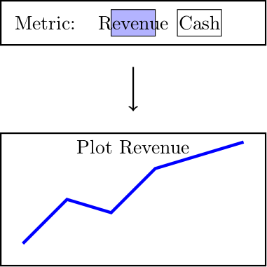

<span class="callout">**Use case:** один дашборд для разных метрик</span>

---

## Кросс-хайлайтинг

### Связь между графиками

- **Механика:** клик на сегменте → подсветка на других графиках
- **Пример:** клик на "Москва" в карте → фильтр на барчарте продаж
- **Реализация:** через параметры и actions в Tableau, slicers в Power BI
- **Эффект:** интуитивное исследование данных

---

## Real-time дашборды

### Потоковые данные


**Технологии:** Grafana + InfluxDB, Tableau + Hyper Live

**Use case:** мониторинг систем, финансовые дашборды

---

## Безопасность в BI: Row-level security

### Ограничение доступа к данным


<span class="callout">**Реализация:** через политики в DWH или в самой BI-системе</span>

---

## Безопасность: Управление доступом

### Кто что может видеть

- **Публичные дашборды:** доступны всем (embed на сайт)
- **Внутренние:** только сотрудники компании
- **Конфиденциальные:** только топ-менеджмент
- **Аудит:** логирование всех действий пользователей

---

## Оптимизация производительности: Индексация

### Ускорение запросов

```sql
-- Без индекса: сканирование всей таблицы
SELECT * FROM sales WHERE region = 'Moscow';

-- С индексом: прямой доступ
CREATE INDEX idx_region ON sales(region);
```

**Типы индексов:** B-tree, Hash, Bitmap (для DWH)

**Trade-off:** ускорение чтения vs замедление записи

---

## Оптимизация: Материализованные views

### Предрасчет агрегатов

```sql
-- Материализованное представление
CREATE MATERIALIZED VIEW daily_sales AS
SELECT 
  date_trunc('day', order_date) as day,
  region,
  SUM(amount) as total_sales
FROM orders
GROUP BY 1, 2;

-- Обновление по расписанию
REFRESH MATERIALIZED VIEW daily_sales;
```

<span class="callout">**Когда использовать:** сложные агрегации, редко меняющиеся данные</span>

---

## Оптимизация: Партиционирование

### Разделение больших таблиц


**Эффект:** запросы читают только нужные партиции

**Стратегии:** по дате, по региону, по hash

---

## Оптимизация: Кэширование запросов

### Повторное использование результатов

- **Механизм:** BI-система запоминает результаты запросов
- **TTL:** время жизни кэша (например, 15 минут)
- **Invalidation:** сброс при обновлении данных
- **Warm-up:** предзагрузка популярных дашбордов

<span class="callout">**Эффект:** 10x-100x ускорение для повторных запросов</span>

---

## Тестирование дашбордов

### Проверка корректности

- **Юнит-тесты:** проверка SQL-логики (dbt tests)
- **Интеграционные тесты:** сравнение с эталонными данными
- **Визуальное тестирование:** скриншоты + diff
- **Нагрузочное тестирование:** симуляция множества пользователей

---

## A/B-тестирование дашбордов

### Экспериментальный подход


<span class="callout">**Метрики:** время до инсайта, частота использования, удовлетворенность</span>

---

## Вопрос для проверки 3

### Проверьте себя

<span class="callout warn">**Вопрос:** Какая техника оптимизации предполагает предварительный расчет агрегатов и их хранение?</span>

A) Индексация  
B) Партиционирование  
C) Материализованные views  
D) Кэширование запросов

---

## Резюме раздела 3

### Построение и оптимизация

<div class="callout good">

- Качество данных критично для дашбордов
- Интерактивность повышает вовлеченность пользователей
- Производительность достигается через кэширование и предрасчет
- Безопасность обеспечивается на уровне данных и доступа
- Тестирование гарантирует корректность и надежность

</div>

---

<!-- _class: section -->

# Раздел 4
## Расширенные темы в BI

---

## Embedded Analytics

### Аналитика внутри продукта


<span class="callout">**Примеры:** Shopify Analytics, Stripe Dashboard</span>

---

## Машинное обучение в BI

### Предиктивная аналитика

- **Прогнозирование:** продажи, отток, спрос
- **Кластеризация:** сегментация клиентов
- **Anomaly detection:** выявление мошенничества, сбоев
- **Рекомендации:** next best action для пользователя

<span class="callout">**Интеграция:** AutoML в Power BI, Einstein Discovery в Salesforce</span>

---

## Anomaly Detection в дашбордах

### Автоматическое выявление аномалий

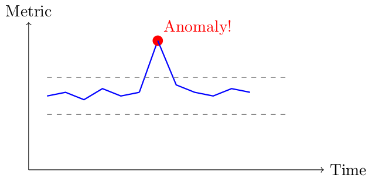

<span class="callout">**Алгоритмы:** Z-score, Isolation Forest, Prophet (Facebook)</span>

---

## Социальное и коллаборативное BI

### Совместная работа над данными

- **Комментарии:** обсуждение инсайтов прямо в дашборде
- **Аннотации:** пометки на графиках ("Здесь была акция")
- **Шаринг:** отправка дашборда коллегам
- **Версионирование:** история изменений дашборда

<span class="callout">**Инструменты:** Slack-интеграции, Tableau Pulse</span>

---

## Headless BI

### API-driven визуализация


**Преимущества:** полный контроль над UX, интеграция в уникальный дизайн

**Недостатки:** больше разработки, меньше out-of-the-box функций

---

## Augmented Analytics

### BI усиленный AI

- **Natural Language Generation:** "Продажи выросли на 15% из-за акции в Москве"
- **Automated insights:** "Обнаружен необычный паттерн в сегменте X"
- **Smart data prep:** автоматическая очистка и трансформация
- **Conversational analytics:** чат-бот для запросов к данным

<span class="callout">**Платформы:** ThoughtSpot, Salesforce Einstein</span>

---

## Тренды: Reverse ETL

### Данные из DWH обратно в операционные системы


**Инструменты:** Census, Hightouch

**Use case:** скоринг клиентов из DWH → CRM для менеджеров

---

## Тренды: Metrics Layer

### Единый слой метрик

- **Проблема:** разные определения "выручки" в разных дашбордах
- **Решение:** централизованный каталог метрик с единой логикой
- **Технологии:** dbt metrics, Looker LookML, Cube.js
- **Эффект:** "single source of truth" для всей компании

---

## Выбор BI-системы: Критерии

### Матрица принятия решения


---

## Кейсы внедрения: E-commerce

### Дашборды для интернет-магазина

- **Метрики:** GMV, конверсия, AOV, LTV, CAC
- **Дашборды:**
  - Продажи в реальном времени
  - Воронка покупок
  - Когортный анализ
  - RFM-сегментация
- **Инструменты:** Looker + BigQuery, Tableau + Snowflake

---

## Кейсы внедрения: Финтех

### Аналитика для финансовых сервисов

- **Метрики:** AUM, транзакции, fraud rate, NPS
- **Дашборды:**
  - Мониторинг мошенничества
  - Портфельная аналитика
  - Регуляторная отчетность
- **Требования:** высокая безопасность, аудит
- **Инструменты:** Qlik + Oracle, Power BI + Azure

---

## Кейсы внедрения: IoT

### Дашборды для умных устройств

- **Метрики:** uptime, sensor readings, alerts
- **Дашборды:**
  - Real-time мониторинг
  - Predictive maintenance
  - Геораспределение устройств
- **Инструменты:** Grafana + InfluxDB, Tableau + AWS IoT

---

## Будущее BI

### Куда движется индустрия

- **Democratization:** BI для каждого сотрудника
- **AI-first:** от визуализации к автоматическим инсайтам
- **Real-time everything:** от батчей к стримингу
- **Embedded everywhere:** аналитика в каждом продукте
- **Collaborative:** от индивидуальных отчетов к совместной работе

---

## Вопрос для проверки 4

### Проверьте себя

<span class="callout warn">**Вопрос:** Что такое Reverse ETL?</span>

A) Обратный процесс извлечения данных  
B) Загрузка данных из DWH в операционные системы  
C) Удаление данных из хранилища  
D) Восстановление данных после сбоя

---

## Резюме раздела 4

### Расширенные темы

<div class="callout good">

- Embedded analytics интегрирует BI в продукты
- ML усиливает возможности поиска инсайтов
- Коллаборация делает аналитику командной работой
- Headless BI дает гибкость в UI/UX
- Будущее — AI-driven, real-time, embedded

</div>

---

<!-- _class: section -->

# Заключение
## Итоговое резюме лекции

---

## Ключевые выводы

### Что мы изучили

- **Визуализация** — мост между данными и решениями
- **BI-системы** — инструменты для демократизации аналитики
- **Оптимизация** — ключ к производительным дашбордам
- **Тренды** — AI, real-time, embedded, collaborative

---


## Бонус-слайд: Частые ошибки

### Чего избегать

| ❌ Ошибка | ✅ Как правильно |
|:----------|:-----------------|
| Слишком много информации на одном экране | Разбейте на несколько дашбордов |
| 3D-графики для количественных данных | Используйте 2D-визуализации |
| Радужные цветовые схемы | Используйте 2–3 основных цвета |
| Нет сравнения с прошлым периодом | Добавьте YoY, MoM-метрики |
| Неоптимизированные запросы | Используйте агрегаты и кэш |

---

<!-- _class: title -->

# Спасибо за внимание!

## Вопросы?

**Материалы курса**
- Схемы: папка `Лекция8_figs/`
- Исходники диаграмм: «Лекция 8 — источники диаграмм.md»
- Презентации всех лекций — в репозитории курса

<div class="meta">Спасибо за семестр!</div>