# Лекция 8: Построение дашбордов и обзор современных BI-систем

---

## Титульный слайд

# Построение дашбордов и обзор современных BI-систем

**Курс:** Инжиниринг данных (продвинутый уровень)

**Лекция 8 из 8**

**Продолжительность:** 80 минут

---

## План лекции

### Основные разделы

- Основы визуализации данных и дашбордов (20 мин)
- Современные BI-системы и их возможности (20 мин)
- Построение и оптимизация дашбордов (25 мин)
- Расширенные темы в BI (15 мин)

---

## Цели лекции

### Что вы узнаете

- Принципы эффективной визуализации данных
- Архитектуру современных BI-платформ
- Методы оптимизации дашбордов
- Тренды развития BI-технологий

---

# Раздел 1: Основы визуализации данных и дашбордов

---

## 1.1 Зачем нужна визуализация?

### От данных к решениям

- Человек воспринимает визуальную информацию в 60 000 раз быстрее текста
- 90% информации, поступающей в мозг, — визуальная
- Визуализация выявляет паттерны, скрытые в таблицах
- Дашборды ускоряют принятие бизнес-решений

---

## 1.2 Принципы эффективной визуализации

### Три кита визуализации

- **Ясность:** информация понятна с первого взгляда
- **Точность:** данные представлены без искажений
- **Информативность:** показаны важные инсайты, а не шум

**Правило:** если дашборд требует инструкции — он плох

---

## 1.3 Принципы Эдварда Тафти

### Классика теории визуализации

- **Максимизация data-ink ratio:** убрать всё лишнее
- **Избегать chartjunk:** украшения мешают восприятию
- **Показывать сравнения:** контекст важнее абсолютных значений
- **Честность:** не искажать данные масштабом или углами

---

## 1.4 Принципы Берта

### Правила восприятия

- Длина линий воспринимается точнее площади
- Площадь точнее угла и цвета
- Избегайте 3D-графиков для количественных данных
- Используйте цвет для категорий, а не количества

---

## 1.5 Типы визуализаций: Барчарты

### Столбчатые и горизонтальные диаграммы

```tikz
\begin{tikzpicture}[scale=0.8]
  % Оси
  \draw[->] (0,0) -- (0,5) node[above] {Sales};
  \draw[->] (0,0) -- (7,0) node[right] {Month};
  
  % Столбцы
  \fill[blue!60] (0.5,0) rectangle (1.5,3) node[pos=.5] {};
  \fill[blue!60] (2,0) rectangle (3,3.8) node[pos=.5] {};
  \fill[blue!60] (3.5,0) rectangle (4.5,2.5) node[pos=.5] {};
  \fill[blue!60] (5,0) rectangle (6,4.2) node[pos=.5] {};
  
  % Подписи
  \node at (1,-0.3) {Jan};
  \node at (2.5,-0.3) {Feb};
  \node at (4,-0.3) {Mar};
  \node at (5.5,-0.3) {Apr};
\end{tikzpicture}
```

**Когда использовать:** сравнение категорий, временные ряды (короткие периоды)

---

## 1.6 Типы визуализаций: Линейные графики

### Тренды и динамика

```tikz
\begin{tikzpicture}[scale=0.8]
  % Оси
  \draw[->] (0,0) -- (0,4) node[above] {Revenue};
  \draw[->] (0,0) -- (7,0) node[right] {Time};
  
  % Линия тренда
  \draw[blue, thick] (0.5,1) -- (1.5,1.5) -- (2.5,1.3) -- (3.5,2) -- (4.5,2.5) -- (5.5,2.8) -- (6.5,3.2);
  
  % Точки данных
  \foreach \x/\y in {0.5/1, 1.5/1.5, 2.5/1.3, 3.5/2, 4.5/2.5, 5.5/2.8, 6.5/3.2}
    \fill[blue] (\x,\y) circle (2pt);
    
  % Сетка
  \draw[gray!30, dashed] (0,1) -- (7,1);
  \draw[gray!30, dashed] (0,2) -- (7,2);
  \draw[gray!30, dashed] (0,3) -- (7,3);
\end{tikzpicture}
```

**Когда использовать:** временные ряды, тренды, непрерывные данные

---

## 1.7 Типы визуализаций: Тепловые карты

### Корреляции и плотность

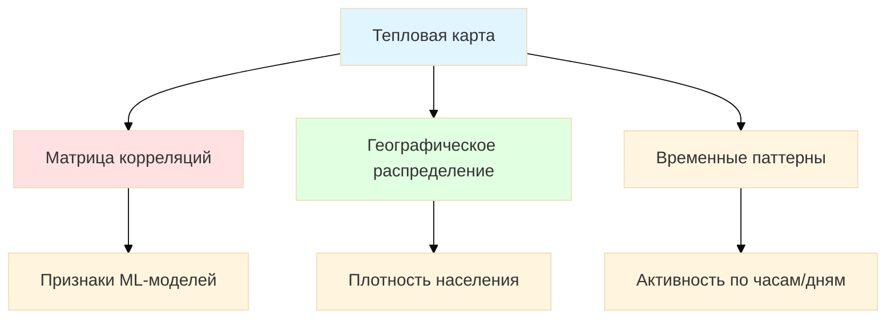

**Когда использовать:** многомерные данные, паттерны в матрицах

---

## 1.8 Типы визуализаций: Scatter plots

### Взаимосвязи переменных

```tikz
\begin{tikzpicture}[scale=0.7]
  % Оси
  \draw[->] (0,0) -- (0,5) node[above] {Price};
  \draw[->] (0,0) -- (6,0) node[right] {Square};
  
  % Точки данных с трендом
  \foreach \x/\y in {0.5/1, 1/1.5, 1.5/1.8, 2/2.2, 2.5/2.5, 3/2.8, 3.5/3.1, 4/3.5, 4.5/3.8, 5/4.2, 5.5/4.5}
    \fill[blue!70] (\x,\y) circle (3pt);
  
  % Линия тренда
  \draw[red, thick, dashed] (0.3,0.8) -- (5.7,4.7);
  
  \node[red] at (5,5) {$R^2 = 0.92$};
\end{tikzpicture}
```

**Когда использовать:** корреляции, выбросы, кластеры

---

## 1.9 Типы визуализаций: Геовизуализация

### Пространственные данные

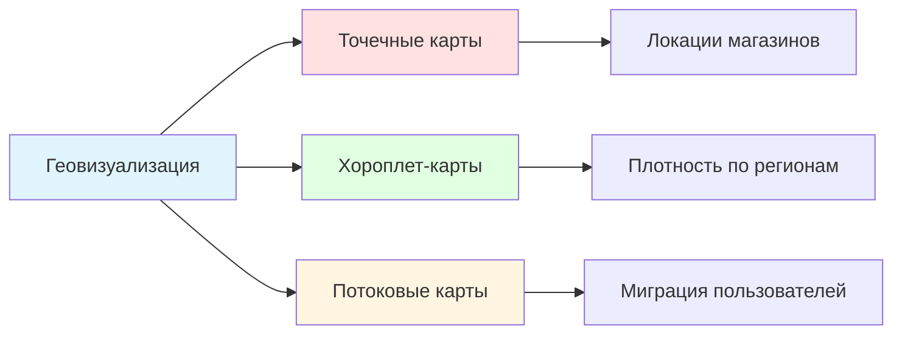

**Инструменты:** Mapbox, Leaflet, Kepler.gl, Deck.gl

---

## 1.10 Дизайн дашбордов: Структура

### Иерархия информации

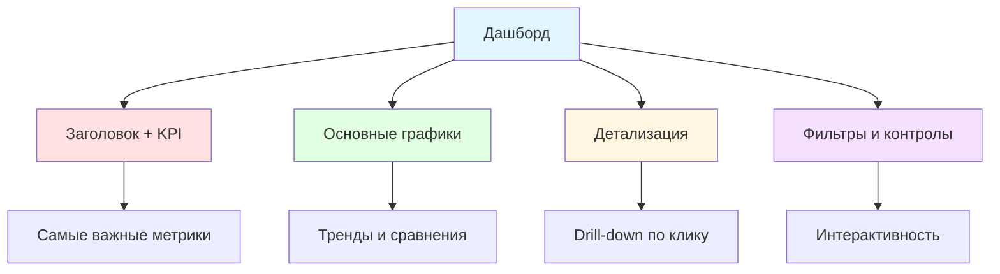

---

## 1.11 Дизайн дашбордов: F-паттерн

### Как пользователь читает экран

```tikz
\begin{tikzpicture}[scale=0.9]
  % Экран дашборда
  \draw[thick] (0,0) rectangle (8,6);
  
  % F-паттерн чтения
  \draw[->, red, ultra thick] (0.5,5.5) -- (7.5,5.5) node[right] {1. Horizont};
  \draw[->, red, ultra thick] (0.5,5.3) -- (0.5,0.5) node[below] {2. Vertical};
  \draw[->, red, ultra thick] (0.7,3.5) -- (5,3.5) node[right] {3. Horizont};
  
  % Зоны важности
  \fill[blue!20] (0.3,5) rectangle (3,5.8) node[pos=.5] {KPI};
  \fill[green!20] (0.3,3) rectangle (4,4.8) node[pos=.5] {Main Plot};
  \fill[yellow!20] (4.2,3) rectangle (7.7,4.8) node[pos=.5] {Details};
\end{tikzpicture}
```

**Правило:** самое важное — в верхний левый угол

---

## 1.12 Дизайн дашбордов: Интерактивность

### Уровни взаимодействия

- **Фильтры:** дата, регион, категория продукта
- **Drill-down:** от общего к частному (страна → город → магазин)
- **Кросс-хайлайтинг:** выбор на одном графике подсвечивает другие
- **Параметры:** динамическое изменение метрик

---

## 1.13 Дизайн дашбордов: Мобильная адаптация

### Responsive дизайн

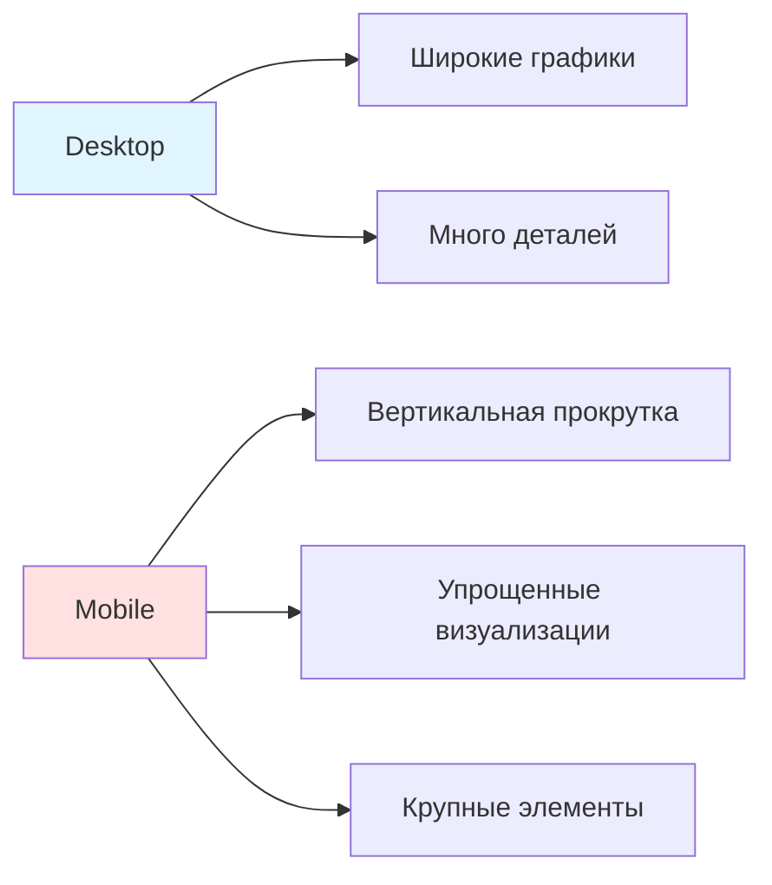

**Тренд:** mobile-first подход в современных BI

---

## 1.14 Метрики успеха дашбордов

### Как оценить эффективность

- **Скорость загрузки:** < 3 секунд для первого экрана
- **Adoption rate:** % пользователей, использующих регулярно
- **Time to insight:** как быстро находят ответ
- **Удовлетворенность:** опросы пользователей (NPS)

---

## 1.15 Интеграция в бизнес-процессы

### От аналитики к действиям

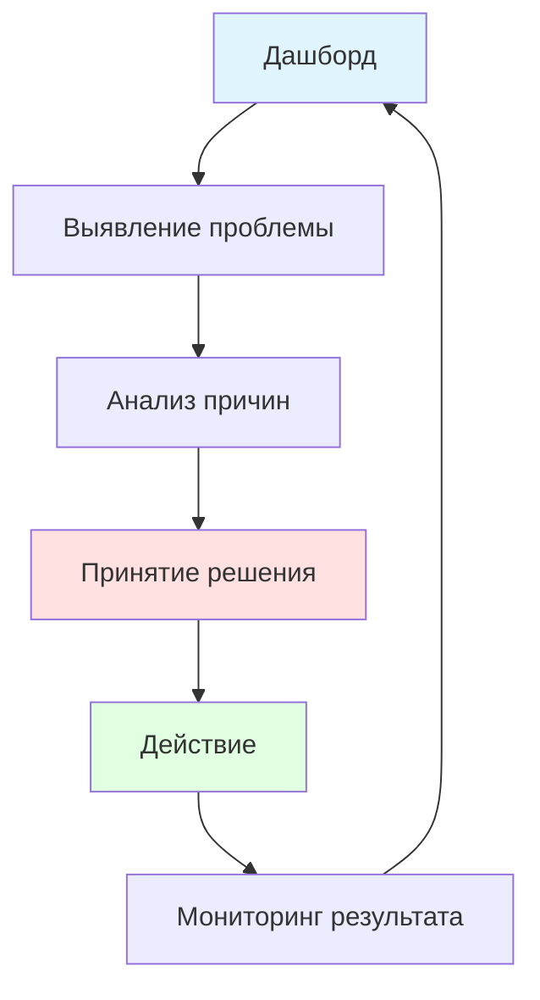

**Пример:** дашборд оттока → анализ сегментов → кампания удержания → отслеживание эффекта

---

## Вопрос для проверки 1

### Проверьте себя

**Вопрос:** Какой тип визуализации лучше всего подходит для отображения корреляции между двумя числовыми переменными?

A) Барчарт  
B) Линейный график  
C) Scatter plot  
D) Тепловая карта

---

## Резюме раздела 1

### Основы визуализации

- Визуализация — мост между данными и решениями
- Принципы: ясность, точность, информативность
- Выбор типа графика зависит от задачи
- Дизайн дашборда следует психологии восприятия
- Успех измеряется скоростью получения инсайтов

---

# Раздел 2: Современные BI-системы и их возможности

---

## 2.1 Что такое BI-система?

### Business Intelligence платформа

- **Определение:** инструмент для сбора, обработки и визуализации данных
- **Цель:** превратить данные в бизнес-инсайты
- **Пользователи:** от аналитиков до топ-менеджеров
- **Компоненты:** подключение к данным, трансформация, визуализация, дистрибуция

---

## 2.2 Архитектура типичной BI-системы

### Слои платформы

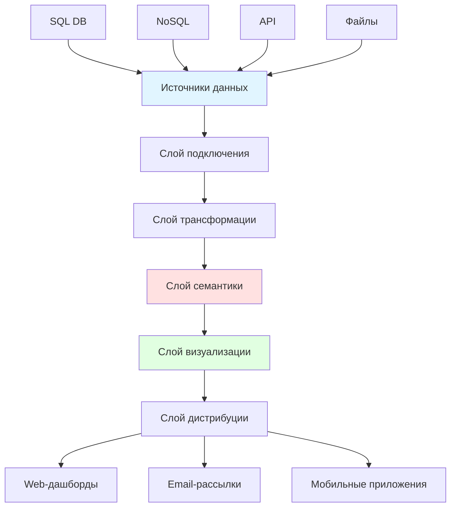

---

## 2.3 Обзор платформ: Tableau

### Лидер визуализации

- **Сильные стороны:** интуитивный drag-and-drop, богатая визуализация
- **Архитектура:** Tableau Desktop (разработка) + Tableau Server (публикация)
- **Подключения:** 100+ нативных коннекторов
- **Цена:** от $70/пользователь/месяц (Creator)
- **Use case:** ad-hoc анализ, красивые презентационные дашборды

---

## 2.4 Обзор платформ: Power BI

### Microsoft экосистема

- **Сильные стороны:** интеграция с Microsoft 365, доступная цена
- **Архитектура:** Power BI Desktop + Power BI Service (облако)
- **DAX язык:** для создания вычисляемых мер
- **Цена:** от $10/пользователь/месяц (Pro)
- **Use case:** корпоративная аналитика в Microsoft-среде

---

## 2.5 Обзор платформ: Looker (Google)

### Код-ориентированный подход

- **Сильные стороны:** LookML для версионирования логики, Git-интеграция
- **Архитектура:** облачная, тесная интеграция с BigQuery
- **Подход:** "single source of truth" через семантический слой
- **Цена:** enterprise (индивидуально)
- **Use case:** data-driven компании с инженерной культурой

---

## 2.6 Обзор платформ: Qlik Sense

### Ассоциативный движок

- **Сильные стороны:** уникальный движок поиска связей в данных
- **Архитектура:** in-memory обработка, Qlik Cloud
- **Особенность:** зеленый/белый/серый цвет для связанных/несвязанных данных
- **Цена:** от $30/пользователь/месяц
- **Use case:** сложный многомерный анализ

---

## 2.7 Обзор платформ: Metabase

### Open-source решение

- **Сильные стороны:** бесплатно, простота, SQL-редактор
- **Архитектура:** Java-приложение, PostgreSQL для метаданных
- **Ограничения:** меньше функций, чем у коммерческих
- **Цена:** бесплатно (Enterprise от $85/месяц)
- **Use case:** стартапы, внутренние дашборды

---

## 2.8 Сравнение платформ

### Матрица выбора

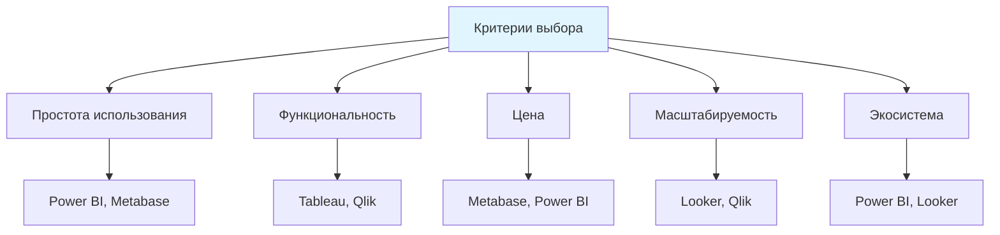

---

## 2.9 Self-service BI

### Демократизация данных

- **Концепция:** бизнес-пользователи создают отчеты без IT
- **Требования:** интуитивный интерфейс, управляемая семантика
- **Риски:** "дикие" дашборды, разные версии правды
- **Решение:** governance + обучение пользователей

---

## 2.10 Облачные vs локальные решения

### Deployment модели

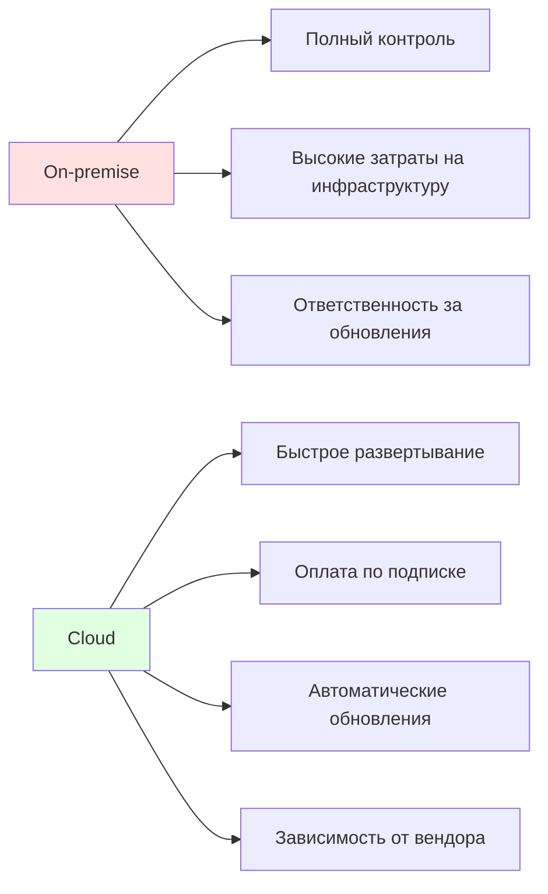

**Тренд:** миграция в облако (70% новых внедрений)

---

## 2.11 Интеграция с хранилищами данных

### Подключения

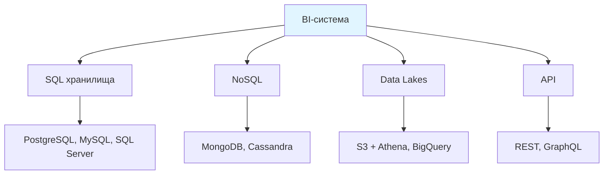

**Лучшая практика:** прямое подключение к DWH, а не к OLTP-базам

---

## 2.12 Автоматическая генерация инсайтов

### AI в BI

- **Explain this:** автоматическое объяснение аномалий (Power BI)
- **Smart narratives:** генерация текстовых описаний графиков
- **Automated insights:** поиск скрытых трендов в данных
- **NLP-запросы:** "Покажи продажи за прошлый квартал" → график

**Пример:** ThoughtSpot, Einstein Analytics (Salesforce)

---

## 2.13 Масштабируемость BI-систем

### Обработка больших данных

- **In-memory кэширование:** Qlik, Tableau Hyper
- **Прямые запросы (DirectQuery):** запросы к источнику в реальном времени
- **Материализованные views:** предрасчет агрегатов
- **Распределенная обработка:** интеграция со Spark, Presto

---

## 2.14 Embedded Analytics

### Интеграция в приложения

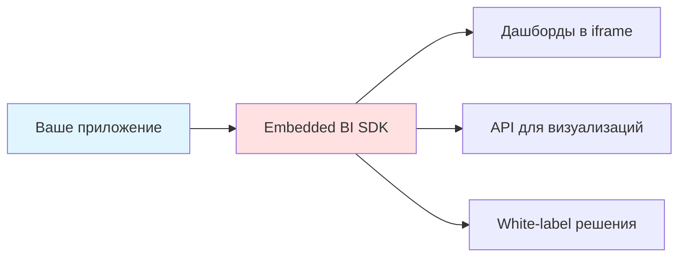

**Примеры:** Looker Embedded, Power BI Embedded, Tableau Embedded

**Use case:** SaaS-продукты с аналитикой для клиентов

---

## Вопрос для проверки 2

### Проверьте себя

**Вопрос:** Какая BI-платформа использует LookML для определения семантического слоя?

A) Tableau  
B) Power BI  
C) Looker  
D) Qlik Sense

---

## Резюме раздела 2

### Современные BI-системы

- BI-системы превращают данные в визуальные инсайты
- Выбор платформы зависит от требований и экосистемы
- Self-service BI демократизирует аналитику
- Облачные решения доминируют в новых внедрениях
- AI усиливает возможности поиска инсайтов

---

# Раздел 3: Построение и оптимизация дашбордов

---

## 3.1 Подготовка данных для визуализации

### ETL перед BI

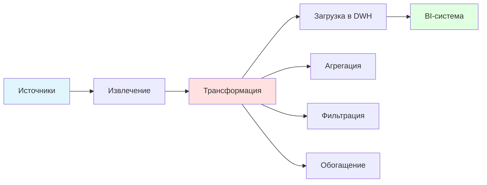

**Правило:** "мусор на входе → мусор на выходе"

---

## 3.2 Агрегация данных

### Предрасчет для производительности

- **Пример:** вместо хранения каждой транзакции, хранить дневные суммы
- **Техники:** GROUP BY, материализованные views, OLAP-кубы
- **Trade-off:** скорость vs гибкость
- **Когда применять:** большие объемы + типовые запросы

---

## 3.3 Кэширование

### Слои кэша в BI

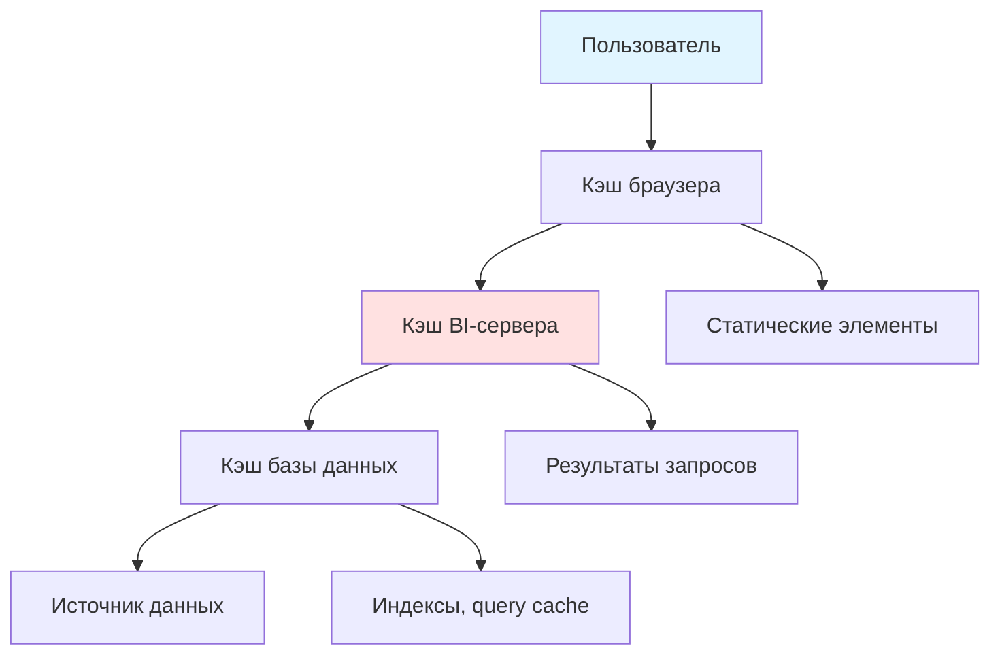

**Настройка:** TTL (time to live) для разных типов данных

---

## 3.4 Интерактивные элементы: Фильтры

### Управление контекстом

- **Типы:** дата, категория, диапазон, поиск
- **Каскадные фильтры:** выбор страны → доступные города
- **Глобальные vs локальные:** применяются ко всему дашборду или одному графику
- **Best practice:** не более 5 фильтров одновременно

---

## 3.5 Интерактивные элементы: Drill-down

### Навигация по уровням детализации

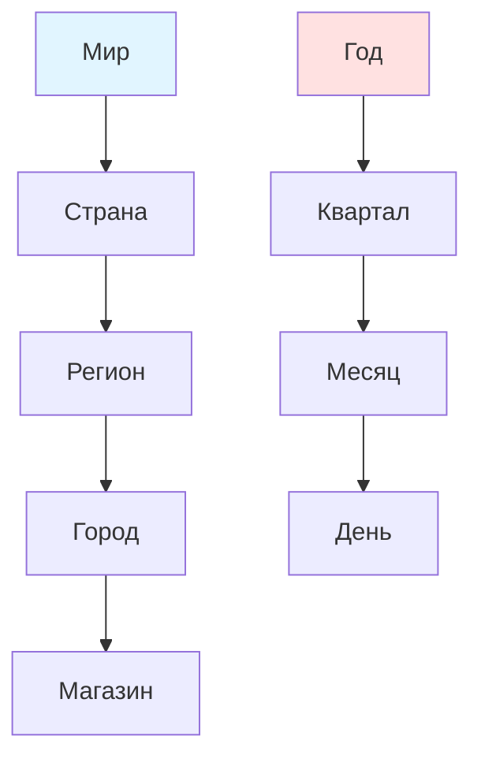

**Реализация:** drill-down кнопки, breadcrumbs для возврата

---

## 3.6 Интерактивные элементы: Параметры

### Динамическое изменение метрик

```tikz
\begin{tikzpicture}[scale=0.8]
  % Переключатель метрики
  \draw[thick] (0,0) rectangle (6,1);
  \node at (1,0.5) {Metric:};
  \draw[fill=blue!30] (2.5,0.2) rectangle (3.5,0.8) node[pos=.5] {Revenue};
  \draw (4,0.2) rectangle (5,0.8) node[pos=.5] {Cash};
  
  % График меняется
  \draw[->, thick] (3,-0.5) -- (3,-1.5);
  
  % Результат
  \draw[thick] (0,-2) rectangle (6,-5);
  \draw[blue, ultra thick] (0.5,-4.5) -- (1.5,-3.5) -- (2.5,-3.8) -- (3.5,-2.8) -- (4.5,-2.5) -- (5.5,-2.2);
  \node at (3,-2.3) {Plot Revenue};
\end{tikzpicture}
```

**Use case:** один дашборд для разных метрик

---

## 3.7 Кросс-хайлайтинг

### Связь между графиками

- **Механика:** клик на сегменте → подсветка на других графиках
- **Пример:** клик на "Москва" в карте → фильтр на барчарте продаж
- **Реализация:** через параметры и actions в Tableau, slicers в Power BI
- **Эффект:** интуитивное исследование данных

---

## 3.8 Real-time дашборды

### Потоковые данные

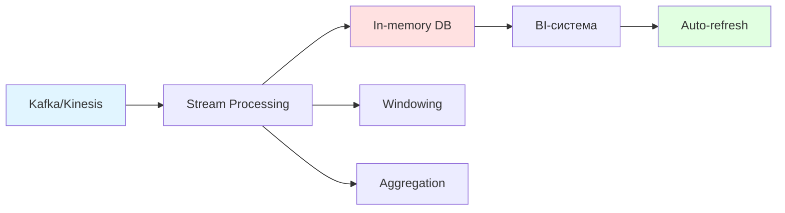

**Технологии:** Grafana + InfluxDB, Tableau + Hyper Live

**Use case:** мониторинг систем, финансовые дашборды

---

## 3.9 Безопасность в BI: Row-level security

### Ограничение доступа к данным

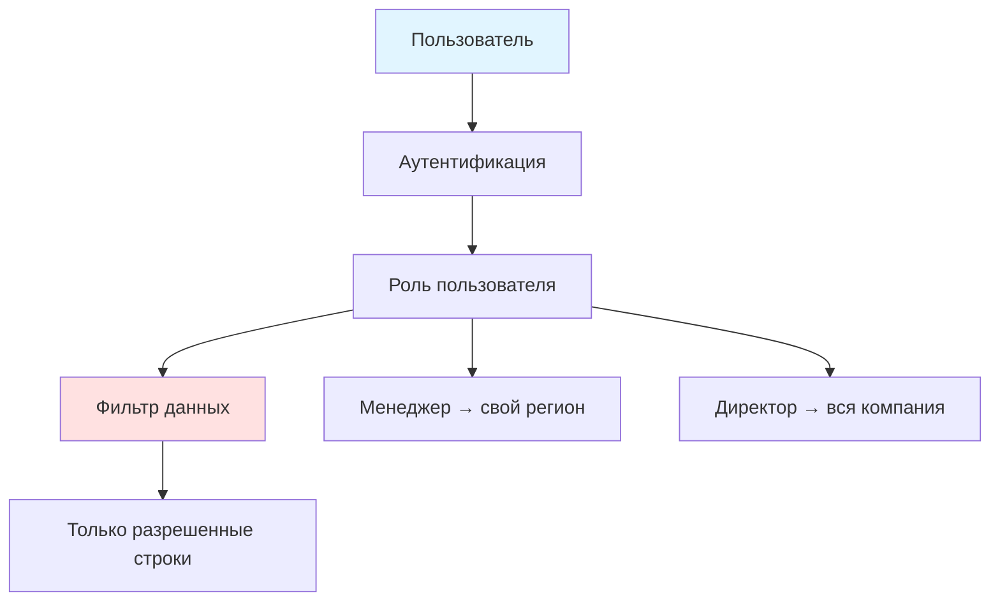

**Реализация:** через политики в DWH или в самой BI-системе

---

## 3.10 Безопасность: Управление доступом

### Кто что может видеть

- **Публичные дашборды:** доступны всем (embed на сайт)
- **Внутренние:** только сотрудники компании
- **Конфиденциальные:** только топ-менеджмент
- **Аудит:** логирование всех действий пользователей

---

## 3.11 Оптимизация производительности: Индексация

### Ускорение запросов

```sql
-- Без индекса: сканирование всей таблицы
SELECT * FROM sales WHERE region = 'Moscow';

-- С индексом: прямой доступ
CREATE INDEX idx_region ON sales(region);
```

**Типы индексов:** B-tree, Hash, Bitmap (для DWH)

**Trade-off:** ускорение чтения vs замедление записи

---

## 3.12 Оптимизация: Материализованные views

### Предрасчет агрегатов

```sql
-- Материализованное представление
CREATE MATERIALIZED VIEW daily_sales AS
SELECT 
  date_trunc('day', order_date) as day,
  region,
  SUM(amount) as total_sales
FROM orders
GROUP BY 1, 2;

-- Обновление по расписанию
REFRESH MATERIALIZED VIEW daily_sales;
```

**Когда использовать:** сложные агрегации, редко меняющиеся данные

---

## 3.13 Оптимизация: Партиционирование

### Разделение больших таблиц

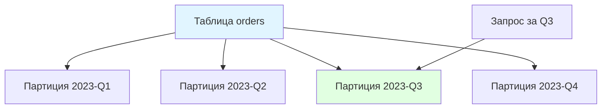

**Эффект:** запросы читают только нужные партиции

**Стратегии:** по дате, по региону, по hash

---

## 3.14 Оптимизация: Кэширование запросов

### Повторное использование результатов

- **Механизм:** BI-система запоминает результаты запросов
- **TTL:** время жизни кэша (например, 15 минут)
- **Invalidation:** сброс при обновлении данных
- **Warm-up:** предзагрузка популярных дашбордов

**Эффект:** 10x-100x ускорение для повторных запросов

---

## 3.15 Тестирование дашбордов

### Проверка корректности

- **Юнит-тесты:** проверка SQL-логики (dbt tests)
- **Интеграционные тесты:** сравнение с эталонными данными
- **Визуальное тестирование:** скриншоты + diff
- **Нагрузочное тестирование:** симуляция множества пользователей

---

## 3.16 A/B-тестирование дашбордов

### Экспериментальный подход

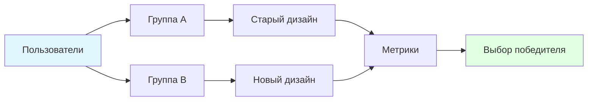

**Метрики:** время до инсайта, частота использования, удовлетворенность

---

## Вопрос для проверки 3

### Проверьте себя

**Вопрос:** Какая техника оптимизации предполагает предварительный расчет агрегатов и их хранение?

A) Индексация  
B) Партиционирование  
C) Материализованные views  
D) Кэширование запросов

---

## Резюме раздела 3

### Построение и оптимизация

- Качество данных критично для дашбордов
- Интерактивность повышает вовлеченность пользователей
- Производительность достигается через кэширование и предрасчет
- Безопасность обеспечивается на уровне данных и доступа
- Тестирование гарантирует корректность и надежность

---

# Раздел 4: Расширенные темы в BI

---

## 4.1 Embedded Analytics

### Аналитика внутри продукта

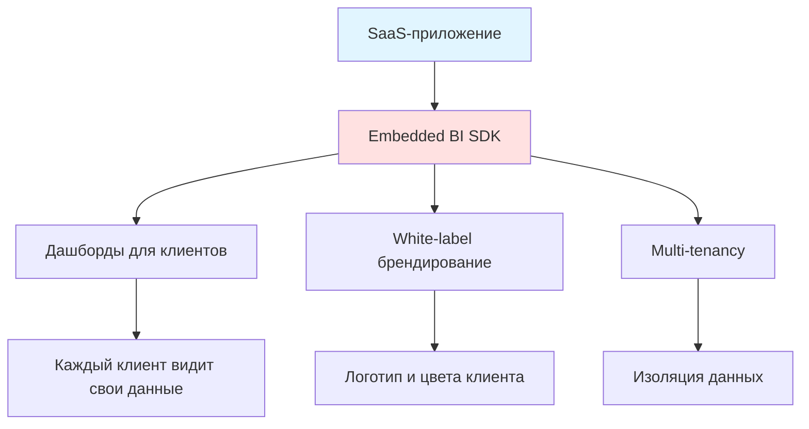

**Примеры:** Shopify Analytics, Stripe Dashboard

---

## 4.2 Машинное обучение в BI

### Предиктивная аналитика

- **Прогнозирование:** продажи, отток, спрос
- **Кластеризация:** сегментация клиентов
- **Anomaly detection:** выявление мошенничества, сбоев
- **Рекомендации:** next best action для пользователя

**Интеграция:** AutoML в Power BI, Einstein Discovery в Salesforce

---

## 4.3 Anomaly Detection в дашбордах

### Автоматическое выявление аномалий

```tikz
\begin{tikzpicture}[scale=0.8]
  % Временной ряд
  \draw[->] (0,0) -- (0,4) node[above] {Metric};
  \draw[->] (0,0) -- (8,0) node[right] {Time};
  
  % Нормальные данные
  \draw[blue, thick] (0.5,2) -- (1,2.1) -- (1.5,1.9) -- (2,2.2) -- (2.5,2) -- (3,2.1);
  
  % Аномалия
  \draw[blue, thick] (3,2.1) -- (3.5,3.5);
  \fill[red] (3.5,3.5) circle (4pt) node[above right] {Anomaly!};
  
  % Возврат к норме
  \draw[blue, thick] (3.5,3.5) -- (4,2.3) -- (4.5,2.1) -- (5,2) -- (5.5,2.2) -- (6,2.1);
  
  % Доверительный интервал
  \draw[gray, dashed] (0.5,2.5) -- (7,2.5);
  \draw[gray, dashed] (0.5,1.5) -- (7,1.5);
\end{tikzpicture}
```

**Алгоритмы:** Z-score, Isolation Forest, Prophet (Facebook)

---

## 4.4 Социальное и коллаборативное BI

### Совместная работа над данными

- **Комментарии:** обсуждение инсайтов прямо в дашборде
- **Аннотации:** пометки на графиках ("Здесь была акция")
- **Шаринг:** отправка дашборда коллегам
- **Версионирование:** история изменений дашборда

**Инструменты:** Slack-интеграции, Tableau Pulse

---

## 4.5 Headless BI

### API-driven визуализация

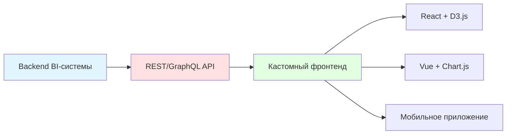

**Преимущества:** полный контроль над UX, интеграция в уникальный дизайн

**Недостатки:** больше разработки, меньше out-of-the-box функций

---

## 4.6 Augmented Analytics

### BI усиленный AI

- **Natural Language Generation:** "Продажи выросли на 15% из-за акции в Москве"
- **Automated insights:** "Обнаружен необычный паттерн в сегменте X"
- **Smart data prep:** автоматическая очистка и трансформация
- **Conversational analytics:** чат-бот для запросов к данным

**Платформы:** ThoughtSpot, Salesforce Einstein

---

## 4.7 Тренды: Reverse ETL

### Данные из DWH обратно в операционные системы

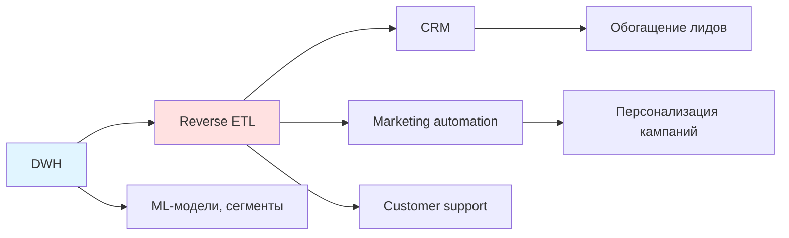

**Инструменты:** Census, Hightouch

**Use case:** скоринг клиентов из DWH → CRM для менеджеров

---

## 4.8 Тренды: Metrics Layer

### Единый слой метрик

- **Проблема:** разные определения "выручки" в разных дашбордах
- **Решение:** централизованный каталог метрик с единой логикой
- **Технологии:** dbt metrics, Looker LookML, Cube.js
- **Эффект:** "single source of truth" для всей компании

---

## 4.9 Выбор BI-системы: Критерии

### Матрица принятия решения

```mermaid
graph TD
    A["Критерии"] --> B["Функциональность"]
    A --> C["Простота использования"]
    A --> D["Интеграции"]
    A --> E["Цена"]
    A --> F["Поддержка"]
    A --> G["Масштабируемость"]
    
    B --> B1["Типы визуализаций"]
    B --> B2["AI/ML возможности"]
    
    C --> C1["Self-service для бизнеса"]
    
    D --> D1["Коннекторы к вашим данным"]
    
    style A fill:#e1f5ff
```

---

## 4.10 Кейсы внедрения: E-commerce

### Дашборды для интернет-магазина

- **Метрики:** GMV, конверсия, AOV, LTV, CAC
- **Дашборды:**
  - Продажи в реальном времени
  - Воронка покупок
  - Когортный анализ
  - RFM-сегментация
- **Инструменты:** Looker + BigQuery, Tableau + Snowflake

---

## 4.11 Кейсы внедрения: Финтех

### Аналитика для финансовых сервисов

- **Метрики:** AUM, транзакции, fraud rate, NPS
- **Дашборды:**
  - Мониторинг мошенничества
  - Портфельная аналитика
  - Регуляторная отчетность
- **Требования:** высокая безопасность, аудит
- **Инструменты:** Qlik + Oracle, Power BI + Azure

---

## 4.12 Кейсы внедрения: IoT

### Дашборды для умных устройств

- **Метрики:** uptime, sensor readings, alerts
- **Дашборды:**
  - Real-time мониторинг
  - Predictive maintenance
  - Геораспределение устройств
- **Инструменты:** Grafana + InfluxDB, Tableau + AWS IoT

---

## 4.13 Будущее BI

### Куда движется индустрия

- **Democratization:** BI для каждого сотрудника
- **AI-first:** от визуализации к автоматическим инсайтам
- **Real-time everything:** от батчей к стримингу
- **Embedded everywhere:** аналитика в каждом продукте
- **Collaborative:** от индивидуальных отчетов к совместной работе

---

## Вопрос для проверки 4

### Проверьте себя

**Вопрос:** Что такое Reverse ETL?

A) Обратный процесс извлечения данных  
B) Загрузка данных из DWH в операционные системы  
C) Удаление данных из хранилища  
D) Восстановление данных после сбоя

---

## Резюме раздела 4

### Расширенные темы

- Embedded analytics интегрирует BI в продукты
- ML усиливает возможности поиска инсайтов
- Коллаборация делает аналитику командной работой
- Headless BI дает гибкость в UI/UX
- Будущее — AI-driven, real-time, embedded

---

# Итоговое резюме лекции

---

## Ключевые выводы

### Что мы изучили

- **Визуализация** — мост между данными и решениями
- **BI-системы** — инструменты для демократизации аналитики
- **Оптимизация** — ключ к производительным дашбордам
- **Тренды** — AI, real-time, embedded, collaborative

---


## Бонус-слайд: Частые ошибки

### Чего избегать

❌ **Слишком много информации на одном экране**  
✅ Разбейте на несколько дашбордов

❌ **3D-графики для количественных данных**  
✅ Используйте 2D-визуализации

❌ **Радужные цветовые схемы**  
✅ Используйте 2-3 основных цвета

❌ **Отсутствие контекста (нет сравнения с прошлым периодом)**  
✅ Добавьте YoY, MoM метрики

❌ **Неоптимизированные запросы**  
✅ Используйте агрегаты и кэш

---

# Спасибо за внимание!

## Вопросы?