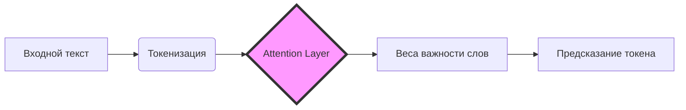
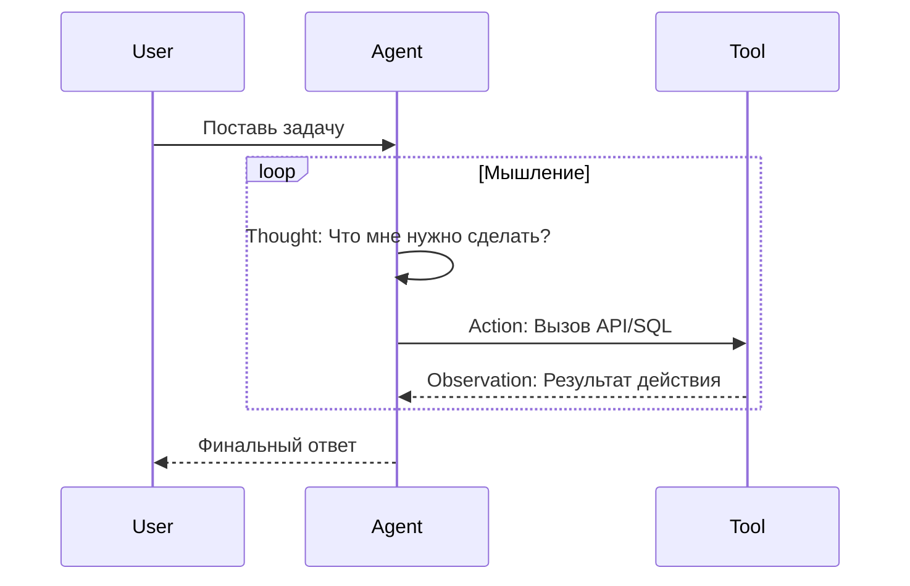
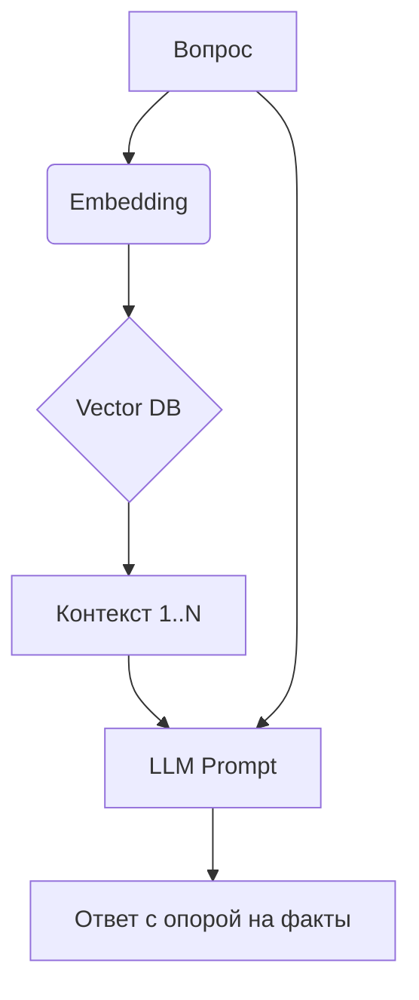

# Лекция 9: Экосистема LLM и архитектура AI-агентов
## Курс: Проектирование систем обработки данных
### Магистратура, Осень 2025

---

## План лекции (80+ минут)
- Введение: LLM как вычислительный движок (15 мин)
- Анатомия AI-агента: Мозг, Планирование, Память (25 мин)
- RAG: Retrieval-Augmented Generation (20 мин)
- Экосистема инструментов: LangChain, CrewAI, Ollama (15 мин)
- Итоги и Q&A (5 мин)

---

# Раздел 1: LLM в инфраструктуре данных

---

## Эволюция обработки данных
- Переход от императивного кода к декларативным промптам
- LLM как "универсальный парсер" неструктурированных данных
- Смена парадигмы: от жестких ETL-схем к семантическому поиску
- Данные теперь — это не только таблицы, но и векторы

---

## Роль LLM как "нового движка"
- Выполнение логических выводов над сырыми данными
- Генерация SQL-запросов и Python-кода "на лету"
- Интеграция в пайплайны как интеллектуальный контроллер
- Автоматизация классификации и суммаризации больших объемов

---

## Архитектура Transformer: Краткий обзор
- Механизм Self-Attention: фокус на релевантных частях текста
- Токенизация: разбиение текста на смысловые единицы
- Context Window: ограничение объема "оперативной памяти" модели
- Обучение на предсказание следующего токена

---

## Визуализация: Процесс Attention

*Диаграмма показывает, как механизм внимания распределяет приоритеты между словами в контексте.*

---

## Открытые vs Закрытые модели
- **Закрытые (GPT-4, Claude):** Высокое качество, риск утечки данных
- **Открытые (Llama 3, Mistral):** Полный контроль, запуск on-premise
- Критерии выбора: Privacy, Latency, Cost, Reasoning capability
- Гибридный подход: малые модели для простых задач, мощные для логики

---

## LLM-native стек технологий
- Векторные БД: хранение знаний в виде эмбеддингов
- Оркестраторы (LangChain): связывание LLM с инструментами
- Провайдеры эмбеддингов: перевод текста в математическое пространство
- Инструменты оценки (Evaluation): проверка точности ответов

---

## Проверка понимания (Раздел 1)
- В чем главное отличие LLM от классического алгоритма обработки?
- Почему Context Window является критическим ресурсом?
- В каких случаях вы выберете Llama 3 вместо GPT-4?

---

## Резюме раздела 1
- LLM становятся центральным элементом современных систем данных
- Transformer — фундамент, обеспечивающий понимание контекста
- Выбор модели зависит от требований безопасности и стоимости

---

# Раздел 2: Анатомия AI-агента

---

## Что такое AI-агент?
- Это система, использующая LLM для достижения цели
- Агент обладает автономностью в выборе инструментов
- Способность к самокоррекции и итеративному мышлению
- Отличие от чат-бота: агент совершает действия в мире

---

## Компоненты агента: Brain (Мозг)
- LLM выступает как координатор и принимающий решения
- Использование Chain of Thought (Цепочка рассуждений)
- Паттерн ReAct: Reason (Рассуждение) + Act (Действие)
- Промпт-инжиниринг как способ задания "личности" агента

---

## Математическая модель принятия решений
$$
\text{Action} = \arg\max_{a \in \mathcal{A}} P(a | \text{Goal}, \text{Context}, \text{Tools})
$$
*Агент выбирает действие $a$ из набора $\mathcal{A}$, максимизируя вероятность достижения цели на основе контекста.*

---

## Планирование (Planning)
- Task Decomposition: разбиение сложной цели на шаги
- Reflection: критический анализ собственного плана
- Динамическое изменение стратегии при получении ошибок
- Ограничение глубины рекурсии для предотвращения циклов

---

## Инструменты (Tools / Actions)
- API-интерфейсы: взаимодействие с внешними сервисами
- SQL-интерфейсы: выполнение запросов к базам данных
- Python REPL: написание и запуск кода для вычислений
- Поиск (Search): доступ к актуальной информации в сети

---

## Визуализация: Цикл ReAct

*Диаграмма итеративного процесса рассуждения и взаимодействия с инструментами.*

---

## Память агента (Memory)
- **Short-term:** История текущего диалога (Context Window)
- **Long-term:** Доступ к базе знаний через векторный поиск
- **Entity Memory:** Запоминание фактов о конкретных объектах
- Техники сжатия памяти: суммаризация старых сообщений

---

## Проверка понимания (Раздел 2)
- Чем агент отличается от простого вызова API модели?
- Зачем агенту нужен этап "Reasoning" перед действием?
- Как ограничить бесконечный цикл действий агента?

---

## Резюме раздела 2
- Агент = LLM + Планирование + Инструменты + Память
- Паттерн ReAct позволяет модели учиться на результатах действий
- Планирование критично для решения многошаговых задач

---

# Раздел 3: RAG (Retrieval-Augmented Generation)

---

## Проблема галлюцинаций
- LLM склонны уверенно врать при отсутствии фактов
- Знания модели ограничены датой завершения обучения
- RAG: предоставление модели актуальных данных в промпте
- Принцип "Open Book Exam": модель смотрит в справочник

---

## Архитектура RAG: Шаг 1 (Ingestion)
- Загрузка документов (PDF, Wiki, SQL)
- Chunking: разбиение текста на фрагменты (200-500 токенов)
- Перевод фрагментов в векторы (Embeddings)
- Сохранение в Vector Store (Pinecone, Chroma)

---

## Архитектура RAG: Шаг 2 (Retrieval)
- Преобразование вопроса пользователя в вектор
- Поиск Top-K наиболее близких фрагментов (Cosine Similarity)
- Ранжирование результатов по релевантности
- Передача фрагментов в LLM как "контекст"

---

## Визуализация: Пайплайн RAG

*Схема обогащения промпта релевантными знаниями из внешней базы.*

---

## Векторные базы данных
- **Chroma/FAISS:** Легкие, для локальных задач
- **Pinecone/Milvus:** Облачные, масштабируемые (миллиарды векторов)
- **pgvector:** Расширение для PostgreSQL (гибридный поиск)
- Важность метаданных для фильтрации результатов

---

## Проверка понимания (Раздел 3)
- Почему нельзя просто запихнуть все документы в промпт?
- Что такое "эмбеддинг" простыми словами?
- Как Chunking влияет на качество поиска?

---

## Резюме раздела 3
- RAG решает проблему актуальности данных и галлюцинаций
- Векторный поиск — это поиск по смыслу, а не по ключевым словам
- Качество RAG зависит от разбиения данных и выбора модели эмбеддингов

---

# Раздел 4: Экосистема и инструменты

---

## Фреймворки оркестрации
- **LangChain:** Самый популярный, огромная библиотека интеграций
- **LlamaIndex:** Фокус на структурах данных и RAG
- **LangGraph:** Для создания сложных графов состояний агентов
- **CrewAI:** Фреймворк для многоагентных систем (MAS)

---

## Локальный запуск (Privacy & Cost)
- **Ollama:** Простой запуск моделей одной командой
- **vLLM:** Высокопроизводительный сервер для инференса
- **LocalAI:** API-совместимая замена OpenAI для локальной сети
- Квантование: запуск тяжелых моделей на бытовом железе

---

## Практический пример: CrewAI
- Определение ролей (Researcher, Writer, Analyst)
- Назначение задач каждому агенту
- Делегирование: агенты могут просить помощи друг у друга
- Результат: согласованная работа цепочки специалистов

---

## Мониторинг и Observability
- **LangSmith:** Отладка цепочек и просмотр трейсов
- **Arize Phoenix:** Оценка качества RAG и эмбеддингов
- Трассировка: понимание, на каком шаге агент ошибся
- Логирование токенов и стоимости каждого запроса

---

## Проверка понимания (Раздел 4)
- Зачем нужны фреймворки, если есть API OpenAI?
- В чем преимущество локального запуска моделей для бизнеса?
- Что такое "квантование" модели?

---

## Резюме раздела 4
- Инструментарий быстро развивается, упрощая вход в AI-инженерию
- Локальные решения становятся конкурентоспособными
- Мониторинг — обязательный этап для production-систем

---

# Заключение и итоги

---

## Связь с лекцией 10
- В следующей лекции: Agentic Workflows в ETL
- Как агенты будут сами чинить упавшие пайплайны
- Переход от "Data Pipelines" к "Data Agents"
- Практика: создание самовосстанавливающегося процесса

---

## Список литературы
1. "Generative AI on AWS" (Chris Fregly, 2024)
2. "Build a Large Language Model (from Scratch)" (Sebastian Raschka)
3. Документация LangChain (python.langchain.com)
4. Статья "Attention Is All You Need" (Vaswani et al., 2017)

---

## Домашнее задание
- Установить Ollama и запустить модель Llama 3 локально
- Реализовать простой RAG на Python (используя LangChain и FAISS)
- Загрузить в базу 3-5 статей по инженерии данных
- Продемонстрировать ответ модели со ссылкой на источник

---

## Вопросы и обсуждение
- *Место для дискуссии со студентами*
- Контакты для связи: [email/telegram]