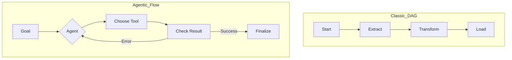
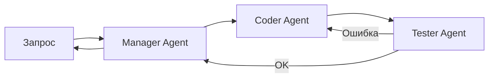

## План сегодняшней лекции

- Сравнение Agentic Workflows и классических ETL/ELT.
- Архитектура многоагентных систем и ролевые модели.
- Инфраструктура LLMOps для обслуживания агентов.
- Практические кейсы: Self-healing пайплайны.

---

# Раздел 1: Agentic Workflows vs Классические пайплайны

---

## Ограничения классических DAG (Airflow)

- Жесткая структура: связи между задачами заданы заранее.
- Хрупкость: изменение схемы данных ломает весь процесс.
- Ручное управление: при сбое требуется вмешательство инженера.
- Отсутствие контекста: система не "понимает" семантику данных.

---

## Что такое Agentic Workflow?

- Динамическое планирование: агент сам решает, какой шаг следующий.
- Использование инструментов: LLM выбирает API или SQL-запрос.
- Цикл обратной связи: агент проверяет результат своей работы.
- Адаптивность: автоматическая подстройка под изменения в источниках.

---

## Сравнение подходов (Визуализация)

*Диаграмма 1: Линейная логика DAG против итеративной логики агента.*

---

## Самокорректирующиеся пайплайны (Self-healing)

- Агент получает лог ошибки (например, `SyntaxError` в SQL).
- LLM анализирует причину сбоя и контекст таблицы.
- Генерация исправленного кода "на лету" без участия человека.
- Повторное выполнение и верификация результата.

---

## Автоматическая генерация схем данных

- Использование LLM для маппинга полей из разных источников.
- Семантический анализ: понимание, что `cust_id` и `client_no` — это одно и то же.
- Автоматическое создание DDL-запросов для целевого хранилища.
- Снижение нагрузки на инженера при интеграции новых API.

---

## Промежуточный вопрос 1

**В чем основное преимущество Agentic Workflow перед классическим Airflow DAG при работе с нестабильными внешними API?**

1. Скорость выполнения кода.
2. Возможность динамической обработки ошибок и смены логики.
3. Меньшее потребление оперативной памяти.

---

## Резюме раздела 1

- Классические пайплайны хороши для стабильных, предсказуемых задач.
- Agentic Workflows незаменимы в условиях неопределенности и семантического поиска.
- Главная ценность — автоматизация обработки исключений и "самолечение" кода.

---

# Раздел 2: Многоагентные системы (Multi-Agent Systems)

---

## Почему одного агента недостаточно?

- Ограниченное окно контекста: сложно держать все задачи сразу.
- Риск галлюцинаций: один агент может запутаться в сложной логике.
- Отсутствие специализации: "мастер на все руки" хуже узкого профи.
- Сложность отладки: трудно понять, где именно ошибся моно-агент.

---

## Ролевые модели в MAS

- **Агент-Проектировщик:** определяет архитектуру и разбивает задачи.
- **Агент-Программист:** пишет код на Python/SQL для трансформации.
- **Агент-Тестировщик:** проверяет данные на соответствие контрактам.
- **Агент-Критик:** оценивает логику и ищет потенциальные баги.

---

## Взаимодействие агентов (Архитектура)

*Диаграмма 2: Иерархическое взаимодействие в многоагентной системе.*

---

## Иерархическое vs Горизонтальное взаимодействие

- **Иерархия:** есть "менеджер", который раздает задачи и проверяет их.
- **Горизонталь:** агенты общаются напрямую (дискуссия/дебаты).
- Иерархия лучше для четких ETL-процессов и пайплайнов.
- Горизонталь эффективна для исследовательского анализа данных.

---

## Паттерн "Дебаты" (Debate Pattern)

- Два агента предлагают разные варианты решения задачи.
- Третий агент (судья) анализирует аргументы и выбирает лучший.
- Математическая вероятность ошибки снижается за счет кросс-проверки.
- Эффективно для сложных трансформаций и очистки данных.

---

## Инструменты: CrewAI, AutoGen, LangGraph

- **CrewAI:** упор на ролевые модели и процессы.
- **AutoGen:** гибкое общение агентов через сообщения.
- **LangGraph:** циклические графы для сложных состояний (Stateful).
- Выбор зависит от требуемой степени контроля над логикой.

---

## Промежуточный вопрос 2

**Какая роль в MAS отвечает за проверку соответствия данных бизнес-требованиям перед загрузкой в DWH?**

1. Агент-Проектировщик.
2. Агент-Тестировщик (QA Agent).
3. Агент-Программист.

---

## Резюме раздела 2

- MAS позволяют разделить ответственность и повысить надежность.
- Ролевые модели (Coder, Tester) имитируют реальную команду разработки.
- Выбор фреймворка (CrewAI/LangGraph) определяет гибкость управления состоянием.

---

# Раздел 3: LLMOps: Инженерия данных для AI

---

## Жизненный цикл LLM-приложения

- Сбор "сырых" данных и создание эмбеддингов.
- Трассировка (Tracing) каждого шага рассуждения агента.
- Оценка (Evaluation) качества ответов и работы инструментов.
- Мониторинг затрат и безопасности в реальном времени.

---

## Трассировка и логирование (Traces)

- Важно сохранять не только итог, но и цепочку мыслей (Chain of Thought).
- Использование инструментов типа LangSmith или Phoenix.
- Анализ "провальных" путей для последующего Fine-tuning.
- Логирование вызовов внешних инструментов (Tool Calls).

---

## Оценка качества (Evaluation)

- Метрики RAGAS: верность (faithfulness), релевантность ответа.
- Использование LLM-as-a-judge для оценки сложных ответов.
- Математическое представление качества:
  $Score = \frac{\sum (Relevance \times Faithfulness)}{N_{queries}}$
- Построение бенчмарков на исторических данных.

---

## Мониторинг затрат и Latency

- Токены стоят денег: отслеживание Token Usage по каждому агенту.
- Проблема задержек: Agentic AI работает медленнее классического кода.
- Оптимизация через кэширование эмбеддингов и ответов.
- Баланс между качеством модели (GPT-4) и ценой (GPT-4o-mini).

---

## Безопасность и Prompt Injection

- Риск выполнения агентом вредоносного кода через промпт.
- Ограничение прав доступа (Sandbox) для Python-интерпретатора.
- Фильтрация входных данных и валидация вывода (Guardrails).
- Принцип минимальных привилегий для API-ключей агентов.

---

## Промежуточный вопрос 3

**Почему в LLMOps важно сохранять "цепочку рассуждений" (Chain of Thought) агента?**

1. Для увеличения стоимости проекта.
2. Для отладки логических ошибок и дообучения моделей.
3. Для ускорения работы GPU.

---

## Резюме раздела 3

- LLMOps — это расширение DevOps для специфики нейросетей.
- Ключевые метрики: Faithfulness, Token Cost, Latency.
- Безопасность требует изоляции среды исполнения кода (Sandboxing).

---

# Раздел 4: Будущее: Агенты как потребители данных

---

## Данные, оптимизированные для ИИ

- Традиционные DWH строились для людей и BI-систем.
- LLM-optimized data: добавление семантических описаний к каждой колонке.
- Использование Markdown и JSON вместо плоских таблиц для контекста.
- Метаданные становятся важнее самих данных.

---

## Агенты в BI: Разговор с данными

- Переход от статичных дашбордов к чат-интерфейсам.
- Агент сам генерирует SQL, строит график и делает выводы.
- Возможность задавать уточняющие вопросы: "А почему продажи упали?".
- Демократизация аналитики для нетехнических пользователей.

---

## График: Эволюция потребления данных

$Visual: Consumption\_Complexity$
$t_0: SQL \rightarrow Reports$
$t_1: BI \rightarrow Dashboards$
$t_2: AI \rightarrow Conversational\_Insights$

---

## Резюме лекции

- Мы переходим от жестких алгоритмов к гибким агентам.
- Будущее инженерии данных — в создании инфраструктуры для MAS.
- Главный вызов — контроль качества и стоимости агентских систем.

---

## Домашнее задание

1. **Практика:** Создать простого агента на CrewAI, который парсит новости и сохраняет их в CSV.
2. **Аналитика:** Сравнить стоимость обработки 1000 строк данных через Python-скрипт и через LLM-агента.
3. **Безопасность:** Написать отчет о возможных рисках Prompt Injection в вашем пайплайне.

---

## Список литературы

- *Lilian Weng*, "LLM Powered Autonomous Agents" (Blog post, 2023).
- *LangChain Documentation*, "LangGraph: Multi-agent Workflows".
- *Chip Huyen*, "AI Engineering" (2024).
- *Harrison Chase*, "Building with LLMs: From Prototype to Production".

---

## Связь со следующими лекциями

- **Лекция 11:** Мы разберем конкретные облачные сервисы для деплоя агентов.
- **Лекция 12:** Итоговый проект — построение сквозного Agentic Data Pipeline.